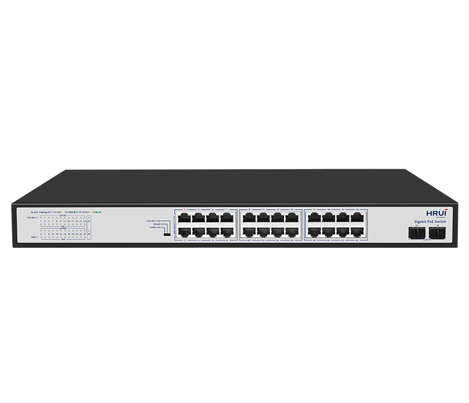
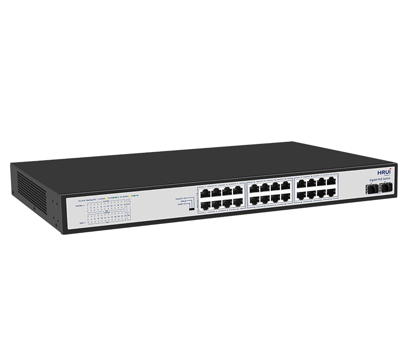
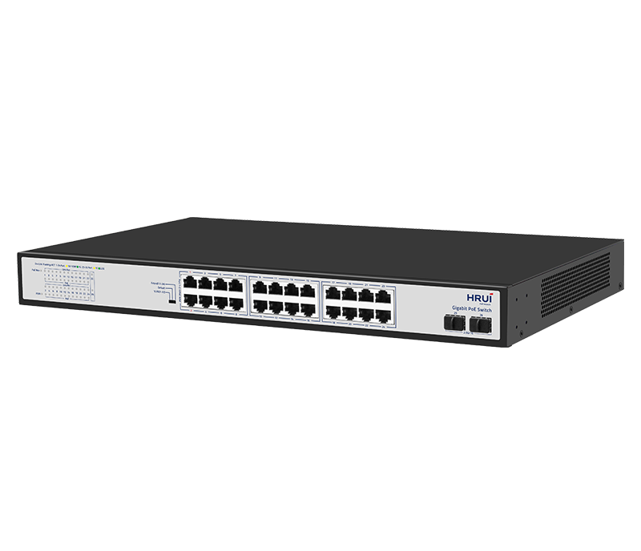
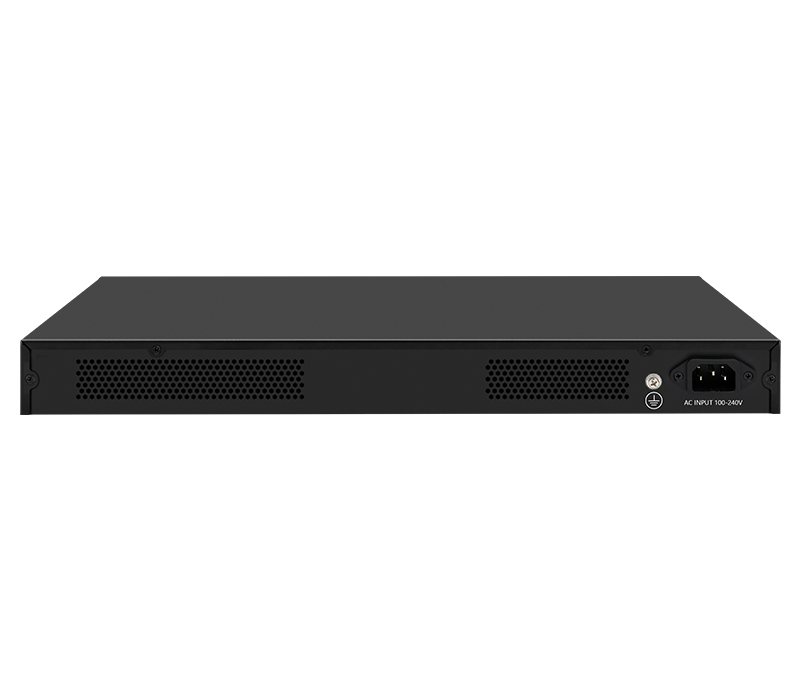

# HR200P-24T2MS-400

> 来源：<https://www.hruitech.com/poe-switch/339.html>（抓取 2026-10-21T03:45:59Z；英文原文照录，中文仅为栏目名）  
> 官网描述：24-Port 10/100/1000T 802.3af/at PoE + 2-Port 2.5G SFP Ethernet Switch (400 Watts)  
> 类目：PoE Switch（site id 339）  
> 接口：24*1Gbps PoE ports / 2*2.5Gbps SFP ports；PoE 预算 380W；交换带宽 58Gbps；电源 AC 100-240V 50/60Hz / DC 52V7.7A

**Brief:** HiPoE 60W | 6KV Port Surge protection | 8KV ESD protection | 4KV Input Protection | Loop Protection | VLAN | 250M Long-Distance Transmission | PoE Budget Indicator | Fanless design

## 产品图





## Datasheet
- [HR200P-24T2MS-400-28EN-29.pdf](https://www.hruitech.com/web/userfiles/productfile/HR200P-24T2MS-400-28EN-29.pdf) （本地：`data/hrui_site_raw/datasheets/HR200P-24T2MS-400-28EN-29.pdf`；文本：`data/hrui_site_raw/datasheet_text/HR200P-24T2MS-400-28EN-29.txt`）

## Feature and Benefits（原文）
```
HR200P-24T2MS-400 is a high-performance 24-port Gigabit PoE switch designed for SMB, IP surveillance, and enterprise network deployments. It features 24× Gigabit PoE ports and 2× 2.5G SFP uplink ports, providing high-speed and reliable connectivity for bandwidth-intensive applications. With a 380W PoE power budget, IEEE 802.3af/at compliance, and HiPoE 60W capability on ports 1–2, it delivers flexible power support for IP cameras, wireless access points, VoIP phones, and other PoE-enabled devices.
Equipped with VLAN isolation, PoE Watchdog, and loop protection, the switch ensures enhanced network stability, security, and simplified maintenance. The extended transmission distance of up to 250 meters enables flexible deployment in large-scale surveillance and access network scenarios. Its fanless design provides silent operation while improving energy efficiency and long-term reliability.
Product Features:
Support 24*1Gbps PoE ports+2*2.5Gbps SFP ports
Comply with IEEE802.3, IEEE802.3u, IEEE802.3x, IEEE802.3ab, and IEEE802.3z standards
Ethernet Ports support 10/100/1000Mbps self-adaptive
Support automatic port flipping (Auto MDI/MDIX)
Adopt a storage and forwarding exchange mechanism
PoE ports automatically enable PoE watchdog mode in Extend and VLAN modes
Support loop protection function
The panel indicator LEDs will monitor the working status and assist in fault analysis
Ports 1-2 support HiPoE 60W
Support PoE priority to be enabled by default, with a priority order of 1-24
```

## Parameter（规格表逐行）
| 项 | 值 |
|---|---|
| Description | Specification |
| Model | HR200P-24T2MS-400 |
| Interface | 24*1Gbps PoE ports |
| Interface | 2*2.5Gbps SFP ports |
| Port Standard | IEEE 802.3: Ethernet Media Access Control (MAC) Protocol |
| Port Standard | IEEE 802.3i: 10BASE-T Ethernet |
| Port Standard | IEEE 802.3u: 100BASE-TX Fast Ethernet |
| Port Standard | IEEE 802.3ab: 1000BASE-T GigabitEthernet |
| Port Standard | IEEE 802.3z: 1000BASE-X Gigabit Ethernet (Fiber optic) |
| Port Standard | IEEE 802.3x: Flow Control |
| Switching Bandwidth | 58Gbps |
| Packet Forwarding Rate | 43.15Mpps |
| Packet Buffer | 8.4Mbit |
| MAC Address Table | 16K |
| Jumbo Frame | 12Kbytes |
| VLAN | VLAN range 1-4094, maximum active VLAN is 31 |
| Transmission Method | Store and Forward |
| PoE Standard | IEEE802.3af (15.4W) |
| PoE Standard | IEEE802.3at (30W) |
| PoE Port Output Voltage | DC 44-57V |
| PoE Ports | Ports 3-24 PoE power output <30W |
| PoE Ports | Ports 1-2 supports HiPoE 60W |
| PoE Power Budget | 380W |
| Power Supply | AC 100-240V 50/60Hz |
| Power Supply | DC 52V7.7A |
| Mainboard Power Consumption | 15.59W |
| Structure Information | Product Dimensions: 440*280*44mm |
| Structure Information | Packaging Dimensions: 500*365*85mm |
| Structure Information | Product Net Weight: 3.47KG |
| Structure Information | Product Gross Weight: 4.2KG |
| Package Information | Carton Dimensions: 520*360*385mm |
| Package Information | Packing Quantity: 4PCS |
| Package Information | Packing Weight: 17.8KG |
| Package Contents | Switch 1pcs, Power Cord 1pcs, Manual 1pcs, Certificate of Inspection 1pcs, Rack-mounting kit 1 pair |
| Fan Quantity | 0 |
| Installation | Desktop, Rack-mounting |
| Surge Protection | Port Surge: Common mode 6KV, Differential mode 2KV (Class C) |
| Surge Protection | Electrostatic ESD: Air 8KV, Contact 6KV (Class B) |
| Surge Protection | Power Supply: Common mode 4KV, Differential mode 2KV (Class B) |
| Operating Temperature | 0~40°C |
| Storage Temperature | -40~70°C |
| Operation Humidity | 10%~90%, non condensing |
| Storage Humidity | 5%~95%, non condensing |
| PWR Green LED | On: Powered on |
| PWR Green LED | Off: Powered off |
| Ports 1-24 | Green LED on: 1Gbps Link normal |
| Ports 1-24 | Yellow LED on: 10/100Mbps Link normal |
| Ports 1-24 | Off: Link blocked |
| Ports 1-24 | Flashing: Data transmitting |
| Ports 1-24 | Slow Flashing: When a local or cross-product loop is detected, the port will flash slowly |
| PoE Yellow LED | On: PoE powered on |
| PoE Yellow LED | Off: PoE powered off |
| Ports 25-26 | Green LED on: 2.5Gbps Link normal |
| Ports 25-26 | Yellow LED on: 1Gbps Link normal |
| Ports 25-26 | Off: Link blocked |
| Ports 25-26 | Flashing: Data transmitting |
| PoE Max Green LED | Off: Indicate that the PoE power usage is less than 90% |
| PoE Max Green LED | Flashing(Once per second): Indicate that the PoE power usage of 90% ≤ P ≤ 95% |
| PoE Max Green LED | On: Indicate that the PoE power is used at 95%<P<100% |
| VLAN/Default/Extend Modes Buttons | VLAN: VLAN mode, ports 1-22 are isolated from each other, communicating with ports 25-26, and automatically activate the PoE watchdog mode |
| VLAN/Default/Extend Modes Buttons | Default: Normal mode, all ports can communicate with each other, transmission distance is within 100 meters, transmission rate is 10/100//1000Mbps adaptive(PoE Watchdog off) |
| VLAN/Default/Extend Modes Buttons | Extend: Extend mode, when the PoE port is in Extend mode, ports 17-24 force 10Mbps to extend the transmission distance to 250meters, and automatically activate the PoE watchdog mode |

## Product structure / Application topology（图）
- https://www.hruitech.com/web/userfiles/image/20260715/1784086585607429.png
