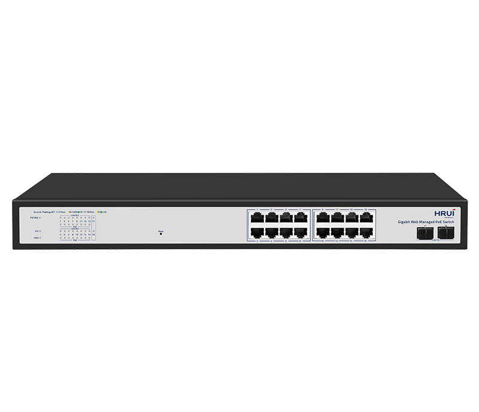
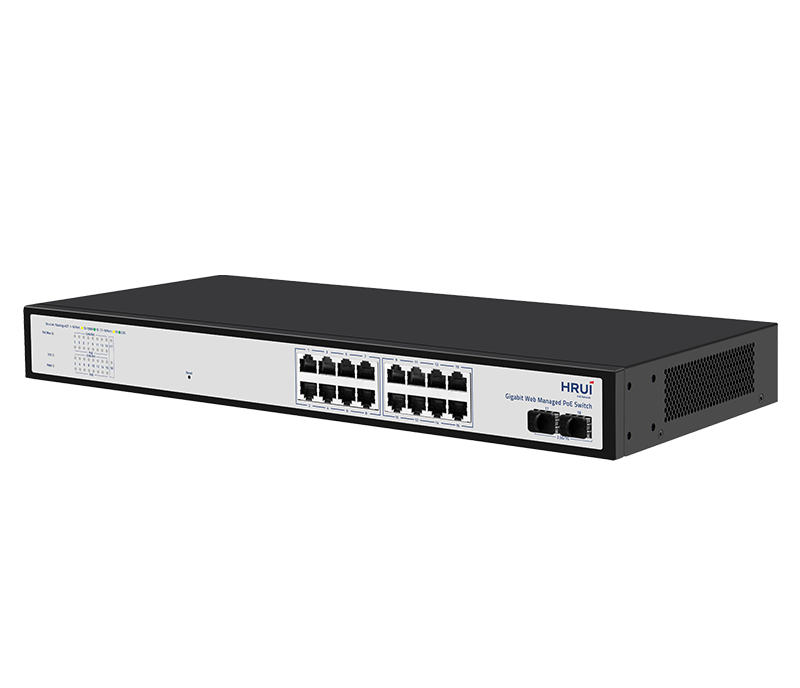
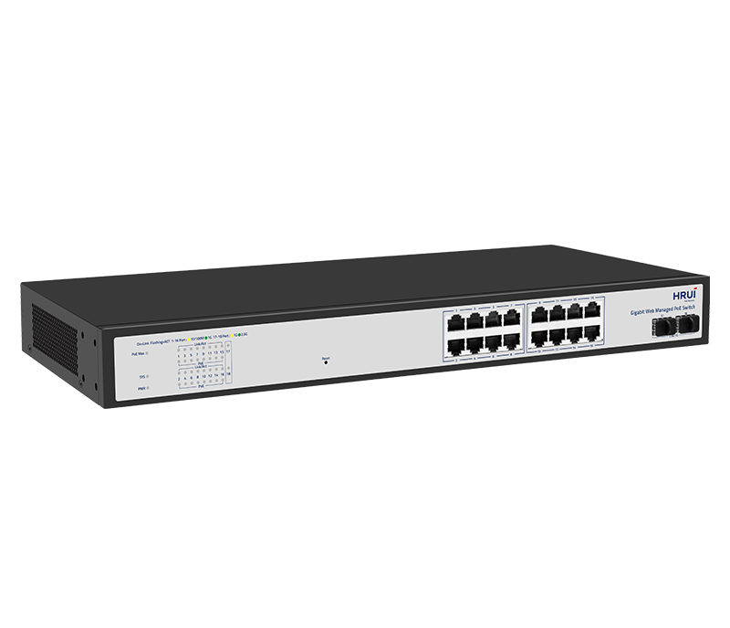
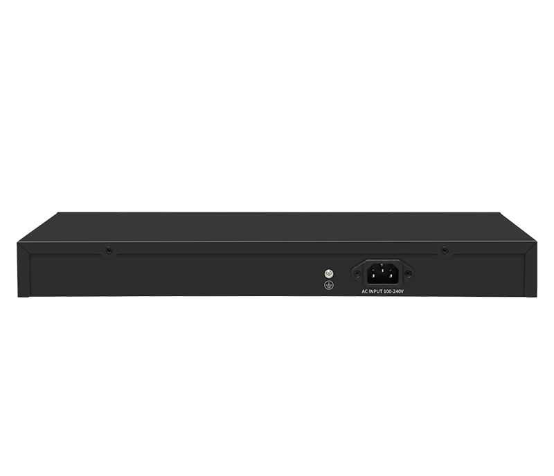

# HR210P-16T2MS-200

> 来源：<https://www.hruitech.com/managed-switch/336.html>（抓取 2026-10-21T04:36:02Z；英文原文照录，中文仅为栏目名）  
> 官网描述：16-Port 10/100/1000T 802.3af/at PoE + 2-Port 1G/2.5G SFP Web Managed Ethernet Switch (185 Watts)  
> 类目：Managed Switch（site id 336）  
> 接口：16*1Gbps PoE ports / 2*2.5Gbps SFP ports；PoE 预算 185W；交换带宽 42Gbps；电源 AC 100-240V 50/60Hz / DC 53.5V7.5A

**Brief:** 6KV Port Surge protection | 8KV ESD protection | Dynamic LACP | IGMP Snooping | DHCP Snooping | IP DSCP/CoS Priority | PoE Budget Indicator | Mgmt VLAN & DNS | Enhanced PoE Setup

## 产品图





## Datasheet
- [HR210P-16T2MS-200-28EN-29.pdf](https://www.hruitech.com/web/userfiles/productfile/HR210P-16T2MS-200-28EN-29.pdf) （本地：`data/hrui_site_raw/datasheets/HR210P-16T2MS-200-28EN-29.pdf`；文本：`data/hrui_site_raw/datasheet_text/HR210P-16T2MS-200-28EN-29.txt`）

## Feature and Benefits（原文）
```
HR210P-16T2MS-200 is a member of the HRUI 210P 2.5G Uplink Gigabit Web-Managed PoE Switch series. It is a Layer 2 Web Managed Gigabit PoE Switch designed for SMB, enterprise and IP surveillance networks. Featuring 16 Gigabit PoE+ ports, dual 2.5G SFP uplinks and a 185W PoE budget, it delivers reliable power and high-speed connectivity for IP cameras, wireless access points, VoIP phones and other PoE devices. Advanced Layer 2 management including VLAN, QoS, LACP, STP/RSTP/MSTP, IGMP Snooping and PoE Watchdog ensures stable and efficient network operation.
Product Features:
Support 16*1Gbps PoE ports++2*2.5Gbps SFP ports
Comply with IEEE802.3, IEEE802.3u, IEEE802.3x, IEEE802.3ab, and IEEE802.3z standards
Ethernet Ports support 10/100/1000Mbps self-adaptive
Support automatic port flipping (Auto MDI/MDIX)
Adopt a storage and forwarding exchange mechanism
All ports support line speed switching
The panel indicator LEDs will monitor the working status and assist in fault analysis
Support QoS data priority
Support web management
```

## Parameter（规格表逐行）
| 项 | 值 |
|---|---|
| Description | Specification |
| Model | HR210P-16T2MS-200 |
| Interface | 16*1Gbps PoE ports |
| Interface | 2*2.5Gbps SFP ports |
| Port Standard | IEEE 802.3: Ethernet Media Access Control (MAC) Protocol |
| Port Standard | IEEE 802.3i: 10BASE-T Ethernet |
| Port Standard | IEEE 802.3u: 100BASE-TX Fast Ethernet |
| Port Standard | IEEE 802.3ab: 1000BASE-T GigabitEthernet |
| Port Standard | IEEE 802.3z: 1000BASE-X Gigabit Ethernet (Fiber optic) |
| Port Standard | IEEE 802.3x: Flow Control |
| Switching Bandwidth | 42Gbps |
| Packet Forwarding Rate | 31.24Mpps |
| Packet Buffer | 8.4Mbit |
| MAC Address Table | 16K |
| Jumbo Frame | 12Kbytes |
| VLAN | VLAN range 1-4094, maximum active VLAN is 31 |
| Transmission Method | Store and Forward |
| PoE Standard | IEEE802.3af (15.4W) |
| PoE Standard | IEEE802.3at (30W) |
| PoE Port Output Voltage | DC 44-57V |
| PoE Ports | Ports 1-24 PoE power output <30W |
| PoE Power Budget | 185W |
| Power Supply | AC 100-240V 50/60Hz |
| Power Supply | DC 53.5V7.5A |
| Mainboard Power Consumption | 10.4W |
| Structure Information | Product Dimensions: 440*204*44mm |
| Structure Information | Packaging Dimensions: 500*290*85mm |
| Structure Information | Product Net Weight: 2.64KG |
| Structure Information | Product Gross Weight: 3.22KG |
| Package Information | Carton Dimensions: 520*445*310mm |
| Package Information | Packing Quantity: 5PCS |
| Package Information | Packing Weight: 17.1KG |
| Package Contents | Switch 1pcs, Power Cord 1pcs, Manual 1pcs, Certificate of Inspection 1pcs, Rack-mounting kit 1 pair |
| Fan Quantity | 0 |
| Installation | Desktop, Rack-mounting |
| Surge Protection | Port Surge: Common mode 6KV, Differential mode 2KV (Class C) |
| Surge Protection | Electrostatic ESD: Air 8KV, Contact 6KV (Class B) |
| Surge Protection | Power Supply: Common mode 4KV, Differential mode 2KV (Class C) |
| Operating Temperature | 0~40°C |
| Storage Temperature | -40~70°C |
| Operation Humidity | 10%~90%, non condensing |
| Storage Humidity | 5%~95%, non condensing |
| PWR Green LED | On: Powered on |
| PWR Green LED | Off: Powered off |
| SYS Green LED | Flashing: System startup in progress |
| SYS Green LED | On: The system is running normally |
| Ports 1-24 Green LED | Green LED on: 1Gbps Link normal |
| Ports 1-24 Green LED | Yellow LED on: 10/100Mbps Link normal |
| Ports 1-24 Green LED | Off: Link blocked |
| Ports 1-24 Green LED | Flashing: Data transmitting |
| PoE Yellow LED | On: PoE powered on |
| PoE Yellow LED | Off: PoE powered off |
| Ports 25-26 | Green LED on: 2.5Gbps Link normal |
| Ports 25-26 | Yellow LED on: 1Gbps Link normal |
| Ports 25-26 | Off: Link blocked |
| Ports 25-26 | Flashing: Data transmitting |
| PoE Max Green LED | Off: Indicate that the PoE power usage is less than 90% |
| PoE Max Green LED | Flashing(Once per second): Indicate that the PoE power usage of 90% ≤ P ≤ 95% |
| PoE Max Green LED | On: Indicate that the PoE power is used at 95%<P<100% |
| Reset | Long press for 6 seconds to restore factory settings |
| **L2 Function** | |
| Port | Port Switch configuration |
| Port | Port Description configuration |
| Port | Port Speed configuration |
| Port | Port Duplex configuration |
| Port | Port Flow Control configuration |
| Port | Jumbo Frame |
| Link Aggregation | Static Group |
| Link Aggregation | Up to 2 groups |
| Link Aggregation | Up to 4 groups |
| Link Aggregation | Max. 4 members per group |
| Link Aggregation | Max. 8 members per group |
| Link Aggregation | LACP |
| Storm Control | Boardcast suppression |
| Storm Control | Unknown Multicast |
| Storm Control | Unknown Unicast |
| Port Mirroring | Support |
| Port Isolation | Support |
| Port Rate-limit | Support |
| Loopback Detection | Support |
| VLAN | Access/Trunk/Hybrid |
| VLAN | VLAN range 1-4094, maximum active VLAN is 31 |
| VLAN | Port VLAN |
| MAC Address | Dynamic MAC address |
| MAC Address | Static MAC address |
| MAC Address | Address Lookup |
| Spanning Tree Protocol | STP/RSTP/MSTP |
| Spanning Tree Protocol | Edge Port |
| Multicast | IGMP Snooping |
| Multicast | IGMP V1/V2 |
| QoS | Traffic classification, supporting SP and WRR scheduling |
| QoS | Port Priority |
| QoS | IP DSCP Priority |
| QoS | COS Pirority |
| QoS | Support up to 8 queues per port |
| **PoE** | |
| PoE Configuration | PoE used power |
| PoE Configuration | PoE Type/Level/Power/Voltage/Current query |
| PoE Configuration | PoE Switch Configuration |
| PoE Configuration | PoE Watchdog |
| PoE Configuration | Enlong Mode |
| PoE Configuration | Force |
| PoE Configuration | PoE power AF/AT adaptation |
| PoE Configuration | PoE Priority |
| **Services** | |
| Access Protocol | HTTP |
| **Security** | |
| DHCP Snooping | Global |
| DHCP Snooping | Option 82 |
| DHCP Snooping | Circuit ID |
| **Diagnostics** | |
| Port Statistics | Support |
| Copper Test | Support |
| **Equipment Management** | |
| Manager Access | HTTP |
| Manager IP | Static Address |
| Manager IP | DHCP Client |
| Manager IP | Manager VLAN |
| Manager IP | DNS |
| User Management | Support |
| Firmware Management | Firmware upgrade |
| Configuration Management | Upload/Backup Configuration |
| Save | Support |
| Restart | Support |
| Factory Defaults | Support |
| **Standard Compliance** | |
| **IEEE 802.3x flow control and back pressure** | |
| **IEEE 802.3ad port trunk with LACP** | |
| **IEEE 802.1D Spanning Tree Protocol** | |
| **IEEE 802.1w Rapid Spanning Tree Protocol** | |
| **IEEE 802.1s Multiple Spanning Tree Protocol** | |
| **IEEE 802.1Q VLAN tagging** | |
| **IEEE 802.3af Power over Ethernet** | |
| **IEEE 802.3at Power over Ethernet Plus** | |
| **RFC 768 UDP** | |
| **RFC 791 IP** | |
| **RFC 792 ICMP** | |
| **RFC 2068 HTTP** | |
| **RFC 1112 IGMP v1** | |
| **RFC 2236 IGMP v2** | |

## Product structure / Application topology（图）
- https://www.hruitech.com/web/userfiles/image/20260701/1782885610554729.png
