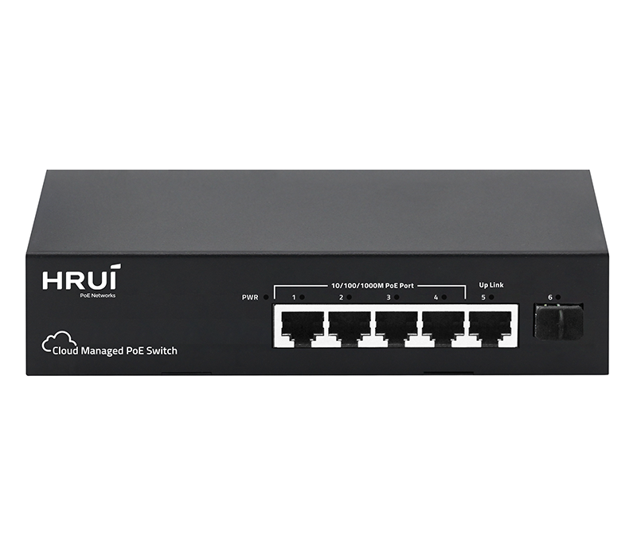

# HR210P-4T2GH-55

> 来源：<https://www.hruitech.com/managed-switch/318.html>（抓取 2026-10-21T04:36:05Z；英文原文照录，中文仅为栏目名）  
> 官网描述：4-Port 10/100/1000T 802.3af/at PoE + 1-Port 10/100/1000T +1-Port 1000X SFP Easy Cloud Managed Ethernet Switch (48 Watts)  
> 类目：Managed Switch（site id 318）  
> 接口：4*1Gbps PoE ports / 1*1Gbps RJ45 port / 1*1Gbps SFP port；PoE 预算 50W；交换带宽 12Gbps；电源 AC 100-240V 50/60Hz / DC 52V 0.92A

**Brief:** 4KV Port Surge protection | 8KV ESD protection | 6KV Power Input Protection | HiPoE Output | VLAN | 250M Long-distance Transmission | PoE Watchdog | Intelligent Cloud Management

## 产品图


## Datasheet
- [HR210P-4T2GH-55-28EN-29.pdf](https://www.hruitech.com/web/userfiles/productfile/HR210P-4T2GH-55-28EN-29.pdf) （本地：`data/hrui_site_raw/datasheets/HR210P-4T2GH-55-28EN-29.pdf`；文本：`data/hrui_site_raw/datasheet_text/HR210P-4T2GH-55-28EN-29.txt`）

## Feature and Benefits（原文）
```
HR210P-4T2GH-55 is a compact, cloud-managed Gigabit PoE switch for small to medium-sized networks. It supports IEEE 802.3af/at PoE standards and offers streamlined cloud management with remote configuration, centralized monitoring, and anomaly alerts, reducing network deployment complexity and maintenance.Built on a high-performance platform, it provides cost-effective all-Gigabit PoE access and essential features such as VLAN and intelligent PoE management, making it ideal for SMBs, office networks, campus access, retail, and video surveillance applications.
Product Features:
Flexible PoE Connectivity
4×1G PoE + 1×1G RJ45 + 1×1G SFP Uplink.
High-Power PoE:
Port 1 delivers up to 45W HiPoE (IEEE 802.3at)
Robust Protection
4 kV surge, 8 kV ESD, and 6 kV power input protection.
Long-Range PoE:
Supports PoE transmission up to 250 m.
Smart PoE Control:
Built-in PoE watchdog for automatic device recovery.
VLAN Support:
One-click VLAN configuration.
Cloud Management:
Remote monitoring and configuration via mobile app.
```

## Parameter（规格表逐行）
| 项 | 值 |
|---|---|
| Description | Specification |
| Model | HR210P-4T2GH-55 |
| Interface | 4*1Gbps PoE ports |
| Interface | 1*1Gbps RJ45 port |
| Interface | 1*1Gbps SFP port |
| Port Standard | IEEE802.3 (Ethernet) |
| Port Standard | IEEE802.3u (Fast Ethernet) |
| Port Standard | IEEE802.3x (Flow Control) |
| Port Standard | IEEE 802.3ab(GigabitEtherne) |
| Port Standard | IEEE 802.3z (Gigabit Ethernet Fiber Standard) |
| Switching Bandwidth | 12Gbps |
| Packet Forwarding Rate | 8.928Mpps |
| Packet Buffer | 1Mbit |
| MAC Address Table | 2K |
| Transmission Method | Store and Forward |
| PoE Standard | IEEE802.3af (15.4W) |
| PoE Standard | IEEE802.3at (30W) |
| POE Port Output Voltage | DC 44-57V |
| PoE Ports | Port 1 supports HiPoE 45W |
| PoE Ports | Ports 2-4 PoE power output <30W |
| PoE Power Budget | 50W |
| Power Supply | AC 100-240V 50/60Hz |
| Power Supply | DC 52V 0.92A |
| Mainboard Power Consumption | 2.1W |
| Structure Information | Product Dimensions: 172*101*37mm |
| Structure Information | Packaging Dimensions: 245*160*55mm |
| Structure Information | Product Net Weight: 0.43KG |
| Structure Information | Product Gross Weight: 0.51KG |
| Packing Information | Carton Dimensions: 520*300*340mm |
| Packing Information | Packing Quantity: 20PCS |
| Packing Information | Packing Weight: 11.2KG |
| Package Contents | Switch 1pcs, Manual 1pcs, Certificate of Inspection 1pcs |
| Fan Quantity | 0 |
| Installation | Desktop |
| Surge Protection | Port Surge: Common mode 4KV, Differential mode 2KV |
| Surge Protection | Electrostatic ESD: Air 8KV, Contact 6KV |
| Surge Protection | Power Supply: Common mode 6KV |
| Operating Temperature | 0~40°C |
| Storage Temperature | -40~70°C |
| Operation Humidity | 10%~90%, non condensing |
| Storage Humidity | 5%~95%, non condensing |
| PWR Green LED | On: Powered on |
| PWR Green LED | Off: Powered off |
| Ports 1-6 Green LED | On: Link normal |
| Ports 1-6 Green LED | Off: Link blocked |
| Ports 1-6 Green LED | Flashing: Data transmitting |
| Ports 1-6 Green LED | Information |
| Ports 1-6 Green LED | Info |
| Port | Port Alias |
| Port | Port Statistics |
| Port | Extend |
| PoE | Restart |
| PoE | Off |
| Setting | Positioning |
| Setting | VLAN |
| Setting | PoE Watchdog |
| Setting | PoE Priority |
| Management | System restart |
| Management | Software update |

## Product structure / Application topology（图）
- https://www.hruitech.com/web/userfiles/image/20260706/1783302692593720.png
