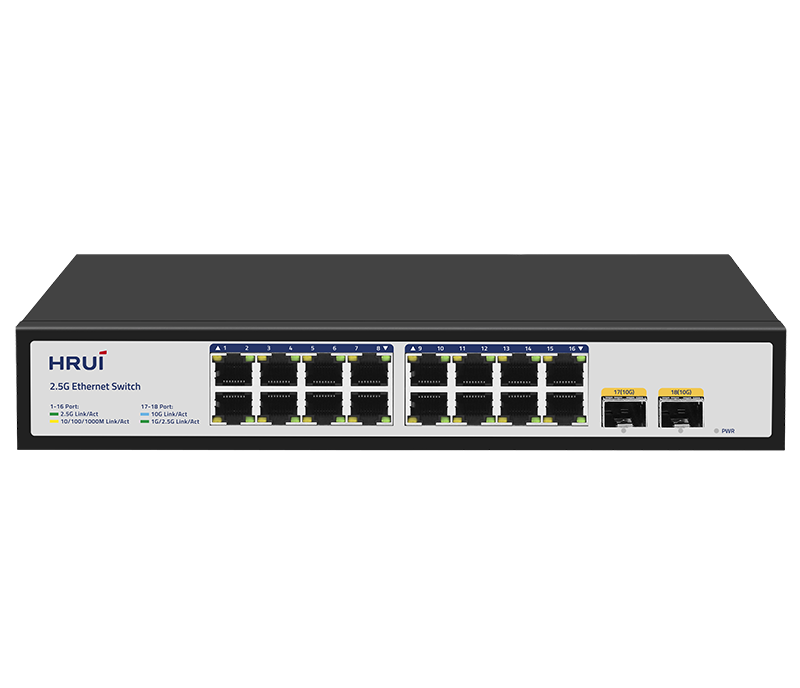
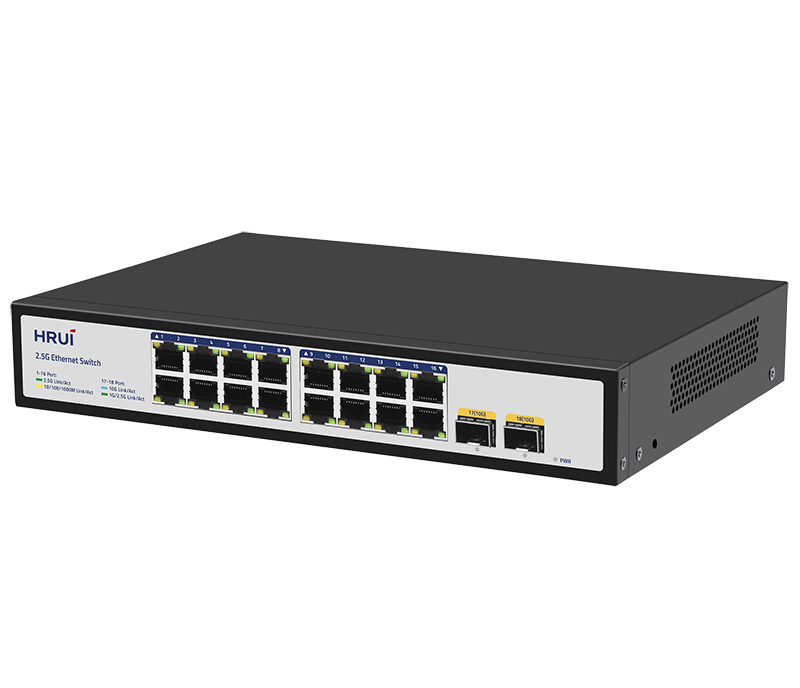
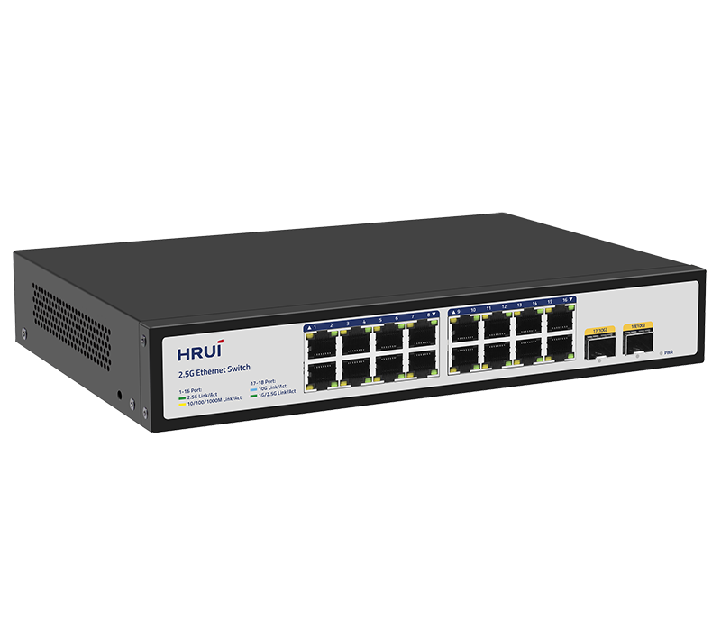
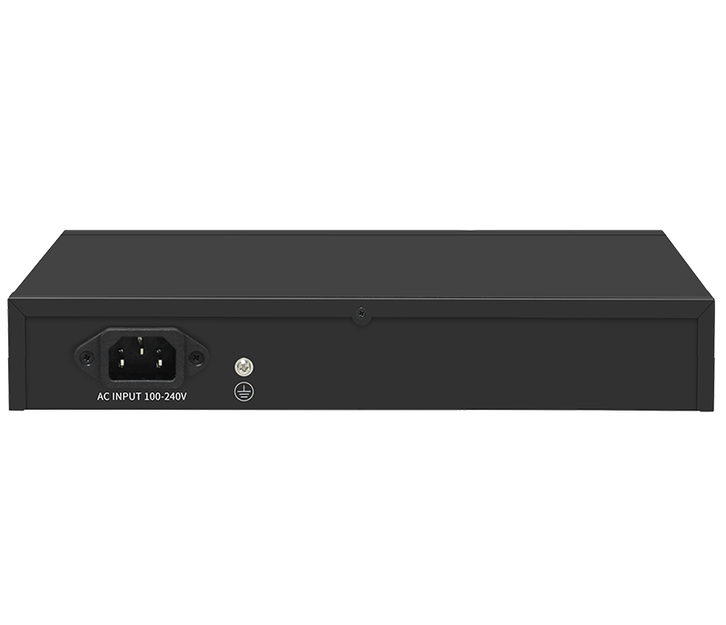

# HR300S-16T2XS

> 来源：<https://www.hruitech.com/ethernet-switch/290.html>（抓取 2026-10-21T04:35:52Z；英文原文照录，中文仅为栏目名）  
> 官网描述：16-Port 10/100/1000/2500T + 2-Port 10G SFP+ Ethernet Switch  
> 类目：Ethernet Switch（site id 290）  
> 接口：16*2.5Gbps RJ45 ports / 2*10Gbps SFP+ ports；PoE 预算 —；交换带宽 120Gbps；电源 AC 100-240V 50/60Hz / DC 12V 3A

**Brief:** The HR300S-16T2XS is a high-performance Ethernet switch designed to meet the increasing demands of modern networks. Featuring 16 ports with speeds of 2.5Gbps and 2 additional 10G SFP+ ports, this switch facilitates seamless data transfer and enhanced connectivity for both small and medium-sized enterprises. Its robust architecture ensures reliable performance and efficient data handling, making it an ideal choice for networking needs that require flexibility and speed.

## 产品图





## Datasheet
- [Datasheet_HR300S_16T2XS.pdf](https://www.hruitech.com/web/userfiles/productfile/Datasheet_HR300S_16T2XS.pdf) （本地：`data/hrui_site_raw/datasheets/Datasheet_HR300S_16T2XS.pdf`；文本：`data/hrui_site_raw/datasheet_text/Datasheet_HR300S_16T2XS.txt`）

## Feature and Benefits（原文）
```
The HR300S-16T2XS is a high-performance Ethernet switch designed to meet the increasing demands of modern networks. Featuring 16 ports with speeds of 2.5Gbps and 2 additional 10G SFP+ ports, this switch facilitates seamless data transfer and enhanced connectivity for both small and medium-sized enterprises. Its robust architecture ensures reliable performance and efficient data handling, making it an ideal choice for networking needs that require flexibility and speed.
Product Features:
High-Speed Connectivity:
16 x 2.5Gbps RJ45 ports and 2 x 10Gbps SFP+ ports for versatile and rapid data transfer capabilities.
Standards Compliance:
Fully compliant with IEEE 802.3, IEEE 802.3u, IEEE 802.3ab, IEEE 802.3bz, IEEE 802.3z, IEEE 802.3ae, and IEEE 802.3x standards, ensuring reliable interoperability with a wide range of devices.
Auto-Negotiation and Speed Adaptation:
Each port supports automatic detection for speeds of 10Mbps, 100Mbps, 1Gbps, and 2.5Gbps, allowing for dynamic adjustments based on connected devices.
Auto MDI/MDIX Support:
Features automatic port flipping (Auto MDI/MDIX), eliminating the need for crossover cables and simplifying installation.
Intuitive Status Monitoring:
Panel indicator LEDs provide real-time monitoring of port status, link activity, and power, making it easy to diagnose and troubleshoot network issues.
Advanced Flow Control:
Supports IEEE 802.3x flow control for full-duplex mode and Backpressure flow control for half-duplex mode, ensuring efficient data transmission and minimizing packet loss.
```

## Parameter（规格表逐行）
| 项 | 值 |
|---|---|
| Description | Specification |
| Model | HR300S-16T2XS |
| Interface | 16*2.5Gbps RJ45 ports |
| Interface | 2*10Gbps SFP+ ports |
| Port Standard | IEEE802.3 (Ethernet) |
| Port Standard | IEEE802.3u (Fast Ethernet) |
| Port Standard | IEEE802.3ab (Gigabit Ethernet) |
| Port Standard | IEEE802.3z (Gigabit Ethernet Fiber Standard) |
| Port Standard | IEEE802.3bz (2.5G Ethernet) |
| Port Standard | IEEE 802.3ae (10G Ethernet) |
| Port Standard | IEEE802.3x (Flow Control) |
| Switching Bandwidth | 120Gbps |
| Packet Forwarding Rate | 89.28Mpps |
| Packet Buffer | 8Mbit |
| MAC Address Table | 16K |
| Transmission Method | Store and Forward |
| Power Supply | AC 100-240V 50/60Hz |
| Power Supply | DC 12V 3A |
| Mainboard Power Consumption | 20W |
| Structure Information | Product Dimensions: 270*180*45mm |
| Structure Information | Packaging Dimensions: 312*262*84mm |
| Structure Information | Product Net Weight: 1.09KG |
| Structure Information | Product Gross Weight: 1.61KG |
| Packing Information | Carton Dimensions: 540*435*332mm |
| Packing Information | Packing Quantity: 10PCS |
| Packing Information | Packing Weight: 17.1KG |
| Package Contents | Switch 1pcs, Power Cord 1pcs, Manual 1pcs, Certificate of Inspection 1pcs, Rack-mounting kit 1pair |
| Fan Quantity | 0 |
| Installation | Desktop, Rack-mounting |
| Surge Protection | Port Surge: Common mode 4KV, Differential mode 2KV |
| Surge Protection | Electrostatic ESD: Air 8KV, Contact 6KV |
| Operating Temperature | 0~40°C |
| Storage Temperature | -40~70°C |
| Operation Humidity | 10%~90%, non condensing |
| Storage Humidity | 5%~95%, non condensing |
| PWR Green LED | On: Powered on |
| PWR Green LED | Off: Powered off |
| Ports 1-16 | Green LED on: 2.5Gbps Link normal |
| Ports 1-16 | Yellow LED on: 10/100/1000Mbps Link normal |
| Ports 1-16 | Off: Link blocked |
| Ports 1-16 | Flashing: Data transmitting |
| Ports 17-18 | Blue LED on: 10Gbps Link normal |
| Ports 17-18 | Green LED on: 1G/2.5Gbps Link normal |
| Ports 17-18 | Off: Link blocked |
| Ports 17-18 | Flashing: Data transmitting |

## Product structure / Application topology（图）
- https://www.hruitech.com/web/userfiles/image/20250414/1744618147109850.png
