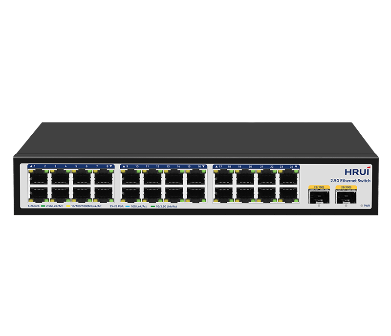
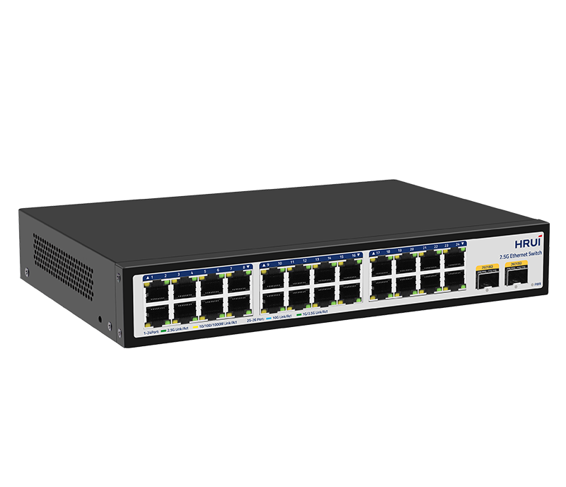
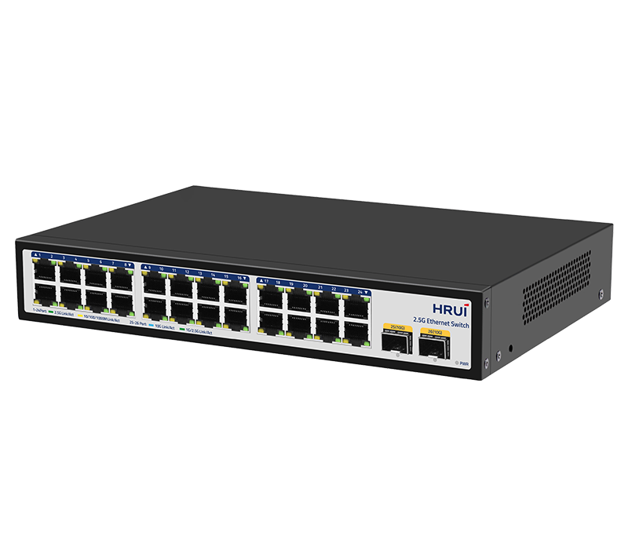
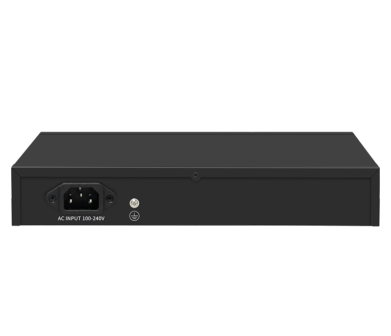

# HR300S-24T2XS

> 来源：<https://www.hruitech.com/ethernet-switch/343.html>（抓取 2026-10-21T03:45:57Z；英文原文照录，中文仅为栏目名）  
> 官网描述：24-Port 10/100/1000/2500T + 2-Port 10G SFP+ Ethernet Switch  
> 类目：Ethernet Switch（site id 343）  
> 接口：24*2.5Gbps RJ45 ports / 2*10Gbps SFP+ ports；PoE 预算 —；交换带宽 160Gbps；电源 AC 100-240V 50/60Hz / DC 12V 3A

**Brief:** 10G Uplink | 2.5G RJ45 | 4KV Port Surge protection | 8KV ESD Protection | 160GbpsSwitching Capacity | Fanless&Noiseless | P lug&Play

## 产品图





## Datasheet
- [HR300S-24T2XS-28EN-29.pdf](https://www.hruitech.com/web/userfiles/productfile/HR300S-24T2XS-28EN-29.pdf) （本地：`data/hrui_site_raw/datasheets/HR300S-24T2XS-28EN-29.pdf`；文本：`data/hrui_site_raw/datasheet_text/HR300S-24T2XS-28EN-29.txt`）

## Feature and Benefits（原文）
```
Upgrade to 2.5G Access with 10G Uplink Performance.The HR300S-24T2XS is a cost-effective 10G uplink 2.5G Ethernet switch that breaks the gigabit bottleneck without expensive rewiring. Delivering up to 160Gbps switching capacity, it provides 24×2.5G ports for high-speed access and 2×10G SFP+ uplinks for aggregation.
Plug-and-play deployment, fanless silent operation, and 4KV surge/8KV ESD protection ensure reliable performance in office, equipment room, and surveillance environments. Rack-mount and desktop ready.Ideal for WiFi 6/7 backhaul, SMB edge networks, office bandwidth upgrades, 4K/8K streaming, and high-speed NAS access—a balanced, future-ready choice for network evolution.
Product Features:
Support 24*2.5Gbps RJ45 ports+2*10Gbps SFP+ ports
Comply with IEEE 802.3, IEEE 802.3u, IEEE 802.3ab, IEEE 802.3bz, IEEE 802.3z, IEEE802.3ae, and IEEE 802.3x standards
Ethernet Ports support 10M/100M/1G/2.5Gbps self-adaptive
Support automatic port flipping (Auto MDI/MDIX)
The panel indicator LEDs will monitor the working status and assist in fault analysis
Flow control method, IEEE802.3x standard for full duplex and Backpressure standard for half duplex
Zero acoustic noise, reduced power consumption, and fewer mechanical failure points
```

## Parameter（规格表逐行）
| 项 | 值 |
|---|---|
| Description | Specification |
| Model | HR300S-24T2XS |
| Interface | 24*2.5Gbps RJ45 ports |
| Interface | 2*10Gbps SFP+ ports |
| Port Standard | IEEE802.3 (Ethernet) |
| Port Standard | IEEE802.3u (Fast Ethernet) |
| Port Standard | IEEE802.3ab (Gigabit Ethernet) |
| Port Standard | IEEE802.3z (Gigabit Ethernet Fiber Standard) |
| Port Standard | IEEE802.3bz (2.5G Ethernet) |
| Port Standard | IEEE 802.3ae (10G Ethernet) |
| Port Standard | IEEE802.3x (Flow Control) |
| Switching Bandwidth | 160Gbps |
| Packet Forwarding Rate | 119.04Mpps |
| Packet Buffer | 8Mbit |
| MAC Address Table | 4K |
| Transmission Method | Store and Forward |
| Power Supply | AC 100-240V 50/60Hz |
| Power Supply | DC 12V 3A |
| Mainboard Power Consumption | 29.19W |
| Structure Information | Product Dimensions: 270*181*44mm |
| Structure Information | Packaging Dimensions: 312*262*84mm |
| Structure Information | Product Net Weight: 1.31KG |
| Structure Information | Product Gross Weight: 1.84KG |
| Packing Information | Carton Dimensions: 540*450*332mm |
| Packing Information | Packing Quantity: 10PCS |
| Packing Information | Packing Weight: 19.4KG |
| Package Contents | Switch 1pcs, Power Cord 1pcs, Manual 1pcs, Certificate of Inspection 1pcs, Rack-mounting kit 1pair |
| Fan Quantity | 0 |
| Installation | Desktop, Rack-mounting |
| Surge Protection | Port Surge: Common mode 4KV, Differential mode 2KV(Class B) |
| Surge Protection | Electrostatic ESD: Air 8KV, Contact 6KV(Class B) |
| Surge Protection | Power Supply: Common mode 2KV, Differential mode 2KV (Class B) |
| Operating Temperature | 0~40°C |
| Storage Temperature | -40~70°C |
| Operation Humidity | 10%~90%, non condensing |
| Storage Humidity | 5%~95%, non condensing |

## Product structure / Application topology（图）
- https://www.hruitech.com/web/userfiles/image/20260715/1784100692726022.png
