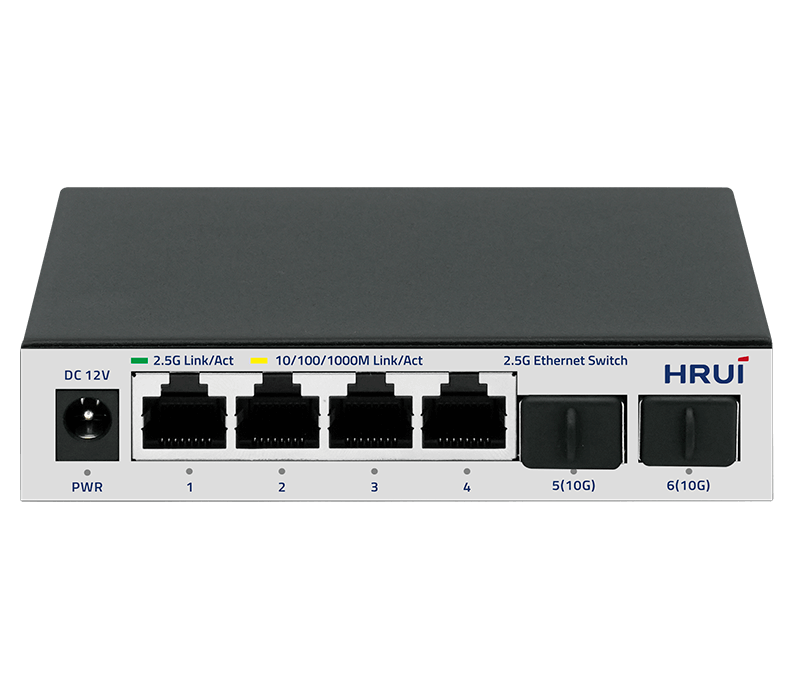
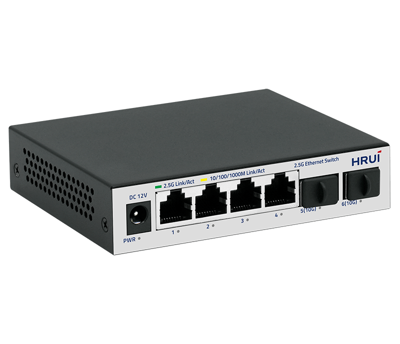
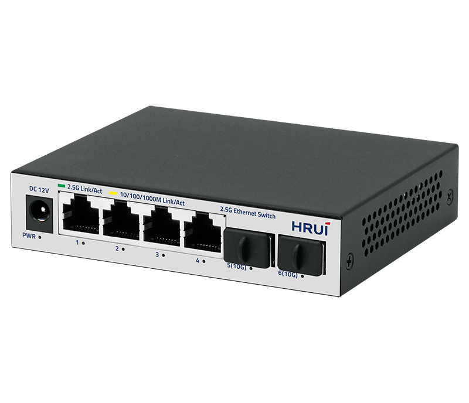
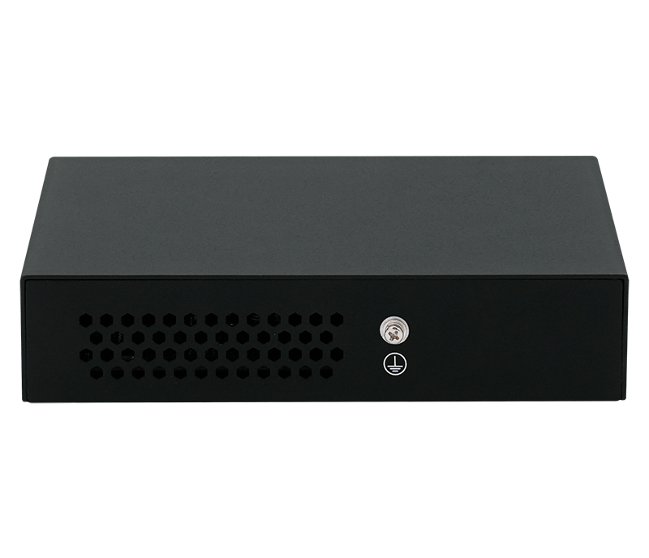

# HR300S-4T2XS

> 来源：<https://www.hruitech.com/ethernet-switch/284.html>（抓取 2026-10-21T04:35:57Z；英文原文照录，中文仅为栏目名）  
> 官网描述：4-Port 10/100/1000/2500T + 2-Port 10G SFP+ Ethernet Switch  
> 类目：Ethernet Switch（site id 284）  
> 接口：4*2.5Gbps RJ45 ports / 2*10Gbps SFP+ ports；PoE 预算 —；交换带宽 60Gbps；电源 AC 100-240V 50/60Hz / DC 12V 1A

**Brief:** The HR300S-4T2XS is a high-performance Ethernet switch designed to deliver fast and reliable connectivity for modern networks. Featuring 4x 2.5G RJ45 ports and 2x 10G SFP+ ports, this switch is perfect for small to medium-sized businesses, home offices, and environments requiring high-speed data transfer. With support for auto-negotiation, advanced flow control, and easy-to-monitor status indicators, the HR300S-4T2XS ensures seamless network operation and efficient troubleshooting.

## 产品图





## Datasheet
- [HR300S_4T2XS.pdf](https://www.hruitech.com/web/userfiles/productfile/HR300S_4T2XS.pdf) （本地：`data/hrui_site_raw/datasheets/HR300S_4T2XS.pdf`；文本：`data/hrui_site_raw/datasheet_text/HR300S_4T2XS.txt`）

## Feature and Benefits（原文）
```
The HR300S-4T2XS is a high-performance Ethernet switch designed to deliver fast and reliable connectivity for modern networks. Featuring 4x 2.5G RJ45 ports and 2x 10G SFP+ ports, this switch is perfect for small to medium-sized businesses, home offices, and environments requiring high-speed data transfer. With support for auto-negotiation, advanced flow control, and easy-to-monitor status indicators, the HR300S-4T2XS ensures seamless network operation and efficient troubleshooting.
Product Features:
High-Speed Connectivity:
Equipped with 4x 2.5Gbps RJ45 ports and 2x 10Gbps SFP+ ports, providing flexible and high-bandwidth connectivity for demanding applications.
Standards Compliance:
Complies with IEEE 802.3, IEEE 802.3u, IEEE 802.3ab, IEEE 802.3bz, IEEE 802.3z, IEEE 802.3ae, and IEEE 802.3x standards, ensuring reliable and interoperable performance.
Auto-Negotiation and Speed Adaptation:
Ethernet ports support 10M/100M/1G/2.5G auto-negotiation, enabling seamless compatibility with a wide range of devices and network speeds.
Auto MDI/MDIX Support:
Features automatic port flipping (Auto MDI/MDIX), eliminating the need for crossover cables and simplifying installation.
Intuitive Status Monitoring:
Panel indicator LEDs provide real-time monitoring of port status, link activity, and power, making it easy to diagnose and troubleshoot network issues.
Advanced Flow Control:
Supports IEEE 802.3x flow control for full-duplex mode and Backpressure flow control for half-duplex mode, ensuring efficient data transmission and minimizing packet loss.
Compact and Versatile Design:
Ideal for environments where space is limited, offering a perfect balance of performance and portability for small-scale deployments.
```

## Parameter（规格表逐行）
| 项 | 值 |
|---|---|
| Description | Specification |
| Model | HR300S-4T2XS |
| Interface | 4*2.5Gbps RJ45 ports |
| Interface | 2*10Gbps SFP+ ports |
| Port Standard | IEEE802.3 (Ethernet) |
| Port Standard | IEEE802.3u (Fast Ethernet) |
| Port Standard | IEEE802.3ab (Gigabit Ethernet) |
| Port Standard | IEEE802.3z (Gigabit Ethernet Fiber Standard) |
| Port Standard | IEEE802.3bz (2.5G Ethernet) |
| Port Standard | IEEE 802.3ae (10G Ethernet) |
| Port Standard | IEEE802.3x (Flow Control) |
| Switching Bandwidth | 60Gbps |
| Packet Forwarding Rate | 44.64Mpps |
| Packet Buffer | 8Mbit |
| MAC Address Table | 4K |
| Transmission Method | Store and Forward |
| Power Supply | AC 100-240V 50/60Hz |
| Power Supply | DC 12V 1A |
| Mainboard Power Consumption | 5.64W |
| Structure Information | Product Dimensions: 113.5*90*25mm |
| Structure Information | Packaging Dimensions: 175*120*63mm |
| Structure Information | Product Net Weight: 0.25KG |
| Structure Information | Product Gross Weight: 0.38KG |
| Packing Information | Carton Dimensions: 520*335*380mm |
| Packing Information | Packing Quantity: 40PCS |
| Packing Information | Packing Weight: 16.2KG |
| Package Contents | Switch 1pcs, Ac adapter 1pcs, Manual 1pcs, Certificate of Inspection 1pcs |
| Fan Quantity | 0 |
| Installation | Desktop |
| Surge Protection | Port Surge: Common mode 4KV, Differential mode 2KV |
| Surge Protection | Electrostatic ESD: Air 8KV, Contact 6KV |
| Operating Temperature | 0~40°C |
| Storage Temperature | -40~70°C |
| Operation Humidity | 10%~90%, non condensing |
| Storage Humidity | 5%~95%, non condensing |
| PWR Green LED | On: Powered on |
| PWR Green LED | Off: Powered off |
| Ports 1-4 | Green LED on: 2.5Gbps Link normal |
| Ports 1-4 | Yellow LED on: 10/100/1000Mbps Link normal |
| Ports 1-4 | Off: Link blocked |
| Ports 1-4 | Flashing: Data transmitting |
| Ports 5-6 | Blue LED on: 10Gbps Link normal |
| Ports 5-6 | Green LED on: 1G/2.5Gbps Link normal |
| Ports 5-6 | Off: Link blocked |
| Ports 5-6 | Flashing: Data transmitting |

## Product structure / Application topology（图）
- https://www.hruitech.com/web/userfiles/image/20250314/1741919470598691.png
