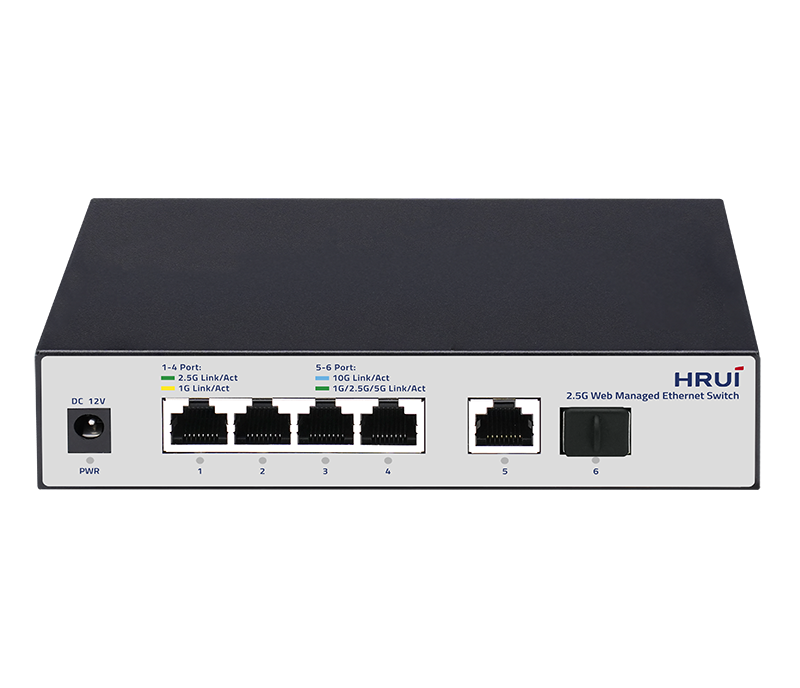
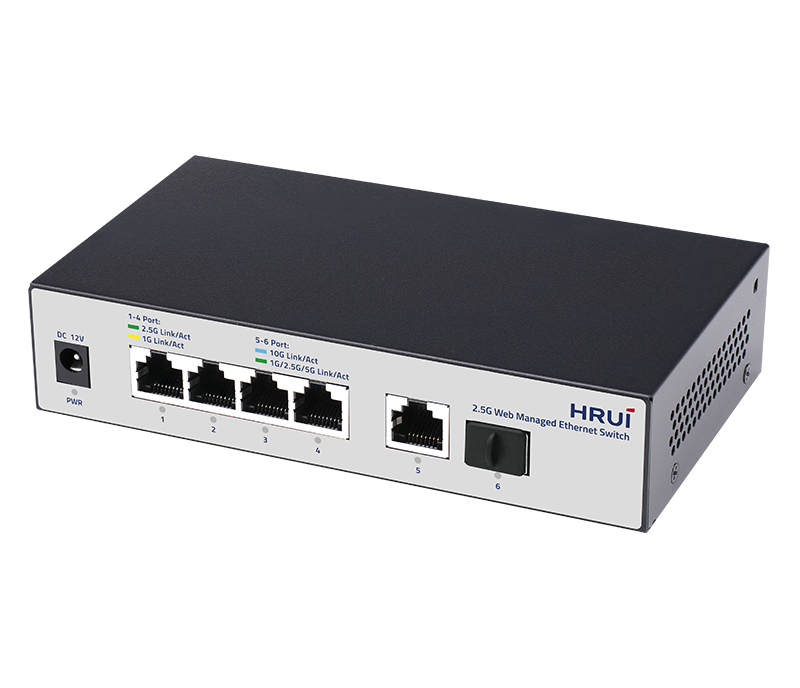
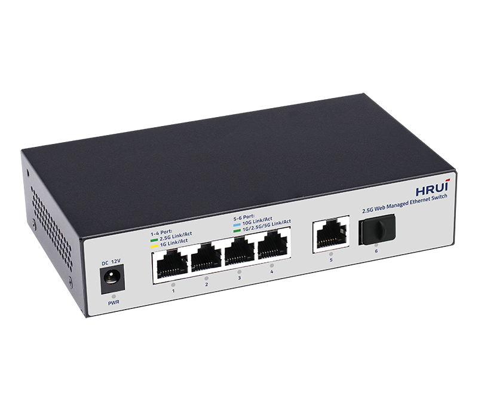
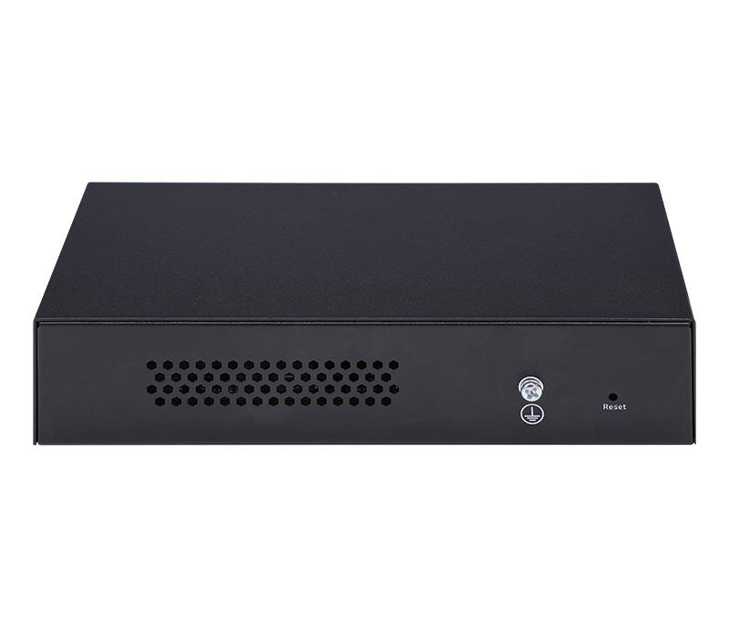

# HR310S-4T2XH

> 来源：<https://www.hruitech.com/managed-switch/289.html>（抓取 2026-10-21T03:47:23Z；英文原文照录，中文仅为栏目名）  
> 官网描述：4-Port 10/100/1000/2500T + 1-Port 10GBASE-T + 1-Port 10G SFP+ Web Managed Switch  
> 类目：Managed Switch（site id 289）  
> 接口：4*2.5Gbps RJ45 ports / 1*10Gbps RJ45 port / 1*10Gbps SFP+ port；PoE 预算 —；交换带宽 60Gbps；电源 AC 100-240V 50/60Hz / DC 12V1A

**Brief:** The HR310S-4T2XH Web-Managed Ethernet Switch is a versatile, future-ready networking solution designed to empower businesses with seamless connectivity and robust performance. Combining four 2.5G RJ45 ports, one 10G RJ45 port, and one 10G SFP+ fiber uplink, this switch delivers the flexibility and bandwidth required to support high-speed applications, from data-intensive workflows to multimedia streaming. Ideal for small to medium enterprises, creative studios, or growing networks, the HR310S-4T2XH bridges the gap between cost-efficiency and cutting-edge performance.

## 产品图





## Datasheet
- [HR310S_4T2XH.pdf](https://www.hruitech.com/web/userfiles/productfile/HR310S_4T2XH.pdf) （本地：`data/hrui_site_raw/datasheets/HR310S_4T2XH.pdf`；文本：`data/hrui_site_raw/datasheet_text/HR310S_4T2XH.txt`）

## Feature and Benefits（原文）
```
The HR310S-4T2XH Web-Managed Ethernet Switch is a versatile, future-ready networking solution designed to empower businesses with seamless connectivity and robust performance. Combining four 2.5G RJ45 ports, one 10G RJ45 port, and one 10G SFP+ fiber uplink, this switch delivers the flexibility and bandwidth required to support high-speed applications, from data-intensive workflows to multimedia streaming. Ideal for small to medium enterprises, creative studios, or growing networks, the HR310S-4T2XH bridges the gap between cost-efficiency and cutting-edge performance.
Product Features:
Hybrid Speed Configuration:
4×2.5G RJ45 ports handle high-bandwidth devices (e.g., NAS, workstations), while dual 10G ports (1×RJ45 + 1×SFP+) enable lightning-fast uplinks or backbone connectivity, supporting both copper and fiber cabling.
Intelligent Web Management:
Simplify network control with an intuitive web interface for VLAN setup, QoS prioritization, and real-time traffic monitoring—all accessible remotely.
Universal Compatibility:
Complies with IEEE 802.3bz (2.5G), IEEE 802.3ae (10G), and other key standards, ensuring seamless integration into existing networks.
Auto-Sensing Convenience:
Ports auto-negotiate speeds (10M/100M/1G/2.5G) and auto-correct cabling (Auto MDI/MDIX), eliminating manual configuration.
Proactive Monitoring:
LED status indicators provide at-a-glance diagnostics for ports, power, and system health, streamlining troubleshooting.
Optimized Traffic Flow:
Advanced flow control (IEEE 802.3x full-duplex, Backpressure half-duplex) minimizes data loss during high-demand periods.
HRUI new-launched series of 2.5G smart web managed Ethernet switches designed to meet diverse application needs by offering flexible port combinations. These switches feature 10-Gigabit uplink ports, making them suitable for high-speed network applications in home networks, business offices, and multimedia transmission environments.
These switches offer reliability and efficient management, simplifying network configuration and monitoring. They ensure network stability and smoothness for both regular business traffic and high-demand scenarios, helping businesses create high-speed and reliable network environments. The 2.5G light-managed Ethernet switch series supports multiple network protocols and security features, enhancing network flexibility and security to address modern network challenges and support business developmemt.
2.5G + 10G Combination
Offer a rich combination of port types and quantities to flexibly meet various network connection needs.
Easily Connect High-speed Devices and Reduce Upgrade Costs
Utilizing existing wiring allows for easy connection of high-speed devices like WiFi 6 routers, AP, NAS, and gaming equipment, meeting growing network demands while reducing upgrade costs and ensuring efficient data transmission.
Smart Web Managed Feature to Optimize Your Network Efficiency
The product offers advanced features like VLAN, port mirroring, traffic control, LACP, QoS, and DHCP Snooping to address complex network needs and enhance security, reliability, and scalability.
Fanless Design
The device features a metal case with vent designs on both sides and the rear, providing improved and more stable heat dissipation.
Rock-solid Reliability
Support 4KV surge protection and 8KV ESD protection for reliable operation.
Plug and Play
Support automatic port flipping, easy to use, plug and play, no configuration needed.
APPLICATION
SPECIFICATION
```

## Parameter（规格表逐行）
| 项 | 值 |
|---|---|
| Description | Specification |
| Model | HR310S-4T2XH |
| Interface | 4*2.5Gbps RJ45 ports |
| Interface | 1*10Gbps RJ45 port |
| Interface | 1*10Gbps SFP+ port |
| Port Standard | IEEE802.3 (Ethernet) |
| Port Standard | IEEE802.3u (Fast Ethernet) |
| Port Standard | IEEE802.3ab (Gigabit Ethernet) |
| Port Standard | IEEE802.3z (Gigabit Ethernet Fiber Standard) |
| Port Standard | IEEE802.3bz (2.5G Ethernet) |
| Port Standard | IEEE 802.3ae (10Gbps Ethernet) |
| Port Standard | IEEE802.3x (Flow Control) |
| Switching Bandwidth | 60Gbps |
| Packet Forwarding Rate | 44.64Mpps |
| Packet Buffer | 8Mbit |
| MAC Address Table | 4K |
| VLAN | VLAN range 1-4094, maximum active VLAN is 4K |
| Jumbo Frame | 10K |
| Transmission Method | Store and Forward |
| Surge Protection | Port Surge: Common mode 4KV, Differential mode 1KV(Class B) |
| Surge Protection | Electrostatic ESD: Air 8KV, Contact 6KV(Class C) |
| Operating Temperature | 0~40°C |
| Storage Temperature | -40~70°C |
| Operation Humidity | 10%~90%, non condensing |
| Storage Humidity | 5%~95%, non condensing |
| Power Supply | AC 100-240V 50/60Hz |
| Power Supply | DC 12V1A |
| Mainboard Power Consumption | 9.84W |
| Structure Information | Product Dimensions: 160*90*35mm |
| Structure Information | Packaging Dimensions: 175*120*73mm |
| Structure Information | Product Net Weight: 0.35KG |
| Structure Information | Product Gross Weight: 0.5KG |
| Packing Information | Carton Dimensions: 520*385*205mm |
| Packing Information | Packing Quantity: 20PCS |
| Packing Information | Packing Weight: 11KG |
| Package Contents | Switch 1pcs, AC Adapter 1pcs, Manual 1pcs, Certificate of Inspection 1pcs |
| Fan Quantity | 0 |
| Installation | Desktop, Wall-mounting |
| PWR Green LED | On: Powered on |
| PWR Green LED | Off: Powered off |
| Ports 1-4 | Green LED on: 2.5Gbps Link normal |
| Ports 1-4 | Yellow LED on: 10/100/1000Mbps Link normal |
| Ports 1-4 | Off: Link blocked |
| Ports 1-4 | Flashing: Data transmitting |
| Port 5 | Blue LED on: 10Gbps Link normal |
| Port 5 | Green LED on: 1G/2.5/5GGbps Link normal |
| Port 5 | Off: Link blocked |
| Port 5 | Flashing: Data transmitting |
| Port 6 | Blue LED on: 10Gbps Link normal |
| Port 6 | Green LED on: 1G/2.5Gbps Link normal |
| Port 6 | Off: Link blocked |
| Port 6 | Flashing: Data transmitting |
| **Software Features** | |
| **L2 Function** | |
| Port | Port Switch configuration |
| Port | Port Speed configuration |
| Port | Port Duplex configuration |
| Port | Port Flow Control configuration |
| Port | EEE |
| Port | Jumbo Frame |
| Link Aggregation | Max. 4 members per group |
| Link Aggregation | Static Group |
| Link Aggregation | LACP |
| Link Aggregation | Up to 2 groups |
| Storm Control | Boardcast suppression |
| Storm Control | Unknown Multicast |
| Storm Control | Unknown Unicast |
| Port Mirroring | Support |
| Port Security | MAC Address Constraints |
| Port Isolation | Support |
| Port Rate-limit | Support |
| VLAN | Access/Trunk/Hybrid |
| VLAN | Congurable VID from 1 - 4094;Max. 31 static VLAN groups |
| MAC Address | Dynamic MAC Address |
| MAC Address | Static MAC address |
| Spanning Tree Protocol | STP/RSTP |
| Spanning Tree Protocol | Edge Port |
| Multicast | IGMP Snooping |
| Multicast | Router Port |
| Multicast | Static IGMP Join |
| Multicast | IGMP V1/V2 |
| QoS | Traffic classification, Supporting SP and WRR scheduling |
| QoS | Port Priority |
| QoS | Support up to 8 queues per port |
| **Services** | |
| Access Protocol | HTTP |
| **Diagnostics** | |
| Port Statistics | Support |
| **Equipment Management** | |
| Manager Access | HTTP |
| Manager IP | Static Address |
| Manager IP | DHCP Client |
| User Management | Support |
| Firmware Management | Firmware upgrade |
| Configuration Management | Upload/Backup Configuration |
| Save | Support |
| Restart | Support |
| Factory Defaults | Support |
| **Standard Compliance** | |
| **IEEE 802.3x flow control and back pressure** | |
| **IEEE 802.1D Spanning Tree Protocol** | |
| **IEEE 802.1w Rapid Spanning Tree Protocol** | |
| **IEEE 802.1Q VLAN tagging** | |
| **RFC 768 UDP** | |
| **RFC 791 IP** | |
| **RFC 792 ICMP** | |
| **RFC 2068 HTTP** | |
| **RFC 1112 IGMP v1** | |
| **RFC 2236 IGMP v2** | |

## Product structure / Application topology（图）
- https://www.hruitech.com/web/userfiles/image/20250409/1744183212189489.png
