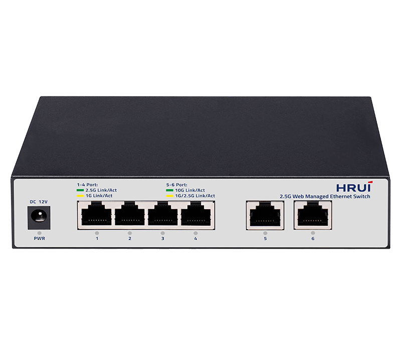
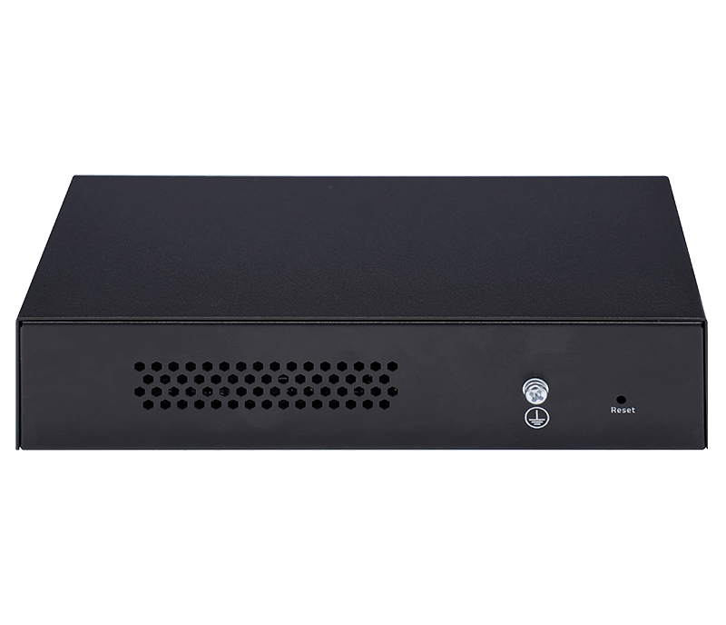
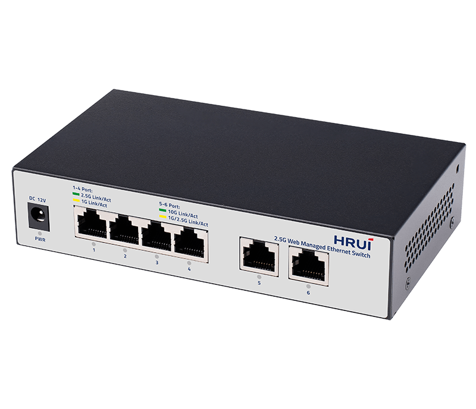
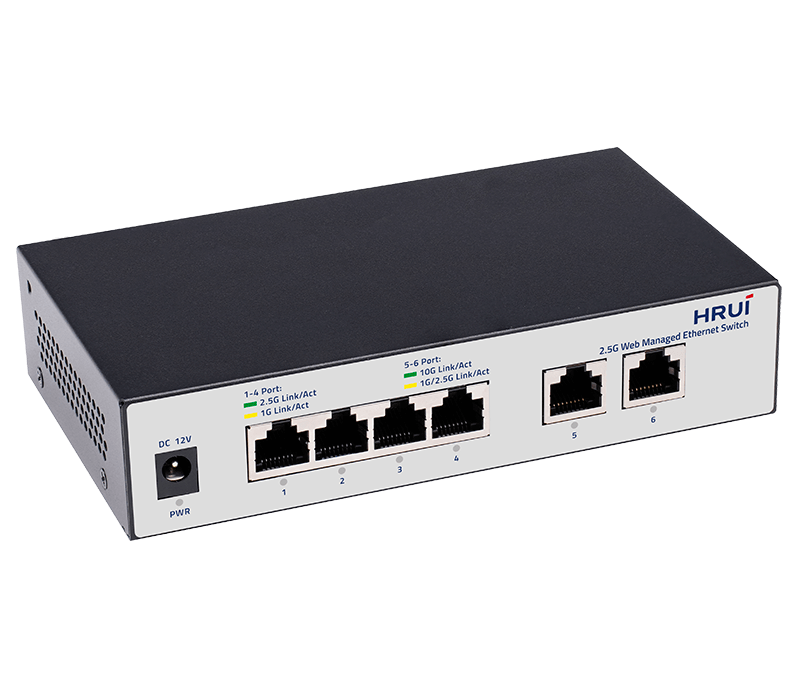

# HR310S-4T2XT

> 来源：<https://www.hruitech.com/managed-switch/79.html>（抓取 2026-10-21T03:47:21Z；英文原文照录，中文仅为栏目名）  
> 官网描述：4-Port 2.5G and 2-Port 10G Web Managed Ethernet Switch | HRUI  
> 类目：Managed Switch（site id 79）  
> 接口：4*10G RJ45 ports / 2*10G RJ45 ports；PoE 预算 —；交换带宽 —；电源 AC 100-240V 50/60Hz / DC 12V1A

**Brief:** HR310S-4T2XT, a powerful and versatile web-managed Ethernet switch designed to elevate your network performance. With its robust combination of 4 ports supporting speeds of 2.5G and an additional 2 ports at 10G, this switch ensures seamless data transfer and high-speed connectivity for a range of applications. Ideal for businesses looking to enhance their network infrastructure, the HR310S-4T2XT provides excellent reliability and easy management for optimal performance.

## 产品图





## Datasheet
- [HR310S-4T2XT-28EN-29.pdf](https://www.hruitech.com/web/userfiles/productfile/HR310S-4T2XT-28EN-29.pdf) （本地：`data/hrui_site_raw/downloads/HR310S-4T2XT-28EN-29.pdf`；文本：`data/hrui_site_raw/datasheet_text/HR310S-4T2XT-28EN-29.txt`）

## Feature and Benefits（原文）
```
HR310S-4T2XT, a powerful and versatile web-managed Ethernet switch designed to elevate your network performance. With its robust combination of 4 ports supporting speeds of 2.5G and an additional 2 ports at 10G, this switch ensures seamless data transfer and high-speed connectivity for a range of applications. Ideal for businesses looking to enhance their network infrastructure, the HR310S-4T2XT provides excellent reliability and easy management for optimal performance.
Product Features:
High-Speed Connectivity:
4 x 10G RJ45 ports and 2 x 10G SFP+ ports for unparalleled data throughput.
Standards Compliance:
Fully compliant with IEEE 802.3, IEEE 802.3u, IEEE 802.3ab, IEEE 802.3bz, IEEE 802.3ae, and IEEE 802.3x standards, ensuring compatibility with various networking devices.
Adaptive RJ45 Ports:
RJ45 ports support multiple speeds: 100M, 1G, 2.5G, 5G, and 10G for versatile connectivity options.
Automatic Port Flipping:
Enhanced connectivity with support for Auto MDI/MDIX, eliminating the need for crossover cables.
Panel Indicators:
Integrated LED indicators provide real-time monitoring of operational status and facilitate quick fault analysis for efficient troubleshooting.
Flow Control Compliance:
Supports IEEE802.3x standard for full duplex flow control and Backpressure standard for half duplex, ensuring smooth data transmission.
Quality of Service (QoS):
Prioritize data packets with advanced QoS features, optimizing network performance for critical applications.
User-Friendly Web Management:
Easy-to-navigate web interface for efficient management and configuration of network settings.
HRUI new-launched series of 2.5G smart web managed Ethernet switches designed to meet diverse application needs by offering flexible port combinations. These switches feature 10-Gigabit uplink ports, making them suitable for high-speed network applications in home networks, business offices, and multimedia transmission environments.
These switches offer reliability and efficient management, simplifying network configuration and monitoring. They ensure network stability and smoothness for both regular business traffic and high-demand scenarios, helping businesses create high-speed and reliable network environments. The 2.5G light-managed Ethernet switch series supports multiple network protocols and security features, enhancing network flexibility and security to address modern network challenges and support business developmemt.
2.5G + 10G Combination
Offer a rich combination of port types and quantities to flexibly meet various network connection needs.
Easily Connect High-speed Devices and Reduce Upgrade Costs
Utilizing existing wiring allows for easy connection of high-speed devices like WiFi 6 routers, AP, NAS, and gaming equipment, meeting growing network demands while reducing upgrade costs and ensuring efficient data transmission.
Smart Web Managed Feature to Optimize Your Network Efficiency
The product offers advanced features like VLAN, port mirroring, traffic control, LACP, QoS, and DHCP Snooping to address complex network needs and enhance security, reliability, and scalability.
Fanless Design
The device features a metal case with vent designs on both sides and the rear, providing improved and more stable heat dissipation.
Rock-solid Reliability
Support 4KV surge protection and 8KV ESD protection for reliable operation.
Plug and Play
Support automatic port flipping, easy to use, plug and play, no configuration needed.
APPLICATION
SPECIFICATION
```

## Parameter（规格表逐行）
| 项 | 值 |
|---|---|
| Description | Specification |
| Model | HR310S-4T2XT |
| Interface | 4*10G RJ45 ports |
| Interface | 2*10G RJ45 ports |
| Port Standard | IEEE802.3 (Et hernet) |
| Port Standard | IEEE802.3u (Fast Ethernet) |
| Port Standard | IEEE802.3ab (Gigabit Ethernet) |
| Port Standard | IEEE 802.3bz (5G Ethernet) |
| Port Standard | IEEE 802.3z (Gigabit Ethernet) |
| Port Standard | IEEE 802.3ae (10G Ethernet) |
| Port Standard | IEEE802.3x (Flow Control) |
| Switching Capacity | 60Gbps |
| Packet Forwarding Rate | 44.64Mpps |
| Packet Buffer | 8Mbit |
| MAC Address Table | 4K |
| VLAN | VLAN range 1-4094, maximum active VLAN is 4K |
| Jumbo Frame | 10K |
| Transmission Method | Store and Forward |
| Surge Protection | Surge Protection: common mode 4KV, differential mode 2KV (Class C) |
| Surge Protection | Electronic ESD: contact 6KV, air 8KV (Class C) |
| Operating Temperature | 0~40°C |
| Storage Temperature | -40 °C to 70 °C |
| Operation Humidity | 10%~90%，non condensing |
| Storage Humidity | 5%~95%，non condensing |
| Power Supply | AC 100-240V 50/60Hz |
| Power Supply | DC 12V1A |
| Mainboard Power Consumption | 9.6W |
| Structure Information | Product Dimensions :160*90*35mm |
| Structure Information | Packaging Dimensions :175*120*73mm |
| Structure Information | Product Net Weight:0.35kg |
| Structure Information | Product Gross Weight: |
| Packing Information | Carton Dimensions : 520*385*205mm |
| Packing Information | Packing Quantity: 20PCS |
| Packing Information | Packing Weight: |
| Package Contents | Switch 1pcs, power adapter 1pcs, manual 1pcs，certificate of qualification 1pcs |
| Fan Quantity | 0 |
| Installation | Desktop |
| PWR Green LED | On: Powered on |
| PWR Green LED | Off: Powered off |
| 1-4 | Green Led On: 2.5G Link normal |
| 1-4 | Yellow Led On: 100M/1G Link normal |
| 1-4 | Off: Link blocked |
| 1-4 | Flashing: Data transmitting |
| 5-6 | Green LED on: 10G link |
| 5-6 | Yellow LED on: 100M/1G/2.5G link |
| 5-6 | Off: Link blocked |
| 5-6 | Flashing: Data transmitting |
| **Software Features** | |
| **L2 Function** | |
| Port | Port Switch configuration |
| Port | Port Description configuration |
| Port | Port Speed configuration |
| Port | Port Duplex configuration |
| Port | Port Flow Control configuration |
| Port | Jumbo Frame |
| Port | EEE |
| Link Aggregation | Supports load balance policy; Base on MAC and IP-MAC |
| Link Aggregation | Static and Dynamic Group |
| Link Aggregation | LACP |
| Link Aggregation | Up to 8 groups |
| Storm Control | Boardcast suppression |
| Storm Control | Unknown Multicast |
| Storm Control | Unknown Unicast |
| Port Mirroring | One to one monitor |
| Port Mirroring | Many to one monitor |
| Port Mirroring | Ingress/Egress/Both |
| Port Mirroring | Up to 4 session groups |
| Port Security | MAC Address Constraints |
| Port Security | Protect/Restrict/Shutdown |
| Port Isolation | Support |
| Port Rate-limit | Support |
| VLAN | Access/Trunk/Hybrid |
| VLAN | VLAN Tunnel (Q-in-Q Tunnel) |
| VLAN | VLAN range 1-4094, maximum active VLAN is 4K |
| MAC Address | Filtering MAC Address |
| MAC Address | Static MAC address |
| LLDP | LLDP |
| LLDP | LLDP MED |
| Spanning Tree Protocol | STP/RSTP |
| Spanning Tree Protocol | BPDU Filter |
| Spanning Tree Protocol | BPDU Guard |
| Spanning Tree Protocol | Edge Port |
| Multicast | IGMP Snooping |
| Multicast | Router Port |
| Multicast | Static IGMP Join |
| Multicast | IGMP V1/V2 |
| QoS | Traffic classification, supporting SP and WRR scheduling |
| QoS | Port Priority |
| QoS | 802.1P Priority |
| QoS | IP DSCP Priority |
| QoS | Priority Remarking |
| QoS | Supports up to 8 queues per port |
| ERPS | Main Ring |
| **Services** | |
| Access Protocol | HTTP |
| Access Protocol | Session Timeout |
| Security | DHCP Snooping |
| Security | Diagnostics |
| Copper Test | support |
| Ping | support |
| **Equipment Management** | |
| Manager Access | HTTP |
| Manager Access | SNMP |
| Manager IP | Static Address |
| Manager IP | Manager VLAN |
| Manager IP | DNS |
| Manager IP | DHCP Client |
| SNMP | V2C |
| SNMP | Community |
| SNMP | Trap Host |
| SNMP MIB | RFC 1213 MIB-II |
| SNMP MIB | RFC 1643 Ethernet MIB |
| SNMP MIB | RFC 2863 Interface MIB |
| User Management | Support |
| Firmware Management | Firmware upgrade |
| Configuration Management | Upload/Backup Configuration |
| Save | Support |
| Restart | Support |
| Factory Defaults | Support |
| **Standard Compliance** | |
| **IEEE 802.3x flow control and back pressure** | |
| **IEEE 802.3ad port trunk with LACP** | |
| **IEEE 802.1D Spanning Tree Protocol** | |
| **IEEE 802.1w Rapid Spanning Tree Protocol** | |
| **IEEE 802.1p Class of Service** | |
| **IEEE 802.1Q VLAN tagging** | |
| **RFC 768 UDP** | |
| **RFC 793 TFTP** | |
| **RFC 791 IP** | |
| **RFC 792 ICMP** | |
| **RFC 2068 HTTP** | |
| **RFC 1112 IGMP v1** | |
| **RFC 2236 IGMP v2** | |
| **RFC 3376 IGMP v3** | |

## Product structure / Application topology（图）
- https://www.hruitech.com/web/userfiles/image/20241125/1732502915247061.png
