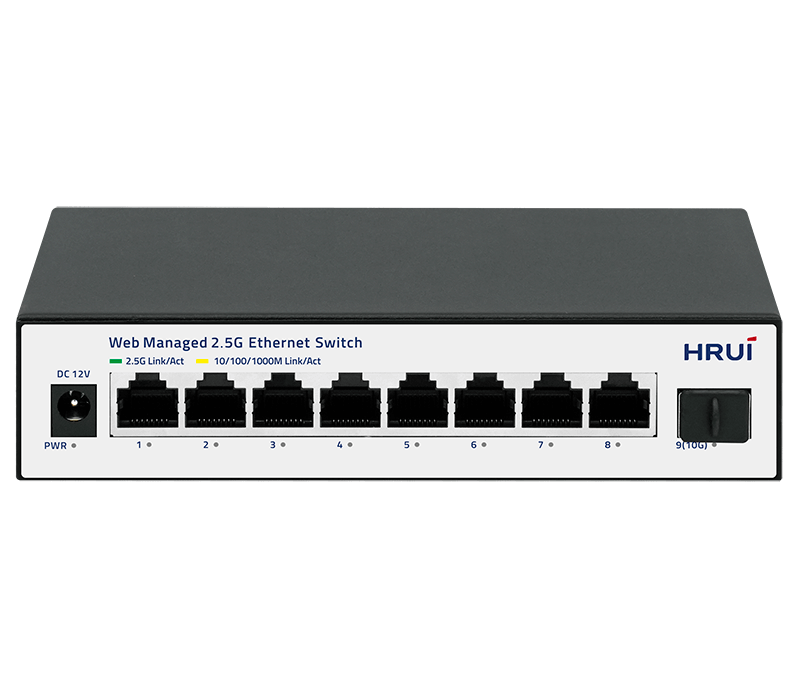
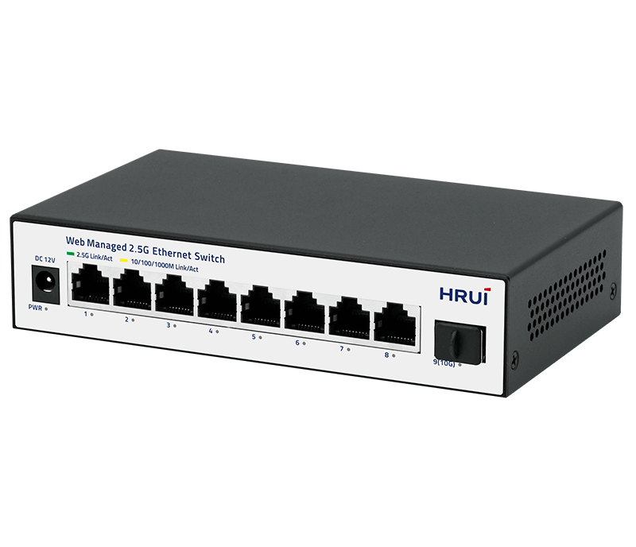
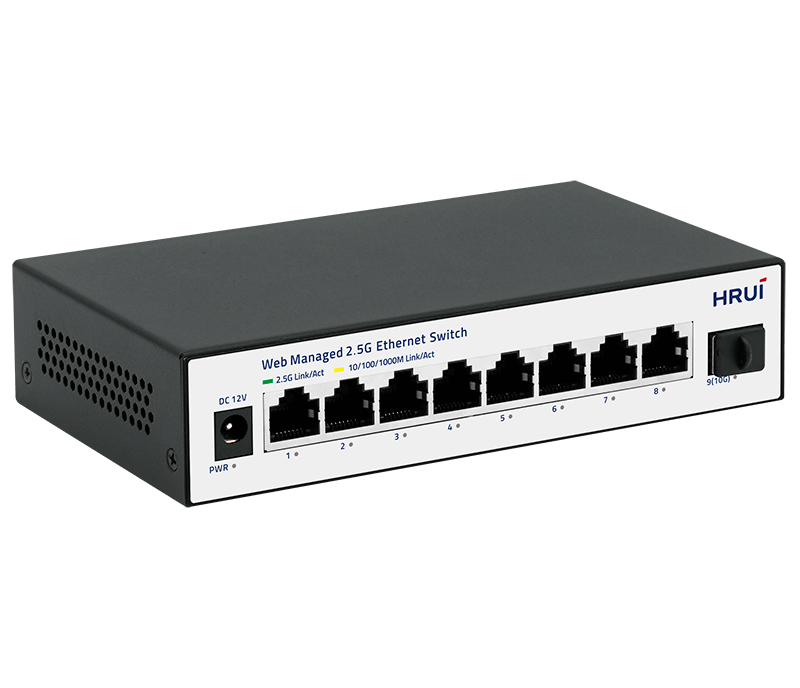
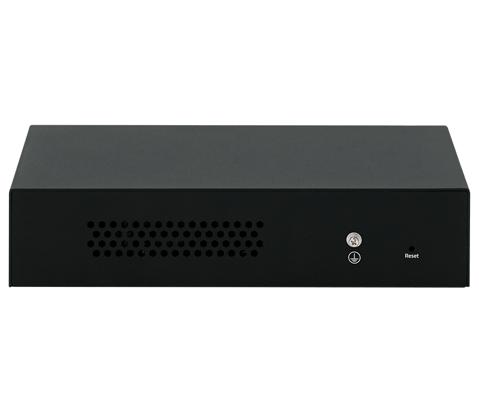

# HR310S-8T1XS

> 来源：<https://www.hruitech.com/managed-switch/288.html>（抓取 2026-10-21T03:47:24Z；英文原文照录，中文仅为栏目名）  
> 官网描述：HR310S-8T1XS - 8-Port 2.5G and 1-Port 10G SFP+ Web Managed Switch  
> 类目：Managed Switch（site id 288）  
> 接口：8*2.5Gbps RJ45 ports / 1*10Gbps SFP+ port；PoE 预算 —；交换带宽 60Gbps；电源 AC 100-240V 50/60Hz / DC 12V 1A

**Brief:** The HR310S-8T1XS is a high-performance, web-managed Ethernet switch designed to meet the needs of modern networks. With 8x 2.5Gbps RJ45 ports and 1x 10Gbps SFP+ port, this switch delivers exceptional speed, flexibility, and scalability for small to medium-sized businesses, creative studios, and high-bandwidth home networks. Its advanced features, including web-based management, QoS support, and intuitive monitoring tools, make it easy to configure, optimize, and troubleshoot your network, ensuring reliable and efficient performance.

## 产品图





## Datasheet
- [HR310S_8T1XS.pdf](https://www.hruitech.com/web/userfiles/productfile/HR310S_8T1XS.pdf) （本地：`data/hrui_site_raw/downloads/HR310S_8T1XS.pdf`；文本：`data/hrui_site_raw/datasheet_text/HR310S_8T1XS.txt`）

## Feature and Benefits（原文）
```
The HR310S-8T1XS is a high-performance, web-managed Ethernet switch designed to meet the needs of modern networks. With 8x 2.5Gbps RJ45 ports and 1x 10Gbps SFP+ port, this switch delivers exceptional speed, flexibility, and scalability for small to medium-sized businesses, creative studios, and high-bandwidth home networks. Its advanced features, including web-based management, QoS support, and intuitive monitoring tools, make it easy to configure, optimize, and troubleshoot your network, ensuring reliable and efficient performance.
Product Features:
High-Speed Connectivity:
Equipped with 8x 2.5Gbps RJ45 ports and 1x 10Gbps SFP+ port, providing flexible and high-bandwidth connectivity for demanding applications.
Standards Compliance:
Complies with IEEE 802.3, IEEE 802.3u, IEEE 802.3ab, IEEE 802.3bz, IEEE 802.3z, IEEE 802.3ae, and IEEE 802.3x standards, ensuring reliable and interoperable performance.
Auto-Negotiation and Speed Adaptation:
Ethernet ports support 10M/100M/1G/2.5Gbps auto-negotiation, enabling seamless compatibility with a wide range of devices and network speeds.
Auto MDI/MDIX Support:
Features automatic port flipping (Auto MDI/MDIX), eliminating the need for crossover cables and simplifying installation.
Intuitive Status Monitoring:
Panel indicator LEDs provide real-time monitoring of port status, link activity, and power, making it easy to diagnose and troubleshoot network issues.
Advanced Flow Control:
Supports IEEE 802.3x flow control for full-duplex mode and Backpressure flow control for half-duplex mode, ensuring efficient data transmission and minimizing packet loss.
QoS Support:
Includes Quality of Service (QoS) features to prioritize critical data traffic, ensuring optimal performance for latency-sensitive applications such as VoIP, video streaming, and online gaming.
Web-Based Management:
Offers an intuitive web-based management interface for easy configuration, monitoring, and optimization of network settings, making it accessible even for non-technical users.
Compact and Versatile Design:
Ideal for environments requiring high-speed connectivity and scalability, offering a perfect balance of performance and portability for growing networks.
HRUI new-launched series of 2.5G smart web managed Ethernet switches designed to meet diverse application needs by offering flexible port combinations. These switches feature 10-Gigabit uplink ports, making them suitable for high-speed network applications in home networks, business offices, and multimedia transmission environments.
These switches offer reliability and efficient management, simplifying network configuration and monitoring. They ensure network stability and smoothness for both regular business traffic and high-demand scenarios, helping businesses create high-speed and reliable network environments. The 2.5G light-managed Ethernet switch series supports multiple network protocols and security features, enhancing network flexibility and security to address modern network challenges and support business developmemt.
2.5G + 10G Combination
Offer a rich combination of port types and quantities to flexibly meet various network connection needs.
Easily Connect High-speed Devices and Reduce Upgrade Costs
Utilizing existing wiring allows for easy connection of high-speed devices like WiFi 6 routers, AP, NAS, and gaming equipment, meeting growing network demands while reducing upgrade costs and ensuring efficient data transmission.
Smart Web Managed Feature to Optimize Your Network Efficiency
The product offers advanced features like VLAN, port mirroring, traffic control, LACP, QoS, and DHCP Snooping to address complex network needs and enhance security, reliability, and scalability.
Fanless Design
The device features a metal case with vent designs on both sides and the rear, providing improved and more stable heat dissipation.
Rock-solid Reliability
Support 4KV surge protection and 8KV ESD protection for reliable operation.
Plug and Play
Support automatic port flipping, easy to use, plug and play, no configuration needed.
APPLICATION
SPECIFICATION
```

## Parameter（规格表逐行）
| 项 | 值 |
|---|---|
| Description | Specification |
| Model | HR310S-8T1XS |
| Interface | 8*2.5Gbps RJ45 ports |
| Interface | 1*10Gbps SFP+ port |
| Port Standard | IEEE802.3 (Ethernet) |
| Port Standard | IEEE802.3u (Fast Ethernet) |
| Port Standard | IEEE802.3ab (Gigabit Ethernet) |
| Port Standard | IEEE802.3z (Gigabit Ethernet Fiber Standard) |
| Port Standard | IEEE802.3bz (2.5G Ethernet) |
| Port Standard | IEEE 802.3ae (10G Ethernet) |
| Port Standard | IEEE802.3x (Flow Control) |
| Switching Bandwidth | 60Gbps |
| Packet Forwarding Rate | 44.64Mpps |
| Packet Buffer | 8Mbit |
| MAC Address Table | 4K |
| Jumbo Frame | 16K |
| VLAN | VLAN range 1-4094, maximum active VLAN is 31 |
| Transmission Method | Store and Forward |
| Power Supply | AC 100-240V 50/60Hz |
| Power Supply | DC 12V 1A |
| Mainboard Power Consumption | 11.29W |
| Structure Information | Product Dimensions: 160*90*35mm |
| Structure Information | Packaging Dimensions: 175*1120*73mm |
| Structure Information | Product Net Weight: 0.33KG |
| Structure Information | Product Gross Weight: 0.47KG |
| Packing Information | Carton Dimensions: 520*385*205mm |
| Packing Information | Packing Quantity: 20PCS |
| Packing Information | Packing Weight: 10.4KG |
| Package Contents | Switch 1pcs, Ac adapter 1pcs, Manual 1pcs, Certificate of Inspection 1pcs |
| Fan Quantity | 0 |
| Installation | Desktop |
| Surge Protection | Port Surge: Common mode 4KV, Differential mode 2KV |
| Surge Protection | Electrostatic ESD: Air 8KV, Contact 6KV |
| Operating Temperature | 0~40°C |
| Storage Temperature | -40~70°C |
| Operation Humidity | 10%~90%, non condensing |
| Storage Humidity | 5%~95%, non condensing |
| PWR Green LED | On: Powered on |
| PWR Green LED | Off: Powered off |
| Ports 1-8 | Green LED on: 2.5Gbps Link normal |
| Ports 1-8 | Yellow LED on: 10/100/1000Mbps Link normal |
| Ports 1-8 | Off: Link blocked |
| Ports 1-8 | Flashing: Data transmitting |
| Port 9 | Blue LED on: 10Gbps Link normal |
| Port 9 | Green LED on: 1G/2.5Gbps Link normal |
| Port 9 | Off: Link blocked |
| Port 9 | Flashing: Data transmitting |
| Reset | Long press for 6 seconds to restore factory settings |
| **Software Features** | |
| **L2 Function** | |
| Port | Port Switch configuration |
| Port | Port Speed configuration |
| Port | Port Duplex configuration |
| Port | Port Flow Control configuration |
| Port | Jumbo Frame |
| Link Aggregation | Up to 2 groups |
| Link Aggregation | Static Group |
| Link Aggregation | LACP |
| Link Aggregation | Max. 4 members per group |
| Storm Control | Boardcast suppression |
| Storm Control | Unknown Multicast |
| Storm Control | Unknown Unicast |
| Port Mirroring | Support |
| VLAN | Access/Trunk/Hybrid |
| VLAN | VLAN range 1-4094, maximum active VLAN is 31 |
| Port Isolation | Support |
| Port Rate-limit | Support |
| MAC Address | Filtering MAC Address |
| MAC Address | Static MAC address |
| Spanning Tree Protocol | STP/RSTP |
| Spanning Tree Protocol | Edge Port |
| Multicast | IGMP Snooping |
| Multicast | IGMP V1/V2 |
| QoS | Traffic classification, supporting SP and WRR scheduling |
| QoS | Port Priority |
| QoS | Support up to 8 queues per port |
| **Services** | |
| Access Protocol | HTTP |
| Security | DHCP Snooping |
| **Diagnostics** | |
| Port Statistics | Support |
| **Equipment Management** | |
| Manager Access | HTTP |
| Manager IP | Static Address |
| Manager IP | DHCP Client |
| User Management | Support |
| Firmware Management | Firmware upgrade |
| Configuration Management | Upload/Backup Configuration |
| Save | Support |
| Restart | Support |
| Factory Defaults | Support |
| **Standard Compliance** | |
| **IEEE 802.3x flow control and back pressure** | |
| **IEEE 802.1D Spanning Tree Protocol** | |
| **IEEE 802.1w Rapid Spanning Tree Protocol** | |
| **IEEE 802.1p Class of Service** | |
| **IEEE 802.1Q VLAN tagging** | |
| **IEEE 802.3af Power over Ethernet** | |
| **IEEE 802.3at Power over Ethernet Plus** | |
| **IEEE 802.3bt PoE++ Power over Ethernet Plus Plus** | |
| **RFC 768 UDP** | |
| **RFC 791 IP** | |
| **RFC 792 ICMP** | |
| **RFC 2068 HTTP** | |
| **RFC 1112 IGMP v1** | |
| **RFC 2236 IGMP v2** | |

## Product structure / Application topology（图）
- https://www.hruitech.com/web/userfiles/image/20250314/1741922137441368.png
