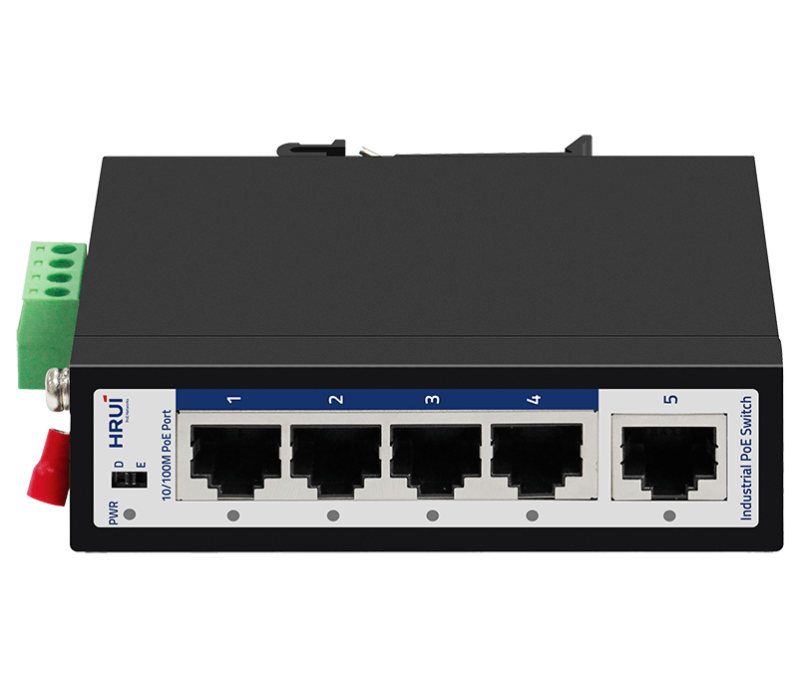
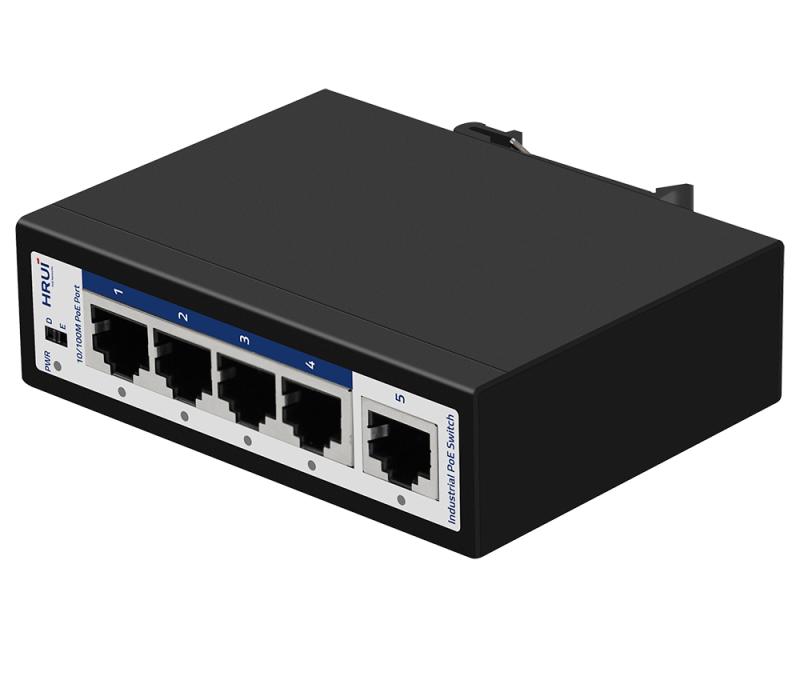
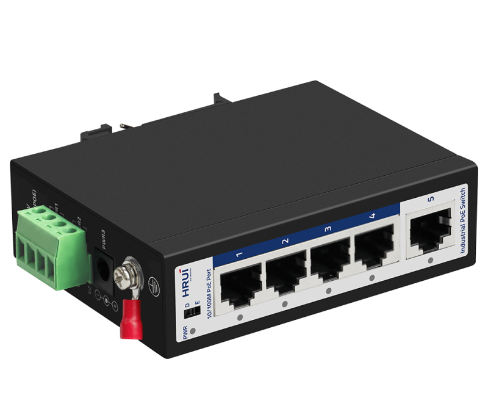
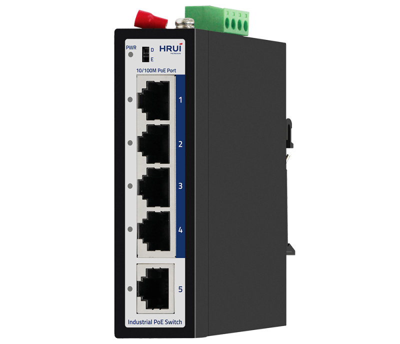
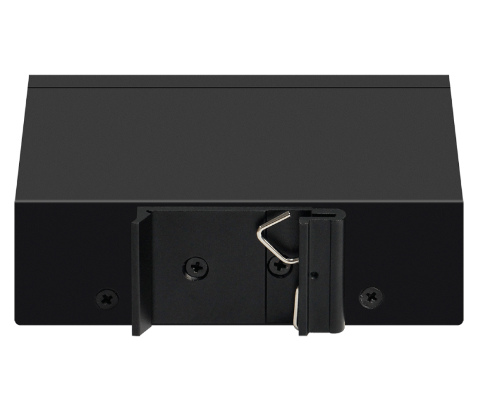

# HR500-AF-41

> 来源：<https://www.hruitech.com/industrial-poe-switch/117.html>（抓取 2026-10-21T04:36:37Z；英文原文照录，中文仅为栏目名）  
> 官网描述：Industrial 4-Port 10/100T 802.3af/at PoE + 1-Port 10/100T Ethernet Switch  
> 类目：Industrial PoE Switch（site id 117）  
> 接口：Industrial 4-Port 10/100T 802.3af/at PoE + 1-Port 10/100T Ethernet Switch；PoE 预算 —；交换带宽 —；电源 —

**Brief:** 10/100M intelligent industrial PoE switch, with 4*10/100M PoE ports + 1*10/100M RJ45 ports, IEEE 802.3af/at standard, bandwidth 1Gbps, support port isolation and 250m transmission, IP30 protection, surge 6KV, suitable for -40~75℃ wide temperature environment

## 产品图






## Datasheet
- [HR500_AF_41.pdf](https://www.hruitech.com/web/userfiles/productfile/HR500_AF_41.pdf) （本地：`data/hrui_site_raw/datasheets/HR500_AF_41.pdf`；文本：`data/hrui_site_raw/datasheet_text/HR500_AF_41.txt`）

## Feature and Benefits（原文）
```
HR500-AF-41, a robust industrial Ethernet Power over Ethernet (PoE) switch from our 500 series. This highly reliable switch features four 10/100M PoE ports and one 10/100M Ethernet port. Designed for versatile installation, it supports both DIN-Rail and wall mounting options. With a power supply input range of DC 48-55V, it operates efficiently across an impressive temperature range of -40℃ to +75℃. Meeting industrial environment certification and adhering to FCC and CE standards, the HR500-AF-41 is engineered for uninterrupted performance, ensuring your automation systems run smoothly and reliably.
This industrial PoE switch is ideal for a variety of applications, including wind power, electrical systems, assembly automation, subway passenger information systems (PIS), power SCADA, sewage treatment, metallurgy, intelligent transportation, rail transport, and military engagements. As a green, low-power solution, it contributes to energy efficiency in industrial Ethernet networks.
Product Features:
Port Configuration:
4 x 10/100M PoE ports and 1 x 10/100M Ethernet port for versatile connectivity.
Compliance Standards:
Supports IEEE 802.3, IEEE 802.3u, and IEEE 802.3x standards for reliable networking performance.
Self-Adaptive Ports:
Ethernet ports are self-adaptive, supporting both 10M and 100M speeds automatically.
PoE Standard:
Compatible with IEEE 802.3at (30W) and IEEE 802.3af (15.4W) for flexible power delivery to connected devices.
Industrial-grade Durability:
Built to withstand harsh environments with an operational temperature range of -40°C to +75°C.
Sturdy Construction:
High-strength iron casing for durability, suitable for DIN35 rail installation.
Redundant Power Supply:
Supports redundant power input to ensure continuous operation, complete with anti-reverse protection.
Surge Protection:
Offers robust surge protection with general (6KV) and differential (4KV) ratings; ESD protection up to 15KV (air) and 8KV (contact).
```

## Parameter（规格表逐行）
| 项 | 值 |
|---|---|
| **Technical Parameter** | |
| **I/O Interface** | |
| Power | DC 52V (48～55V) |
| Ethernet | 4* 10/100M PoE Port |
| Ethernet | 1* 10/100M Ethernet Port |
| **Chipset** | |
| Main Chipset | IP175G |
| PoE Chipset | RTL8238B/RTL8234B |
| **Performance** | |
| Bandwidth | 1Gbps |
| Packet Forwarding Rate | 0.744Mpps |
| package cache | 448K |
| MAC Address | 1K |
| Jumbo Frame | 1536bytes |
| Transfer Mode | Store and forward |
| MTBF | 100000 hours |
| **Standard** | |
| Network Protocol | IEEE802.3 (Ethernet) |
| Network Protocol | IEEE802.3u (Fast Ethernet) |
| Network Protocol | IEEE802.3x (Flow Control) |
| PoE Standard | PoE Standard: IEEE802.3af /IEEE802.3at |
| PoE Standard | 15.4 W (IEEE 802.3af) |
| PoE Standard | 30 W (IEEE 802.3at) |
| Industrial Standard | EMI: FCC Part 15 CISPR (EN55032) class A |
| Industrial Standard | EMS: EN61000-4-2 (ESD) |
| Industrial Standard | EN61000-4-4 (EFT) |
| Industrial Standard | EN61000-4-5 (Surge) |
| Network Medium | 10BASE-T: Cat 3, 4, 5 or above UTP(≤100 meter) |
| Network Medium | 100BASE-TX: Cat 5 or above UTP (≤100 meter) |
| **Certificate** | |
| Safety Certificate | CE, FCC, RoHS |
| **Environment Standard** | |
| Working Environment | Working Temperature：-40~75°C |
| Working Environment | Storage Temperature：-40~85°C |
| Working Environment | Working Humidity ：10%~90%，non-condensing |
| Working Environment | Storage Temperature：5%~90%，non-condensing |
| **Physical Features** | |
| Dimension | Product Dimension：100*76.5*30mm |
| Dimension | Package Dimension：175*130*55mm |
| Dimension | N.W：0.29 KG |
| Dimension | G.W：0.38 KG |
| Packaging Info | Carton MEAS：540*290*375mm |
| Packaging Info | Packing Qty：40 PCS |
| Packaging Info | Packing Weight: 16.2 KG |
| Power Voltage | Input Voltage ：DC 48-55 V |
| Power Voltage | Type of input: 4 PIN Industrial Terminal (block V1+V1- V2+ V2-); DC-IN (2.1mm) |
| Power Voltage | (DC 2.1 cannot be used together with V1 and V2) |
| Package List | 1. Industrial Switch：1 PC |
| Package List | 2. User Manual：1 PC |
| Package List | 3. Certification：1 PC |
| Package List | 4. Pull-arm : 1 PC |
| **Indicators** | |
| LED Indicator | PWR (Power Indicate)，1-5 Green LED（Link & Data) |
| PWR（power supply） | On: Power on |
| PWR（power supply） | Off: Power off |
| 1-5 Green LED（Link & Data） | On: Connecting |
| 1-5 Green LED（Link & Data） | Flashing: Data Transmit |
| 1-5 Green LED（Link & Data） | Off: Disconnect |
| Dialing function | D: Default mode |
| Dialing function | E: In the extended mode, ports 1-4 are reduced to 10M and can be extended to 250m |

## Product structure / Application topology（图）
- https://www.hruitech.com/web/userfiles/image/20250103/1735885989256975.png
