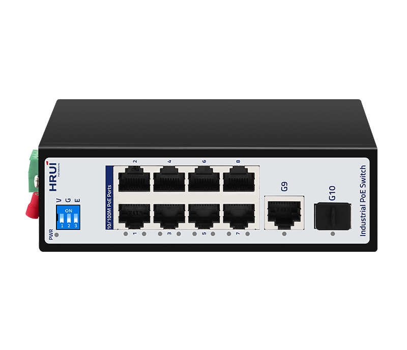
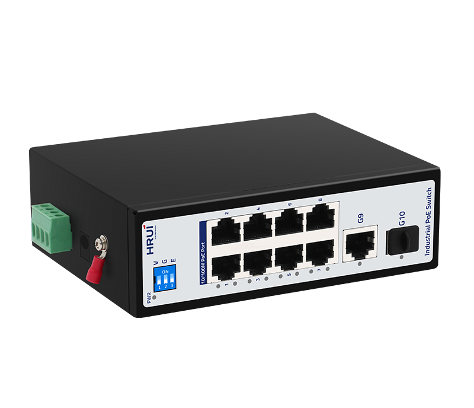
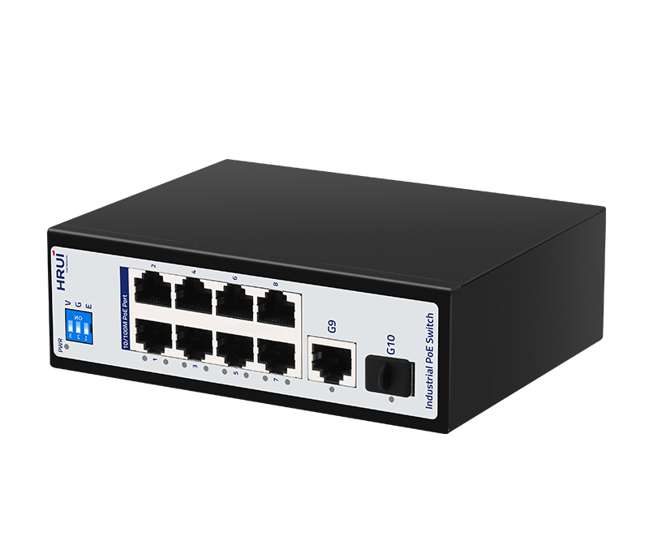
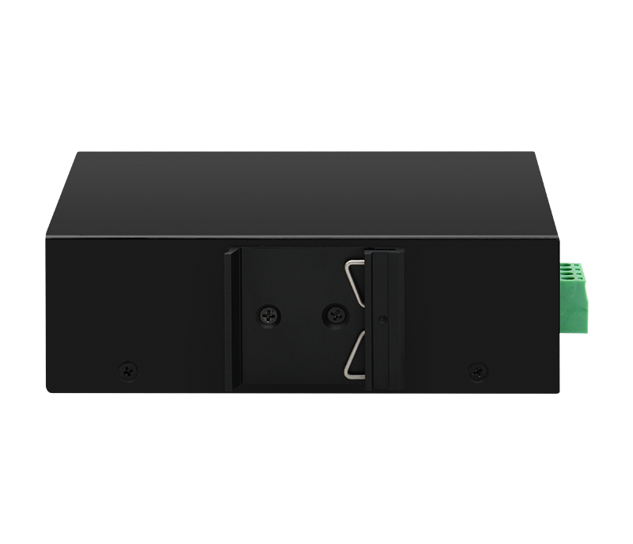

# HR500-AF-811GS

> 来源：<https://www.hruitech.com/industrial-poe-switch/344.html>（抓取 2026-10-21T04:36:24Z；英文原文照录，中文仅为栏目名）  
> 官网描述：Industrial 8-Port 10/100T 802.3af/at PoE + 1-Port 10/100/1000T + 1-Port 1000X SFP Ethernet Switch  
> 类目：Industrial PoE Switch（site id 344）  
> 接口：8*100Mbps PoE ports / 1*1Gbps uplink port / 1*1Gbps SFP port；PoE 预算 According to the adapter；交换带宽 5.6Gbps；电源 DC12~55V / DC48~55V (PoE) / Power wiring: 4 PIN industrial terminals (redundant V1+V1-, V2+V2-)

**Brief:** 4KV Port Surge Protection | 8KV ESD Protection | HiPoE 60W | IP40 | -40~75°C Wide-range Temperature | PoE Watchdog | 250M Long-distance Transmission | Redundant Power Supply

## 产品图





## Datasheet
- [HR500-AF-811GS-28EN-29.pdf](https://www.hruitech.com/web/userfiles/productfile/HR500-AF-811GS-28EN-29.pdf) （本地：`data/hrui_site_raw/datasheets/HR500-AF-811GS-28EN-29.pdf`；文本：`data/hrui_site_raw/datasheet_text/HR500-AF-811GS-28EN-29.txt`）

## Feature and Benefits（原文）
```
HR500-AF-811GS is a 10-Port Industrial PoE Switch with 8×10/100Mbps PoE ports, 1×Gigabit uplink, and 1×Gigabit SFP port. Supporting IEEE 802.3af/at and up to 60W HiPoE on Port 1, it provides reliable power and data transmission for IP cameras, wireless APs, and other PoE devices. PoE Watchdog, VLAN, 250m Extend mode, wide-temperature operation from -40°C to 75°C, and industrial-grade protection make it well suited for surveillance, industrial monitoring, road networks, and other demanding environments.
Product Features:
Port Configuration:
8 × 10/100Mbps PoE ports, 1 × Gigabit RJ45 uplink, and 1 × Gigabit SFP port for flexible network connectivity.
High PoE Support:
Port 1 supports 60W HiPoE for compatible devices.
PoE Standard:
Ports 2–8 support IEEE 802.3af/at PoE for compatible devices.
Extended Transmission:
Supports 250m long-distance PoE for flexible deployment across wide monitoring areas.
Industrial Design:
IP40 enclosure with DIN35 rail installation for durable and efficient cabinet integration.
Wide Temperature Range:
Operates reliably from -40°C to 75°C in harsh or extreme environments.
Redundant Power Input:
Supports redundant power supply with reverse-polarity protection for enhanced power reliability.
Protection:
Provides 4kV common-mode / 2kV differential-mode surge protection and 6kV contact / 8kV air ESD protection.
Certifications:
CE, FCC, and RoHS compliance for international safety and environmental standards.
```

## Parameter（规格表逐行）
| 项 | 值 |
|---|---|
| Description | Specification |
| Model | HR500-AF-811GS |
| Interface | 8*100Mbps PoE ports |
| Interface | 1*1Gbps uplink port |
| Interface | 1*1Gbps SFP port |
| Port Standard | IEEE802.3 (Ethernet) |
| Port Standard | IEEE802.3u (Fast Ethernet) |
| Port Standard | IEEE802.3ab (Gigabit Ethernet) |
| Port Standard | IEEE802.3z (Gigabit Ethernet Fibre Standards) |
| Port Standard | IEEE802.3x (Flow Control) |
| Switching Bandwidth | 5.6Gbps |
| Packet Forwarding Rate | 4.166Mpps |
| Packet Buffer | 4Mbit |
| MAC Address Table | 8K |
| Transmission Method | Store and Forward |
| PoE Standard | IEEE802.3af (15.4W) |
| PoE Standard | IEEE802.3at (30W) |
| PoE Port Output Voltage | DC 48-55V |
| PoE Ports | Port 1 supports HiPoE 60W, Ports 2-8 PoE power output <30W |
| PoE Power Budget | According to the adapter |
| Power Supply | DC12~55V |
| Power Supply | DC48~55V (PoE) |
| Power Supply | Power wiring: 4 PIN industrial terminals (redundant V1+V1-, V2+V2-) |
| Certification | CE, FCC, RoHS |
| Mainboard Power Consumption | 3.88W |
| Structure Information | Product Dimensions: 138*108*44 mm |
| Structure Information | Packaging Dimensions: 245*190*60mm |
| Structure Information | Product Net Weight: 0.5KG |
| Structure Information | Product Gross Weight: 0.63KG (excluding power supply) |
| Packing Information | Carton Dimensions: 520*320*400mm |
| Packing Information | Packing Quantity: 20PCS |
| Packing Information | Packing Weight: 13.66KG |
| Package Contents | Switch 1pcs, Manual 1pcs, Certificate of Inspection 1pcs |
| Fan Quantity | 0 |
| Installation | Desktop, Wall mounting installation, Rail installation |
| Surge Protection | Port Surge: Common mode 4KV, Differential mode 2KV |
| Surge Protection | Electrostatic ESD: Air 8KV, Contact 6KV (Class C) |
| Operating Temperature | -40~75°C |
| Storage Temperature | -40~85°C |
| Operation Humidity | 10%~90%, non condensing |
| Storage Humidity | 5%~95%, non condensing |
| PWR Red LED | On: Powered on |
| PWR Red LED | Off: Powered off |
| Ports 1-8 Green LED | Slow Flashing: 10/100Mbps Link normal |
| Ports 1-8 Green LED | Off: Link blocked |
| Ports 1-8 Green LED | Fast Flashing: Data transmitting |
| Port G9 Green LED | Slow Flashing: 10/100/1000Mbps Link normal |
| Port G9 Green LED | Off: Link blocked |
| Port G9 Green LED | Fast Flashing: Data transmitting |
| Port G10 Green LED | On: 10/100/1000Mbps Link normal |
| Port G10 Green LED | Off: Fiber optic link blocked |
| Port G10 Green LED | Fast Flashing: Data transmitting |
| V/G/E Modes Buttons | V: VLAN mode, ports 1-8 are isolated from each other, communicating with ports 9-10 |
| V/G/E Modes Buttons | G: Normal mode, all ports can communicate with each other, transmission distance is within 100 meters, transmission rate is 10/100Mbps adaptive, ports 1-8 automatically activate the PoE watchdog mode |
| V/G/E Modes Buttons | E: Extend mode, when the PoE port is in Extend mode, ports 1-8 force 10Mbps to extend the transmission distance to 250meters |

## Product structure / Application topology（图）
- https://www.hruitech.com/web/userfiles/image/20260904/1788485669104057.png
