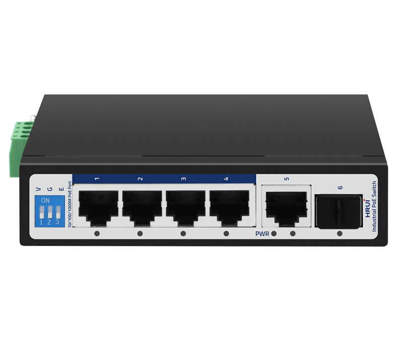
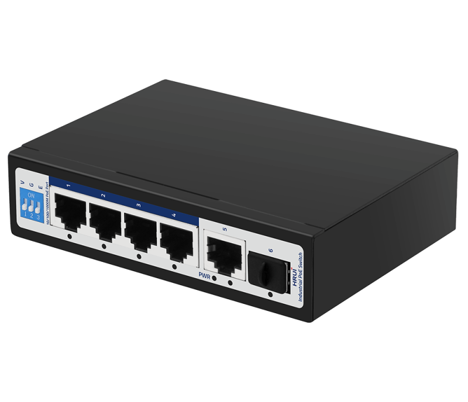
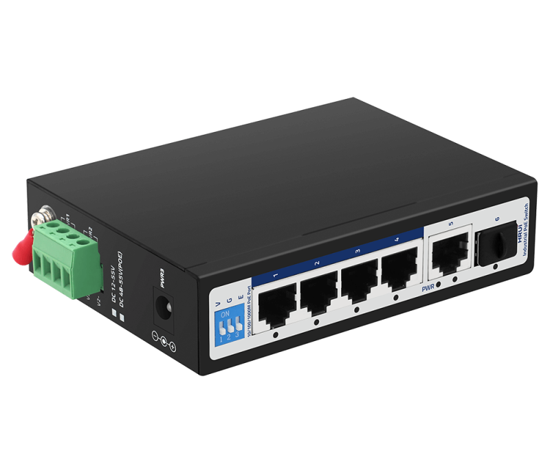
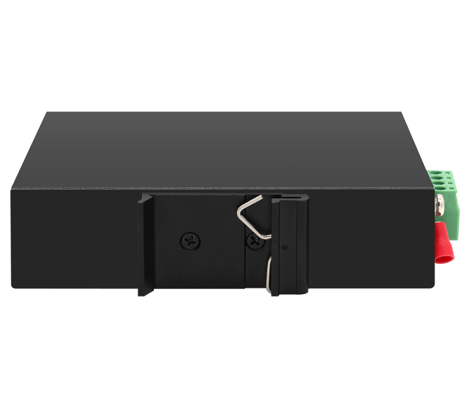

# HR500-AFG-411S

> 来源：<https://www.hruitech.com/industrial-poe-switch/120.html>（抓取 2026-10-21T04:36:36Z；英文原文照录，中文仅为栏目名）  
> 官网描述：Industrial 4-Port 10/100/1000T 802.3af/at PoE + 1-Port 10/100/1000T + 1-Port 1000X SFP Ethernet Switch  
> 类目：Industrial PoE Switch（site id 120）  
> 接口：Industrial 4-Port 10/100/1000T 802.3af/at PoE + 1-Port 10/100/1000T + 1-Port 1000X SFP Ethernet Switch；PoE 预算 —；交换带宽 —；电源 —

**Brief:** Full Gigabit intelligent industrial PoE switch, with 4*Gigabit PoE ports + 1*Gigabit RJ45 port + 1*Gigabit SFP port, IEEE 802.3af/at standard, bandwidth 12Gbps, support port isolation and 250m transmission, IP40 protection, surge 6KV, suitable for -40~85℃ wide temperature environment

## 产品图





## Datasheet
- [HR500_AFG_411S.pdf](https://www.hruitech.com/web/userfiles/productfile/HR500_AFG_411S.pdf) （本地：`data/hrui_site_raw/datasheets/HR500_AFG_411S.pdf`；文本：`data/hrui_site_raw/datasheet_text/HR500_AFG_411S.txt`）

## Feature and Benefits（原文）
```
HR500-AFG-411S Intelligent Industrial PoE Switch—a robust solution designed for demanding environments. This versatile switch features 4 Gigabit PoE ports, 1 Gigabit uplink Ethernet port, and 1 Gigabit SFP port. With the ability to support both DIN-Rail and wall mounting configurations, it offers flexibility in installation. The dual power supply input (DC48-55V) ensures reliable operation, while its wide operating temperature range of -40℃ to +75℃ makes it suitable for extreme conditions.
Certified to meet industrial standards, the HR500-AFG-411S complies with FCC, CE, CCC, and RoHS regulations, guaranteeing safety and reliability. This smart industrial switch is engineered to maintain uninterrupted and stable performance for your automation systems. Its energy-efficient design marks it as a cutting-edge, green solution for your industrial networking needs.
Ideal for various applications, this series of industrial PoE switches are commonly used in industries such as wind energy, electrical power, assembly automation, subway passenger information systems (PIS), power SCADA, sewage treatment, metallurgy, intelligent transportation, rail transportation, and military operations.
Product Features:
Port Configuration:
4*Gigabit PoE ports + 1*Gigabit uplink Ethernet port + 1*Gigabit SFP port.
Robust Temperature Range:
Operating temperature from -40°C to +75°C for superior durability in harsh environments.
Flexible Power Input:
Equipped with a 4PIN industrial terminal and DC2.1 input interface, supporting a wide voltage range from DC48V to DC55V.
Customizable Network Modes:
Three DIP switch settings available for VLAN, Genius, and Extend modes, allowing for tailored network configurations.
Installation Options:
Designed for both rail and wall mount installation to suit various industrial setups.
Enhanced Protection:
Features surge protection up to 4KV and ESD protection with 15KV Air and 8KV Contact ratings, ensuring stability and longevity in demanding environments.
```

## Parameter（规格表逐行）
| 项 | 值 |
|---|---|
| **Specification** | |
| **I/O Interface** | |
| Power | DC 48～55V |
| Ethernet | 4* Gigabit PoE Ports |
| Ethernet | 1* Gigabit Uplink port |
| Ethernet | 1* Gigabit SFP Port |
| **Performance** | |
| Bandwidth | 12Gbps |
| Pack forwarding rate | 8.928Mpps |
| MAC address | 8K |
| Jumbo frame | 9.6Kbytes |
| Transfer mode | Storage & forward |
| MTBF | 100000 Hours |
| **Standards** | |
| Network protocol | IEEE802.3 |
| Network protocol | IEEE802.3i |
| Network protocol | IEEE802.3u |
| Network protocol | IEEE802.3ab |
| Network protocol | IEEE802.3z |
| PoE standard | PoE standard: IEEE802.3af /IEEE802.3at |
| PoE standard | Single port max: 15.4 W (IEEE 802.3af) |
| PoE standard | Single port max: 30 W (IEEE 802.3at) |
| PoE standard | PoE compatibility: IEEE 802.3af/at self-adaptive |
| PoE standard | PoE port output voltage: DC 48-55V |
| PoE standard | PoE power supply wire core:1/2+ ; 3/6- |
| Indsutry standard | EMI: FCC Part 15, CISPR (EN55022) class A |
| Indsutry standard | EMS: EN61000-4-2 (ESD) |
| Indsutry standard | EN61000-4-4 (EFT) |
| Indsutry standard | EN61000-4-5 (Surge) |
| Network Medium | 10BASE-T: Cat3, 4, 5 UTP (≤100 m) |
| Network Medium | 100BASE-TX: Cat5 or above UTP (≤100 m) |
| Network Medium | 1000BASE-TX: Cat5 or above UTP (≤100 m) |
| Optical medium | Multimode fiber: 850nm, 1310nm transmission distance: 550m/2Km |
| Optical medium | Single-mode fiber: 1310nm, 1550nm transmission distance: 20/40/60/80/100/120km |
| **Certificate** | |
| Safety certificate | CE, FCC, RoHS |
| **Environment standard** | |
| Workin environment | Working temperature: -40～75℃ |
| Workin environment | Storage temperature: -40～85℃ |
| Workin environment | Humidity: 5%~95 % (non-condensing) |
| **Physical specification** | |
| Structure size | Product dimension: 120*87*30 mm |
| Structure size | Package dimension: 175*130*55mm |
| Structure size | Product N.W: 0.441 KG |
| Structure size | Product G.W: 0.530 KG (without power) |
| Packaging info | Carton MEAS: 540*290*375mm |
| Packaging info | Packing Qty: 40 PCS |
| Packaging info | Packing Weight: 22.2 KG |
| Power voltage | Voltage input: DC48～55V |
| Power voltage | Power cable :4 PIN Industrial terminal (redundancy V1+V1-, V2+V2-)/ DC 2.1 |
| Power voltage | (DC 2.1 cannot be used together with V1 and V2) |
| Packaging List | 1. Industrial Switch: 1 PC |
| Packaging List | 2. User Manual: 1 PC |
| Packaging List | 3. Certification: 1 PC |
| Packaging List | 4. Pull-arm: 1 PC |
| **Indicator** | |
| LED Indicator | PWR, 1-6 green light |
| PWR | On: Powered on |
| PWR | Off: Powered off |
| 1-6 green light | On: Link normal |
| 1-6 green light | Off: Link off |
| 1-6 green light | Flashing: Link data transmitting |
| DIP function | V, G, E (Up open, down close) |
| V | V: VLAN mode, ports 1 to 4 are isolated and can communicate with ports 5 and 6 |
| G | G: Normal mode |
| E | E: Extend mode, ports 1-4 are reduced to 10M and can be extended to 250m |

## Product structure / Application topology（图）
- https://www.hruitech.com/web/userfiles/image/20250103/1735885485856262.png
