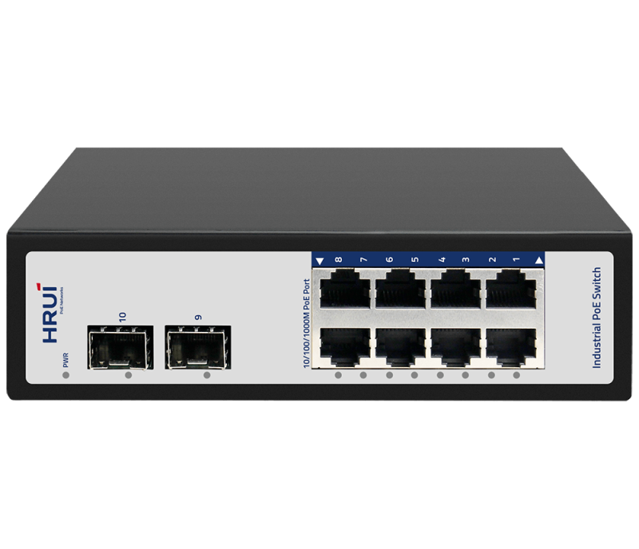
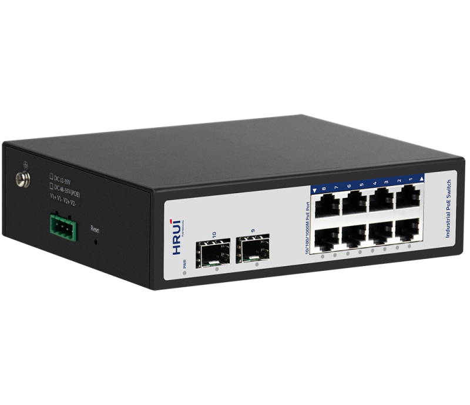
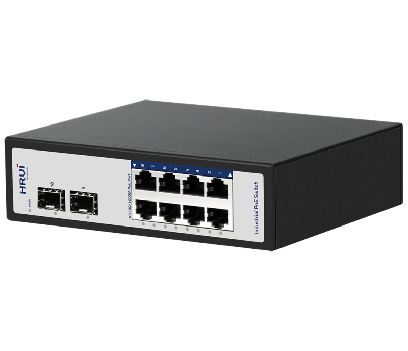
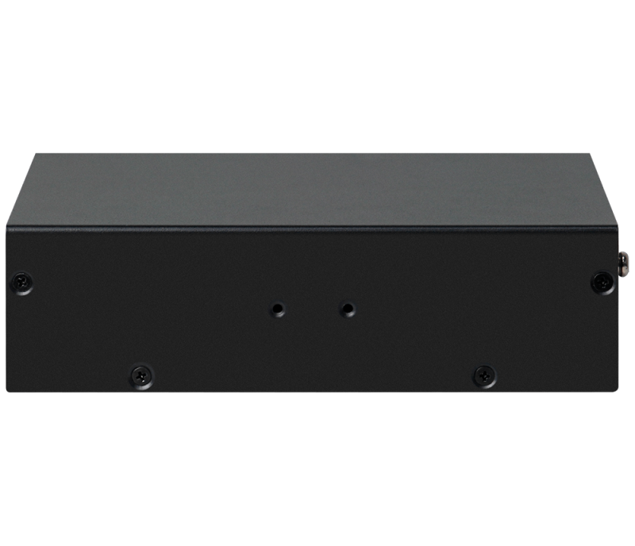

# HR500-AFG-82S

> 来源：<https://www.hruitech.com/industrial-poe-switch/89.html>（抓取 2026-10-21T04:36:42Z；英文原文照录，中文仅为栏目名）  
> 官网描述：Industrial 8-Port 10/100/1000T 802.3af/at PoE + 2-Port 1000X SFP Ethernet Switch  
> 类目：Industrial PoE Switch（site id 89）  
> 接口：Industrial 8-Port 10/100/1000T 802.3af/at PoE + 2-Port 1000X SFP Ethernet Switch；PoE 预算 —；交换带宽 —；电源 —

**Brief:** Full Gigabit industrial PoE switch, 8*PoE ports and 2*SFP slots, with high flexibility and strong anti-interference ability, it is suitable for network engineering projects,such as road transportation, electric energy, miner metallurgy, comprehensive pipe gallery, automatic production and other industries.

## 产品图





## Datasheet
- [Datasheet_HR500_AFG_82S.pdf](https://www.hruitech.com/web/userfiles/productfile/Datasheet_HR500_AFG_82S.pdf) （本地：`data/hrui_site_raw/datasheets/Datasheet_HR500_AFG_82S.pdf`；文本：`data/hrui_site_raw/datasheet_text/Datasheet_HR500_AFG_82S.txt`）

## Feature and Benefits（原文）
```
The HR500-AFG-82S is a robust full Gigabit industrial Power over Ethernet (PoE) switch designed for demanding applications. With 8 PoE ports and 2 SFP slots, this switch offers high flexibility and exceptional anti-interference capabilities, making it an ideal choice for various network engineering projects. Whether in road transportation, electric energy, mining and metallurgy, comprehensive pipe galleries, or automated production, this switch delivers outstanding performance and reliability in industrial environments.
Product Features:
8 Gigabit PoE Ports & 2 SFP Ports:
Supports up to 8 ports delivering 1000 Mbps PoE power, alongside 2 high-speed SFP ports for flexible network connectivity.
IEEE802.3af/at Compliance:
Adheres to PoE standards and provides a maximum power output of 30W per individual PoE port.
Power Protection:
Features a DC input range of 48V to 55V, with built-in overvoltage and overload protection to safeguard against reverse polarity connections.
Reliable Power Supply:
Equipped with a 4-pin industrial terminal for dual redundant power supply, ensuring uninterrupted operation.
Durable Construction:
Encased in a sturdy iron shell with IP40 protection, this switch is built to withstand harsh industrial conditions.
Enhanced EMC Design:
Engineered with an EMC industrial-grade high-strength protection design to minimize electrical noise and interference.
Robust Protection:
Offers 6KV lightning protection and 15KV anti-static protection, ensuring the longevity and safety of your network.
Wide Temperature Range:
Operates reliably in extreme conditions with a temperature range from -40°C to 75°C, suitable for various industrial settings.
Flexible Installation:
Designed for easy mounting with DIN35 rail or wall-mounted options, allowing for versatile deployment in diverse environments.
```

## Parameter（规格表逐行）
| 项 | 值 |
|---|---|
| **Hardware Features & Performance** | |
| Model | HR500-AF G-82S |
| General | Interface / 8 *1000Mbps PoE ports |
| General | Interface / 2* 1000Mbps SFP ports |
| General | Port Standard / IEEE802.3 (Ethernet) |
| General | Port Standard / IEEE802.3u (Fast Ethernet) |
| General | Port Standard / IEEE 802.3ab (1000Mbps Ethernet) |
| General | Port Standard / IEEE 802.3i -10Base-T Access Control Methods and Physical Layer Specifications |
| General | Port Standard / IEEE 802.3z (1000Mbps Ethernet Fiber Standard) |
| Performance | Switching Capacity / 20Gbps |
| Performance | Packet Forwarding Rate / 14.88Mpps |
| Performance | Packet Buffer |
| Performance | MAC Address Table / 4K |
| Performance | Transmission Method / Store and Forward |
| PoE | PoE Standard / IEEE802.3af （15.4W） |
| PoE | PoE Standard / IEEE802.3at （30W） |
| PoE | PoE Port Output Voltage / DC 48～55V |
| PoE | PoE Ports / Port 1-8 PoE power output <30W |
| PoE | PoE Power Budget / According to the power adapter |
| Environment | Surge Protection / Surge Protection: Common mode 4KV, differential mode 2KV （Class B） |
| Environment | Surge Protection / Electrostatic ESD: Air 8KV, Contact 6KV （Class B） |
| Environment | Operating Temperature / -40 ~ 75°C |
| Environment | Storage Temperature / -40～85℃ |
| Environment | Operation Humidity / 10%~90%，non condensing |
| Environment | Storage Humidity / 5%~95%，non condensing |
| Physical | Power Supply / DC 48～55V |
| Physical | Power Supply / Power wiring: 4 PIN industrial terminals ( V1+V1-, V2+V2-） |
| Physical | Mainboard Power Consumption / 5.65W |
| Physical | Structure Information / Product Dimensions: 160* 135*44mm |
| Physical | Structure Information / Packaging Dimensions: 242* 207* 86mm |
| Physical | Structure Information / Product Net Weight: 0.73 KG |
| Physical | Structure Information / Product Gross Weight: 0.90KG |
| Physical | Packing Information / Carton Dimensions: 445* 445* 510mm |
| Physical | Packing Information / Packing Quantity: 20PCS |
| Physical | Packing Information / Packing Weight: 19KG |
| Physical | Packing List / Switch 1pcs, instruction manual 1pcs, certificate of qualification 1pcs, mounting ears 1 pair |
| Physical | Fan Quantity / 0 |
| Physical | Installation / Desktop,wall mounting installation, rail installation |
| Indicator Lights | PWR / On: Powered on |
| Indicator Lights | PWR / Off: Powered off |
| Indicator Lights | 1-10 Green led / On: Link normal |
| Indicator Lights | 1-10 Green led / Off: Link blocked |
| Indicator Lights | 1-10 Green led / Fast Blinking: Data transmitting |
