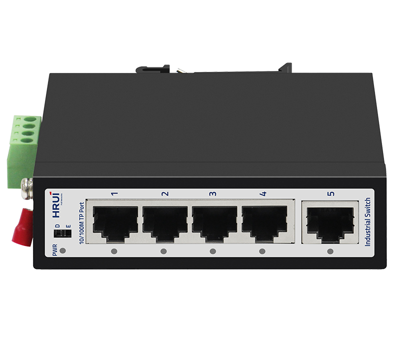
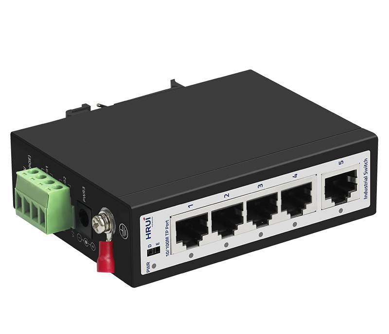
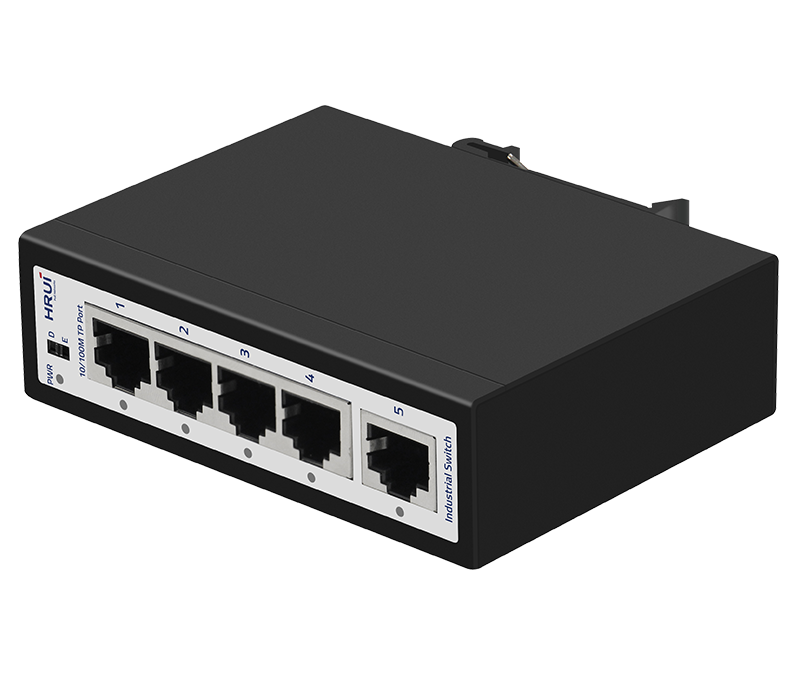
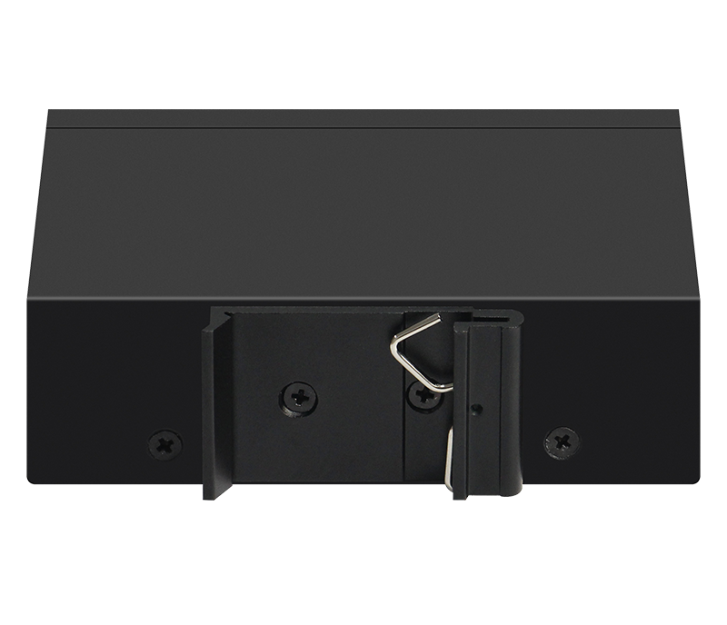

# HR500-SW1060

> 来源：<https://www.hruitech.com/industrial-ethernet-switch/186.html>（抓取 2026-10-21T04:36:47Z；英文原文照录，中文仅为栏目名）  
> 官网描述：Industrial 5-Port 10/100T Ethernet Switch  
> 类目：Industrial Ethernet Switch（site id 186）  
> 接口：5*100Mbps RJ45 ports；PoE 预算 —；交换带宽 1Gbps；电源 DC12~55V / Power wiring: 4 PIN industrial terminals (redundant V1+V1-, V2+V2-)

**Brief:** HR500-SW1050, a robust and reliable 5-port industrial Ethernet switch designed to meet the demanding requirements of industrial environments. Engineered for superior performance and durability, this switch ensures seamless connectivity and data transmission at speeds of up to 100Mbps. With its high-strength cast iron casing and engineered features, the HR500-SW1050 is the ideal choice for businesses looking to optimize their networking capabilities in harsh operating conditions.

## 产品图





## Datasheet
- [HR500_SW1050.pdf](https://www.hruitech.com/web/userfiles/productfile/HR500_SW1050.pdf) （本地：`data/hrui_site_raw/datasheets/HR500_SW1050.pdf`；文本：`data/hrui_site_raw/datasheet_text/HR500_SW1050.txt`）

## Feature and Benefits（原文）
```
HR500-SW1050, a robust and reliable 5-port industrial Ethernet switch designed to meet the demanding requirements of industrial environments. Engineered for superior performance and durability, this switch ensures seamless connectivity and data transmission at speeds of up to 100Mbps. With its high-strength cast iron casing and engineered features, the HR500-SW1050 is the ideal choice for businesses looking to optimize their networking capabilities in harsh operating conditions.
Product Features:
Port Configuration:
4 x 100Mbps Ethernet ports for device connectivity and 1 x 100Mbps uplink RJ45 port for network expansion.
Standards Compliance:
Fully compliant with IEEE 802.3, IEEE 802.3u, and IEEE 802.3x standards, ensuring compatibility with a wide range of devices.
Self-Adaptive Ethernet Ports:
Each port supports 10/100Mbps self-adaptive capabilities, providing flexibility and automatic speed adjustment for optimal performance.
Industrial-Grade Protection:
Designed to operate efficiently in extreme environments with an operational temperature range of -40°C to 75°C, making it suitable for various industrial applications.
Durable Construction:
High-strength cast iron casing provides exceptional protection against physical and environmental damage.
Flexible Installation Options:
Easily mountable on DIN35 rails, supporting a streamlined integration into existing setups.
Enhanced Power Resilience:
Supports redundant power supply connections with anti-reverse protection to ensure continuous operation even in the event of power disruptions.
```

## Parameter（规格表逐行）
| 项 | 值 |
|---|---|
| Description | Specification |
| Model | HR500-SW1050 |
| Interface | 5*100Mbps RJ45 ports |
| Port Standard | IEEE802.3 (Ethernet) |
| Port Standard | IEEE802.3u (Fast Ethernet) |
| Port Standard | IEEE802.3x (Flow Control) |
| Switching Bandwidth | 1Gbps |
| Packet Forwarding Rate | 0.744Mpps |
| Packet Buffer | 448Kbit |
| MAC Address Table | 1K |
| Transmission Method | Store and Forward |
| Power Supply | DC12~55V |
| Power Supply | Power wiring: 4 PIN industrial terminals (redundant V1+V1-, V2+V2-) |
| Mainboard Power Consumption | 1.45W |
| Structure Information | Product Dimensions: 100*76.5*30mm |
| Structure Information | Packaging Dimensions: 175*130*55mm |
| Structure Information | Product Net Weight: 0.27KG |
| Structure Information | Product Gross Weight: 0.36KG |
| Packing Information | Carton Dimensions: 540*290*375mm |
| Packing Information | Packing Quantity: 40PCS |
| Packing Information | Packing Weight: 15.4KG |
| Package Contents | Switch 1pcs, Manual 1pcs, Certificate of Inspection 1pcs |
| Certification | CE, FCC, RoHS |
| Fan Quantity | 0 |
| Installation | Desktop, Wall mounting installation, Rail installation |
| Surge Protection | Port Surge Protection: Common mode 4KV, differential mode 2KV |
| Surge Protection | Electrostatic ESD: Air 8KV, Contact 6KV (Class B) |
| Operating Temperature | -40~75°C |
| Storage Temperature | -40~85°C |
| Operation Humidity | 10%~90%, non condensing |
| Storage Humidity | 5%~95%, non condensing |
| PWR Green LED | On: Powered on |
| PWR Green LED | Off: Powered off |
| Ports 1-5 Green LED | On: 10/100Mbps Link normal |
| Ports 1-5 Green LED | Off: Link blocked |
| Ports 1-5 Green LED | Fast Flashing: Data transmitting |
| Default/Extend Modes Buttons | Default: Normal mode, all ports can communicate with each other, transmission distance is within 100 meters, transmission rate is 10/100Mbps adaptive |
| Default/Extend Modes Buttons | Extend: Extend mode, when the PoE port is in Extend mode, ports 1-4 force 10Mbps to extend the transmission distance to 250meters |

## Product structure / Application topology（图）
- https://www.hruitech.com/web/userfiles/image/20250113/1736748036332647.png
