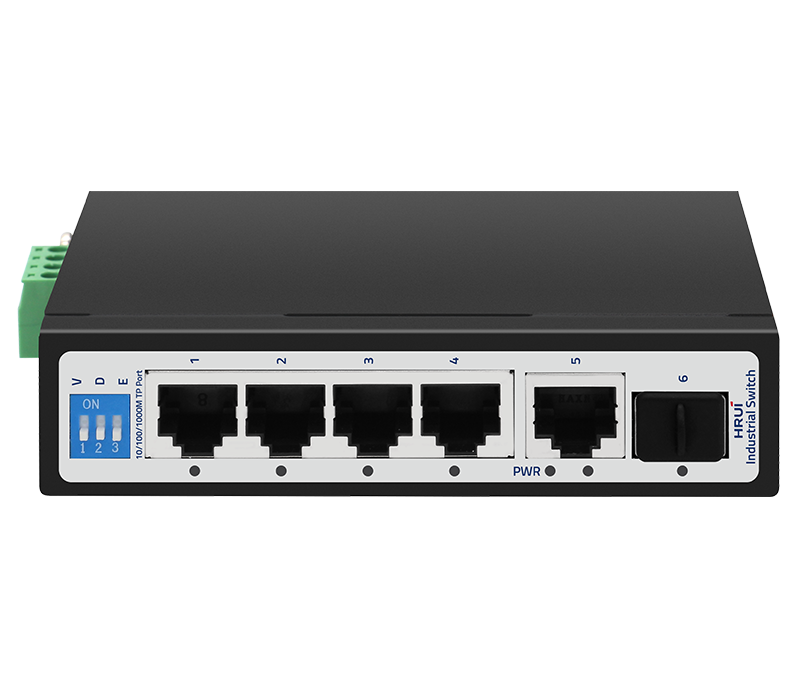
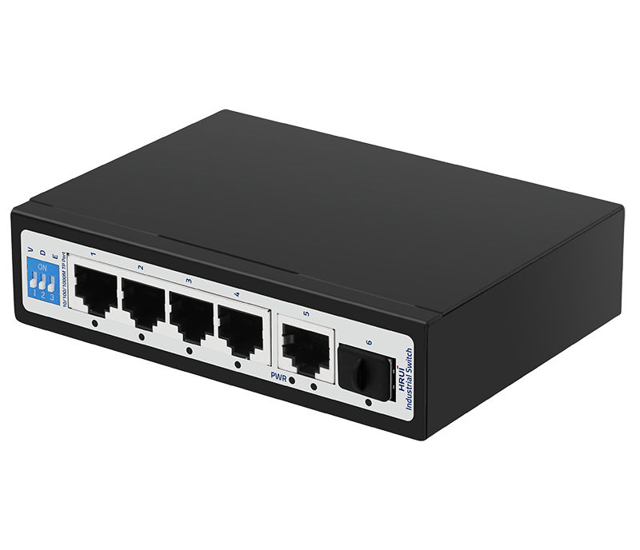
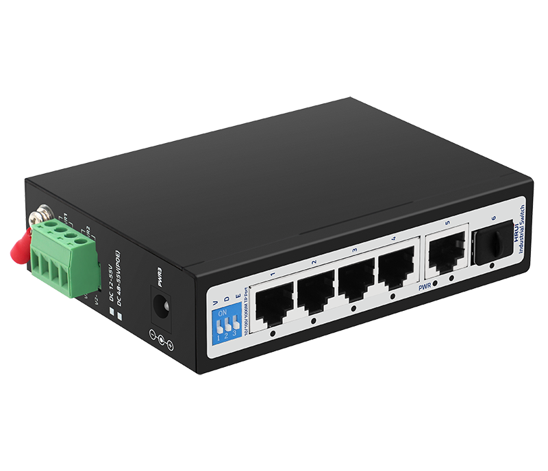
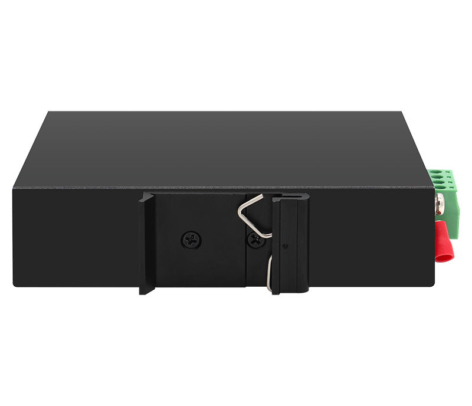

# HR500-SWG10411S

> 来源：<https://www.hruitech.com/industrial-ethernet-switch/187.html>（抓取 2026-10-21T04:36:46Z；英文原文照录，中文仅为栏目名）  
> 官网描述：Industrial 4-Port 10/100/1000T + 1-Port 10/100/1000T + 1-Port 1000X SFP Ethernet Switch  
> 类目：Industrial Ethernet Switch（site id 187）  
> 接口：4*1Gbps RJ45 ports / 1*1Gbps uplink RJ45 port / 1*1Gbps SFP port；PoE 预算 —；交换带宽 12Gbps；电源 DC12~55V / Power wiring: 4 PIN industrial terminals (redundant V1+V1-, V2+V2-)/ DC 2.1(DC 2.1 cannot be combined with V1, V2 used simultaneously)

**Brief:** Full Gigabit intelligent industrial Ethernet switch, with 4*Gigabit RJ45 ports + 1*Gigabit Uplink RJ45 port + 1*Gigabit SFP port, bandwidth 12Gbps, support port isolation, IP40 protection, Surge 6KV, suitable for -40~75℃ wide temperature environment

## 产品图





## Datasheet
- [HR500_SWG10411S.pdf](https://www.hruitech.com/web/userfiles/productfile/HR500_SWG10411S.pdf) （本地：`data/hrui_site_raw/datasheets/HR500_SWG10411S.pdf`；文本：`data/hrui_site_raw/datasheet_text/HR500_SWG10411S.txt`）

## Feature and Benefits（原文）
```
The HR500-SWG10411S is a robust and intelligent industrial Ethernet switch designed for demanding environments. It features an all-Gigabit architecture with 4 Gigabit RJ45 ports, 1 Gigabit uplink RJ45 port, and 1 Gigabit SFP port, providing an impressive bandwidth of 12 Gbps. Engineered for maximum reliability, this switch supports port isolation and boasts IP40 protection, making it highly resistant to dust and harsh conditions. Withstanding extreme temperatures ranging from -40°C to 75°C, and equipped with a 6KV surge protection feature, it is the ideal solution for industrial applications.
Product Features:
Port Configuration:
4x Gigabit RJ45 ports, 1x Gigabit uplink RJ45 port, and 1x Gigabit SFP port.
Wide Operating Temperature:
Reliable performance in environments with temperatures from -40°C to 75°C.
Power Supply Options:
Features a 4-pin industrial terminal and a DC2.1 input interface, supporting a wide voltage input range of DC 12-55V.
Advanced Network Features:
Supports VLAN segmentation, Genius, and Extend modes for improved network performance and scalability.
Flexible Mounting Options:
Designed for ease of installation with rail and wall mounting capabilities, providing adaptability to various industrial settings.
```

## Parameter（规格表逐行）
| 项 | 值 |
|---|---|
| Description | Specification |
| Model | HR500-SWG10411S |
| Interface | 4*1Gbps RJ45 ports |
| Interface | 1*1Gbps uplink RJ45 port |
| Interface | 1*1Gbps SFP port |
| Port Standard | IEEE802.3 (Ethernet) |
| Port Standard | IEEE802.3u (Fast Ethernet) |
| Port Standard | IEEE802.3ab (Gigabit Ethernet) |
| Port Standard | IEEE802.3z (Gigabit Ethernet Fibre Standards) |
| Port Standard | IEEE802.3x (Flow Control) |
| Switching Bandwidth | 12Gbps |
| Packet Forwarding Rate | 8.928Mpps |
| Packet Buffer | 1Mbit |
| MAC Address Table | 2K |
| Transmission Method | Store and Forward |
| Power Supply | DC12~55V |
| Power Supply | Power wiring: 4 PIN industrial terminals (redundant V1+V1-, V2+V2-)/ DC 2.1(DC 2.1 cannot be combined with V1, V2 used simultaneously) |
| Mainboard Power Consumption | 4.96W |
| Structure Information | Product Dimensions: 120*87*30mm |
| Structure Information | Packaging Dimensions: 175*130*55mm |
| Structure Information | Product Net Weight: 0.441KG |
| Structure Information | Product Gross Weight: 0.530KG (excluding power supply) |
| Packing Information | Carton Dimensions: 540*290*375mm |
| Packing Information | Packing Quantity: 40PCS |
| Packing Information | Packing Weight: 22.2KG |
| Package Contents | Switch 1pcs, Manual 1pcs, Certificate of Inspection 1pcs |
| Certification | CE, FCC, RoHS |
| Fan Quantity | 0 |
| Installation | Desktop, Wall mounting installation, Rail installation |
| Surge Protection | Port Surge: Common mode 4KV |
| Surge Protection | Electrostatic ESD: Air 8KV, Contact 6KV (Class C) |
| Operating Temperature | -40~75°C |
| Storage Temperature | -40~85°C |
| Operation Humidity | 10%~90%, non condensing |
| Storage Humidity | 5%~95%, non condensing |
| PWR Green LED | On: Powered on |
| PWR Green LED | Off: Powered off |
| Ports 1-6 Green LED | On: 10/100/1000Mbps Link normal |
| Ports 1-6 Green LED | Off: Link blocked |
| Ports 1-6 Green LED | Fast Flashing: Data transmitting |
| V/G/E Modes LED | V: VLAN mode, ports 1-4 are isolated from each other, communicating with ports 5-6 |
| V/G/E Modes LED | G: Normal mode, all ports can communicate with each other, transmission distance is within 100 meters, transmission rate is 10/100Mbps adaptive |
| V/G/E Modes LED | E: Extend mode, when the PoE port is in Extend mode, ports 1-4 force 10Mbps to extend the transmission distance to 250meters |

## Product structure / Application topology（图）
- https://www.hruitech.com/web/userfiles/image/20250113/1736747210670709.png
