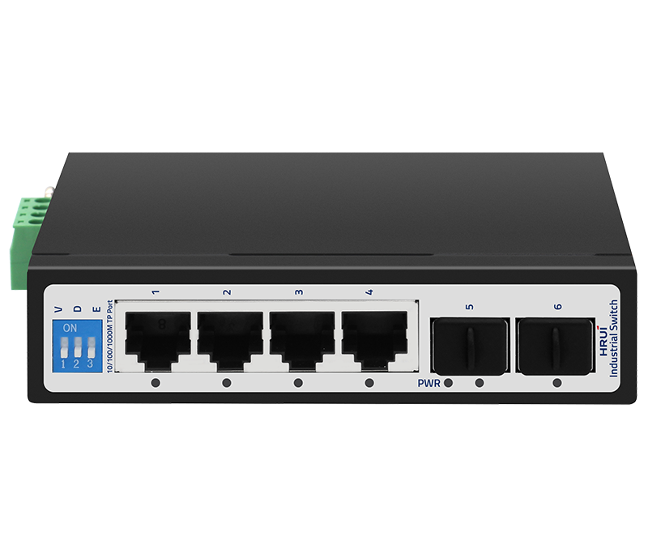
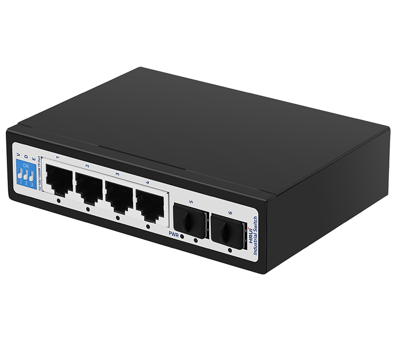
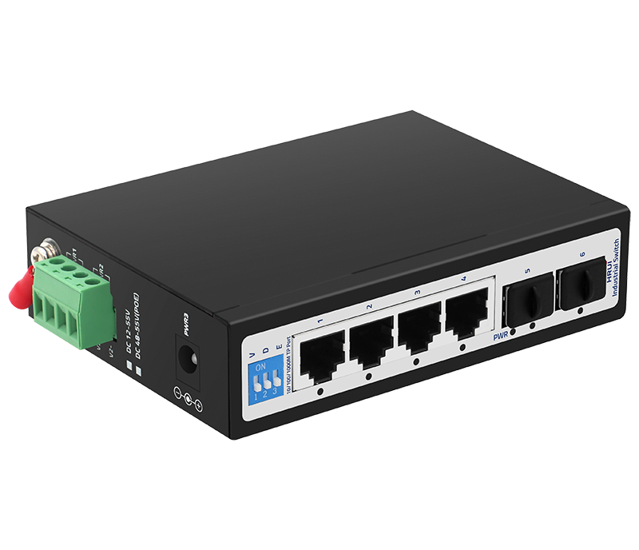
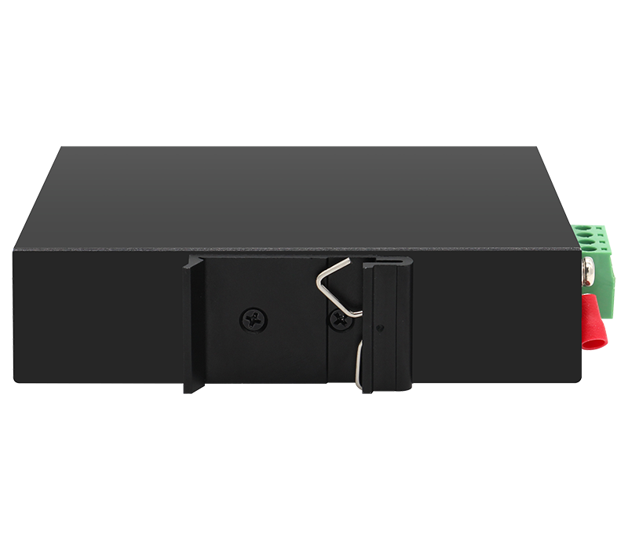

# HR500-SWG1042S

> 来源：<https://www.hruitech.com/industrial-ethernet-switch/264.html>（抓取 2026-10-21T04:36:45Z；英文原文照录，中文仅为栏目名）  
> 官网描述：Industrial 4-Port 10/100/1000T + 2-Port 1000X SFP Ethernet Switch  
> 类目：Industrial Ethernet Switch（site id 264）  
> 接口：4*1Gbps RJ45 ports / 2*1Gbps SFP ports；PoE 预算 —；交换带宽 12Gbps；电源 DC12~55V / Power wiring: 4 PIN industrial terminals (redundant V1+V1-, V2+V2-)/ DC 2.1

**Brief:** The HR500-SWG1042S is a rugged, high-performance 4-Port Gigabit Ethernet Switch designed for industrial applications. With two additional SFP ports for flexible fiber connectivity, this switch ensures exceptional data transmission speeds and reliability, even in the harshest environments. Engineered to operate within a temperature range of -40°C to 75°C, it is built to withstand extreme conditions, making it ideal for factories, outdoor deployments, and other demanding scenarios.

## 产品图





## Datasheet
- [HR500_SWG1042S.pdf](https://www.hruitech.com/web/userfiles/productfile/HR500_SWG1042S.pdf) （本地：`data/hrui_site_raw/datasheets/HR500_SWG1042S.pdf`；文本：`data/hrui_site_raw/datasheet_text/HR500_SWG1042S.txt`）

## Feature and Benefits（原文）
```
The HR500-SWG1042S is a rugged, high-performance 4-Port Gigabit Ethernet Switch designed for industrial applications. With two additional SFP ports for flexible fiber connectivity, this switch ensures exceptional data transmission speeds and reliability, even in the harshest environments. Engineered to operate within a temperature range of -40°C to 75°C, it is built to withstand extreme conditions, making it ideal for factories, outdoor deployments, and other demanding scenarios.
Product Features:
Port Configuration:
4 x 1Gbps RJ45 ports for device connectivity and 2 x 1Gbps SFP ports for fiber optic connections, allowing for long-distance data transmission.
Robust Operating Temperature:
Designed to function in extreme conditions with a wide temperature range of -40°C to 75°C, ensuring reliable performance in various environments.
Flexible Power Options:
Features a 4-pin industrial terminal and a DC2.1 input interface, supporting a wide voltage input range of DC 12V to 55V, accommodating various power supply requirements.
Mounting Flexibility:
Supports both rail and wall mounting installations, making it easy to integrate into any industrial setup.
Advanced Network Management:
Supports VLAN configurations, Default, and Extend modes, providing enhanced traffic management and network segmentation capabilities.
```

## Parameter（规格表逐行）
| 项 | 值 |
|---|---|
| Description | Specification |
| Model | HR500-SWG1042S |
| Interface | 4*1Gbps RJ45 ports |
| Interface | 2*1Gbps SFP ports |
| Port Standard | IEEE802.3 (Ethernet) |
| Port Standard | IEEE802.3u (Fast Ethernet) |
| Port Standard | IEEE802.3ab (Gigabit Ethernet) |
| Port Standard | IEEE802.3z (Gigabit Ethernet Fibre Standards) |
| Port Standard | IEEE802.3x (Flow Control) |
| Switching Bandwidth | 12Gbps |
| Packet Forwarding Rate | 8.928Mpps |
| Packet Buffer | 1Mbit |
| MAC Address Table | 2K |
| Transmission Method | Store and Forward |
| Power Supply | DC12~55V |
| Power Supply | Power wiring: 4 PIN industrial terminals (redundant V1+V1-, V2+V2-)/ DC 2.1 |
| Mainboard Power Consumption | 5.56W |
| Structure Information | Product Dimensions: 120*87*30 mm |
| Structure Information | Packaging Dimensions: 175*130*55mm |
| Structure Information | Product Net Weight: 0.441 KG |
| Structure Information | Product Gross Weight: 0.530 KG (excluding power supply) |
| Packing Information | Carton Dimensions: 540*290*375mm |
| Packing Information | Packing Quantity: 40PCS |
| Packing Information | Packing Weight: 22.2KG |
| Package Contents | Switch 1pcs, Manual 1pcs, Certificate of Inspection 1pcs |
| Certification | CE, FCC, RoHS |
| Fan Quantity | 0 |
| Installation | Desktop, Wall mounting installation, Rail installation |
| Surge Protection | Port Surge: Common mode 4KV, Differential mode 2KV |
| Surge Protection | Electrostatic ESD: Air 8KV, Contact 6KV (Class B) |
| Operating Temperature | -40~75°C |
| Storage Temperature | -40~85°C |
| Operation Humidity | 10%~90%, non condensing |
| Storage Humidity | 5%~95%, non condensing |
| PWR Green LED | On: Powered on |
| PWR Green LED | Off: Powered off |
| Ports 1-6 Green LED | On: 10/100/1000Mbps Link normal |
| Ports 1-6 Green LED | Off: Link blocked |
| Ports 1-6 Green LED | Fast Flashing: Data transmitting |
| V/D/E Modes Buttons | V: VLAN mode, ports 1-4 are isolated from each other, communicating with ports 5-6 |
| V/D/E Modes Buttons | D: Normal mode, all ports can communicate with each other, transmission distance is within 100 meters, transmission rate is 10/100Mbps adaptive |
| V/D/E Modes Buttons | E: Extend mode, when the PoE port is in Extend mode, ports 1-4 force 10Mbps to extend the transmission distance to 250meters |

## Product structure / Application topology（图）
- https://www.hruitech.com/web/userfiles/image/20250113/1736748718792155.png
