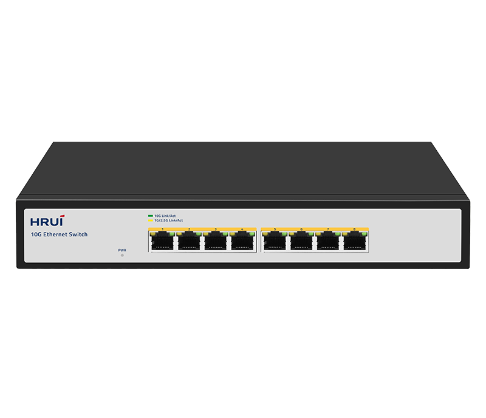
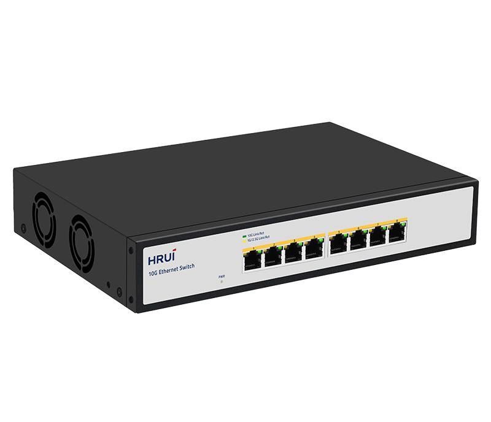
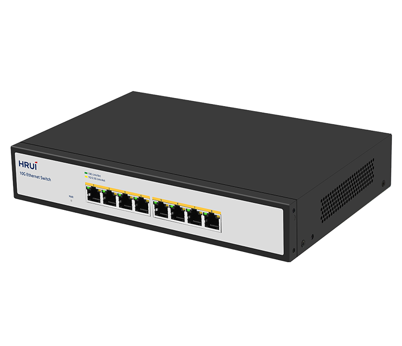
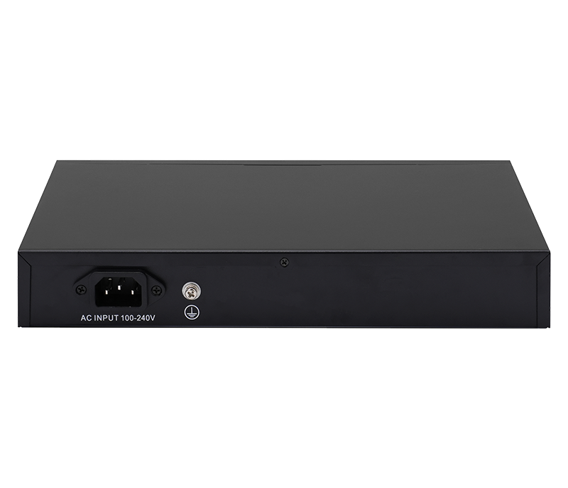

# HR500S-8T

> 来源：<https://www.hruitech.com/ethernet-switch/135.html>（抓取 2026-10-21T04:35:54Z；英文原文照录，中文仅为栏目名）  
> 官网描述：8-Port 10GBASE-T Ethernet Switch   
> 类目：Ethernet Switch（site id 135）  
> 接口：8*10Gbps RJ45 ports；PoE 预算 —；交换带宽 160Gbps；电源 AC 100-240V 50/60Hz / DC 12V 4A

**Brief:** 8 Port Full 10G Ethernet Switch, adopts a high-quality and high-speed network chip solution with a full 10G network interface and smooth line speed forwarding. It is configured with 8* 10G Ethernet ports, which supports 100/1000M/2500M/5G/10G adaptive rates. It adopts a storage and forwarding mechanism, and internally integrates a high capacity cache to ensure that all ports can achieve 10G non-blocking line speed forwarding, and adopt to more emergency situations. With a sturdy and durable and high strength fan steel shell design, the efficient heat dissipation ensures stable operation of the product. The switch can be widely used in security network video monitoring, hotels, campuses, large and medium-sized. enterprise network engineering, and other fields.

## 产品图





## Datasheet
- [HR500S_8T.pdf](https://www.hruitech.com/web/userfiles/productfile/HR500S_8T.pdf) （本地：`data/hrui_site_raw/datasheets/HR500S_8T.pdf`；文本：`data/hrui_site_raw/datasheet_text/HR500S_8T.txt`）

## Feature and Benefits（原文）
```
8-Port Full 10G Ethernet Switch: High-Speed Networking Redefined
The 8-Port Full 10G Ethernet Switch is designed to deliver exceptional performance and reliability for high-demand networking environments. Equipped with a premium, high-speed network chip solution, it features a full 10G network interface that ensures seamless data transmission and line speed forwarding.
Product Features:
Eight 10G Ethernet Ports:
Each port supports adaptive rates of 100M, 1000M, 2500M, 5G, and 10G, making it versatile for varying network requirements.
Advanced Switching Mechanism:
Utilizing a storage and forwarding architecture, the switch integrates a high-capacity cache to guarantee non-blocking line speed forwarding across all ports, even in demanding situations.
Robust Design:
Constructed from high-strength steel and featuring a sturdy shell, this switch is built to withstand the rigors of operational environments. Its efficient heat dissipation system promotes stable and reliable performance, reducing the risk of overheating.
Versatile Applications:
Ideal for a diverse range of applications, including security network video monitoring, hospitality, educational campuses, and the networking needs of large and medium-sized enterprises.
Technical Specifications:
Compliance:
Supports industry standards including IEEE 802.3, IEEE 802.3u, IEEE 802.3ab, IEEE 802.3bz, IEEE 802.3ae, IEEE 802.3.x, and IEEE 802.3az.
Self-Adaptive Ethernet Ports:
Each of the Ethernet ports can automatically negotiate speeds of 100M, 1000M, 2500M, 5G, and 10G.
Port Auto MDI/MDIX Support:
Simplifies connections and minimizes network setup complexity by automatically detecting the required configuration.
Monitoring Capabilities:
Panel indicators provide real-time monitoring of operating conditions and facilitate quick fault analysis.
Flow Control and Surge Protection:
Implements IEEE802.3x standard flow control for full duplex, along with back-pressure standards for half duplex. Additionally, it includes surge protection rated at 6KV for common mode and 8KV air/6KV contact for ESD (Electrostatic Discharge), ensuring durability and safety.
```

## Parameter（规格表逐行）
| 项 | 值 |
|---|---|
| Description | Specification |
| Model | HR500S-8T |
| Interface | 8*10Gbps RJ45 ports |
| Port Standard | IEEE802.3 (Ethernet) |
| Port Standard | IEEE802.3u (Fast Ethernet) |
| Port Standard | IEEE802.3ab (Gigabit Ethernet) |
| Port Standard | IEEE 802.3bz (5G Ethernet) |
| Port Standard | IEEE 802.3z (Gigabit Ethernet) |
| Port Standard | IEEE 802.3ae (10G Ethernet) |
| Port Standard | IEEE802.3x (Flow Control) |
| Switching Bandwidth | 160Gbps |
| Packet Forwarding Rate | 119.04Mpps |
| Packet Buffer | 12Mbit |
| MAC Address Table | 16K |
| Jumbo Frame | Support |
| VLAN | VLAN range 1-4094, maximum active VLAN is 4K |
| Transmission Method | Store and Forward |
| Power Supply | AC 100-240V 50/60Hz |
| Power Supply | DC 12V 4A |
| Mainboard Power Consumption | 33.97W |
| Structure Information | Product Dimensions: 270*181*44mm |
| Structure Information | Packaging Dimensions: 312*262*84mm |
| Structure Information | Product Net Weight: 1.3KG |
| Structure Information | Product Gross Weight: 1.75KG |
| Package Information | Carton Dimensions: 540*435*332mm |
| Package Information | Packing Quantity: 10PCS |
| Package Information | Packing Weight: 18.5KG |
| Package Contents | Switch 1pcs, Power Cord 1pcs, Manual 1pcs, Certificate of Inspection 1pcs |
| Fan Quantity | 2 |
| Installation | Desktop |
| Surge Protection | Port Surge: Common mode 4KV, Differential mode 1KV |
| Surge Protection | Electrostatic ESD: Air 8KV, Contact 6KV |
| Operating Temperature | 0~40°C |
| Storage Temperature | -40~70°C |
| Operation Humidity | 10%~90%, non condensing |
| Storage Humidity | 5%~95%, non condensing |
| PWR Green LED | On: Powered on |
| PWR Green LED | Off: Powered off |
| Ports 1-8 | Green LED on: 10Gbps Link normal |
| Ports 1-8 | Yellow LED on: 1G/2.5Gbps Link normal |
| Ports 1-8 | Off: Link blocked |
| Ports 1-8 | Flashing: Data transmitting |

## Product structure / Application topology（图）
- https://www.hruitech.com/web/userfiles/image/20241230/1735522924103170.png
