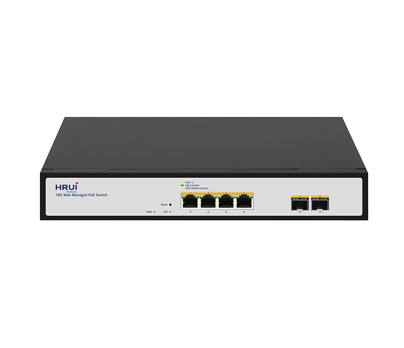
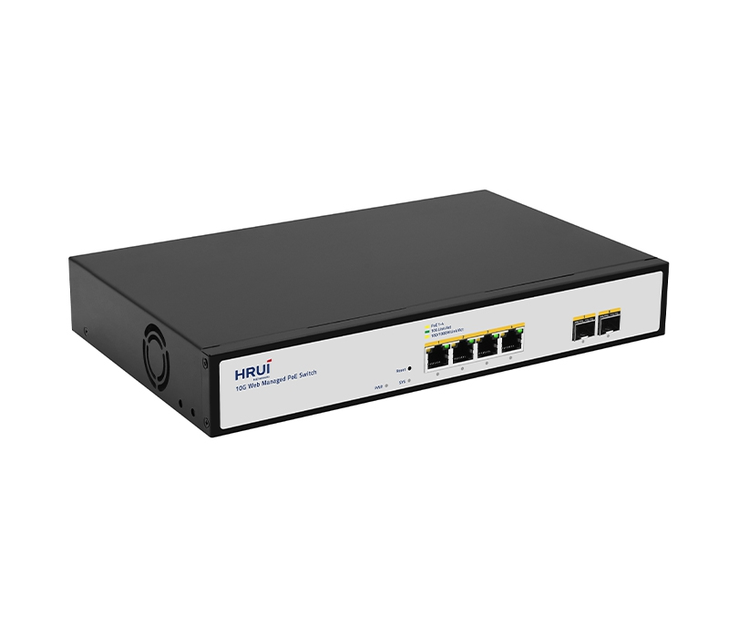
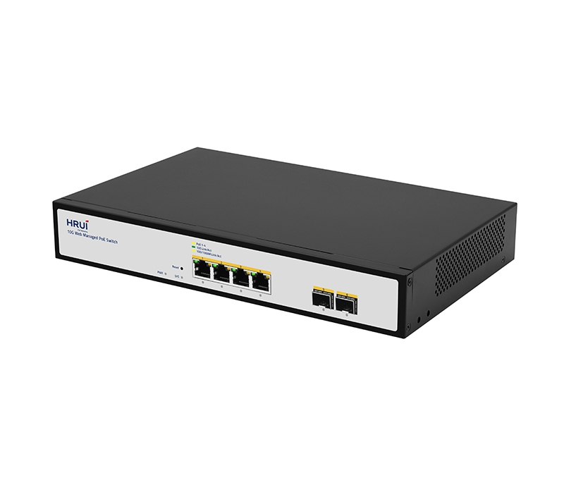
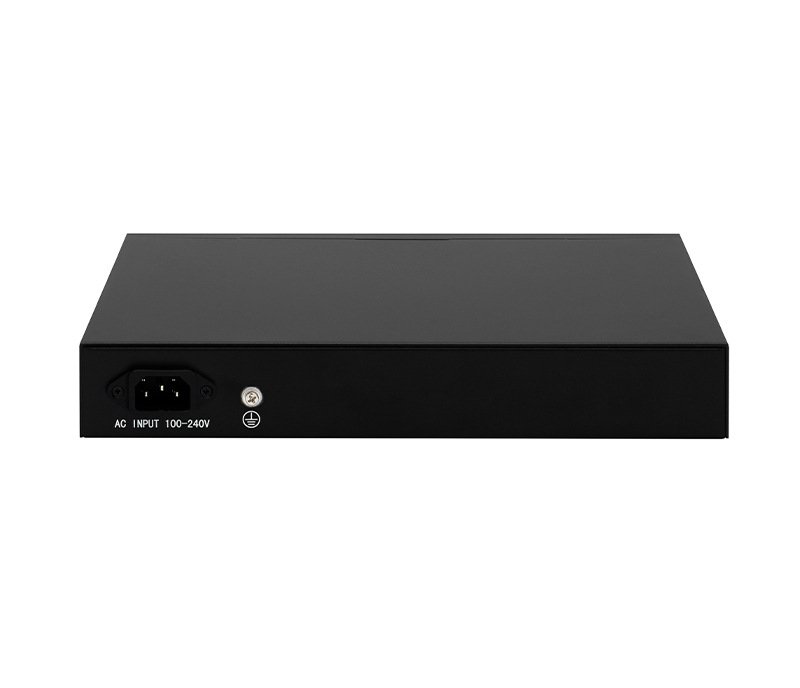

# HR510P-4T2XS-150

> 来源：<https://www.hruitech.com/managed-switch/311.html>（抓取 2026-10-21T04:36:07Z；英文原文照录，中文仅为栏目名）  
> 官网描述：4-Port 10GBASE-T 802.3af/at/bt PoE + 2-Port 10GBASE-X SFP Web Smart Ethernet Switch  
> 类目：Managed Switch（site id 311）  
> 接口：4*10Gbps PoE ports / 2*10Gbps SFP+ ports；PoE 预算 125W；交换带宽 120Gbps；电源 AC 100-240V 50/60Hz / DC 53.5V 2.8A

**Brief:** 4KV Port Surge protection | 8KV ESD protection | BT 90W | Easy Web management | VLAN | ERPS | QoS priority | LACP

## 产品图





## Datasheet
- [HR510P-4T2XS-150-28EN-29.pdf](https://www.hruitech.com/web/userfiles/productfile/HR510P-4T2XS-150-28EN-29.pdf) （本地：`data/hrui_site_raw/datasheets/HR510P-4T2XS-150-28EN-29.pdf`；文本：`data/hrui_site_raw/datasheet_text/HR510P-4T2XS-150-28EN-29.txt`）

## Feature and Benefits（原文）
```
The HR510P-4T2XS-150 is a high-performance 6-port web-managed PoE switch.Designed to meet the needs of modern enterprise network environments. It features 4×10G PoE ports and 2× 10G SFP+ ports, providing seamless high-speed connectivity and robust power delivery.It supports IEEE 802.3bt (90W) and can power demanding devices. This switch features 4KV surge protection, 8KV ESD protection, and supports easy web management, VLANs, QoS, LACP, and ERPS, providing a reliable, scalable, and future-proof network solution for enterprises, campuses, monitoring systems, and smart buildings.
Product Features:
Flexible 10G Connectivity:
Equipped with 4×10G PoE RJ45 ports and 2×10G SFP+ uplink.
Multi-Speed Adaptation:
RJ45 ports support 100M/1G/2.5G/5G/10G; SFP+ ports support 1G/2.5G/10G manual switching.
High-Power PoE:
Ports 1-4 deliver up to 90W per port (IEEE 802.3bt).
Robust Protection:
4KV port surge protection and 8KV ESD resistance.
Web Management:
Intuitive web-based configuration and monitoring.
Auto Cable Detection:
Auto MDI/MDIX on all RJ45 ports.
Visual Status Monitoring:
Front-panel LEDs for real-time status and diagnostics.
```

## Parameter（规格表逐行）
| 项 | 值 |
|---|---|
| Description | Specification |
| Model | HR510P-4T2XS-150 |
| Interface | 4*10Gbps PoE ports |
| Interface | 2*10Gbps SFP+ ports |
| Port Standard | IEEE802.3 (Ethernet) |
| Port Standard | IEEE802.3u (Fast Ethernet) |
| Port Standard | IEEE802.3ab (Gigabit Ethernet) |
| Port Standard | IEEE 802.3bz (5G Ethernet) |
| Port Standard | IEEE 802.3z (Gigabit Ethernet) |
| Port Standard | IEEE 802.3ae (10G Ethernet) |
| Port Standard | IEEE802.3x (Flow Control) |
| Switching Bandwidth | 120Gbps |
| Packet Forwarding Rate | 89.28Mpps |
| Packet Buffer | 12Mbit |
| MAC Address Table | 16K |
| VLAN | VLAN range 1-4094, maximum active VLAN is 4K |
| Jumbo Frame | 12KBytes |
| Transmission Method | Store and Forward |
| PoE Standard | IEEE802.3af (15.4W) |
| PoE Standard | IEEE802.3at (30W) |
| PoE Standard | IEEE802.3bt (90W) |
| PoE Port Output Voltage | DC 44-57V |
| PoE Ports | Ports 1-4 support BT90W power supply |
| PoE Power Budget | 125W |
| Surge Protection | Port Surge: Common mode 4KV, Differential mode 2KV(Class A) |
| Surge Protection | Electrostatic ESD: Air 8KV, Contact 6KV(Class B) |
| Operating Temperature | 0~40°C |
| Storage Temperature | -40~70°C |
| Operation Humidity | 10%~90%, non condensing |
| Storage Humidity | 5%~95%, non condensing |
| Power Supply | AC 100-240V 50/60Hz |
| Power Supply | DC 53.5V 2.8A |
| Mainboard Power Consumption | 24.3W |
| Structure Information | Product Dimensions: 290*200*44mm |
| Structure Information | Packaging Dimensions: 370*290*85mm |
| Structure Information | Product Net Weight: 1.58KG |
| Structure Information | Product Gross Weight: 2.12KG |
| Packing Information | Carton Dimensions: 445*310*390mm |
| Packing Information | Packing Quantity: 5PCS |
| Packing Information | Packing Weight: 11.06KG |
| Package Contents | Switch 1pcs, Power Cord 1pcs, Manual 1pcs, Certificate of Inspection 1pcs, Rack-mounting kit 1 pair |
| Fan Quantity | 1 |
| Installation | Desktop, Rack-mounting |
| PWR Green LED | On: Powered on |
| PWR Green LED | Off: Powered off |
| SYS Green LED | On: The system is normal |
| SYS Green LED | Flashing: System startup in progress |
| Ports 1-4 | Green LED on: 10Gbps Link normal |
| Ports 1-4 | Yellow LED on: 100M/1G/2.5/5Gbps Link normal |
| Ports 1-4 | Off: Link blocked |
| Ports 1-4 | Flashing: Data transmitting |
| Ports 5-6 | Green LED on: 10Gbps Link normal |
| Ports 5-6 | Yellow LED on: 1G/2.5Gbps Link normal |
| Ports 5-6 | Off: Link blocked |
| Ports 5-6 | Flashing: Data transmitting |
| PoE Yellow LED | On: PoE powered on |
| PoE Yellow LED | Off: PoE powered off |
| Reset | Long press for 6 seconds to restore factory settings |
| **L2 Function** | |
| Port | Port Switch configuration |
| Port | Port Description |
| Port | Port Speed configuration |
| Port | Port Duplex configuration |
| Port | Port Flow Control configuration |
| Port | EEE |
| Port | Jumbo Frame |
| Link Aggregation | Support load balance policy; Base on MAC and IP-MAC |
| Link Aggregation | Static and Dynamic Group |
| Link Aggregation | LACP |
| Link Aggregation | Up to 8 groups |
| Storm Control | Boardcast suppression |
| Storm Control | Unknown Multicast |
| Storm Control | Unknown Unicast |
| Port Mirroring | One to one monitor |
| Port Mirroring | Many to one monitor |
| Port Mirroring | Ingress/Egress/Both |
| Port Mirroring | Up to 4 session groups |
| Port Security | MAC Address Constraints |
| Port Security | Protect/Restrict/Shutdown |
| Port Isolation | Support |
| Port Rate-limit | Support |
| VLAN | Access/Trunk/Hybrid |
| VLAN | VLAN Tunnel (Q-in-Q Tunnel) |
| VLAN | VLAN range 1-4094, maximum active VLAN is 4K |
| MAC Address | Filtering MAC Address |
| MAC Address | Static MAC address |
| Spanning Tree Protocol | STP/RSTP/MSTP |
| Spanning Tree Protocol | BPDU Filter |
| Spanning Tree Protocol | BPDU Guard |
| Spanning Tree Protocol | Edge Port |
| LLDP | LLDP |
| LLDP | LLDP MED |
| Multicast | IGMP Snooping |
| Multicast | Router Port |
| Multicast | Static IGMP group address |
| Multicast | IGMP V1/V2/V3 |
| QoS | Traffic classification, Supporting SP and WRR scheduling |
| QoS | Port Priority |
| QoS | 802.1P Priority |
| QoS | IP DSCP Priority |
| QoS | Priority Remarking |
| QoS | Support up to 8 queues per port |
| ERPS | Main Ring |
| **PoE** | |
| PoE Configuration | PoE Temperature |
| PoE Configuration | PoE Type/Level/Power/Voltage/Current |
| PoE Configuration | PoE Switch |
| PoE Configuration | PoE Watchdog |
| PoE Configuration | PoE power AF/AT adaptation |
| PoE Configuration | IEEE 802.3bt,compatible with IEEE 802.3af/802.3at PoE |
| **Services** | |
| Access Protocol | HTTP |
| Access Protocol | Session Timeout |
| Security | DHCP Snooping |
| **Diagnostics** | |
| Copper Test | Support |
| Ping | Support |
| **Equipment Management** | |
| Manager Access | HTTP |
| Manager Access | SNMP |
| Time Synchronization | SNTP |
| Time Synchronization | Manual Time |
| Loopback-detection | Support |
| Manager IP | Static Address |
| Manager IP | Manager VLAN |
| Manager IP | DNS |
| Manager IP | DHCP Client |
| SNMP | V1/V2C/V3 |
| SNMP | Community |
| SNMP | V3 User |
| SNMP | Group |
| SNMP | Trap Host |
| SNMP MIB | RFC 1213 MIB-II |
| SNMP MIB | RFC 1643 Ethernet MIB |
| SNMP MIB | RFC 2863 Interface MIB |
| User Management | Support |
| Firmware Management | Firmware upgrade |
| Configuration Management | Upload/Backup Configuration |
| Save | Support |
| Restart | Support |
| Factory Defaults | Support |
| **Standard Compliance** | |
| **IEEE 802.3x flow control and back pressure** | |
| **IEEE 802.3ad port trunk with LACP** | |
| **IEEE 802.1D Spanning Tree Protocol** | |
| **IEEE 802.1w Rapid Spanning Tree Protocol** | |
| **IEEE 802.1p Class of Service** | |
| **IEEE 802.1Q VLAN tagging** | |
| **IEEE 802.1ab LLDP** | |
| **IEEE 802.3af Power over Ethernet** | |
| **IEEE 802.3at Power over Ethernet Plus** | |
| **IEEE 802.3bt PoE++ Power over Ethernet Plus Plus** | |
| **RFC 768 UDP** | |
| **RFC 793 TFTP** | |
| **RFC 791 IP** | |
| **RFC 792 ICMP** | |
| **RFC 2068 HTTP** | |
| **RFC 1112 IGMP v1** | |
| **RFC 2236 IGMP v2** | |
| **RFC 3376 IGMP v3** | |

## Product structure / Application topology（图）
- https://www.hruitech.com/web/userfiles/image/20251121/1763721452997256.jpg
