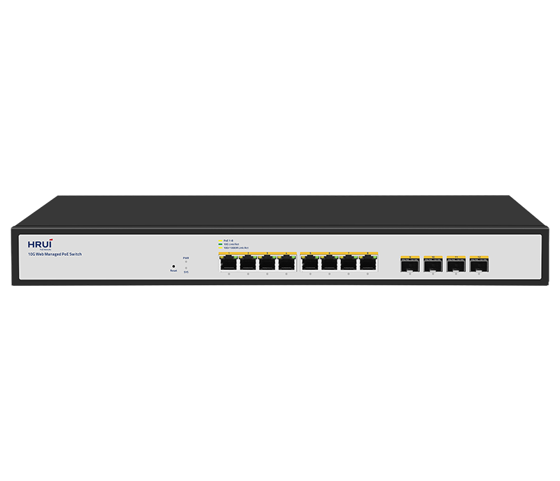
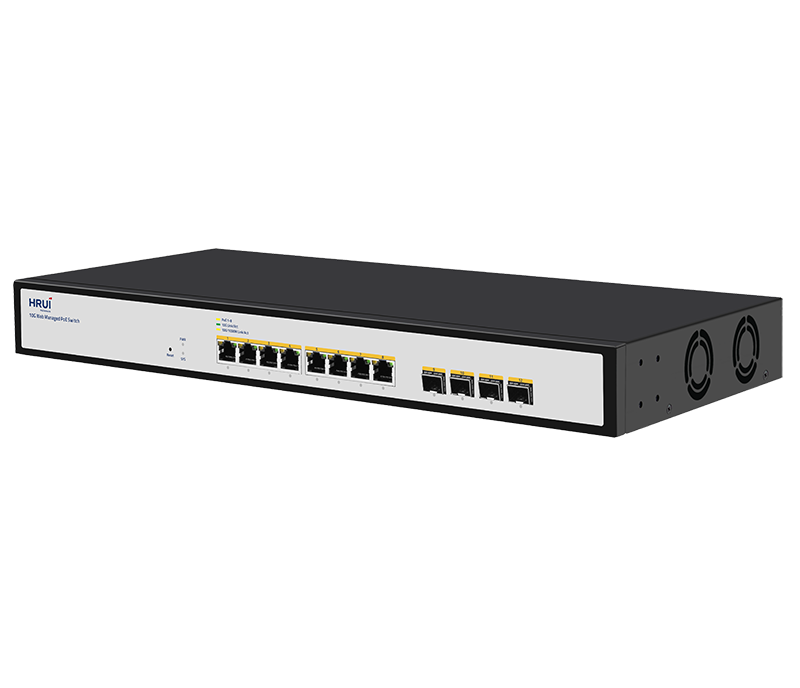
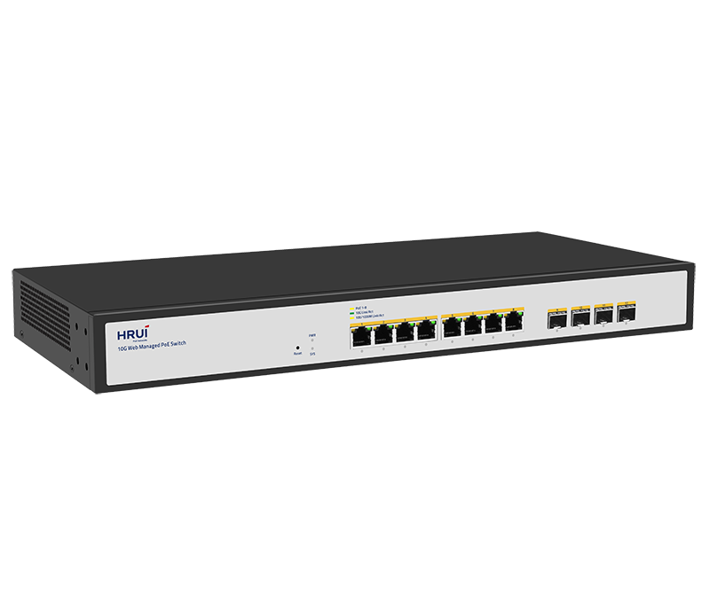
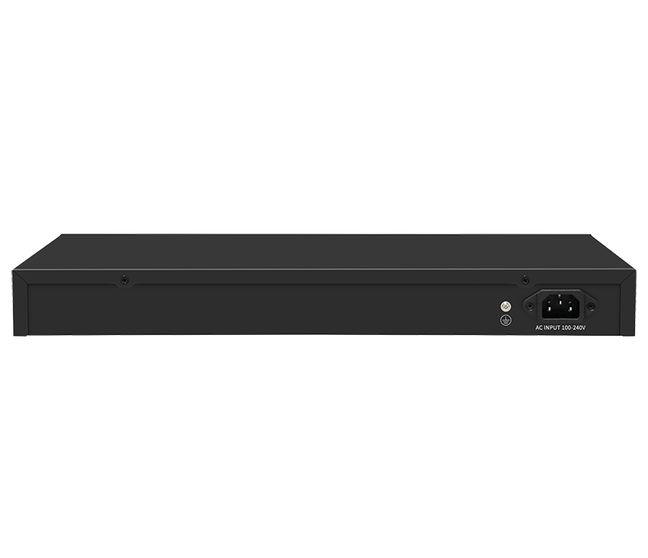

# HR510P-8T4XS-260

> 来源：<https://www.hruitech.com/managed-switch/263.html>（抓取 2026-10-21T04:36:08Z；英文原文照录，中文仅为栏目名）  
> 官网描述：Layer3 8-Port 10GBASE-T 802.3bt PoE and 4-Port 10G SFP+ Managed Switch  
> 类目：Managed Switch（site id 263）  
> 接口：8*10Gbps PoE ports / 4*10Gbps SFP+ ports；PoE 预算 200W；交换带宽 240Gbps；电源 AC 100-240V 50/60Hz / DC 54V3.7A &12V5A

**Brief:** The HR510P-8T4XS-260 is a powerful 12-port web-managed Ethernet switch designed to meet the demanding requirements of modern network environments. With eight 10Gbps Power over Ethernet (PoE) ports and four 10Gbps SFP+ ports, this switch provides exceptional performance and flexibility for your network infrastructure. Ideal for businesses seeking reliable high-speed connectivity, the HR510P-8T4XS-260 simplifies network management while providing robust features for optimal data flow and power delivery.

## 产品图





## Datasheet
- [HR510P_8T4XS_260.pdf](https://www.hruitech.com/web/userfiles/productfile/HR510P_8T4XS_260.pdf) （本地：`data/hrui_site_raw/datasheets/HR510P_8T4XS_260.pdf`；文本：`data/hrui_site_raw/datasheet_text/HR510P_8T4XS_260.txt`）

## Feature and Benefits（原文）
```
The HR510P-8T4XS-260 is a powerful 12-port web-managed Ethernet switch designed to meet the demanding requirements of modern network environments. With eight 10Gbps Power over Ethernet (PoE) ports and four 10Gbps SFP+ ports, this switch provides exceptional performance and flexibility for your network infrastructure. Ideal for businesses seeking reliable high-speed connectivity, the HR510P-8T4XS-260 simplifies network management while providing robust features for optimal data flow and power delivery.
Product Features:
High-Speed Connectivity:
Eight 10Gbps PoE ports and four 10Gbps SFP+ ports for flexible network expansion.
Standards Compliance:
Fully complies with IEEE 802.3, IEEE 802.3u, IEEE 802.3ab, IEEE 802.3bz, IEEE 802.3ae, and IEEE 802.3x standards to ensure seamless interoperability and reliability.
Adaptive Ethernet Ports:
Ethernet ports adapt automatically to support multiple speeds: 100M, 1G, 2.5G, 5G, and 10G, accommodating various networking environments without the need for manual configuration.
Automatic Port Flipping:
Features Auto MDI/MDIX for seamless connectivity, eliminating the need for crossover cables.
Intuitive Monitoring:
On-panel LED indicator lights provide real-time monitoring of each port's status, assisting in quick fault diagnosis and assessment.
Advanced Flow Control:
Implements IEEE 802.3x standard for full duplex and backpressure for half duplex, ensuring smooth data transmission and minimized packet loss.
Quality of Service (QoS) Support:
Prioritize critical data traffic to ensure bandwidth availability for important applications, enhancing overall network efficiency.
Web Management Interface:
User-friendly web management capability allows for easy configuration and monitoring, giving network administrators full control over their network environment.
```

## Parameter（规格表逐行）
| 项 | 值 |
|---|---|
| Description | Specification |
| Model | HR510P-8T4XS-260 |
| Interface | 8*10Gbps PoE ports |
| Interface | 4*10Gbps SFP+ ports |
| Port Standard | IEEE802.3 (Ethernet) |
| Port Standard | IEEE802.3u (Fast Ethernet) |
| Port Standard | IEEE802.3ab (Gigabit Ethernet) |
| Port Standard | IEEE 802.3bz (5G Ethernet) |
| Port Standard | IEEE 802.3z (Gigabit Ethernet) |
| Port Standard | IEEE 802.3ae (10G Ethernet) |
| Port Standard | IEEE802.3x (Flow Control) |
| Switching Bandwidth | 240Gbps |
| Packet Forwarding Rate | 178.56Mpps |
| Packet Buffer | 16Mbit |
| MAC Address Table | 32K |
| VLAN | VLAN range 1-4094, maximum active VLAN is 4K |
| Jumbo Frame | Support |
| Transmission Method | Store and Forward |
| PoE Standard | IEEE802.3af (15.4W) |
| PoE Standard | IEEE802.3at (30W) |
| PoE Standard | IEEE802.3bt (90W) |
| PoE Port Output Voltage | DC 44-57V |
| PoE Ports | Ports 1-4 support BT90W power supply |
| PoE Ports | Ports 5-8 PoE power output <30W |
| PoE Power Budget | 200W |
| Surge Protection | Port Surge: Common mode 4KV, Differential mode 1KV |
| Surge Protection | Electrostatic ESD: Air 8KV, Contact 6KV |
| Operating Temperature | 0~40°C |
| Storage Temperature | -40~70°C |
| Operation Humidity | 10%~90%, non condensing |
| Storage Humidity | 5%~95%, non condensing |
| Power Supply | AC 100-240V 50/60Hz |
| Power Supply | DC 54V3.7A &12V5A |
| Mainboard Power Consumption | 48.75W |
| Structure Information | Product Dimensions: 440*204*44mm |
| Structure Information | Packaging Dimensions: 500*290*85mm |
| Structure Information | Product Net Weight: 2.9KG |
| Structure Information | Product Gross Weight: 3.48KG |
| Packing Information | Carton Dimensions: 520*445*310mm |
| Packing Information | Packing Quantity: 5PCS |
| Packing Information | Packing Weight:18.4KG |
| Package Contents | Switch 1pcs, Power Cord 1pcs, Manual 1pcs, Certificate of Inspection 1pcs, Rack-mounted kit 1 pair |
| Fan Quantity | 2 |
| Installation | Desktop, Rack-mounting |
| PWR Green LED | On: Powered on |
| PWR Green LED | Off: Powered off |
| SYS Green LED | On: The system is normal |
| SYS Green LED | Flashing: System startup in progress |
| Ports 1-8 | Green LED on: 10Gbps Link normal |
| Ports 1-8 | Yellow LED on: 1G/2.5Gbps Link normal |
| Ports 1-8 | Off: Link blocked |
| Ports 1-8 | Flashing: Data transmitting |
| Ports 9-12 | Green LED on: 10Gbps Link normal |
| Ports 9-12 | Yellow LED on: 1G/2.5Gbps Link normal |
| Ports 9-12 | Off: Link blocked |
| Ports 9-12 | Flashing: Data transmitting |
| PoE Yellow LED | On: PoE powered on |
| PoE Yellow LED | Off: PoE powered off |
| Reset | Long press for 6 seconds to restore factory settings |
| **Software Features** | |
| **L2 Function** | |
| Port | Port Switch configuration |
| Port | Port Speed configuration |
| Port | Port Duplex configuration |
| Port | Port Flow Control configuration |
| Port | EEE |
| Port | Jumbo Frame |
| Link Aggregation | Support load balance policy; Base on MAC and IP-MAC |
| Link Aggregation | Static and Dynamic Group |
| Link Aggregation | LACP |
| Link Aggregation | Up to 8 groups |
| Storm Control | Boardcast suppression |
| Storm Control | Unknown Multicast |
| Storm Control | Unknown Unicast |
| Port Mirroring | One to one monitor |
| Port Mirroring | Many to one monitor |
| Port Mirroring | Ingress/Egress/Both |
| Port Mirroring | Up to 4 session groups |
| Port Security | MAC Address Constraints |
| Port Security | Protect/Restrict/Shutdown |
| Port Isolation | Support |
| Port Rate-limit | Support |
| VLAN | Access/Trunk/Hybrid |
| VLAN | VLAN Tunnel (Q-in-Q Tunnel) |
| VLAN | VLAN range 1-4094, maximum active VLAN is 4K |
| MAC Address | Filtering MAC Address |
| MAC Address | Static MAC address |
| Spanning Tree Protocol | STP/RSTP/MSTP |
| Spanning Tree Protocol | BPDU Filter |
| Spanning Tree Protocol | BPDU Guard |
| Spanning Tree Protocol | Edge Port |
| LLDP | LLDP |
| LLDP | LLDP MED |
| Multicast | IGMP Snooping |
| Multicast | Router Port |
| Multicast | Static IGMP group address |
| Multicast | IGMP V1/V2/V3 |
| QoS | Traffic classification, Supporting SP and WRR scheduling |
| QoS | Port Priority |
| QoS | 802.1P Priority |
| QoS | IP DSCP Priority |
| QoS | Priority Remarking |
| QoS | Support up to 8 queues per port |
| ERPS | Main Ring |
| **PoE** | |
| PoE Configuration | PoE used power |
| PoE Configuration | PoE Type/Level/Power/Voltage/Current |
| PoE Configuration | PoE Switch |
| PoE Configuration | PoE power AF/AT adaptation |
| PoE Configuration | IEEE 802.3bt,compatible with IEEE 802.3af/802.3at PoE |
| **Services** | |
| Access Protocol | HTTP |
| Access Protocol | Session Timeout |
| Security | DHCP Snooping |
| **Diagnostics** | |
| Copper Test | Support |
| Ping | Support |
| **Equipment Management** | |
| Manager Access | HTTP |
| Manager Access | SNMP |
| Time Synchronization | SNTP |
| Time Synchronization | Manual Time |
| Manager IP | Static Address |
| Manager IP | Manager VLAN |
| Manager IP | DNS |
| Manager IP | DHCP Client |
| SNMP | V1/V2C/V3 |
| SNMP | Community |
| SNMP | V3 User |
| SNMP | Group |
| SNMP | Trap Host |
| SNMP MIB | RFC 1213 MIB-II |
| SNMP MIB | RFC 1643 Ethernet MIB |
| SNMP MIB | RFC 2863 Interface MIB |
| User Management | Support |
| Firmware Management | Firmware upgrade |
| Configuration Management | Upload/Backup Configuration |
| Save | Support |
| Restart | Support |
| Factory Defaults | Support |
| **Standard Compliance** | |
| **IEEE 802.3x flow control and back pressure** | |
| **IEEE 802.3ad port trunk with LACP** | |
| **IEEE 802.1D Spanning Tree Protocol** | |
| **IEEE 802.1w Rapid Spanning Tree Protocol** | |
| **IEEE 802.1p Class of Service** | |
| **IEEE 802.1Q VLAN tagging** | |
| **RFC 768 UDP** | |
| **RFC 793 TFTP** | |
| **RFC 791 IP** | |
| **RFC 792 ICMP** | |
| **RFC 2068 HTTP** | |
| **RFC 1112 IGMP v1** | |
| **RFC 2236 IGMP v2** | |
| **RFC 3376 IGMP v3** | |

## Product structure / Application topology（图）
- https://www.hruitech.com/web/userfiles/image/20250107/1736216451875219.png
