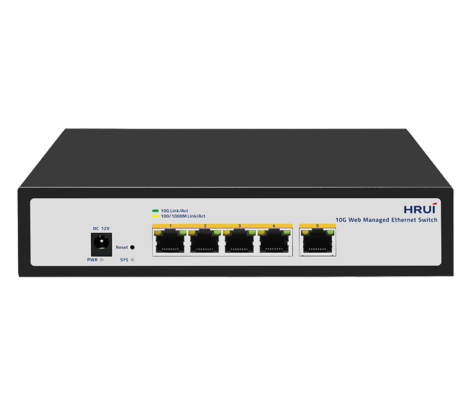
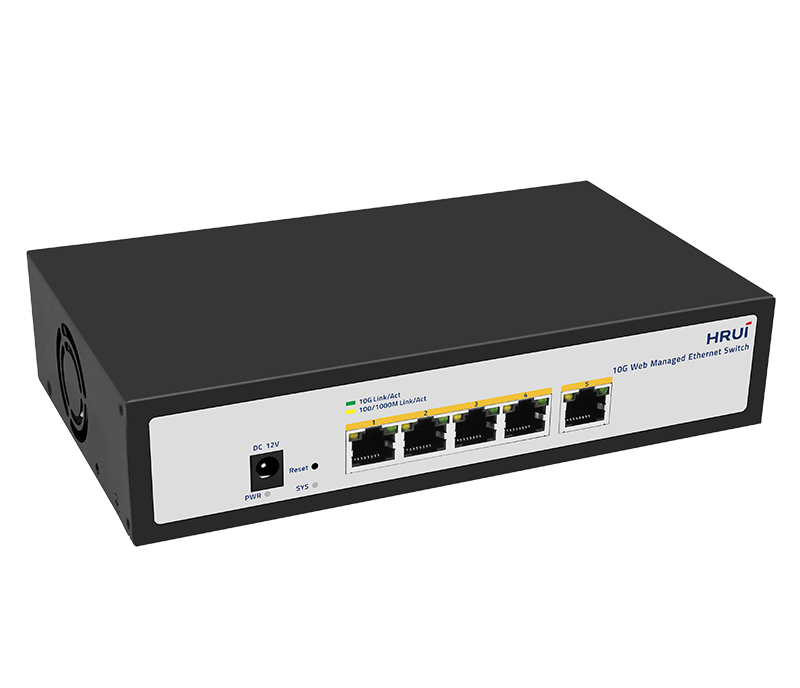
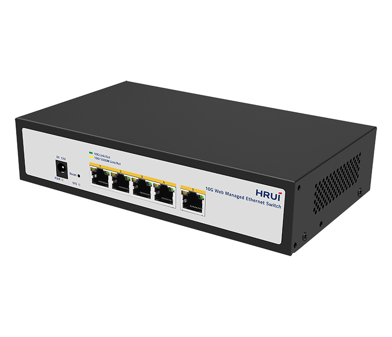

# HR510S-5T

> 来源：<https://www.hruitech.com/managed-switch/81.html>（抓取 2026-10-21T03:47:36Z；英文原文照录，中文仅为栏目名）  
> 官网描述：5-Port 10GBASE-T Web Managed Switch  
> 类目：Managed Switch（site id 81）  
> 接口：5* 10G RJ45 ports；PoE 预算 —；交换带宽 —；电源 AC100-240V 50/60Hz / DC12V 2A

**Brief:** The HR510S-5T is a high-performance, web-managed Ethernet switch that offers advanced network management features and unparalleled connectivity. With its compact design and robust functionality, this switch is perfect for small to medium-sized businesses, data centers, and enterprise networks.

## 产品图





## Datasheet
- [20240828161606122.pdf](https://www.hruitech.com/web/userfiles/productfile/20240828161606122.pdf) （本地：`data/hrui_site_raw/datasheets/20240828161606122.pdf`；文本：`data/hrui_site_raw/datasheet_text/20240828161606122.txt`）

## Feature and Benefits（原文）
```
The HR510S-5T is a high-performance, web-managed Ethernet switch that offers advanced network management features and unparalleled connectivity. With its compact design and robust functionality, this switch is perfect for small to medium-sized businesses, data centers, and enterprise networks.
Product Features:
Robust Port Configuration:
Equipped with 5 x 10G RJ45 ports for versatile connectivity options.
Standards Compliance:
Meets IEEE 802.3, IEEE 802.3u, IEEE 802.3ab, IEEE 802.3bz, IEEE 802.3ae, and IEEE 802.3x standards for seamless integration with existing network infrastructure.
Adaptive RJ45 Ports:
Automatically detects and adapts to different speeds (100M/1G/2.5G/5G/10G) and duplex modes (full/half) for optimal performance.
Automatic Port Flipping:
Enhanced connectivity with support for Auto MDI/MDIX, eliminating the need for crossover cables.
Panel Indicators:
Integrated LED indicators provide real-time monitoring of operational status and facilitate quick fault analysis for efficient troubleshooting.
Flow Control Compliance:
Supports IEEE802.3x standard for full duplex flow control and Backpressure standard for half duplex, ensuring smooth data transmission.
Quality of Service (QoS):
Prioritize data packets with advanced QoS features, optimizing network performance for critical applications.
The HRUI 10G Smart Web Managed Switch constitutes a high-performance, intelligent series designed to provide complete 10G RJ-45 ports and SFP+ ports. It facilitates the establishment of high-speed connections between WiFi 7 access points, storage servers, and various other devices. This product is tailored to fulfill the requirements of users necessitating high-performance network connectivity.
The product is simple and convenient to use, plug-and-play, with no configuration required. It provides a rich set of software features, supporting VLAN, port mirroring, traffic control, LACP, QoS, DHCP Snooping, and more, catering to various complex network requirements and enhancing network security, reliability, and scalability. Additionally, the product supports cloud management functionality, allowing for remote maintenance work with management platforms like HRUI Cloud, making network management more convenient and intelligent. Therefore, this switch is particularly suitable for scenarios that require faster network speeds.
10G High-speed Transmission
Provide RJ-45 or SFP+ ports to provide high-speed network connectivity for NAS and access servers, supporting self-negotiation of 10G/5G/2.5G/1G multiple port rates.
High Switching Capacity for High-Load Applications
Enhances performance with increased concurrent connections, faster data transmission, and higher processing capacity, ideal for large-scale networks, ensuring smooth, high-speed, and stable data transmission.
Smart Web Managed Feature to Optimize Your Network Efficiency
The product offers advanced software features, including VLAN, port mirroring, flow control, LACP, QoS, and DHCP Snooping, to cater to diverse network demands and enhance network security, reliability, and scalability.
VLAN
VLAN enables network devices to be grouped by function, department, or region, and isolated into logical networks, enhancing network management flexibility, scalability, and security while simplifying administration and boosting efficiency.
LACP
LACP enables connection to NAS/routers for link aggregation and rate stacking, while also ensuring network availability, reliability, and security through link failover, reducing the risk of network interruptions and data loss.
QoS
Provide different QoS and prioritization for various types of traffic to ensure reliability and performance of critical services while reducing failure rates and network congestion.
DHCP Snooping
Detecting and preventing rogue DHCP servers ensures network security by preventing attacks, ensuring unique IP addresses, and protecting against unauthorized access.
SNMP
Support SNMP protocol for centralized management of network devices, compatible with various management platforms
Unified Management in the Cloud: Accessible, Scalable, and Efficient
Provide cloud-based management for remote equipment monitoring and control, simplifying detection, configuration, deployment, and maintenance to reduce costs and improve efficiency and reliability.
Plug and Play
No configuration is required. Simply plug a device into the network. It automation begins.
Rock-solid Reliability
Support 4KV surge protection against harsh environments.
SPECIFICATIONS
Port Rate: 5*10GE RJ-45
Bandwidth: 100Gbps
Management: Web
Surge Protection: 4KV
Working Temperature: 0℃～40℃
Port Rate: 4*10GE RJ-45 + 2*10G SFP+
Bandwidth: 120Gbps
Management: Web
Surge Protection: 4KV
Working Temperature: 0℃～40℃
```

## Parameter（规格表逐行）
| 项 | 值 |
|---|---|
| Port Rate: 5*10GE RJ-45 Bandwidth: 100Gbps Management: Web Surge Protection: 4KV Working Temperature: 0℃～40℃ | Port Rate: 4*10GE RJ-45 + 2*10G SFP+ Bandwidth: 120Gbps Management: Web Surge Protection: 4KV Working Temperature: 0℃～40℃ |
| Description | Specification |
| Model | HR510S-5T |
| Interface | 5* 10G RJ45 ports |
| Port Standard | IEEE80 2.3 (Ethernet) |
| Port Standard | IEEE802.3u (Fast Ethernet) |
| Port Standard | IEEE802.3ab (Gigabit Ethernet) |
| Port Standard | IEEE 802.3bz (5G Ethernet) |
| Port Standard | IEEE 802.3z (Gigabit Ethernet) |
| Port Standard | IEEE 802.3ae (10 Gigabit Ethernet) |
| Port Standard | IEEE802.3x (Flow Control) |
| Switching Capacity | 100Gbps |
| Packet Forwarding Rate | 74.4Mpps |
| Packet Buffer | 12Mbit |
| MAC Address Table | 16K |
| Jumbo Frame | Support |
| VLAN | VLAN range 1-4094, maximum active VLAN is 4K |
| Transmission Method | Store and Forward |
| Power Supply | AC100-240V 50/60Hz |
| Power Supply | DC12V 2A |
| Mainboard Power Consumption | 10.35W |
| Structure Information | Product Dimensions: 200*118*44mm |
| Structure Information | Packaging Dimensions: 245*190*60mm |
| Structure Information | Product Net Weight: |
| Structure Information | Product Gross Weight: |
| Package Information | Carton Dimensions: 520*320*400mm |
| Package Information | Packing Quantity: 20PCS |
| Package Information | Packing Weight: |
| Package Contents | Switch 1pcs,ac adapter 1pcs,manual 1pcs,certificate of qualification 1pcs |
| Fan Quantity | 1 |
| Installation | Desktop |
| Surge Protection | Surge Protection: Common mode 4KV, differential mode 2KV; |
| Surge Protection | Electrostatic ESD: Air 8KV, Contact 6KV |
| Operating Temperature | 0~40°C |
| Storage Temperature | -40 °C to 70 °C |
| Operation Humidity | 10%~90%，non condensing |
| Storage Humidity | 5%~95%，non condensing |
| PWR | On: Powered on |
| PWR | Off: Powered off |
| SYS | On: The system is normal |
| SYS | Blinking: System startup in progress |
| 1-5 | Green Led On: 10G Link normal |
| 1-5 | Yellow Led On: 100/1000Mbps/2.5Gbps /5Gbps Link normal |
| 1-5 | Off: Link blocked |
| 1-5 | Blinking: Data transmitting |
| RESET | Long press for 6 seconds to restore factory settings |
| **L2 Function** | |
| Port | Port Switch configuration |
| Port | Port Description configuration |
| Port | Port Speed configuration |
| Port | Port Duplex configuration |
| Port | Port Flow Control configuration |
| Port | Jumbo Frame |
| Port | EEE |
| Link Aggregation | Supports load balance policy; Base on MAC and IP-MAC |
| Link Aggregation | Static and Dynamic Group |
| Link Aggregation | LACP |
| Link Aggregation | Up to 8 groups |
| Storm Control | Boardcast suppression |
| Storm Control | Unknown Multicast |
| Storm Control | Unknown Unicast |
| Port Mirroring | One to one monitor |
| Port Mirroring | Many to one monitor |
| Port Mirroring | Ingress/Egress/Both |
| Port Mirroring | Up to 4 session groups |
| Port Security | MAC Address Constraints |
| Port Security | Protect/Restrict/Shutdown |
| Port Isolation | Support |
| Port Rate-limit | Support |
| VLAN | Access/Trunk/Hybrid |
| VLAN | VLAN Tunnel （Q-in-Q Tunnel） |
| VLAN | VLAN range 1-4094, maximum active VLAN is 4K |
| MAC Address | Filtering MAC Address |
| MAC Address | Static MAC address |
| Spanning Tree Protocol | STP/RSTP |
| Spanning Tree Protocol | BPDU Filter |
| Spanning Tree Protocol | BPDU Guard |
| Spanning Tree Protocol | Edge Port |
| Multicast | IGMP Snooping |
| Multicast | Router Port |
| Multicast | Static IGMP Join |
| Multicast | IGMP V1/V2/V3 |
| QoS | Traffic classification, Supporting SP and WRR scheduling |
| QoS | Port Priority |
| QoS | 802.1P Priority |
| QoS | IP DSCP Priority |
| QoS | Priority Remarking |
| QoS | Supports up to 8 queues per port |
| ERPS | Main Ring |
| **Services** | |
| Access Protocol | HTTP |
| Access Protocol | Session Timeout |
| Security | DHCP Snooping |
| **Diagnostics** | |
| Copper Test | Support |
| Ping | Support |
| **Equipment Management** | |
| Manager Acces | HTTP |
| Manager Acces | SNMP |
| Manager IP | Static Address |
| Manager IP | Manager VLAN |
| Manager IP | DNS |
| Manager IP | DHCP Client |
| SNMP | V1/V2C |
| SNMP | Community |
| SNMP | Trap Host |
| SNMP MIB | RFC 1213 MIB-II |
| SNMP MIB | RFC 1643 Ethernet MIB |
| SNMP MIB | RFC 2863 Interface MIB |
| User Management | Support |
| Firmware Management | Firmware upgrade |
| Configuration Management | Upload/Backup Configuration |
| Save | Support |
| Restart | Support |
| Factory Defaults | Support |
| **Standard Compliance** | |
| **IEEE 802.3x flow control and back pressure** | |
| **IEEE 802.3ad port trunk with LACP** | |
| **IEEE 802.1D Spanning Tree Protocol** | |
| **IEEE 802.1w Rapid Spanning Tree Protocol** | |
| **IEEE 802.1p Class of Service** | |
| **IEEE 802.1Q VLAN tagging** | |
| **RFC 768 UDP** | |
| **RFC 793 TFTP** | |
| **RFC 791 IP** | |
| **RFC 792 ICMP** | |
| **RFC 2068 HTTP** | |
| **RFC 1112 IGMP v1** | |
| **RFC 2236 IGMP v2** | |
| **RFC 3376 IGMP v3** | |

## Product structure / Application topology（图）
- https://www.hruitech.com/web/userfiles/image/20241125/1732503141569686.png
- https://www.hruitech.com/web/userfiles/image/20241125/1732503152931345.jpg
