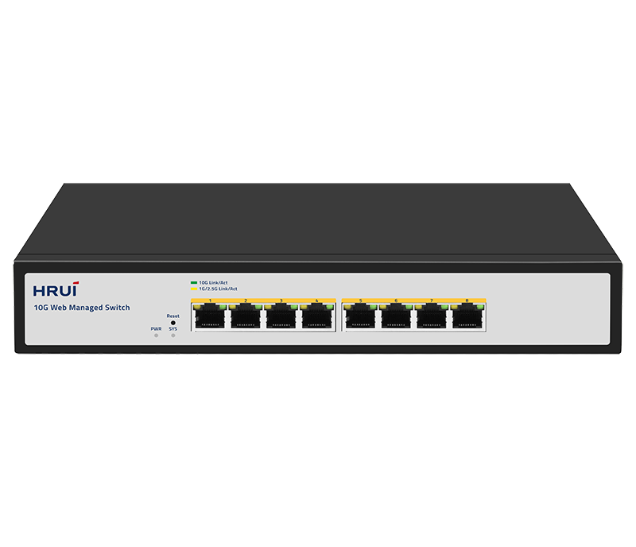
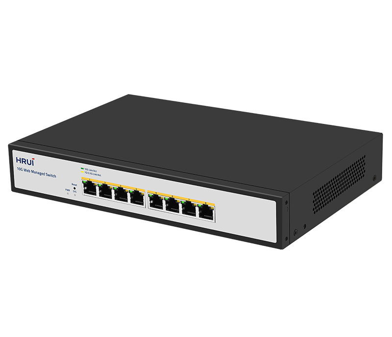
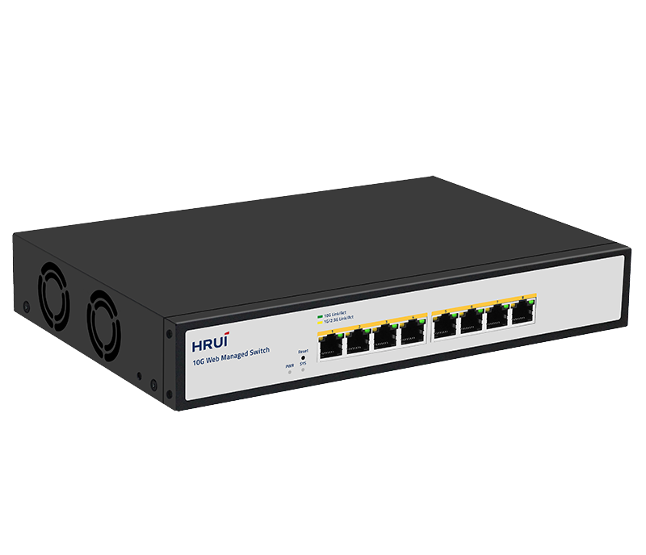
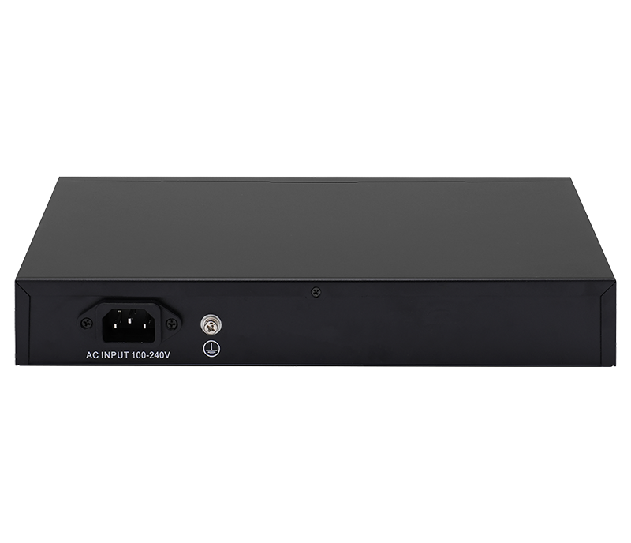

# HR510S-8T

> 来源：<https://www.hruitech.com/managed-switch/260.html>（抓取 2026-10-21T04:36:11Z；英文原文照录，中文仅为栏目名）  
> 官网描述：8-Port 10GBASE-T Web Managed Switch  
> 类目：Managed Switch（site id 260）  
> 接口：8*10Gbps RJ45 ports；PoE 预算 —；交换带宽 160Gbps；电源 AC 100-240V 50/60Hz / DC 12V 4A

**Brief:** The HR510S-8T is an advanced 8-port 10G Web-Managed Ethernet Switch, designed to meet the growing demands of modern networks. With its high-speed, reliable connectivity and intelligent management features, this switch is ideal for businesses requiring seamless data transmission and robust network performance.

## 产品图





## Datasheet
- [HR510S_8T.pdf](https://www.hruitech.com/web/userfiles/productfile/HR510S_8T.pdf) （本地：`data/hrui_site_raw/datasheets/HR510S_8T.pdf`；文本：`data/hrui_site_raw/datasheet_text/HR510S_8T.txt`）

## Feature and Benefits（原文）
```
The HR510S-8T is an advanced 8-port 10G Web-Managed Ethernet Switch, designed to meet the growing demands of modern networks. With its high-speed, reliable connectivity and intelligent management features, this switch is ideal for businesses requiring seamless data transmission and robust network performance.
Product Features:
8 x 10Gbps RJ45 Ports:
Experience lightning-fast connectivity across all eight ports, ensuring efficient data transfer and enhanced network performance.
Standards Compliance:
Fully compliant with IEEE 802.3, IEEE 802.3u, IEEE 802.3ab, IEEE 802.3bz, IEEE 802.3ae, and IEEE 802.3x standards, ensuring compatibility with a wide range of network devices and protocols.
Self-Adaptive Ethernet Ports:
The Ethernet ports support multiple speeds (100M/1G/2.5G/10Gbps), automatically adjusting to the needs of connected devices for optimal performance.
Automatic Port Flipping (Auto MDI/MDIX):
Simplifies installation and configuration by automatically detecting and adjusting the connection type, eliminating the need for crossover cables.
Status Monitoring with LEDs:
The panel indicator LEDs provide real-time insights into the operational status of each port, facilitating quick fault identification and analysis.
Advanced Flow Control:
Implements IEEE 802.3x standard for full duplex and a Backpressure standard for half duplex to optimize data flow and prevent packet loss during high traffic.
Quality of Service (QoS) Support:
Prioritize critical data traffic to ensure bandwidth availability for important applications, enhancing overall network efficiency.
Web Management Interface:
Easily manage and configure your switch through a user-friendly web interface, providing a comprehensive overview and control of network settings.
```

## Parameter（规格表逐行）
| 项 | 值 |
|---|---|
| Description | Specification |
| Model | HR510S-8T |
| Interface | 8*10Gbps RJ45 ports |
| Port Standard | IEEE 802.3: Ethernet Media Access Control (MAC) Protocol |
| Port Standard | IEEE 802.3i: 10BASE-T Ethernet |
| Port Standard | IEEE 802.3u: 100BASE-TX Fast Ethernet |
| Port Standard | IEEE 802.3ab: 1000BASE-T Gigabit Ethernet |
| Port Standard | IEEE 802.3x: Flow Control |
| Port Standard | IEEE 802.3az (Energy Efficient Ethernet) |
| Port Standard | IEEE 802.3ae (10G Ethernet) |
| Port Standard | IEEE802.3x (Flow Control) |
| Port Standard | IEEE802.3 bz (2.5G/5G Ethernet standard) |
| Switching Bandwidth | 160Gbps |
| Packet Forwarding Rate | 119.04Mpps |
| Packet Buffer | 12Mbit |
| MAC Address Table | 16K |
| Jumbo Frame | Support |
| VLAN | VLAN range 1-4094, maximum active VLAN is 4K |
| Transmission Method | Store and Forward |
| Power Supply | AC 100-240V 50/60Hz |
| Power Supply | DC 12V 4A |
| Mainboard Power Consumption | 33.97W |
| Structure Information | Product Dimensions: 270*181*44mm |
| Structure Information | Packaging Dimensions: 312*262*84mm |
| Structure Information | Product Net Weight: 1.3KG |
| Structure Information | Product Gross Weight: 1.75KG |
| Package Information | Carton Dimensions: 540*435*332mm |
| Package Information | Packing Quantity: 10PCS |
| Package Information | Packing Weight: 18.5KG |
| Package Contents | Switch 1pcs, Power Cord 1pcs, Manual 1pcs, Certificate of Inspection 1pcs |
| Fan Quantity | 2 |
| Installation | Desktop |
| Surge Protection | Port Surge: Common mode 4KV, Differential mode 1KV |
| Surge Protection | Electrostatic ESD: Air 8KV, Contact 6KV |
| Operating Temperature | 0~40°C |
| Storage Temperature | -40~70°C |
| Operation Humidity | 10%~90%, non condensing |
| Storage Humidity | 5%~95%, non condensing |
| PWR Green LED | On: Powered on |
| PWR Green LED | Off: Powered off |
| SYS Green LED | On: The system is normal |
| SYS Green LED | Flashing: System startup in progress |
| Ports 1-8 | Green LED on: 10Gbps Link normal |
| Ports 1-8 | Yellow LED on: 1G/2.5Gbps Link normal |
| Ports 1-8 | Off: Link blocked |
| Ports 1-8 | Flashing: Data transmitting |
| Reset | Long press for 6 seconds to restore factory settings |
| **Software Features** | |
| **L2 Function** | |
| Port | Port Switch configuration |
| Port | Port Description configuration |
| Port | Port Speed configuration |
| Port | Port Duplex configuration |
| Port | Port Flow Control configuration |
| Port | Jumbo Frame |
| Port | EEE |
| Link Aggregation | Support load balance policy; Base on MAC and IP-MAC |
| Link Aggregation | Static and Dynamic Group |
| Link Aggregation | LACP |
| Link Aggregation | Up to 8 groups |
| Storm Control | Boardcast suppression |
| Storm Control | Unknown Multicast |
| Storm Control | Unknown Unicast |
| Port Mirroring | One to one monitor |
| Port Mirroring | Many to one monitor |
| Port Mirroring | Ingress/Egress/Both |
| Port Mirroring | Up to 4 session groups |
| Port Security | MAC Address Constraints |
| Port Security | Protect/Restrict/Shutdown |
| Port Isolation | Support |
| Port Rate-limit | Support |
| VLAN | Access/Trunk/Hybrid |
| VLAN | VLAN Tunnel (Q-in-Q Tunnel) |
| VLAN | VLAN range 1-4094, maximum active VLAN is 4K |
| MAC Address | Filtering MAC Address |
| MAC Address | Static MAC address |
| Spanning Tree Protocol | STP/RSTP |
| Spanning Tree Protocol | BPDU Filter |
| Spanning Tree Protocol | BPDU Guard |
| Spanning Tree Protocol | Edge Port |
| Multicast | IGMP Snooping |
| Multicast | Router Port |
| Multicast | Static IGMP Join |
| Multicast | IGMP V1/V2 |
| QoS | Traffic classification, Supporting SP and WRR scheduling |
| QoS | Port Priority |
| QoS | 802.1P Priority |
| QoS | IP DSCP Priority |
| QoS | Priority Remarking |
| QoS | Support up to 8 queues per port |
| ERPS | Main Ring |
| **Services** | |
| Access Protocol | HTTP |
| Access Protocol | Session Timeout |
| Security | DHCP Snooping |
| **Diagnostics** | |
| Copper Test | Support |
| Ping | Support |
| **Equipment Management** | |
| Manager Acces | HTTP |
| Manager Acces | SNMP |
| Manager IP | Static Address |
| Manager IP | Manager VLAN |
| Manager IP | DNS |
| Manager IP | DHCP Client |
| SNMP | V2C |
| SNMP | Community |
| SNMP | Trap Host |
| SNMP MIB | RFC 1213 MIB-II |
| SNMP MIB | RFC 1643 Ethernet MIB |
| SNMP MIB | RFC 2863 Interface MIB |
| User Management | Support |
| Firmware Management | Firmware upgrade |
| Configuration Management | Upload/Backup Configuration |
| Save | Support |
| Restart | Support |
| Factory Defaults | Support |
| **Standard Compliance** | |
| **IEEE 802.3x flow control and back pressure** | |
| **IEEE 802.3ad port trunk with LACP** | |
| **IEEE 802.1D Spanning Tree Protocol** | |
| **IEEE 802.1w Rapid Spanning Tree Protocol** | |
| **IEEE 802.1p Class of Service** | |
| **IEEE 802.1Q VLAN tagging** | |
| **RFC 768 UDP** | |
| **RFC 793 TFTP** | |
| **RFC 791 IP** | |
| **RFC 792 ICMP** | |
| **RFC 2068 HTTP** | |
| **RFC 1112 IGMP v1** | |
| **RFC 2236 IGMP v2** | |
| **RFC 3376 IGMP v3** | |

## Product structure / Application topology（图）
- https://www.hruitech.com/web/userfiles/image/20250107/1736213386633115.png
