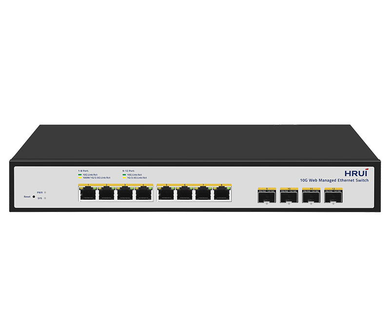
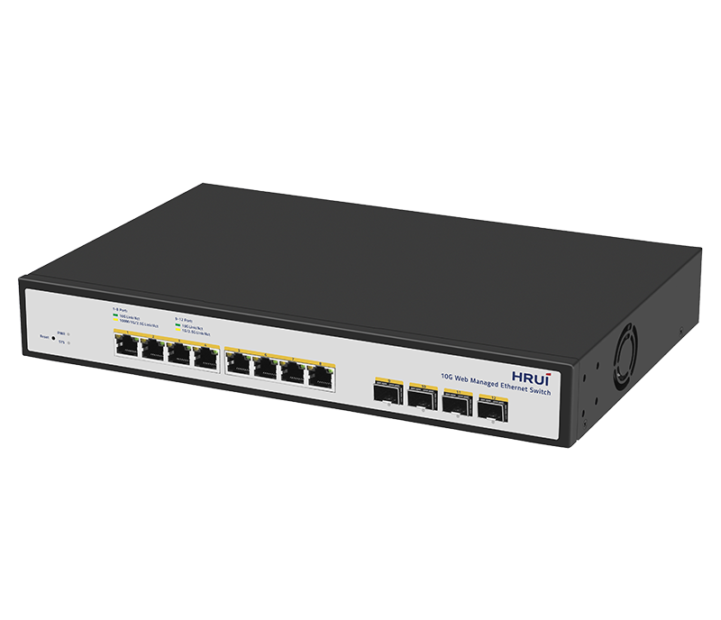
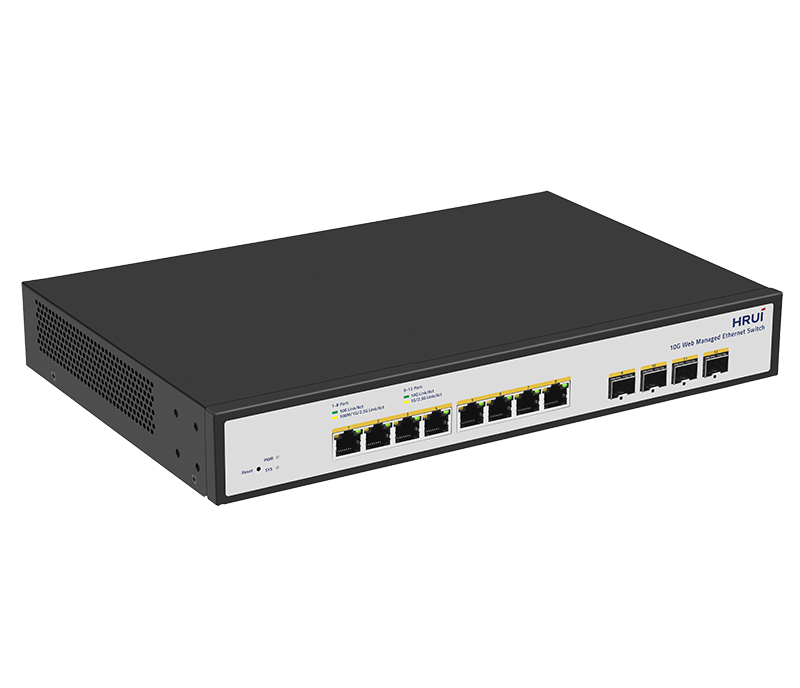
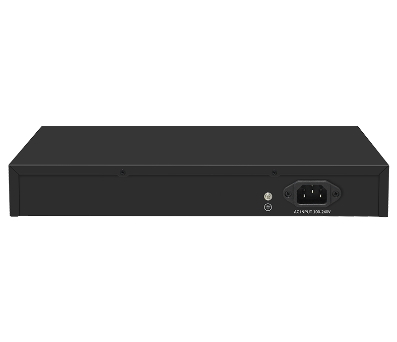

# HR510S-8T4XS

> 来源：<https://www.hruitech.com/managed-switch/261.html>（抓取 2026-10-21T04:36:09Z；英文原文照录，中文仅为栏目名）  
> 官网描述：Layer3 8-Port 10GBASE-T and 4-Port 10G SFP+ Managed Switch  
> 类目：Managed Switch（site id 261）  
> 接口：8*10Gbps RJ45 ports / 4*10Gbps SFP+ ports；PoE 预算 —；交换带宽 240Gbps；电源 AC 100-240V 50/60Hz / DC 12V8A

**Brief:** HR510S-8T4XS, a sophisticated 12-port Ethernet switch designed for optimal speed and efficiency. Featuring 8 *10Gbps RJ45 ports and 4 *10Gbps SFP+ ports, this switch provides robust connectivity suitable for data-intensive environments. With web management capabilities, you can effortlessly monitor and configure your network to meet your specific needs.

## 产品图





## Datasheet
- [HR510S_8T4XS.pdf](https://www.hruitech.com/web/userfiles/productfile/HR510S_8T4XS.pdf) （本地：`data/hrui_site_raw/datasheets/HR510S_8T4XS.pdf`；文本：`data/hrui_site_raw/datasheet_text/HR510S_8T4XS.txt`）

## Feature and Benefits（原文）
```
HR510S-8T4XS, a sophisticated 12-port Ethernet switch designed for optimal speed and efficiency. Featuring 8 10Gbps RJ45 ports and 4 10Gbps SFP+ ports, this switch provides robust connectivity suitable for data-intensive environments. With web management capabilities, you can effortlessly monitor and configure your network to meet your specific needs.
Product Features:
High-Speed Connectivity:
Equipped with 8 x 10Gbps RJ45 ports and 4 x 10Gbps SFP+ ports to accommodate your bandwidth demands.
Standards Compliance:
Fully compliant with IEEE standards including IEEE 802.3, 802.3u, 802.3ab, 802.3bz, 802.3ae, and 802.3x, ensuring reliable performance across various network configurations.
Versatile Port Support:
Each Ethernet port supports self-adaptive speeds of 100M, 1G, 2.5G, and 10Gbps, providing flexibility for diverse network requirements.
Automatic Port Flipping:
Features Auto MDI/MDIX for seamless connectivity, eliminating the need for crossover cables.
Intuitive Monitoring:
On-panel LED indicator lights provide real-time monitoring of each port's status, assisting in quick fault diagnosis and assessment.
Advanced Flow Control:
Implements IEEE 802.3x standard for full duplex and backpressure for half duplex, ensuring smooth data transmission and minimized packet loss.
Quality of Service (QoS) Support:
Prioritize critical data traffic to ensure bandwidth availability for important applications, enhancing overall network efficiency.
```

## Parameter（规格表逐行）
| 项 | 值 |
|---|---|
| Description | Specification |
| Model | HR510S-8T4XS |
| Interface | 8*10Gbps RJ45 ports |
| Interface | 4*10Gbps SFP+ ports |
| Port Standard | IEEE802.3 (Ethernet) |
| Port Standard | IEEE802.3u (Fast Ethernet) |
| Port Standard | IEEE802.3ab (Gigabit Ethernet) |
| Port Standard | IEEE 802.3bz (5G Ethernet) |
| Port Standard | IEEE 802.3z (Gigabit Ethernet) |
| Port Standard | IEEE 802.3ae (10G Ethernet) |
| Port Standard | IEEE802.3x (Flow Control) |
| Switching Bandwidth | 240Gbps |
| Packet Forwarding Rate | 178.56Mpps |
| Packet Buffer | 16Mbit |
| MAC Address Table | 32K |
| Jumbo Frame | Support |
| VLAN | VLAN range 1-4094, maximum active VLAN is 4K |
| Transmission Method | Store and Forward |
| Power Supply | AC 100-240V 50/60Hz |
| Power Supply | DC 12V8A |
| Mainboard Power Consumption | 48.75W |
| Structure Information | Product Dimensions: 320*207*45mm |
| Structure Information | Packaging Dimensions: 370*290*85mm |
| Structure Information | Product Net Weight: 1.72KG |
| Structure Information | Product Gross Weight: 2.28KG |
| Packing Information | Carton Dimensions: 445*310*390mm |
| Packing Information | Packing Quantity: 5PCS |
| Packing Information | Packing Weight: 12.4KG |
| Package Contents | Switch 1pcs, Power Cord 1pcs, Manual 1pcs, Certificate of Inspection 1pcs, Rack-mounted kit 1 pair |
| Fan Quantity | 1 |
| Installation | Desktop, Rack-mounting |
| Surge Protection | Port Surge: Common mode 4KV, Differential mode 1KV |
| Surge Protection | Electrostatic ESD: Air 8KV, Contact 6KV |
| Operating Temperature | 0~40°C |
| Storage Temperature | -40~70°C |
| Operation Humidity | 10%~90%, non condensing |
| Storage Humidity | 5%~95%, non condensing |
| PWR Green LED | On: Powered on |
| PWR Green LED | Off: Powered off |
| SYS Green LED | On: The system is normal |
| SYS Green LED | Flashing: System startup in progress |
| Ports 1-8 | Green LED on: 10Gbps Link normal |
| Ports 1-8 | Yellow LED on: 1G/2.5Gbps Link normal |
| Ports 1-8 | Off: Link blocked |
| Ports 1-8 | Flashing: Data transmitting |
| Ports 9-12 | Green LED on: 10Gbps Link normal |
| Ports 9-12 | Yellow LED on: 1G/2.5Gbps Link normal |
| Ports 9-12 | Off: Link blocked |
| Ports 9-12 | Flashing: Data transmitting |
| Reset | Long press for 6 seconds to restore factory settings |
| **Software Features** | |
| **L2 Function** | |
| Port | Port Switch configuration |
| Port | Port Description configuration |
| Port | Port Speed configuration |
| Port | Port Duplex configuration |
| Port | Port Flow Control configuration |
| Port | Jumbo Frame |
| Port | EEE |
| Link Aggregation | Support load balance policy; Base on MAC and IP-MAC |
| Link Aggregation | Static and Dynamic Group |
| Link Aggregation | LACP |
| Link Aggregation | Up to 8 groups |
| Storm Control | Boardcast suppression |
| Storm Control | Unknown Multicast |
| Storm Control | Unknown Unicast |
| Port Mirroring | One to one monitor |
| Port Mirroring | Many to one monitor |
| Port Mirroring | Ingress/Egress/Both |
| Port Mirroring | Up to 4 session groups |
| Port Security | MAC Address Constraints |
| Port Security | Protect/Restrict/Shutdown |
| Port Isolation | Support |
| Port Rate-limit | Support |
| VLAN | Access/Trunk/Hybrid |
| VLAN | VLAN Tunnel (Q-in-Q Tunnel) |
| VLAN | VLAN range 1-4094, maximum active VLAN is 4K |
| MAC Address | Filtering MAC Address |
| MAC Address | Static MAC address |
| Spanning Tree Protocol | STP/RSTP |
| Spanning Tree Protocol | BPDU Filter |
| Spanning Tree Protocol | BPDU Guard |
| Spanning Tree Protocol | Edge Port |
| Multicast | IGMP Snooping |
| Multicast | Router Port |
| Multicast | Static IGMP Join |
| Multicast | IGMP V1/V2 |
| QoS | Traffic classification, Supporting SP and WRR scheduling |
| QoS | Port Priority |
| QoS | 802.1P Priority |
| QoS | IP DSCP Priority |
| QoS | Priority Remarking |
| QoS | Support up to 8 queues per port |
| ERPS | Main Ring |
| **Services** | |
| Access Protocol | HTTP |
| Access Protocol | Session Timeout |
| Security | DHCP Snooping |
| **Diagnostics** | |
| Copper Test | Support |
| Ping | Support |
| **Equipment Management** | |
| Manager Acces | HTTP |
| Manager Acces | SNMP |
| Manager IP | Static Address |
| Manager IP | Manager VLAN |
| Manager IP | DNS |
| Manager IP | DHCP Client |
| SNMP | V2C |
| SNMP | Community |
| SNMP | Trap Host |
| SNMP MIB | RFC 1213 MIB-II |
| SNMP MIB | RFC 1643 Ethernet MIB |
| SNMP MIB | RFC 2863 Interface MIB |
| User Management | Support |
| Firmware Management | Firmware upgrade |
| Configuration Management | Upload/Backup Configuration |
| Save | Support |
| Restart | Support |
| Factory Defaults | Support |
| **Standard Compliance** | |
| **IEEE 802.3x flow control and back pressure** | |
| **IEEE 802.3ad port trunk with LACP** | |
| **IEEE 802.1D Spanning Tree Protocol** | |
| **IEEE 802.1w Rapid Spanning Tree Protocol** | |
| **IEEE 802.1p Class of Service** | |
| **IEEE 802.1Q VLAN tagging** | |
| **RFC 768 UDP** | |
| **RFC 793 TFTP** | |
| **RFC 791 IP** | |
| **RFC 792 ICMP** | |
| **RFC 2068 HTTP** | |
| **RFC 1112 IGMP v1** | |
| **RFC 2236 IGMP v2** | |
| **RFC 3376 IGMP v3** | |

## Product structure / Application topology（图）
- https://www.hruitech.com/web/userfiles/image/20250107/1736214466872637.png
