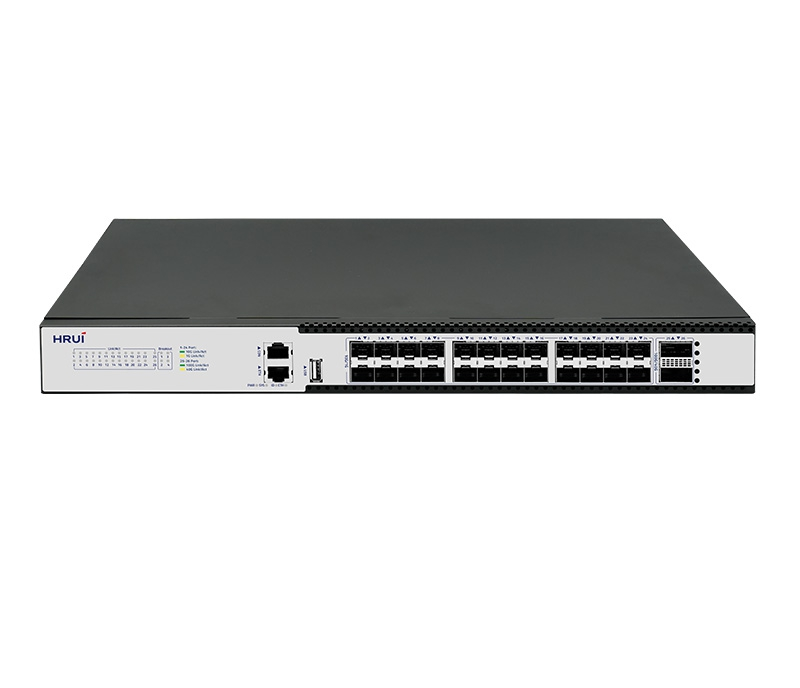
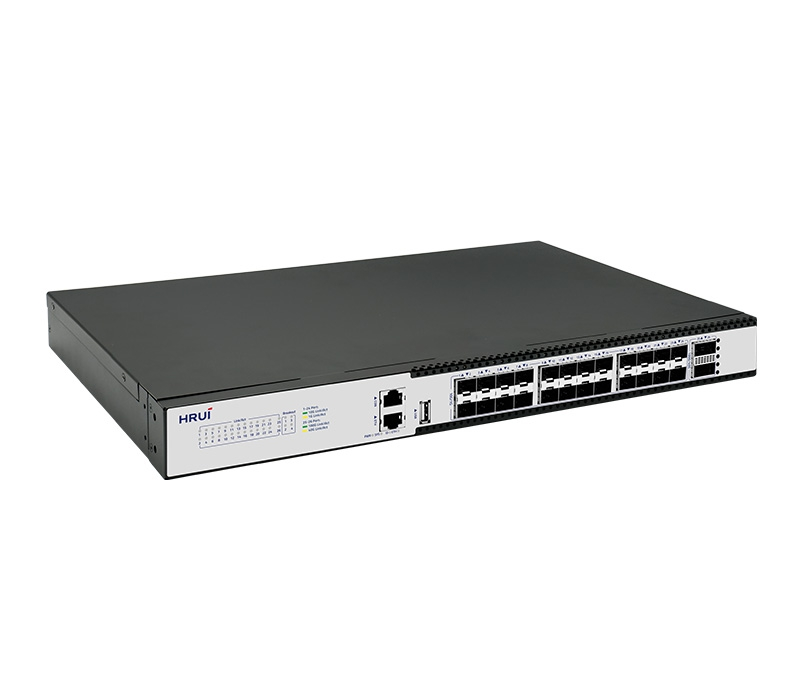
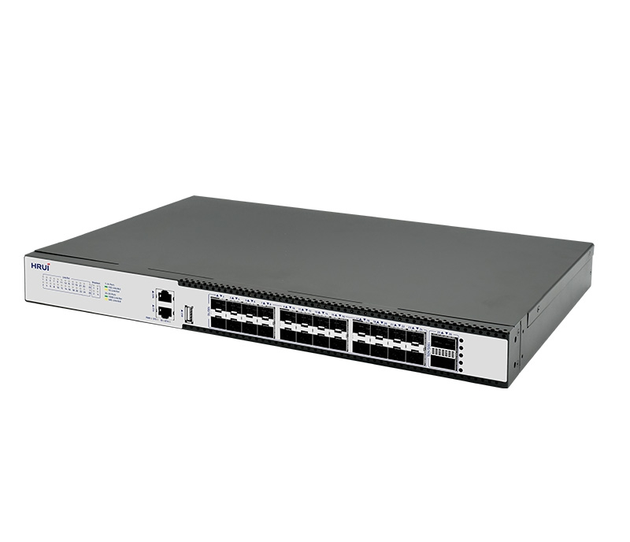
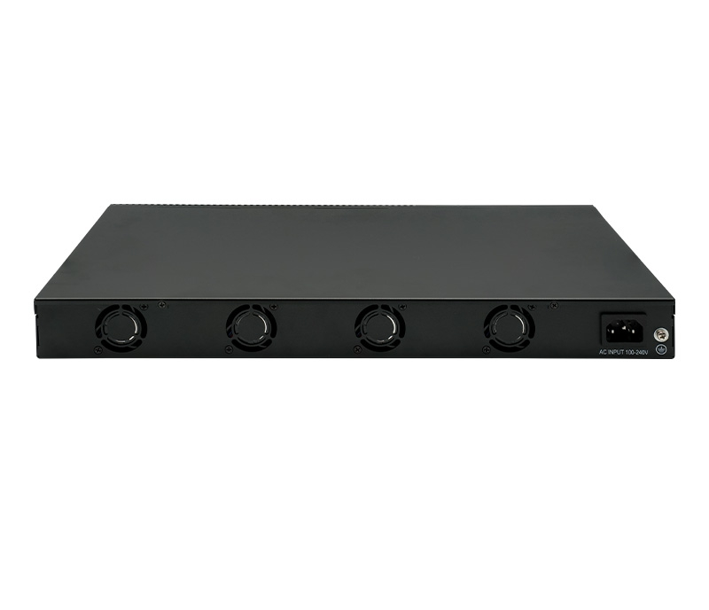

# HR530S-24S2CQ

> 来源：<https://www.hruitech.com/managed-switch/309.html>（抓取 2026-10-21T04:36:08Z；英文原文照录，中文仅为栏目名）  
> 官网描述：Layer3 24-Port 10G SFP+ and 2-Port 100G QSFP28 Managed Switch  
> 类目：Managed Switch（site id 309）  
> 接口：24*10Gbps SFP+ ports / 2*100Gbps QSFP28 ports / 1*Console port, 1*ETH port / 1*USB port；PoE 预算 —；交换带宽 880Gbps；电源 AC 100-240V 50/60Hz / DC 12V12.5A

**Brief:** NTP 0.1-1ms high-precision synchronization | lPSLA network monitoring | MLAG link aggregation | NAT address translation | VRRP redundancy protection | OSPF routing protocol | ERPS<50ms | 880Gbps Non-blockingswitching capacity

## 产品图





## Datasheet
- [HR530S-24S2CQ-28EN-29.pdf](https://www.hruitech.com/web/userfiles/productfile/HR530S-24S2CQ-28EN-29.pdf) （本地：`data/hrui_site_raw/datasheets/HR530S-24S2CQ-28EN-29.pdf`；文本：`data/hrui_site_raw/datasheet_text/HR530S-24S2CQ-28EN-29.txt`）

## Feature and Benefits（原文）
```
HR530S-24S2CQ is a high-performance Layer 3 managed switch for modern data centers and enterprise core networks, designed to meet the network demands of high bandwidth, low latency, and high reliability. Equipped with 24 10GbE SFP+ optical ports and 2 100GbE QSFP28 uplink ports, the switch supports 40G/100G multi-rate adaptation and port splitting (which can be split into 25G or 10G modes). It also provides one console management port, one ETH management port, and one USB port for easy maintenance and configuration backup, offering flexible networking and efficient bandwidth expansion.
Product Features:
Layer 3 Management:
Supports advanced Layer 3 features, including DHCP server, QoS (Quality of Service), ACL (Access Control List) control, and SNMP V1/V2/V3, for comprehensive network management.
Standards Compliance:
Compatible with IEEE 802.3, 802.3ae, 802.3ba, and other Ethernet protocols, ensuring high-performance data transmission and interoperability.
Advanced Forwarding Mode:
Supports cut-through forwarding mode for ultra-low fixed latency, ideal for high-frequency trading and real-time applications.
High-Speed Connectivity:
Multi-rate support of 10G/25G/40G/100G provides flexible bandwidth options and future-proof scalability.
Powerful Management Options:
Management via web, TELNET, SSH, SNMP, and RMON protocols provides comprehensive network control.
Real-Time Monitoring:
Supports standard 19-inch rack mounting for easy integration into data center environments.
Rack-mountable design:
Status indicator LEDs provide instant display of port status and system performance.
Operating Temperature:
Designed to operate from 0°C to 45°C, ensuring reliability in controlled data center environments.
```

## Parameter（规格表逐行）
| 项 | 值 |
|---|---|
| Description | Specification |
| Model | HR530S-24S2CQ |
| Interface | 24*10Gbps SFP+ ports |
| Interface | 2*100Gbps QSFP28 ports |
| Interface | 1*Console port, 1*ETH port |
| Interface | 1*USB port |
| Port Standard | IEEE802.3 (Ethernet) |
| Port Standard | IEEE 802.3ae (10G Ethernet) |
| Port Standard | IEEE 802.3ba (40/100G Ethernet) |
| Port Standard | IEEE802.3x (Flow Control) |
| Port Standard | IEEE 802.3az (Energy Efficient Ethernet) |
| Port Standard | IEEE 802.3ad (link Aggregation) |
| Port Standard | IEEE 802.1AB LLDP/LLDP-MED (Link Layer Discovery Protocol) |
| Port Standard | IEEE 802.1D Spanning Tree Protocol (STP) |
| Port Standard | IEEE 802.1w Rapid Spanning Tree Protocol (RSTP) |
| Port Standard | IEEE 802.1s Multiple Spanning Tree Protocol (MSTP) |
| Port Standard | IEEE 802.1Q (Virtual VLAN) |
| Port Standard | IEEE 802.1p (VLAN Label) |
| Port Standard | IEEE 802.1X (User uthentification) |
| Switching Bandwidth | 880Gbps |
| Packet Forwarding Rate | 476Mpps |
| Memory | 2GB |
| Flash Memory | 8GB |
| Packet Buffer | 9Mbit |
| MAC Address Table | 98K |
| Jumbo Frame | 9216Kbytes |
| VLAN | 4K VLAN |
| Transmission Method | Store and Forward |
| Power Supply | AC 100-240V 50/60Hz |
| Power Supply | DC 12V12.5A |
| Mainboard Power Consumption | 30.67W |
| Surge Protection | Port Surge: Common mode 4KV, Differential mode 2KV(Class A) |
| Surge Protection | Electrostatic ESD: Air 8KV, Contact 6KV(Class C) |
| Structure Information | Product Dimensions: 440*280*44mm |
| Structure Information | Packaging Dimensions: 500*365*85mm |
| Structure Information | Product Net Weight: 3.63KG |
| Structure Information | Product Gross Weight: 4.36KG |
| Packing Information | Carton Dimensions: 520*190*385mm |
| Packing Information | Packing Quantity: 2PCS |
| Packing Information | Packing Weight: 9.72KG |
| Package Contents | Switch 1pcs, Power Cord 1pcs, Manual 1pcs, Certificate of Inspection 1pcs, Rack-mounted kit 1 pair, Network cable 1pcs |
| Fan Quantity | 4 |
| Installation | Desktop, Rack-mounting |
| Certification | CE, FCC, ROHS |
| Operating Temperature | 0~45°C |
| Storage Temperature | -40~70°C |
| Operation Humidity | 10%~90%, non condensing |
| Storage Humidity | 0%~95%, non condensing |
| ID Green LED | On: ID indication on |
| ID Green LED | Off: ID indication off |
| ETH | Green LED on: 1Gbps Link normal |
| ETH | Yellow LED on: 10/100Mbps Link normal |
| ETH | Flashing: Data transmitting |
| PWR Green LED | On: Powered on |
| PWR Green LED | Off: Powered off |
| SYS | Green LED on: The system is starting up or running normally |
| SYS | Yellow LED on: System abnormal alarm or other errors |
| SYS | Off: The system is not powered on or running abnormally |
| Description | Specification |
| Ports 1-24 | Green LED on: 10Gbps Link normal |
| Ports 1-24 | Yellow LED on: 1Gbps Link normal |
| Ports 1-24 | Off: Link blocked |
| Ports 1-24 | Flashing: Data transmitting |
| Ports 25~26 | Green LED on: 100Gbps Link normal |
| Ports 25~26 | Yellow LED on: 40G Link normal |
| Ports 25~26 | Off: Link blocked |
| Ports 25~26 | Flashing: Data transmitting |
| Breakout | Loop flashing: Data transmission |
| **Software Features** | |
| **L3 Function** | |
| IPv4 | IPv4 VLAN Interface |
| IPv4 | IPv4 Static Routes |
| IPv4 | IPv4 Black Hole Routing |
| IPv4 | Static routing and IP SLA linkage |
| IPv4 | uRPF |
| IPv4 | ARP |
| IPv4 | Gratuitous ARP |
| IPv4 | ARP Proxy |
| IPv6 | IPv6 VLAN Interface |
| IPv6 | IPv6 Static Routes |
| IPv6 | IPv6 Black Hole Routing |
| IPv6 | ICMP V6 |
| IPv6 | IPv6 ND |
| RIP | V2 |
| OSPF | Router-ID |
| OSPF | Authentication |
| OSPF | V2 |
| ECMP | SLB |
| ECMP | DLB |
| ECMP | RR |
| NAT | Support |
| VRRP | V2 |
| VRRP | Track for VRRP V2 |
| **L2 Function** | |
| Port | Port Switch |
| Port | Port Description |
| Port | Port Speed |
| Port | Port Duplex |
| Port | Port Flow Control |
| Port | Support 10G/1G |
| Port | Support 40G/100G |
| Port | Jumbo, Up to 9600 bytes |
| Port | Fiber Module(DDM) |
| Port | 2.5G Electrical Port |
| Link Aggregation | Support load balance policy; Base on MAC and IP-MAC |
| Link Aggregation | SLB |
| Link Aggregation | DLB |
| Link Aggregation | RR |
| Link Aggregation | Static and Dynamic Group |
| Link Aggregation | Support LACP |
| Link Aggregation | Up to 16 groups |
| Storm Control | Boardcast |
| Storm Control | Unknown Multicast |
| Storm Control | Unknown Unicast |
| Port Mirroring | Based on Port |
| Port Mirroring | Based on Flow |
| Port Mirroring | Use CPU as mirror source |
| Port Mirroring | Use CPU as mirror destination |
| Port Mirroring | One to one monitor |
| Port Mirroring | Many to one monitor |
| Port Mirroring | Ingress/Egress/Both |
| Port Mirroring | Up to 4 session groups |
| Port Security | MAC Address Constraints |
| Port Security | Port Security MAC Address |
| Port Security | Protect/Restrict/Shutdown |
| Port Isolation | L2 Traffic Isolation |
| Port Isolation | ALL Traffic Isolation |
| Loopback Detection | Boardcast |
| VLAN | Access / Trunk |
| VLAN | Congurable VID from 1 - 4094;Max. 4K static VLAN groups |
| VLAN | MAC VLAN |
| VLAN | Protocol VLAN |
| VLAN | IP VLAN |
| VLAN | Private VLAN |
| VLAN | VLAN Statistics |
| VLAN | Basic QinQ VLAN |
| VLAN | Flexible QinQ |
| VLAN | VLAN mapping |
| MAC Address | Dynamic Address |
| MAC Address | Static Address |
| MAC Address | Filtering Address |
| MAC Address | MAC drift check |
| Spnning Tree Protocol | STP/RSTP/MSTP |
| Spnning Tree Protocol | BPDU Filter |
| Spnning Tree Protocol | BPDU Guard |
| Spnning Tree Protocol | Root Guard |
| Spnning Tree Protocol | Loop Guard |
| Spnning Tree Protocol | Edge Port |
| Spnning Tree Protocol | Anti TC-BPDU attack |
| LLDP | LLDP |
| LLDP | LLDP MED |
| Port Security | MAC Address Constraints |
| Port Security | Port Security MAC Address |
| Port Security | Protect/Restrict/Shutdown |
| Port Isolation | L2 Traffic Isolation |
| Port Isolation | ALL Traffic Isolation |
| Loopback Detection | Boardcast |
| VLAN | Access / Trunk |
| VLAN | Congurable VID from 1 - 4094;Max. 4K static VLAN groups |
| VLAN | MAC VLAN |
| VLAN | Protocol VLAN |
| VLAN | IP VLAN |
| VLAN | Private VLAN |
| VLAN | VLAN Statistics |
| VLAN | Basic QinQ VLAN |
| VLAN | Flexible QinQ |
| VLAN | VLAN mapping |
| MAC Address | Dynamic Address |
| MAC Address | Static Address |
| MAC Address | Filtering Address |
| MAC Address | MAC drift check |
| Spnning Tree Protocol | STP/RSTP/MSTP |
| Spnning Tree Protocol | BPDU Filter |
| Spnning Tree Protocol | BPDU Guard |
| Spnning Tree Protocol | Root Guard |
| Spnning Tree Protocol | Loop Guard |
| Spnning Tree Protocol | Edge Port |
| Spnning Tree Protocol | Anti TC-BPDU attack |
| LLDP | LLDP |
| LLDP | LLDP MED |
| **Security** | |
| AAA | Authentication |
| AAA | Authorization |
| AAA | Accounting |
| AAA | RADIUS |
| AAA | TACACS+ |
| AAA | 802.1X |
| AAA | Base on port/MAC/local |
| AAA | Guest VLAN |
| DHCP Snooping | Global/VLAN |
| DHCP Snooping | Option 82 |
| DHCP Snooping | Circuit ID |
| IP Source Guard | Support |
| Dynamic ARP Inspection | Support |
| Prevent DDOS attack | Support |
| Control Plane Policy (COPP) | Support |
| ACL | MAC ACL |
| ACL | IPv4 ACL |
| ACL | IPv6 ACL |
| ACL | Time Range |
| ACL | Basic Mode ACL |
| ACL | Port-group ACL |
| ACL | Telnet/SSH ACL filtering |
| ACL | Telnet/SSH IPv6 ACL filtering |
| **Diagnostics** | |
| Syslog | Logging Message |
| Syslog | Remote Server |
| SFLOW | Support |
| IPSLA | Support |
| IPFIX | Support |
| Ping | Support |
| Traceroute | Support |
| UDLD | Support |
| MLAG | IGMP Snnoping |
| ETH OAM | Hardware level CCM detection |
| **Managemnet** | |
| Manager Access | Console |
| Manager Access | METH |
| Manager Access | HTTP/HTTPS |
| Manager Access | Telnet |
| Manager Access | SSHv2 |
| Manager Access | SNMP |
| Manager IP | Static Address |
| Manager IP | DHCP Client |
| Manager IP | Support IPv4 and IPv6 address |
| Manager IP | DNS |
| Time Synchronization | NTP |
| Time Synchronization | Manual Time |
| Time Synchronization | Time Zone |
| SNMP | V1/V2C/V3 |
| SNMP | Community |
| SNMP | V3 User |
| SNMP | Group |
| SNMP | Trap Host |
| SNMP MIB | RFC 1213 MIB-II |
| SNMP MIB | RFC 1493 Bridge MIB |
| SNMP MIB | RFC 1643 Ethernet MIB |
| SNMP MIB | RFC 2819 RMON MIB (Groups 1, 2, 3 and 9) |
| SNMP MIB | RFC 2863 Interface MIB |
| SNMP MIB | LLDP |
| SNMP MIB | Private MIB |
| RMON | Statistics |
| RMON | History |
| RMON | Event |
| RMON | Alarm |
| User | Account |
| User | Level |
| Firmware | Double Image; Swap between Active and Alternate firmware image. |
| Firmware | Firmware Upgarde |
| Configuration | Upload and download |
| Configuration | Upload and download via USB interface |
| File System | File System |
| File System | TFTP |
| File System | FTP |
| File System | SCP |
| File System | xmodem |
| Banner | Support |
| Save | Support |
| Restart | Support |
| Factory Defaults | Support |
| Standards Compliance | V1/V2C/V3 |
| **IEEE 802.3x flow control and back pressure** | |
| **IEEE 802.3ad port trunk with LACP** | |
| **IEEE 802.1D Spanning Tree Protocol** | |
| **IEEE 802.1w Rapid Spanning Tree Protocol** | |
| **IEEE 802.1s Multiple Spanning Tree Protocol** | |
| **IEEE 802.1p Class of Service** | |
| **IEEE 802.1Q VLAN tagging** | |
| **IEEE 802.1x Port Authentication Network Control** | |
| **IEEE 802.1ab LLDP** | |
| **RFC 768 UDP** | |
| **RFC 793 TFTP** | |
| **RFC 791 IP** | |
| **RFC 792 ICMP** | |
| **RFC 959 FTP** | |
| **RFC 2068 HTTP** | |
| **RFC 1112 IGMP v1** | |
| **RFC 2236 IGMP v2** | |
| **RFC 3376 IGMP v3** | |
| **RFC 2328 OSPF v2** | |
| **RFC 2453 RIP v2** | |
| **RFC 4443 ICMPv6** | |

## Product structure / Application topology（图）
- https://www.hruitech.com/web/userfiles/image/20250909/1757412310188439.png
