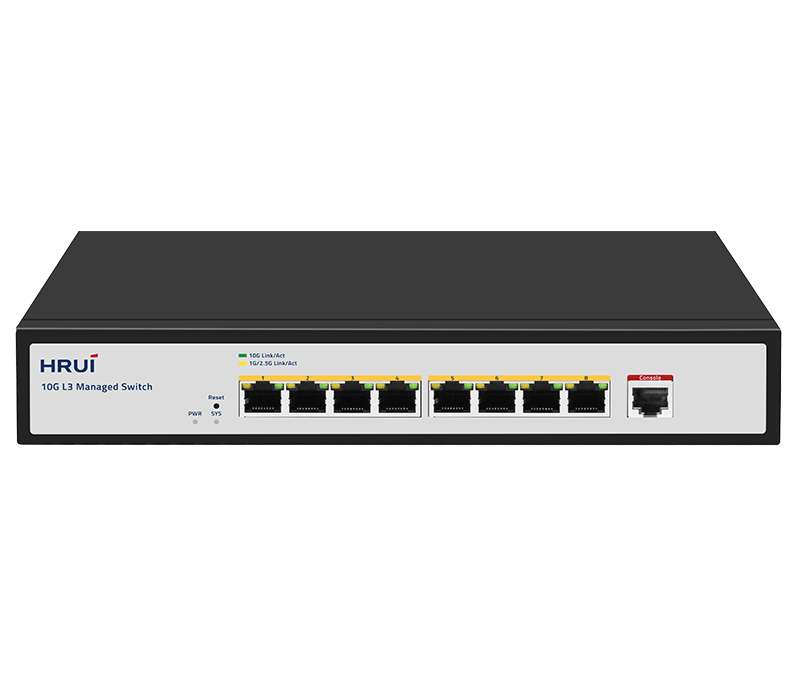
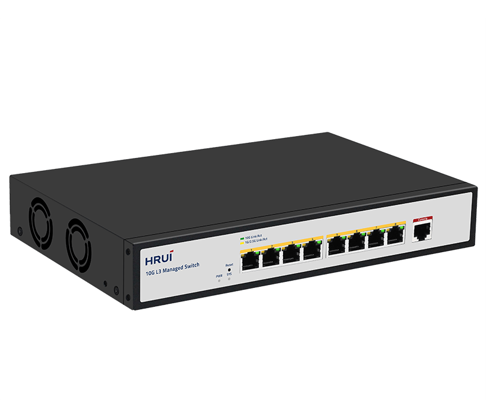
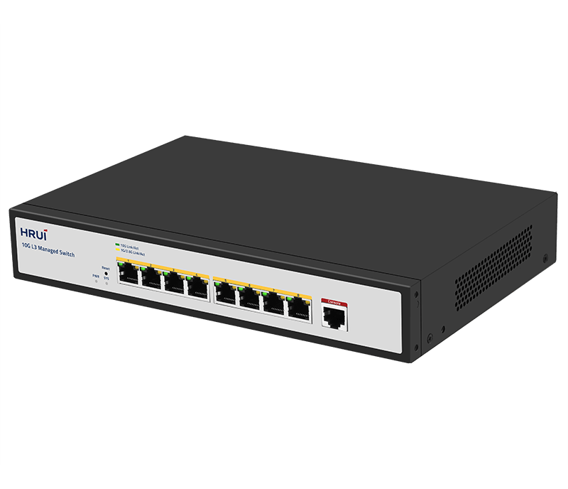
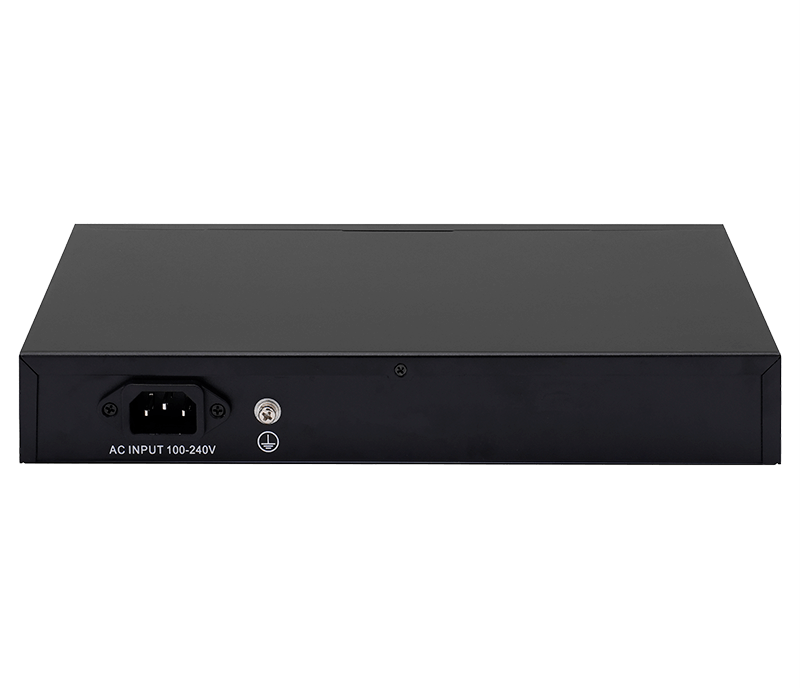

# HR530S-8T

> 来源：<https://www.hruitech.com/managed-switch/283.html>（抓取 2026-10-21T04:36:10Z；英文原文照录，中文仅为栏目名）  
> 官网描述：Layer3 8-Port 10GBASE-T Managed Switch  
> 类目：Managed Switch（site id 283）  
> 接口：8*10Gbps RJ45 ports；PoE 预算 —；交换带宽 160Gbps；电源 AC 100-240V 50/60Hz / DC 12V 4A

**Brief:** The HR530S-8T is a high-performance, Layer 3 managed Ethernet switch designed for demanding network environments. With 8 high-speed 10G Ethernet ports, this switch delivers exceptional throughput, low latency, and advanced management capabilities, making it ideal for data centers, enterprise networks, and high-bandwidth applications. It combines robust security features, flexible management options, and support for both IPv4 and IPv6, ensuring seamless integration into modern network infrastructures.

## 产品图





## Datasheet
- [HR530S_8T.pdf](https://www.hruitech.com/web/userfiles/productfile/HR530S_8T.pdf) （本地：`data/hrui_site_raw/datasheets/HR530S_8T.pdf`；文本：`data/hrui_site_raw/datasheet_text/HR530S_8T.txt`）

## Feature and Benefits（原文）
```
The HR530S-8T is a high-performance, Layer 3 managed Ethernet switch designed for demanding network environments. With 8 high-speed 10G Ethernet ports, this switch delivers exceptional throughput, low latency, and advanced management capabilities, making it ideal for data centers, enterprise networks, and high-bandwidth applications. It combines robust security features, flexible management options, and support for both IPv4 and IPv6, ensuring seamless integration into modern network infrastructures.
Product Features:
Standards Compliance:
Complies with IEEE 802.1d, IEEE 802.1w, IEEE 802.1s, IEEE 802.1p, IEEE 802.3, IEEE 802.3u, IEEE 802.3x, IEEE 802.3z, IEEE 802.3ab, and IEEE 802.3ae standards, ensuring broad compatibility and reliable performance.
Layer 3 Management:
Supports advanced Layer 3 features, including DHCP Server, QoS (Quality of Service), ACL (Access Control List) control, and SNMP V1/V2/V3 for comprehensive network management and monitoring.
Enhanced Network Reliability:
Features Spanning Tree Protocol (STP/RSTP/MSTP), ERPS (Ethernet Ring Protection Switching), loop detection, self-healing, and remote loopback monitoring to ensure network stability and minimize downtime.
Advanced VLAN Support:
Enables multiple VLAN partitions, including MAC VLAN and protocol VLAN, for efficient network segmentation and optimized traffic management.
Robust Security Features:
Supports IP+MAC+VLAN+Port binding, DHCP Snooping, IP Source Guard, and Dynamic ARP Inspection (DAI) to safeguard against unauthorized access and network threats.
IPv4/IPv6 Dual-Stack Support:
Fully compatible with both IPv4 and IPv6, supporting RIP v1/v2 and OSPF v2 routing protocols for seamless integration into diverse and future-proof network environments.
Flexible Management Options:
Offers multiple management interfaces, including WEB, TELNET, CLI (Command Line Interface), SSH, SNMP, and RMON, for easy configuration, monitoring, and troubleshooting.
IGMP Snooping:
Supports IGMP Snooping v1/v2 for efficient multicast traffic management, optimizing bandwidth usage and improving network performance.
```

## Parameter（规格表逐行）
| 项 | 值 |
|---|---|
| Description | Specification |
| Model | HR530S-8T |
| Interface | 8*10Gbps RJ45 ports |
| Port Standard | IEEE 802.3: Ethernet Media Access Control (MAC) Protocol |
| Port Standard | IEEE 802.3i: 10BASE-T Ethernet |
| Port Standard | IEEE 802.3u: 100BASE-TX Fast Ethernet |
| Port Standard | IEEE 802.3ab: 1000BASE-T Gigabit Ethernet |
| Port Standard | IEEE 802.3x: Flow Control |
| Port Standard | IEEE 802.3az (Energy Efficient Ethernet) |
| Port Standard | IEEE802.1w Rapid Spanning Tree Protocol |
| Port Standard | IEEE 802.3ae (10G Ethernet) |
| Port Standard | IEEE802.3x (Flow Control) |
| Port Standard | IEEE802.3 bz (2.5G/5G Ethernet standard) |
| Switching Bandwidth | 160Gbps |
| Packet Forwarding Rate | 119.04Mpps |
| Packet Buffer | 12Mbit |
| MAC Address Table | 16K |
| Jumbo Frame | Support |
| VLAN | VLAN range 1-4094, maximum active VLAN is 4K |
| Transmission Method | Store and Forward |
| Power Supply | AC 100-240V 50/60Hz |
| Power Supply | DC 12V 4A |
| Mainboard Power Consumption | 33.97W |
| Structure Information | Product Dimensions: 270*181*44mm |
| Structure Information | Packaging Dimensions: 312*262*84mm |
| Structure Information | Product Net Weight: 1.3KG |
| Structure Information | Product Gross Weight: 1.75KG |
| Package Information | Carton Dimensions: 540*435*332mm |
| Package Information | Packing Quantity: 10PCS |
| Package Information | Packing Weight: 18.5KG |
| Package Contents | Switch 1pcs, Power Cord 1pcs, Manual 1pcs, Certificate of Inspection 1pcs |
| Fan Quantity | 2 |
| Installation | Desktop |
| Surge Protection | Port Surge: Common mode 4KV, Differential mode 1KV |
| Surge Protection | Electrostatic ESD: Air 8KV, Contact 6KV |
| Operating Temperature | 0~40°C |
| Storage Temperature | -40~70°C |
| Operation Humidity | 10%~90%, non condensing |
| Storage Humidity | 5%~95%, non condensing |
| PWR Green LED | On: Powered on |
| PWR Green LED | Off: Powered off |
| SYS Green LED | On: The system is normal |
| SYS Green LED | Flashing: System startup in progress |
| Ports 1-8 | Green LED on: 10Gbps Link normal |
| Ports 1-8 | Yellow LED on: 1G/2.5Gbps Link normal |
| Ports 1-8 | Off: Link blocked |
| Ports 1-8 | Flashing: Data transmitting |
| Reset | Long press for 6 seconds to restore factory settings |
| **Software Features** | |
| **L3 Function** | |
| IPv4 | IPv4 VLAN Interface |
| IPv4 | IPv4 Static Routes |
| IPv4 | ARP |
| IPv6 | IPv6 VLAN Interface |
| IPv6 | IPv6 Static Routes |
| IPv6 | IPv6 ND |
| RIP | V1/V2 |
| OSPF | Router-ID |
| OSPF | Authentication |
| OSPF | V2 |
| **L2 Function** | |
| Port | Port Switch configuration |
| Port | Port Description configuration |
| Port | Port Speed configuration |
| Port | Port Duplex configuration |
| Port | Port Flow Control configuration |
| Port | Support 10G/2.5G |
| Port | Jumbo Frame, Up to 10K |
| Port | EEE |
| Port | Fiber Module(DDM) |
| Link Aggregation | Support load balance policy; Base on MAC and IP-MAC |
| Link Aggregation | Static and Dynamic Group |
| Link Aggregation | Support LACP |
| Link Aggregation | Up to 8 groups |
| Storm Control | Boardcast suppression |
| Storm Control | Unknown Multicast |
| Storm Control | Unknown Unicast |
| Port Mirroring | One to one monitor |
| Port Mirroring | Many to one monitor |
| Port Mirroring | Ingress/Egress/Both |
| Port Mirroring | Up to 4 session groups |
| Port Security | MAC Address Constraints |
| Port Security | Port Security MAC Address |
| Port Security | Protect/Restrict/Shutdown |
| Port Isolation | Support |
| Port Rate-limit | Support |
| Loopback Detection | Support |
| VLAN | Access/Trunk/Hybrid |
| VLAN | VLAN Tunnel (Q-in-Q Tunnel) |
| VLAN | VLAN range 1-4094, maximum active VLAN is 4K |
| VLAN | Voice VLAN |
| VLAN | MAC VLAN |
| VLAN | Surveillance VLAN |
| VLAN | Protocol VLAN |
| VLAN | GVRP |
| MAC Address | Dynamic MAC address |
| MAC Address | Static MAC address |
| MAC Address | Filtering MAC Address |
| Spanning Tree Protocol | STP/RSTP/MSTP |
| Spanning Tree Protocol | BPDU Filter |
| Spanning Tree Protocol | BPDU Guard |
| Spanning Tree Protocol | Edge Port |
| LLDP | LLDP |
| LLDP | LLDP MED |
| Multicast | IGMP Snooping |
| Multicast | IGMP V1/V2/V3 |
| Multicast | Router Port |
| Multicast | Static IGMP group address |
| Multicast | IGMP groups filtering |
| Multicast | Querier |
| Multicast | MLD Snooping |
| Multicast | MVR |
| QoS | Traffic classification based, Strict priority and WRR |
| QoS | Port Priority |
| QoS | 802.1P Priority |
| QoS | IP TOS Priority |
| QoS | IP DSCP Priority |
| QoS | Support up to 8 queues per port |
| QoS | Priority Remarking |
| ERPS | Only SFP port |
| **Services** | |
| DHCP | DHCP Server |
| DHCP | IP Pool |
| DHCP | Static Binding |
| DHCP | Option 43 |
| DHCP | DHCP Relay |
| Access Protocol | HTTP |
| Access Protocol | HTTPS |
| Access Protocol | Telnet |
| Access Protocol | SSHv2 |
| Access Protocol | Manager ACL |
| Access Protocol | Session Timeout |
| Access Protocol | Password Retry Count |
| Access Protocol | Silent Time |
| **Security** | |
| AAA | RADIUS |
| AAA | TACACS+ |
| AAA | 802.1X |
| AAA | Base on port/MAC/local/WEB |
| DHCP Snooping | Global/VLAN |
| DHCP Snooping | Option 82 |
| DHCP Snooping | Circuit ID |
| IP Source Guard | Support |
| Dynamic ARP Inspection | Support |
| DoS | Support |
| ACL | MAC ACL |
| ACL | IPv4 ACL |
| ACL | IPv6 ACL |
| **Diagnostics** | |
| Syslog | Logging Message |
| Syslog | Remote Server |
| Ping | Support |
| Traceroute | Support |
| Copper Test | Support |
| UDLD | Support |
| **Equipment Management** | |
| Manager Access | Console |
| Manager Access | HTTP/HTTPS |
| Manager Access | Telnet |
| Manager Access | SSH |
| Manager Access | SNMP |
| Manager IP | Static Address |
| Manager IP | DHCP Client |
| Manager IP | Support IPv4 and IPv6 address |
| Manager IP | Manager VLAN |
| Manager IP | DNS |
| Time Synchronization | SNTP |
| Time Synchronization | Manual Time |
| SNMP | V1/V2C/V3 |
| SNMP | Community |
| SNMP | V3 User |
| SNMP | Group |
| SNMP | Trap Host |
| SNMP MIB | RFC 1213 MIB-II |
| SNMP MIB | RFC 1493 Bridge MIB |
| SNMP MIB | RFC 1643 Ethernet MIB |
| SNMP MIB | RFC 2819 RMON MIB (Groups 1, 2, 3 and 9) |
| SNMP MIB | RFC 2863 Interface MIB |
| SNMP MIB | LLDP |
| SNMP MIB | Private MIB |
| RMON | Statistics |
| RMON | History Configuration |
| RMON | Event Configuration |
| RMON | Alarm Configuration |
| User Management | Support |
| Firmware Management | Firmware upgrade |
| Firmware Management | Double Image; Swap between Active and Alternate firmware image |
| Configuration Management | Upload and download |
| Configuration Management | Upload and download via USB interface |
| Save | Support |
| Restart | Support |
| Factory Defaults | Support |
| **Standard Compliance** | |
| **IEEE 802.3x flow control and back pressure** | |
| **IEEE 802.3ad port trunk with LACP** | |
| **IEEE 802.1D Spanning Tree Protocol** | |
| **IEEE 802.1w Rapid Spanning Tree Protocol** | |
| **IEEE 802.1s Multiple Spanning Tree Protocol** | |
| **IEEE 802.1p Class of Service** | |
| **IEEE 802.1Q VLAN tagging** | |
| **IEEE 802.1x Port Authentication Network Control** | |
| **IEEE 802.1ab LLDP** | |
| **RFC 768 UDP** | |
| **RFC 793 TFTP** | |
| **RFC 791 IP** | |
| **RFC 792 ICMP** | |
| **RFC 2068 HTTP** | |
| **RFC 1112 IGMP v1** | |
| **RFC 2236 IGMP v2** | |
| **RFC 3376 IGMP v3** | |
| **RFC 2710 MLD v1** | |
| **FRC 3810 MLD v2** | |
| **RFC 2328 OSPF v2** | |

## Product structure / Application topology（图）
- https://www.hruitech.com/web/userfiles/image/20250314/1741918722824352.png
