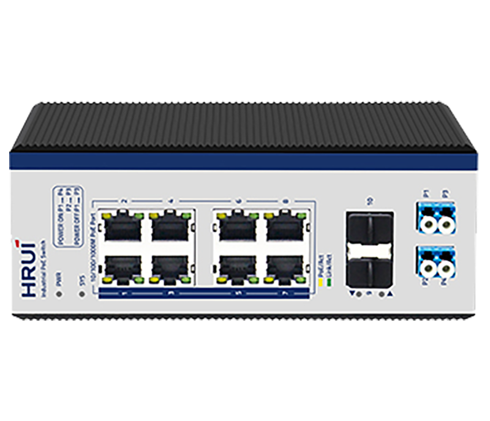
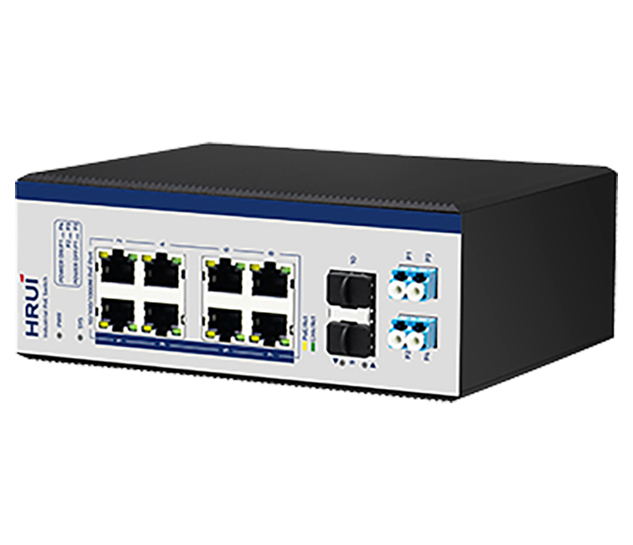
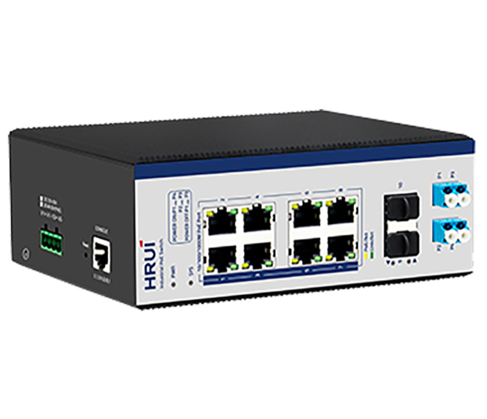
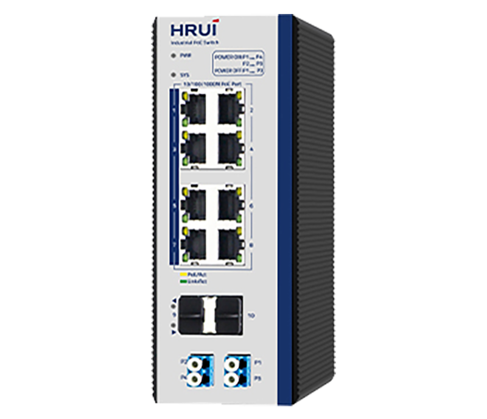

# HR600-AFGM-82AS-BP

> 来源：<https://www.hruitech.com/industrial-poe-switch/125.html>（抓取 2026-10-21T03:47:32Z；英文原文照录，中文仅为栏目名）  
> 官网描述：Industrial L2+ 8-Port 10/100/1000T 802.3af/at PoE + 2-Port 2.5G SFP Bypass Managed Ethernet Switch  
> 类目：Industrial PoE Switch（site id 125）  
> 接口：8 Gigabit PoE Ports + 2 *2.5G SFP Port(Compatible with 1.25G / 155M) + 1 Console Port；PoE 预算 —；交换带宽 —；电源 Input Voltage: DC12～55V / Type of input: 4 PIN Industrial Terminal（block V1+V1- V2+ V2-）

**Brief:** 2.5G ring network industiral managed PoE switch, integrated with Bypass protection function, 8*Gigabit PoE ports + 2*Gigabit uplink SFP ports + 1*Console port, 9-10 ports support 2.5G, bandwidth 26Gbps, Layer 2 management, support ERPS protocol, ring network redundancy, IP40 protection, Surge 6KV, ESD 15KV, DC48-55V power input, redundant power supply, adapt to -40°C~+85°C wide temperature

## 产品图





## Datasheet
- [HR600_AFGM_82AS.pdf](https://www.hruitech.com/web/userfiles/productfile/HR600_AFGM_82AS.pdf) （本地：`data/hrui_site_raw/datasheets/HR600_AFGM_82AS.pdf`；文本：`data/hrui_site_raw/datasheet_text/HR600_AFGM_82AS.txt`）

## Feature and Benefits（原文）
```
HR600-AFGM-82AS-BP, a robust 10-Port Gigabit Industrial Ethernet PoE Switch designed for seamless connectivity and reliability in demanding environments. This innovative switch features 8 Gigabit PoE Ports and 2 *2.5G SFP Ports (fully compatible with 1.25G and 155M) along with an additional Console Port. It incorporates an integrated bypass protection function and offers versatile mounting options on Din rail or walls.
With dual power input support (DC 12-55V) and a wide operating temperature range of -40 to 75°C, this switch meets the rigorous standards of industrial environments, receiving certifications from FCC, CE, CCC, and RoHS. Its reliable industrial design ensures the stable operation of automation systems, making it suitable for various applications such as wind power, electric power, assembly automation, subway passenger information systems (PIS), electric power SCADA, sewage treatment, metallurgy, intelligent transportation, rail transportation, military operations, and more. Additionally, it boasts energy-efficient performance, contributing to its status as a green, low-power industrial Ethernet switch.
The HR600 series is engineered with advanced network management capabilities, including redundant ring topology, loop protection, VLAN configuration, Quality of Service (QoS), speed control, port mirroring, and support for firmware online upgrades. Built with standardized industrial design principles, this switch fulfills the stringent requirements of industrial sites, ensuring enhanced reliability and uninterrupted safety communications through redundant, wide-voltage power inputs and outputs.
Product Features:
Port Configuration:
8 Gigabit PoE Ports + 2 *2.5G SFP Ports (compatible with 1.25G / 155M) + 1 Console Port.
Standards Compliance:
IEEE802.3, IEEE802.3u, IEEE802.3x, IEEE802.3z / AB, IEEE802.1Q, IEEE802.1p, IEEE802.1d/w.
PoE Management:
PoE Power Management with PoE Watchdog based on data stream detection.
Bypass Protection:
Integrated bypass function for uninterrupted data flow.
PoE Standards Supported:
IEEE802.3af (15.4W), IEEE802.3at (30W).
Spanning Tree Protocols:
STP (802.1D), RSTP (802.1w), MSTP (802.1s), ERPS.
Network Security:
Support for SNMP v1/v2/v3, IGMP snooping, static multicast filtering, and MLD snooping.
Authentication and Management:
Supports 802.1x port access and AAA certification for enhanced security, with management options via WEB, Telnet, CLI, and SSH.
Durability:
IP40 rated protection with a rugged, high-strength metal chassis, suitable for DIN35 rail mounting.
EMC Compliance:
EMC grade 4 design, operating temperature range of -40 to 75°C.
Redundant Power Supply:
Supports redundant power supply connections with anti-reverse protection.
Surge Protection:
General 6KV, Differential 4KV; ESD ratings of 15KV (Air) and 8KV (Contact).
EMC Compliance:
Adheres to EMC EN55032 standards for electromagnetic compatibility.
```

## Parameter（规格表逐行）
| 项 | 值 |
|---|---|
| **Conventional parameters** | |
| Product Name | 10 Ports Gigabit Managed Industrial PoE Switch |
| Product Model | HR600-AFGM-82AS-BP |
| Port Definition | 8 Gigabit PoE Ports + 2 *2.5G SFP Port(Compatible with 1.25G / 155M) + 1 Console Port |
| Network Protocols | IEEE802.3 |
| Network Protocols | IEEE802.3u |
| Network Protocols | IEEE802.3z |
| Network Protocols | IEEE802.3ab |
| Network Protocols | IEEE802.3x |
| Network Protocols | IEEE802.1d |
| Network Protocols | IEEE802.1w |
| POE Parameters | POE Standard: IEEE 802.3af / IEEE 802.3at/IEEE802.3bt |
| POE Parameters | Single PoE Port Power Output: |
| POE Parameters | Max: 15.4 W (IEEE 802.3af) |
| POE Parameters | Max: 30 W (IEEE 802.3at) |
| POE Parameters | PoE Compatibility: IEEE 802.3af / at adaptive |
| POE Parameters | POE Power Output: DC 48-55V |
| POE Parameters | POE Power Pin:1/2- ; 3/6+ |
| Network Media | 10BASE-T: Cat3,4,5 UTP(≤100 M) |
| Network Media | 100BASE-TX: Cat5 or above UTP(≤100 M) |
| Network Media | 1000BASE-TX: Cat5 or above UTP(≤100 M) |
| Bypass | P1: Optical Fiber in or out Port (P3 and P4 are corresponding outlets, recommended to connect A ) |
| Bypass | P3: Optical Fiber in or out Port (P1 and P2 as corresponding outlets, recommended to connect B ) |
| Bypass | P2: SFP Module Fiber Port (P3 as corresponding outlets, recommended to connect A ) |
| Bypass | P4: SFP Module Fiber Port (P1 as corresponding outlets, recommended to connect B ) |
| Fiber Media | Multi-mode：850nm，1310nm Transmission Distance: 550m/2Km |
| Fiber Media | Single-mode：1310nm，1550nm Transmission Distance: 20/40/60/80/100/120Km |
| LED Indicator | PWR / Lighting：Powered |
| LED Indicator | PWR / Un-Light：No Power |
| LED Indicator | SYS / Lighting：System is operating normally |
| LED Indicator | SYS / Un-Light：System is not running |
| LED Indicator | Yellow light / Lighting：PoE Powered |
| LED Indicator | Yellow light / Un-Light：No PoE Powered |
| LED Indicator | Yellow light / Flashing：Port and device mismatch |
| LED Indicator | Green light / Slow Flashing：10/100/1000 Link normally |
| LED Indicator | Green light / Un-Light：Link disconnect |
| LED Indicator | Green light / Flashing：Link data transmission |
| LED Indicator | G9-G10 / Lighting：Fiber Connection is Normal |
| LED Indicator | G9-G10 / Un-Light：Disconnect |
| LED Indicator | G9-G10 / Flashing：Link data transmission |
| Power Supply | Input Voltage: DC12～55V |
| Power Supply | Type of input: 4 PIN Industrial Terminal（block V1+V1- V2+ V2-） |
| Physical structure | Protect grade： IP40 |
| Physical structure | Installation：DIN Rail |
| Physical structure | Product weight： 0.8 KG Package weight: 1.1 KG（Without power） |
| Physical structure | Product Dimensions (L×W×H): 165mm×130mm×65mm |
| Physical structure | Package Dimensions (L×W×H): 242mm×207mm×86mm |
| Physical structure | Standard packing (L×W×H): 445mm×445mm×510mm |
| Physical structure | Standard packing quantity : 28(PCS) |
| Working Environment | Operating temperature: -40～75℃ |
| Working Environment | Storage temperature: -40～85℃ |
| Working Environment | Humidity: 5%~95 % ( No condensation) |
| Industry Standard | EMI: FCC Part 15, CISPR (EN55032) class A |
| Industry Standard | EMS: EN61000-4-2 (ESD) |
| Industry Standard | EN61000-4-4 (EFT) |
| Industry Standard | EN61000-4-5 (Surge) |
| Certification | CE , FCC , ROHS |
| MTBF | 100,000 hours |
| Packing list | 1. Industrial grade switch: 1 Set |
| Packing list | 2. Instruction manual: 1 PCS |
| Packing list | 3. Certificate, warranty card: 1 PCS |
| Packing list | 4. Serial cable：1PCS |
| Warranty | 5 years |
| **Hardware Parameters** | |
| Bandwidth | 26Gbps |
| Packet Forwarding Rate | 19.34Mpps |
| RAM | 128MB |
| Flash | 16MB |
| Packet Buffer Memory | 4M |
| Jumbo frame | 9.6Kbytes |
| VLANs | 4096 |
| MAC | 8K |
| Forwarding Mode | Store-And-Forward |
| Menu Items | Submenus / Secondary Submenus / Triple Submenus |
| Information & Status | System Information |
| Information & Status | IP Status |
| Information & Status | Syslog |
| Information & Status | Detailed Syslog |
| Information & Status | MAC Table |
| Information & Status | VLANs / Membership |
| Information & Status | VLANs / Ports |
| Information & Status | Ports / Traffic Overview |
| Information & Status | Ports / Detailed Statistics |
| Information & Status | LACP / System Status |
| Information & Status | LACP / Port Status |
| Information & Status | LACP / Port Statistics |
| Information & Status | Green Ethernet |
| Information & Status | LLDP / Neighbors |
| Information & Status | LLDP / Port Statistics |
| Information & Status | Loop Protection |
| Information & Status | Spanning Tree / Bridge Status |
| Information & Status | Spanning Tree / Port Status |
| Information & Status | Spanning Tree / Port Statistics |
| Information & Status | IGMP Snooping / Status |
| Information & Status | IGMP Snooping / Groups Information |
| Information & Status | IGMP Snooping / IPv4 SFM Information |
| Information & Status | MLD Snooping / Status |
| Information & Status | MLD Snooping / Groups Information |
| Information & Status | MLD Snooping / IPv6 SFM Information |
| Information & Status | DHCP / Server / Statistics |
| Information & Status | DHCP / Server / Binding |
| Information & Status | DHCP / Server / Declined IP |
| Information & Status | DHCP / Snooping Table |
| Information & Status | DHCP / Relay Statistics |
| Information & Status | DHCP / Detailed Statistics |
| Information & Status | Security / Port Security / Switch |
| Information & Status | Security / Port Security / Port |
| Information & Status | Security / Access Management Statistics |
| Information & Status | Security / 802.1X / Switch |
| Information & Status | Security / 802.1X / Port |
| Information & Status | Security / ACL Status |
| Information & Status | Security / AAA / RADIUS Overview |
| Information & Status | Security / AAA / RADIUS Details |
| Information & Status | QoS / QoS Statistics |
| Information & Status | QoS / QCL Status |
| Network Admin | IP Config |
| Network Admin | IP Status |
| Network Admin | DHCPServer / Mode |
| Network Admin | DHCPServer / Excluded IP |
| Network Admin | DHCPServer / Pool |
| Network Admin | NTP |
| Network Admin | Timezone |
| Network Admin | SNMP / System |
| Network Admin | SNMP / Trap |
| Network Admin | SNMP / Communities |
| Network Admin | SNMP / Users |
| Network Admin | SNMP / Groups |
| Network Admin | SNMP / Views |
| Network Admin | SNMP / Access |
| Network Admin | Syslog |
| Port Configure | Ports |
| Port Configure | Aggregation / Static |
| Port Configure | Aggregation / LACP |
| Port Configure | Mirroring |
| Port Configure | Green Ethernet |
| Port Configure | DDM / DDM Configuration |
| Port Configure | DDM / DDM Overview |
| Port Configure | DDM / DDM Detailed |
| PoE | PoE Setting |
| PoE | PoE Status |
| Advanced Configure | MAC Table |
| Advanced Configure | VLANs |
| Advanced Configure | GVRP / Global config |
| Advanced Configure | GVRP / Port config |
| Advanced Configure | Port Isolation / Port Group |
| Advanced Configure | Port Isolation / Port Isolation |
| Advanced Configure | Loop Protection |
| Advanced Configure | Spanning Tree / Bridge Setting |
| Advanced Configure | Spanning Tree / MSTI Mapping |
| Advanced Configure | Spanning Tree / MSTI Priorities |
| Advanced Configure | Spanning Tree / CIST Ports |
| Advanced Configure | Spanning Tree / MSTI Ports |
| Advanced Configure | IPMC Profile / Profile Table |
| Advanced Configure | IPMC Profile / Address Entry |
| Advanced Configure | MEP |
| Advanced Configure | ERPS |
| Advanced Configure | IGMP Snooping / Basic Configuration |
| Advanced Configure | IGMP Snooping / VLAN Configuration |
| Advanced Configure | IGMP Snooping / Port Filtering Profile |
| Advanced Configure | IPV6 MLD Snooping / Basic Configuration |
| Advanced Configure | IPV6 MLD Snooping / VLAN Configuration |
| Advanced Configure | IPV6 MLD Snooping / Port Filtering Profile |
| Advanced Configure | LLDP |
| Security Configure | Users |
| Security Configure | Privilege Levels |
| Security Configure | SSH |
| Security Configure | Port Security Limit |
| Security Configure | Access Management |
| Security Configure | 802.1X |
| Security Configure | ACL / Ports |
| Security Configure | ACL / Rate Limiters |
| Security Configure | ACL / Access Control List |
| Security Configure | DHCP / Snooping Setting |
| Security Configure | DHCP / Snooping Table |
| Security Configure | DHCP / Relay |
| Security Configure | DHCP / Relay Statistics |
| Security Configure | DHCP / Detailed Statistics |
| Security Configure | IP&MAC Source Guard / Configuration |
| Security Configure | IP&MAC Source Guard / Static Table |
| Security Configure | IP&MAC Source Guard / Dynamic Table |
| Security Configure | ARP Inspection / Port Configuration |
| Security Configure | ARP Inspection / VLAN Configuration |
| Security Configure | ARP Inspection / Static Table |
| Security Configure | ARP Inspection / Dynamic Table |
| Security Configure | AAA / RADIUS |
| Security Configure | AAA / TACACS+ |
| QoS Configure | Port Classification |
| QoS Configure | Port Policing |
| QoS Configure | Queue Policing |
| QoS Configure | Port Scheduler |
| QoS Configure | Port Shaping |
| QoS Configure | Port Tag Remarking |
| QoS Configure | Port DSCP |
| QoS Configure | DSCP-Based QoS |
| QoS Configure | DSCP Translation |
| QoS Configure | DSCP Classification |
| QoS Configure | QoS Control List |
| QoS Configure | Storm Policing |
| Diagnostics | Ping |
| Diagnostics | Cable Diagnostics |
| Diagnostics | CPU Load |
| Maintenance | Restart Device |
| Maintenance | Factory Defaults |
| Maintenance | Firmware Upgrade |
| Maintenance | Firmware Select |
| Maintenance | Configuration / Download |
| Maintenance | Configuration / Upload |
| Maintenance | Configuration / Activate |
| Maintenance | Configuration / Delete |
