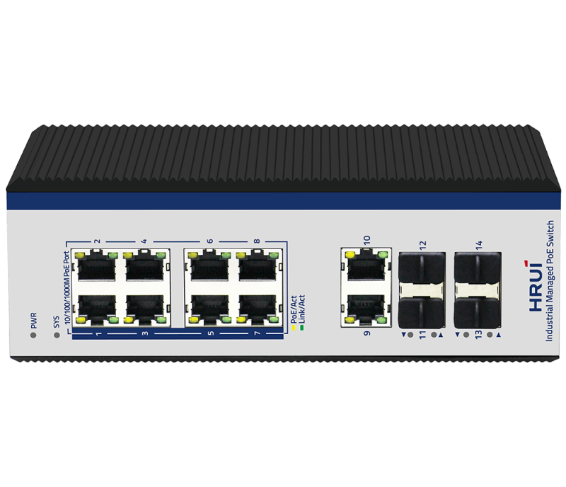
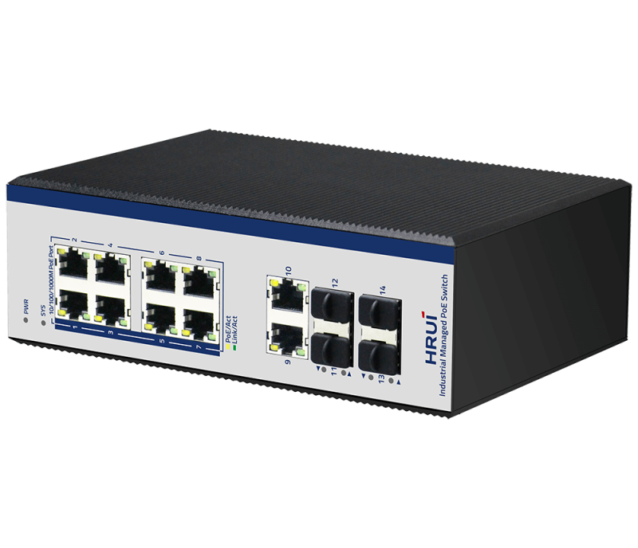
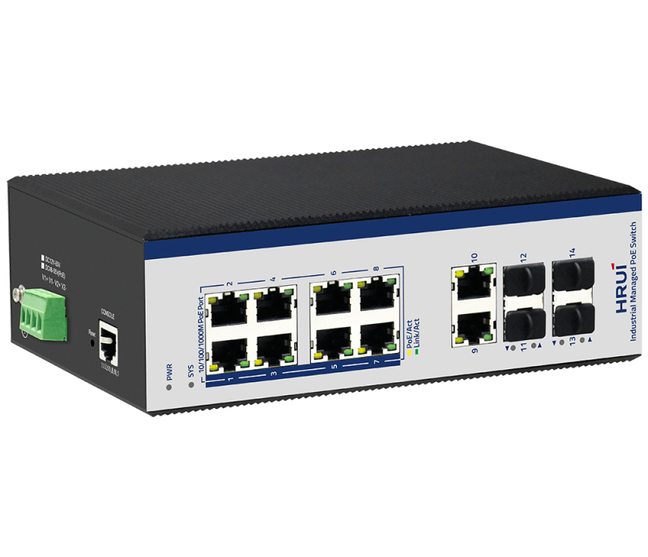
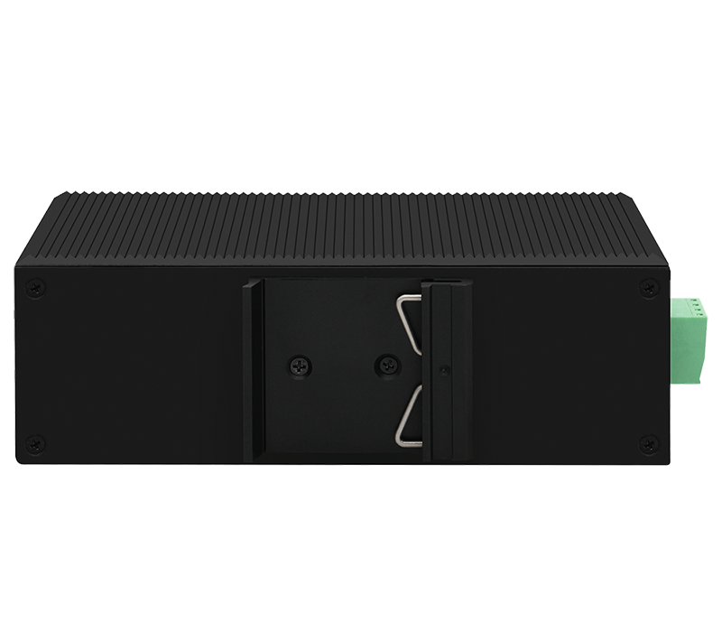

# HR600-AFGM-SWG20824AS

> 来源：<https://www.hruitech.com/industrial-poe-switch/109.html>（抓取 2026-10-21T04:36:39Z；英文原文照录，中文仅为栏目名）  
> 官网描述：Industrial L2+ 8-Port 10/100/1000T 802.3af/at PoE+ 2-Port 10/100/1000T+2-Port 1000X SFP +2-Port 2.5G SFP Managed Ethernet Switch  
> 类目：Industrial PoE Switch（site id 109）  
> 接口：8 *1G PoE ports / 2 *1G RJ45 ports / 4 *1G SFP ports(13-14 Port support 2.5G,Compatible with 1.25G/155M)) / 1 * Console port；PoE 预算 According to the adapter；交换带宽 —；电源 DC12～55V / DC48～55V (PoE) / Power wiring: 4 PIN industrial terminals (redundant V1+V1-, V2+V2-）

**Brief:** 2.5G ring network industiral managed PoE switch, with 8*Gigabit PoE ports + 2*Gigabit uplink RJ45 ports + 4*Gigabit uplink SFP ports + 1*Console port, 13-14 ports support 2.5G, bandwidth 34Gbps, Layer 2 management, support ERPS protocol, ring network redundancy, IP40 protection, Surge 6KV, ESD 15KV, DC48-55V power input, redundant power supply, adapt to -40°C~+75°C wide temperature

## 产品图





## Datasheet
- [HR600_AFGM_SWG20824AS.pdf](https://www.hruitech.com/web/userfiles/productfile/HR600_AFGM_SWG20824AS.pdf) （本地：`data/hrui_site_raw/datasheets/HR600_AFGM_SWG20824AS.pdf`；文本：`data/hrui_site_raw/datasheet_text/HR600_AFGM_SWG20824AS.txt`）

## Feature and Benefits（原文）
```
The HR600-AFGM-SWG20824AS is a cutting-edge 2.5G industrial managed Power over Ethernet (PoE) switch, designed to meet the demanding needs of network infrastructures. Featuring 14 versatile ports, it includes 8 Gigabit PoE ports, 2 Gigabit uplink RJ45 ports, 4 Gigabit uplink SFP ports, and a console port. With support for 2.5G throughput and an impressive bandwidth capacity of 34Gbps, this switch is optimized for high-performance applications. It supports Layer 2 management and the ERPS protocol, ensuring ring network redundancy for added reliability. The device is built to withstand harsh conditions, offering IP40-rated protection, surge protection up to 6KV, and ESD protection of 15KV. Its DC48-55V power input and redundant power supply ensure uninterrupted operation across extreme temperatures ranging from -40°C to +75°C.
Product Features:
Standards Compliance:
Compliant with IEEE802.3, IEEE802.3u, IEEE802.3x, IEEE802.3z/ab, IEEE802.1Q, IEEE802.1p, and IEEE802.1d/w for enhanced compatibility.
Power over Ethernet (PoE) Management:
Intelligent PoE power management and a PoE watchdog based on data stream detection, supporting IEEE 802.3af (15.4W) and IEEE 802.3at (30W) standards.
Network Protocols:
Supports STP (802.1D), RSTP (802.1w), MSTP (802.1s), and ERPS for robust network topology management.
Network Monitoring:
SNMP v1/v2/v3 support for efficient network management, along with IGMP Snooping, static multicast filtering, and MLD Snooping.
Enhanced Security:
802.1x port-based authentication and AAA certification to enhance network security and access control.
Management Interfaces:
Offers multiple management options including WEB, Telnet, CLI, and SSH for convenience and flexibility.
Durable Design:
Constructed with a rugged high-strength metal casing, featuring IP40 protection, DIN35 rail mounting options, and meeting EMC grade 4 standards; operational from -40°C to 75°C.
Power Redundancy:
Supports redundant power supply connections and safeguards against reverse polarity connections.
EMC Standards Compliance:
Meets EMC standards including EN55032 for electromagnetic compatibility and interference resistance.
```

## Parameter（规格表逐行）
| 项 | 值 |
|---|---|
| Description | Specification |
| Model | HR600-AFGM-SWG20824AS |
| Interface | 8 *1G PoE ports |
| Interface | 2 *1G RJ45 ports |
| Interface | 4 *1G SFP ports(13-14 Port support 2.5G,Compatible with 1.25G/155M)) |
| Interface | 1 * Console port |
| Port Standard | IEEE802.3 (Ethernet) |
| Port Standard | IEEE802.3u (Fast Ethernet) |
| Port Standard | IEEE 802.3ab (Gigabit Ethernet) |
| Port Standard | IEEE 802.3z (Gigabit Ethernet Fiber Standard) |
| Port Standard | IEEE802.3x (Flow Control) |
| Port Standard | IEEE 802.1D Spanning Tree Protocol |
| Port Standard | IEEE 802.1w Rapid Spanning Tree Protocol |
| Bandwidth | 34Gbps |
| Packet Forwarding Rate | 25.29Mpps |
| Packet Buffer | 4Mbit |
| MAC Address Table | 8K |
| Jumbo Frame | 9.6Kbytes |
| VLAN | VLAN range 1-4094, maximum active VLAN is 4K |
| Transmission Method | Store and Forward |
| PoE Standard | IEEE802.3af (15.4W) |
| PoE Standard | IEEE802.3at (30W) |
| PoE Port Output Voltage | DC 48-55V |
| PoE Ports | Port 1-8 PoE power output <30W |
| PoE Power Budget | According to the adapter |
| Power Supply | DC12～55V |
| Power Supply | DC48～55V (PoE) |
| Power Supply | Power wiring: 4 PIN industrial terminals (redundant V1+V1-, V2+V2-） |
| Mainboard Power Consumption | 9.8W |
| Structure Information | Product Dimensions :188*130*64mm |
| Structure Information | Packaging Dimensions : 242*207*86mm |
| Structure Information | Product Net Weight: 1KG |
| Structure Information | Product Gross Weight: 1.3KG (excluding power supply) |
| Structure Information | Packing Quantity: 20PCS |
| Structure Information | Packing Weight: 27KG |
| Package Contents | Switch 1pcs, serial cable 1pcs,manual 1pcs,certificate of qualification 1pcs |
| Fan Quantity | 0 |
| Certification | CE、FCC、RoHS |
| Installation | Desktop,wall mounting installation, rail installation |
| Surge Protection | Port Surge: Common mode 6KV, differential mode 2KV; |
| Surge Protection | Electrostatic ESD: Air 15KV, Contact 8KV |
| Operating Temperature | -40 ~ 75°C |
| Storage Temperature | -40～85℃ |
| Operation Humidity | 10%~90%,non condensing |
| Storage Humidity | 5%~95%,non condensing |
| SYS Green LED | On: The system is running normally |
| SYS Green LED | Off:The system is not running |
| 1-10 Green LED | Slow Flashing: 10M/100M/1G Link normal |
| 1-10 Green LED | Off: Link blocked |
| 1-10 Green LED | Fast Flashing: Data transmitting |
| 1-10 Yellow LED | On: PoE powered on |
| 1-10 Yellow LED | Off: PoE powered off |
| G11-G14 Green LED | On: 10M/100M/1G Link normal |
| G11-G14 Green LED | Off: Link blocked |
| G11-G14 Green LED | Flashing: Link data transmission |
| PWR Green LED | On: powered on |
| PWR Green LED | Off: powered off |
| Reset | Long press for 6 seconds to restore factory settings |
| **Software Features** | |
| **L2 Function** | |
| IPv4 | IPv4 VLAN Interface |
| IPv4 | IPv4 Static Routes |
| IPv4 | ARP |
| Port | Port Switch configuration |
| Port | Port Description configuration |
| Port | Port Speed configuration |
| Port | Port Duplex configuration |
| Port | Port Flow Control configuration |
| Port | Max. 2500Mbps at SFP interface |
| Port | Jumbo Frame |
| Port | EEE |
| Port | Fiber Module(DDM) |
| Link Aggregation | Supports load balance policy; Base on MAC and IP-MAC |
| Link Aggregation | Static and Dynamic Group |
| Link Aggregation | Supports LACP |
| Storm Control | Boardcast suppression |
| Storm Control | Unknown Multicast |
| Storm Control | Unknown Unicast |
| Port Mirroring | One to one monitor |
| Port Mirroring | Many to one monitor |
| Port Mirroring | Ingress/Egress/Both |
| Port Security | MAC Address Constraints |
| Port Security | Action：Trap/Shutdown |
| Port Isolation | Support |
| Port Rate-limit | Support |
| Loopback Detection | Support |
| VLAN | Access/Trunk/Hybrid |
| VLAN | VLAN Tunnel (Q-in-Q Tunnel) |
| VLAN | GVRP |
| VLAN | VLAN range 1-4094, maximum active VLAN is 4K |
| MAC Address | Dynamic MAC address |
| MAC Address | Static MAC address |
| Spanning Tree Protocol | STP/RSTP/MSTP |
| Spanning Tree Protocol | BPDU Filter |
| Spanning Tree Protocol | BPDU Guard |
| Spanning Tree Protocol | Edge Port |
| ERPS | Major and sub ring |
| ERPS | up to 16 rings |
| Smart Ring | Private Ring |
| Smart Ring | Major and sub ring |
| Smart Ring | Up to 16 rings |
| PTP | Ordinary Clock |
| PTP | Boundary Clock |
| PTP | Transparent clock |
| LLDP | Support |
| Multicast | IGMP Snooping |
| Multicast | IGMP V1/V2/V3 |
| Multicast | Router Port |
| Multicast | Static IGMP group address |
| Multicast | IGMP groups filtering |
| Multicast | Querier |
| Multicast | MLD Snooping |
| QoS | Traffic classification based, Strict priority and WRR |
| QoS | Port Priority |
| QoS | 802.1P Priority |
| QoS | IP DSCP Priority |
| QoS | Supports up to 8 queues per port |
| QoS | Port Shaping |
| **PoE** | |
| PoE Configuration | PoE Temperature |
| PoE Configuration | PoE Type/Level/Power/Voltage/Current query |
| PoE Configuration | PoE Switch Configuration |
| PoE Configuration | PoE Watchdog |
| PoE Configuration | Total PoE power budget control |
| PoE Configuration | PoE power management |
| PoE Configuration | PoE port priority |
| PoE Configuration | IEEE 802.3bt，compatible with IEEE 802.3af/802.3at PoE |
| PoE Configuration | Per PoE port power limit |
| PoE Schedule | Support |
| PoE Port Timer Reboot | Support |
| **Services** | |
| DHCP | DHCP Server |
| DHCP | IP Pool |
| DHCP | Static Binding |
| DHCP | DHCP Relay |
| Access Protocol | HTTP |
| Access Protocol | Telnet |
| Access Protocol | SSH |
| Access Protocol | Manager ACL |
| **Security** | |
| AAA | RADIUS |
| AAA | TACACS+ |
| AAA | 802.1X |
| AAA | Base on port/MAC/local/WEB |
| DHCP Snooping | Support |
| IP Source Guard | Support |
| Dynamic ARP Inspection | Support |
| ACL | MAC ACL |
| ACL | Port ACL |
| ACL | IPv4 ACL |
| ACL | IPv6 ACL |
| **Diagnostics** | |
| Syslog | Logging Message |
| Syslog | Remote Server |
| Ping | Support |
| Traceroute | Support |
| Cable Diagnositics | Support |
| **Equipment Management** | |
| Manager Access | Console |
| Manager Access | HTTP |
| Manager Access | Telnet |
| Manager Access | SSHv2 |
| Manager Access | SNMP |
| Manager IP | Static Address |
| Manager IP | DHCP Client |
| Manager IP | Supports IPv4 and IPv6 address |
| Manager IP | DNS |
| Time Synchronization | SNTP |
| Time Synchronization | Manual Time |
| SNMP | V1/V2C/V3 |
| SNMP | Community |
| SNMP | V3 User |
| SNMP | Group |
| SNMP | Trap Host |
| SNMP MIB | RFC 1213 MIB-II |
| SNMP MIB | RFC 1493 Bridge MIB |
| SNMP MIB | RFC 1643 Ethernet MIB |
| SNMP MIB | RFC 2819 RMON MIB (Groups 1, 2, 3 and 9) |
| SNMP MIB | RFC 2863 Interface MIB |
| SNMP MIB | Private MIB |
| RMON | Statistics |
| RMON | History Configuration |
| RMON | Event Configuration |
| RMON | Alarm Configuration |
| User Management | Congurable user privilege level from 0 - 15; |
| Firmware Management | Firmware upgrade |
| Firmware Management | Double Image; Swap between Active and Alternate firmware image. |
| Configuration Management | Upload and download |
| Save | Support |
| Restart | Support |
| Factory Defaults | Support |
| **Standard Compliance** | |
| **IEEE 802.3x flow control and back pressure** | |
| **IEEE 802.3ad port trunk with LACP** | |
| **IEEE 802.1D Spanning Tree Protocol** | |
| **IEEE 802.1w Rapid Spanning Tree Protocol** | |
| **IEEE 802.1s Multiple Spanning Tree Protocol** | |
| **IEEE 802.1p Class of Service** | |
| **IEEE 802.1Q VLAN tagging** | |
| **IEEE 802.1x Port Authentication Network Control** | |
| **IEEE 802.1ab LLDP** | |
| **IEEE 802.3af Power over Ethernet** | |
| **IEEE 802.3at Power over Ethernet Plus** | |
| **IEEE 802.3bt PoE++ Power over Ethernet Plus Plus** | |
| **RFC 768 UDP** | |
| **RFC 793 TFTP** | |
| **RFC 791 IP** | |
| **RFC 792 ICMP** | |
| **RFC 2068 HTTP** | |
| **RFC 1112 IGMP v1** | |
| **RFC 2236 IGMP v2** | |
| **RFC 3376 IGMP v3** | |
| **RFC 2710 MLD v1** | |
| **FRC 3810 MLD v2** | |
| **ITU-T G.8032 ERPS Ring** | |

## Product structure / Application topology（图）
- https://www.hruitech.com/web/userfiles/image/20250109/1736402676353656.png
