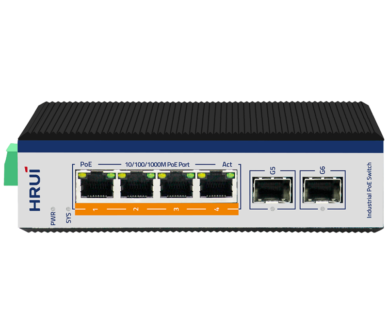
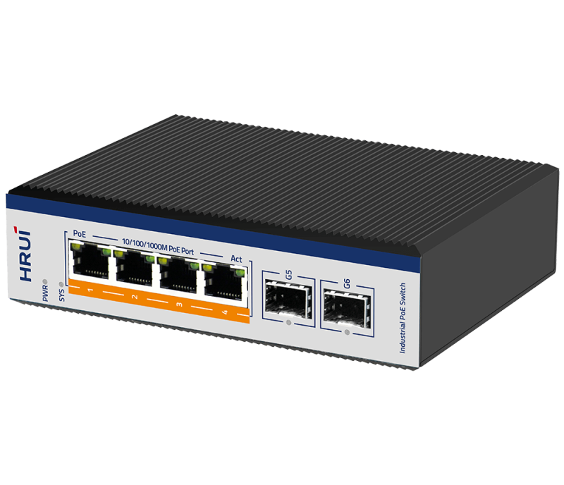
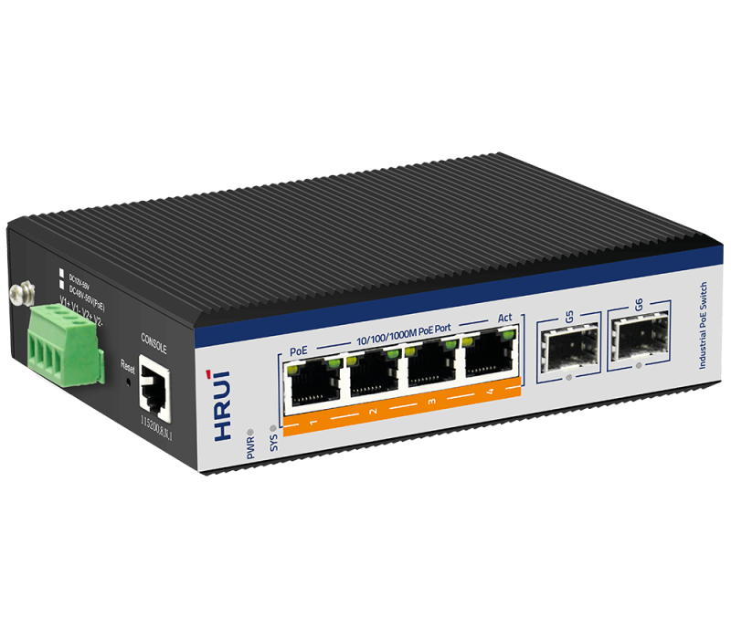
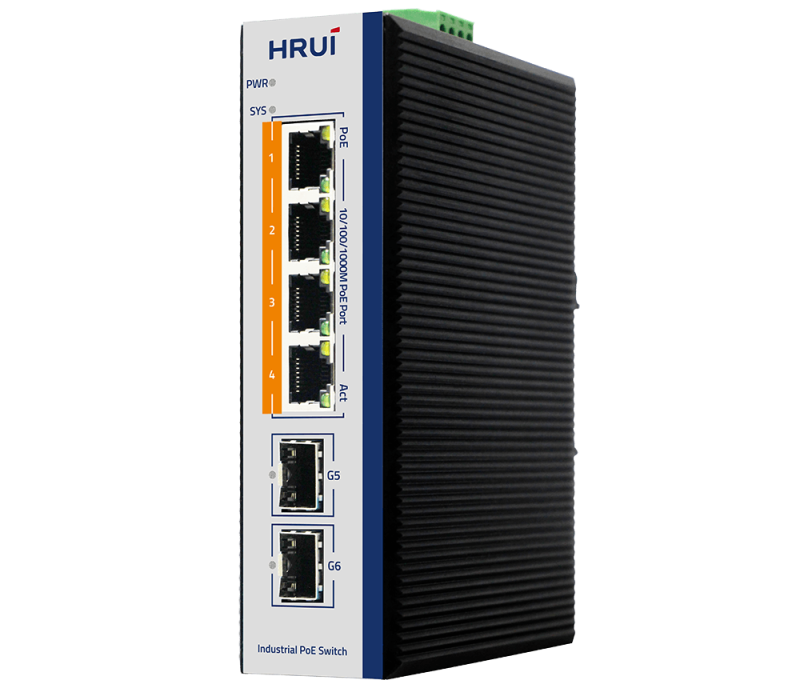

# HR600-BTGM-42AS

> 来源：<https://www.hruitech.com/industrial-poe-switch/104.html>（抓取 2026-10-21T03:46:10Z；英文原文照录，中文仅为栏目名）  
> 官网描述：6-Port Gigabit Industrial 2.5G SFP Managed BT90W PoE Switch  
> 类目：Industrial PoE Switch（site id 104）  
> 接口：4 *1G PoE ports / 2 *2.5Gbps SFP ports(Compatible with 1.25G/155M) / 1 * Console port；PoE 预算 240W；交换带宽 —；电源 DC12～55V / DC48～55V (PoE) / Power wiring: 4 PIN industrial terminals (redundant V1+V1-, V2+V2-）

**Brief:** 2.5G ring network industiral managed BT90W PoE switch, with 4*Gigabit BT90W PoE ports + 2*2.5G uplink SFP ports + 1*Console port, bandwidth 18Gbps, Layer 2 management, support ERPS protocol, ring network redundancy, IP40 protection, Surge 6KV, ESD 15KV, DC48-55V power input, redundant power supply, adapt to -40°C~+75°C wide temperature

## 产品图





## Datasheet
- [HR600_BTGM_42AS.pdf](https://www.hruitech.com/web/userfiles/productfile/HR600_BTGM_42AS.pdf) （本地：`data/hrui_site_raw/downloads/HR600_BTGM_42AS.pdf`；文本：`data/hrui_site_raw/datasheet_text/HR600_BTGM_42AS.txt`）

## Feature and Benefits（原文）
```
The HRUI 6-port Gigabit Industrial Ethernet PoE Switch (HR600-BTGM-42AS) is engineered for high performance in demanding environments. It features four Gigabit BT PoE ports with a 90W power output and two 2.5G SFP ports for flexible connectivity. With dual power input (DC48-55V) and an operating temperature range of -40℃ to 75℃, it ensures reliable operation under extreme conditions.
This switch offers advanced network management capabilities like redundancy loops, VLAN, QoS, and firmware upgrades, supporting the IEEE 1588 protocol for accurate time synchronization. Built with industrial-grade components, it is ideal for applications in industries such as wind power, automation, and military, providing dependable network solutions for complex environments.
PRODUCT FEATURES
• IEEE 802.3af/at/bt PoE Standard
Offer 4 PoE ports with a maximum output power of 90W per port, enabling simultaneous transmission of both power and data signals to end devices over a single Cat.5e or higher Ethernet cable, eliminating the need for separate power cables and simplifying installation and maintenance.
• 2.5G SFP
This Gigabit Industrial Switch features two 2.5G Base-X SFP ports and offers an increased switching capacity for non-blocking high-speed data forwarding. It supports high-bandwidth connections and is compatible with auto-adaptive fiber optic modules for 155M, 1G, 1.25G, and 2.5G, providing a broader range of data rates.
• Industrial Design Enabling Durable Applications
The device features IP40 protection and a rugged high-strength metal case, designed for reliable operation in demanding industrial environments. It supports DIN35 rail mounting and boasts an EMC grade 4 design, ensuring resilience against electromagnetic interference. With a working temperature range of -40℃ to 75℃, it is built to withstand harsh conditions while delivering optimal performance.
• Dual Power Input Design
The device features dual power input, enabling you to set up multiple power sources for enhanced reliability and redundancy. This design guarantees that your system stays operational during power failures or unexpected shutdowns.
• Rich Management Function
Support port management, ACL, QoS, VLANS, RSTP, STP, VLAN, LACP, LLDP, Multicast and more.
• ERPS Ring
The HR600-BTGM-42AS is designed to support the ERPS ring and boasts a
robust self-recovery capability that operates within 12ms.
This feature helps prevent interruptions and external threats, significantly improving system reliability and uptime across diverse environments.
• Integrated PoE Features for Managing PD
Designed as a managed PoE switch for surveillance, wireless, and VoIP networks, the HR600-BTGM-42AS offers several advanced PoE management features, including:
• PoE Watchdog
• PoE Configuration
• PoE Schedule
• PoE Timer Management
PoE Watchdog
Detect and reboot dropped or unresponsive PoE-powered devices.
PoE Configuration
Provide configuration support for PoE settings, including parameters such as
temperature, type, level, power, current, total PoE power budget management, PoE power control, port priority allocations, and individualized power limits for each PoE port.
This thorough strategy will optimize PoE management, promote efficient resource utilization, and improve device reliability and performance.
PoE Schedule
Support for customizing the schedule to turn the PoE function on or off based on specific needs. This flexibility not only helps optimize energy consumption but also reduces operational costs, making it an efficient solution for energy management.
PoE Timer Management
Support rebooting the PoE function of port during a specified time. This will help reduce device crashes caused by buffer overflow, ensuring more reliable and stable performance during designated time intervals.
• IPv6/IPv4 Dual Stack Management
The HR600-BTGM-42AS supports both IPv6 and IPv4 protocols, enabling SMBs to transition to the IPv6 era with minimal investment. There's no need to replace or overhaul existing network infrastructure when implementing the IPv6 networking.
• Secure Networking
The HR600-BTGM-42AS features advanced cybersecurity measures, including SSHv2 and SNMPv3 protocols, to protect against cyber threats. Its robust security capabilities enhance switch management while maintaining cost-effective deployment for critical network operations.
• Enhanced Fiber Module DDM Capabilities
Support for Fiber Module DDM (Digital Diagnostic Monitoring) includes tracking key parameters such as transceiver supply voltage, temperature, transmitter bias current, transmitter output power, and received optical power. By analyzing these metrics, you can effectively diagnose issues that may be affecting the transceiver optics' performance.
• IEEE 1588 Solution
The HR600-BTGM-42AS is perfectly suited for telecommunications and Carrier Ethernet applications, compatible with IEEE 1588 and synchronous Ethernet.
```

## Parameter（规格表逐行）
| 项 | 值 |
|---|---|
|  | • IEEE 802.3af/at/bt PoE Standard |
|  | Offer 4 PoE ports with a maximum output power of 90W per port, enabling simultaneous transmission of both power and data signals to end devices over a single Cat.5e or higher Ethernet cable, eliminating the need for separate power cables and simplifying installation and maintenance. |
|  | • 2.5G SFP |
|  | This Gigabit Industrial Switch features two 2.5G Base-X SFP ports and offers an increased switching capacity for non-blocking high-speed data forwarding. It supports high-bandwidth connections and is compatible with auto-adaptive fiber optic modules for 155M, 1G, 1.25G, and 2.5G, providing a broader range of data rates. |
|  | • Industrial Design Enabling Durable Applications |
|  | The device features IP40 protection and a rugged high-strength metal case, designed for reliable operation in demanding industrial environments. It supports DIN35 rail mounting and boasts an EMC grade 4 design, ensuring resilience against electromagnetic interference. With a working temperature range of -40℃ to 75℃, it is built to withstand harsh conditions while delivering optimal performance. |
|  | • Dual Power Input Design |
|  | The device features dual power input, enabling you to set up multiple power sources for enhanced reliability and redundancy. This design guarantees that your system stays operational during power failures or unexpected shutdowns. |
|  | • Rich Management Function |
|  | Support port management, ACL, QoS, VLANS, RSTP, STP, VLAN, LACP, LLDP, Multicast and more. |
|  | • ERPS Ring |
|  | The HR600-BTGM-42AS is designed to support the ERPS ring and boasts a robust self-recovery capability that operates within 12ms. This feature helps prevent interruptions and external threats, significantly improving system reliability and uptime across diverse environments. |
|  | • Integrated PoE Features for Managing PD |
|  | Designed as a managed PoE switch for surveillance, wireless, and VoIP networks, the HR600-BTGM-42AS offers several advanced PoE management features, including: • PoE Watchdog • PoE Configuration • PoE Schedule • PoE Timer Management |
|  | PoE Watchdog |
|  | Detect and reboot dropped or unresponsive PoE-powered devices. |
|  | PoE Configuration |
|  | Provide configuration support for PoE settings, including parameters such as temperature, type, level, power, current, total PoE power budget management, PoE power control, port priority allocations, and individualized power limits for each PoE port. This thorough strategy will optimize PoE management, promote efficient resource utilization, and improve device reliability and performance. |
|  | PoE Schedule |
|  | Support for customizing the schedule to turn the PoE function on or off based on specific needs. This flexibility not only helps optimize energy consumption but also reduces operational costs, making it an efficient solution for energy management. |
|  | PoE Timer Management |
|  | Support rebooting the PoE function of port during a specified time. This will help reduce device crashes caused by buffer overflow, ensuring more reliable and stable performance during designated time intervals. |
|  | • IPv6/IPv4 Dual Stack Management |
|  | The HR600-BTGM-42AS supports both IPv6 and IPv4 protocols, enabling SMBs to transition to the IPv6 era with minimal investment. There's no need to replace or overhaul existing network infrastructure when implementing the IPv6 networking. |
|  | • Secure Networking |
|  | The HR600-BTGM-42AS features advanced cybersecurity measures, including SSHv2 and SNMPv3 protocols, to protect against cyber threats. Its robust security capabilities enhance switch management while maintaining cost-effective deployment for critical network operations. |
|  | • Enhanced Fiber Module DDM Capabilities |
|  | Support for Fiber Module DDM (Digital Diagnostic Monitoring) includes tracking key parameters such as transceiver supply voltage, temperature, transmitter bias current, transmitter output power, and received optical power. By analyzing these metrics, you can effectively diagnose issues that may be affecting the transceiver optics' performance. |
|  | • IEEE 1588 Solution |
|  | The HR600-BTGM-42AS is perfectly suited for telecommunications and Carrier Ethernet applications, compatible with IEEE 1588 and synchronous Ethernet. |
| Description | Specification |
| Model | HR600-BTGM-42AS |
| Interface | 4 *1G PoE ports |
| Interface | 2 *2.5Gbps SFP ports(Compatible with 1.25G/155M) |
| Interface | 1 * Console port |
| Port Standard | IEEE802.3 (Ethernet) |
| Port Standard | IEEE802.3u (Fast Ethernet) |
| Port Standard | IEEE 802.3ab (Gigabit Ethernet) |
| Port Standard | IEEE 802.3z (Gigabit Ethernet Fiber Standard) |
| Port Standard | IEEE802.3x (Flow Control) |
| Port Standard | IEEE 802.1D Spanning Tree Protocol |
| Port Standard | IEEE 802.1w Rapid Spanning Tree Protocol |
| Bandwidth | 18Gbps |
| Packet Forwarding Rate | 13.39Mpps |
| Packet Buffer | 4.1Mbit |
| MAC Address Table | 8K |
| Jumbo Frame | 9.6Kbytes |
| VLAN | VLAN range 1-4094, maximum active VLAN is 4K |
| Transmission Method | Store and Forward |
| PoE Standard | IEEE802.3af (15.4W) |
| PoE Standard | IEEE802.3at (30W) |
| PoE Standard | IEEE802.3bt(90W) |
| PoE Port Output Voltage | DC 48-55V |
| PoE Ports | Port 1-4 PoE power output <90W |
| PoE Power Budget | 240W |
| Power Supply | DC12～55V |
| Power Supply | DC48～55V (PoE) |
| Power Supply | Power wiring: 4 PIN industrial terminals (redundant V1+V1-, V2+V2-） |
| Mainboard Power Consumption | 2.49W |
| Structure Information | Product Dimensions :145*108*40 mm (including hanging ears) |
| Structure Information | Packaging Dimensions : 245*190*60mm |
| Structure Information | Product Net Weight: 0.63KG |
| Structure Information | Product Gross Weight: 0.83KG (excluding power supply) |
| Packing Information | Carton Dimensions : 520*320*400mm |
| Packing Information | Packing Quantity: 20PCS |
| Packing Information | Packing Weight: 17.6KG |
| Package Contents | Switch 1pcs, serial cable 1pcs,manual 1pcs,certificate of qualification 1pcs |
| Fan Quantity | 0 |
| Certification | CE、FCC、RoHS |
| Installation | Desktop,wall mounting installation, rail installation |
| Surge Protection | Port Surge: Common mode 6KV, differential mode 4KV; |
| Surge Protection | Electrostatic ESD: Air 15KV, Contact 8KV |
| Operating Temperature | -40 ~ 75°C |
| Storage Temperature | -40～85℃ |
| Operation Humidity | 10%~90%,non condensing |
| Storage Humidity | 5%~95%,non condensing |
| SYS Green LED | On: The system is running normally |
| SYS Green LED | Off:The system is not running |
| 1-4 Green LED | Slow Flashing: 10M/100M/1G Link normal |
| 1-4 Green LED | Off: Link blocked |
| 1-4 Green LED | Fast Flashing: Data transmitting |
| 1-4 Yellow LED | On: PoE powered on |
| 1-4 Yellow LED | Off: PoE powered off |
| G5-G6 Green LED | On: 10M/100M/1G Link normal |
| G5-G6 Green LED | Off: Link blocked |
| G5-G6 Green LED | Flashing: Link data transmission |
| PWR Green LED | On: powered on |
| PWR Green LED | Off: powered off |
| Reset | Long press for 6 seconds to restore factory settings |
| **Software Features** | |
| **L2 Function** | |
| IPv4 | IPv4 VLAN Interface |
| IPv4 | IPv4 Static Routes |
| IPv4 | ARP |
| Port | Port Switch configuration |
| Port | Port Description configuration |
| Port | Port Speed configuration |
| Port | Port Duplex configuration |
| Port | Port Flow Control configuration |
| Port | Jumbo Frame |
| Port | EEE |
| Port | Fiber Module(DDM) |
| Link Aggregation | Supports load balance policy; Base on MAC and IP-MAC |
| Link Aggregation | Static and Dynamic Group |
| Link Aggregation | Supports LACP |
| Storm Control | Boardcast suppression |
| Storm Control | Unknown Multicast |
| Storm Control | Unknown Unicast |
| Port Mirroring | One to one monitor |
| Port Mirroring | Many to one monitor |
| Port Mirroring | Ingress/Egress/Both |
| Port Security | MAC Address Constraints |
| Port Security | Action：Trap/Shutdown |
| Port Isolation | Support |
| Port Rate-limit | Support |
| Loopback Detection | Support |
| VLAN | Access/Trunk/Hybrid |
| VLAN | VLAN Tunnel (Q-in-Q Tunnel) |
| VLAN | GVRP |
| VLAN | VLAN range 1-4094, maximum active VLAN is 4K |
| MAC Address | Dynamic MAC address |
| MAC Address | Static MAC address |
| Spanning Tree Protocol | STP/RSTP/MSTP |
| Spanning Tree Protocol | BPDU Filter |
| Spanning Tree Protocol | BPDU Guard |
| Spanning Tree Protocol | Edge Port |
| ERPS | Major and sub ring |
| ERPS | up to 16 rings |
| Smart Ring | Private Ring |
| Smart Ring | Major and sub ring |
| Smart Ring | Up to 16 rings |
| PTP | Ordinary Clock |
| PTP | Boundary Clock |
| PTP | Transparent clock |
| LLDP | Support |
| Multicast | IGMP Snooping |
| Multicast | IGMP V1/V2/V3 |
| Multicast | Router Port |
| Multicast | Static IGMP group address |
| Multicast | IGMP groups filtering |
| Multicast | Querier |
| Multicast | MLD Snooping |
| QoS | Traffic classification based, Strict priority and WRR |
| QoS | Port Priority |
| QoS | 802.1P Priority |
| QoS | IP DSCP Priority |
| QoS | Supports up to 8 queues per port |
| QoS | Port Shaping |
| **PoE** | |
| PoE Configuration | PoE Temperature |
| PoE Configuration | PoE Type/Level/Power/Voltage/Current query |
| PoE Configuration | PoE Switch Configuration |
| PoE Configuration | PoE Watchdog |
| PoE Configuration | Total PoE power budget control |
| PoE Configuration | PoE power management |
| PoE Configuration | PoE port priority |
| PoE Configuration | IEEE 802.3bt，compatible with IEEE 802.3af/802.3at PoE |
| PoE Configuration | Per PoE port power limit |
| PoE Schedule | Support |
| PoE Port Timer Reboot | Support |
| **Services** | |
| DHCP | DHCP Server |
| DHCP | IP Pool |
| DHCP | Static Binding |
| DHCP | DHCP Relay |
| Access Protocol | HTTP |
| Access Protocol | Telnet |
| Access Protocol | SSH |
| Access Protocol | Manager ACL |
| **Security** | |
| AAA | RADIUS |
| AAA | TACACS+ |
| AAA | 802.1X |
| AAA | Base on port/MAC/local/WEB |
| DHCP Snooping | Support |
| IP Source Guard | Support |
| Dynamic ARP Inspection | Support |
| ACL | MAC ACL |
| ACL | Port ACL |
| ACL | IPv4 ACL |
| ACL | IPv6 ACL |
| **Diagnostics** | |
| Syslog | Logging Message |
| Syslog | Remote Server |
| Ping | Support |
| Traceroute | Support |
| Cable Diagnositics | Support |
| **Equipment Management** | |
| Manager Access | Console |
| Manager Access | HTTP |
| Manager Access | Telnet |
| Manager Access | SSHv2 |
| Manager Access | SNMP |
| Manager IP | Static Address |
| Manager IP | DHCP Client |
| Manager IP | Supports IPv4 and IPv6 address |
| Manager IP | DNS |
| Time Synchronization | SNTP |
| Time Synchronization | Manual Time |
| SNMP | V1/V2C/V3 |
| SNMP | Community |
| SNMP | V3 User |
| SNMP | Group |
| SNMP | Trap Host |
| SNMP MIB | RFC 1213 MIB-II |
| SNMP MIB | RFC 1493 Bridge MIB |
| SNMP MIB | RFC 1643 Ethernet MIB |
| SNMP MIB | RFC 2819 RMON MIB (Groups 1, 2, 3 and 9) |
| SNMP MIB | RFC 2863 Interface MIB |
| SNMP MIB | Private MIB |
| RMON | Statistics |
| RMON | History Configuration |
| RMON | Event Configuration |
| RMON | Alarm Configuration |
| User Management | Congurable user privilege level from 0 - 15; |
| Firmware Management | Firmware upgrade |
| Firmware Management | Double Image; Swap between Active and Alternate firmware image. |
| Configuration Management | Upload and download |
| Save | Support |
| Restart | Support |
| Factory Defaults | Support |
| **Standard Compliance** | |
| **IEEE 802.3x flow control and back pressure** | |
| **IEEE 802.3ad port trunk with LACP** | |
| **IEEE 802.1D Spanning Tree Protocol** | |
| **IEEE 802.1w Rapid Spanning Tree Protocol** | |
| **IEEE 802.1s Multiple Spanning Tree Protocol** | |
| **IEEE 802.1p Class of Service** | |
| **IEEE 802.1Q VLAN tagging** | |
| **IEEE 802.1x Port Authentication Network Control** | |
| **IEEE 802.1ab LLDP** | |
| **IEEE 802.3af Power over Ethernet** | |
| **IEEE 802.3at Power over Ethernet Plus** | |
| **IEEE 802.3bt PoE++ Power over Ethernet Plus Plus** | |
| **RFC 768 UDP** | |
| **RFC 793 TFTP** | |
| **RFC 791 IP** | |
| **RFC 792 ICMP** | |
| **RFC 2068 HTTP** | |
| **RFC 1112 IGMP v1** | |
| **RFC 2236 IGMP v2** | |
| **RFC 3376 IGMP v3** | |
| **RFC 2710 MLD v1** | |
| **FRC 3810 MLD v2** | |
| **ITU-T G.8032 ERPS Ring** | |

## Product structure / Application topology（图）
- https://www.hruitech.com/web/userfiles/image/20241224/1735004245402187.png
- https://www.hruitech.com/web/userfiles/product/productdetail/HR600_BTGM_42AS/top12.jpg
