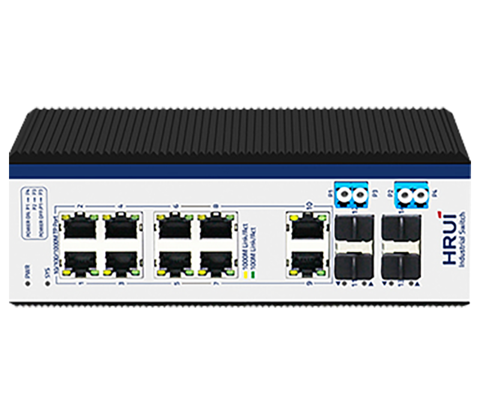
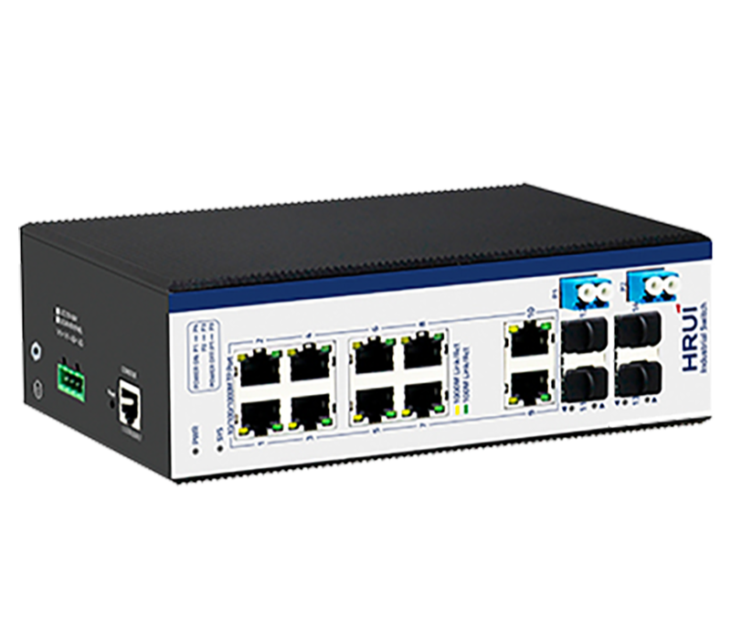
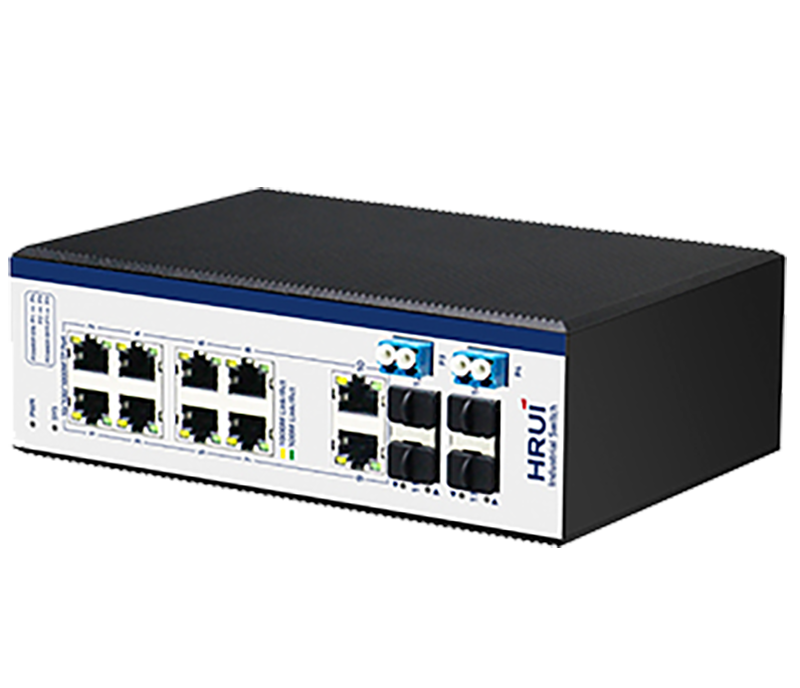
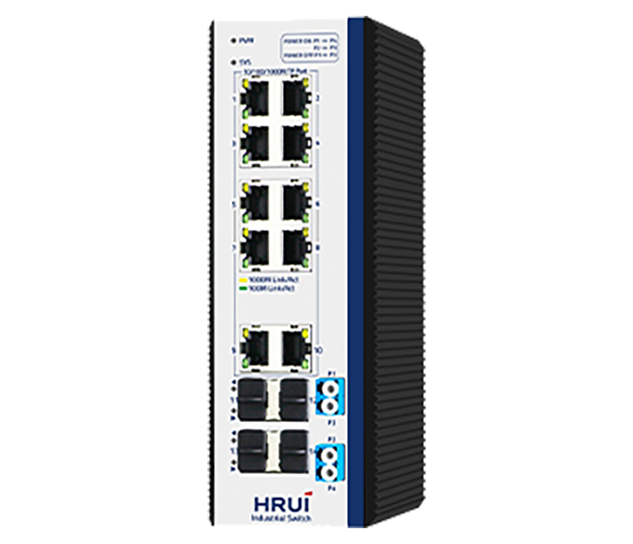

# HR600-SWG20824AS-BP

> 来源：<https://www.hruitech.com/industrial-ethernet-switch/170.html>（抓取 2026-10-21T03:47:34Z；英文原文照录，中文仅为栏目名）  
> 官网描述：2.5G SFP Bypass Managed Industrial Ethernet Switch | HRUI  
> 类目：Industrial Ethernet Switch（site id 170）  
> 接口：8×Gigabit + 4×Gigabit；PoE 预算 —；交换带宽 —；电源 Input Voltage: DC12～55V / Type of input: 4 PIN terminal （block V1+V1- V2+ V2-）

**Brief:** 2.5G ring network industiral managed Ethernet switch, integrated with bypass protection function, 8*Gigabit RJ45 ports + 2*Gigabit uplink RJ45 ports + 4*Gigabit uplink SFP ports + 1*Console port, 13-14 ports support 2.5G, bandwidth 34Gbps, Layer 2 management, support ERPS protocol, ring network redundancy, IP40 protection, Surge 6KV, ESD 15KV, DC12-55V power input, redundant power supply, adapt to -40°C~+85°C wide temperature

## 产品图





## Datasheet
- [HR600_SWG20824AS_BP.pdf](https://www.hruitech.com/web/userfiles/productfile/HR600_SWG20824AS_BP.pdf) （本地：`data/hrui_site_raw/downloads/HR600_SWG20824AS_BP.pdf`；文本：`data/hrui_site_raw/datasheet_text/HR600_SWG20824AS_BP.txt`）

## Feature and Benefits（原文）
```
The HR600-SWG20824AS-BP is a robust 14-port Gigabit Industrial Ethernet switch designed for high-performance networking in demanding environments. It features 8 Gigabit Ethernet ports, 2 Gigabit uplink ports, and 4 Gigabit SFP ports (with ports 13-14 supporting 2.5G and compatible with 1.25G/155M) alongside a dedicated console port. The switch is equipped with integrated bypass protection, allowing for seamless failover to maintain network uptime. With options for DIN rail and wall mounting, this switch is versatile in its deployment.
Engineered to operate in extreme temperatures from -40°C to 75°C, the HR600-SWG20824AS-BP is built to withstand the rigors of industrial use. It meets various industry certifications, including FCC, CE, CCC, and RoHS, ensuring compliance with safety and environmental standards. Its reliable industrial design guarantees the continued operation of automation systems, making it ideal for applications in wind power, electric utilities, assembly automation, subway PIS, SCADA systems, sewage treatment, metallurgy, intelligent transportation, rail systems, and military operations. This eco-friendly switch is designed for low power consumption without sacrificing performance.
The HR600 series offers advanced network management features including redundant ring support, loop protection, VLAN configuration, Quality of Service (QoS), speed control, port mirroring, and online firmware upgrades. Constructed from industrial-grade components, this switch provides a secure and durable solution for critical industrial communications, featuring redundant, wide-voltage power inputs to ensure uninterrupted operations.
Product Features:
Flexible Port Configuration:
8 Gigabit Ethernet Ports + 2 Gigabit Uplink Ports + 4 Gigabit SFP Ports (Ports 13-14 support 2.5G, compatible with 1.25G/155M)
Compliance with Standards:
Supports IEEE802.3, IEEE802.3u, IEEE802.3x, IEEE802.3z/ab, IEEE802.1Q, IEEE802.1p, and IEEE802.1d/w protocols.
Bypass Protection:
Integrated functionality to maintain network continuity during power loss.
Network Protocols:
Supports STP (802.1D), RSTP (802.1w), MSTP (802.1s), and ERPS for reliability and redundancy.
Advanced Management:
Compatibility with SNMP v1/v2/v3 and management through WEB, Telnet, CLI, and SSH.
Multicast Filtering:
IGMP Snooping, static multicast filtering, and MLD Snooping for efficient bandwidth management.
Enhanced Security:
Supports 802.1x port authentication and AAA certification for improved network security.
Robust Design:
IP40 rated, housed in a rugged high-strength metal case, suitable for DIN35 rail mounting.
Environmental Resilience:
EMC Grade 4 design ensuring rugged performance in harsh environments, with operating temperatures from -40°C to 75°C.
Redundant Power Supply:
Supports dual power supply access with anti-reverse connection protection.
Surge Protection:
6KV general surge immunity, 4KV differential, and 15KV (air) / 8KV (contact) ESD protection.
EMC Compliance:
Meets EN55032 standards for electromagnetic compatibility.
```

## Parameter（规格表逐行）
| 项 | 值 |
|---|---|
| **Conventional parameters** | |
| Product Name | 14 Ports Gigabit Industrial Managed Switch |
| Product Model | HR600-SWG20824AS-BP |
| Port Definition | 8 Gigabit Ports + 2 Gigabit Uplink Port+ 4 Gigabit SFP Port (13-14 Port support 2.5G, Compatible with 1.25G/155M) |
| Network Protocols | IEEE802.3 |
| Network Protocols | IEEE802.3u |
| Network Protocols | IEEE802.3z |
| Network Protocols | IEEE802.3ab |
| Network Protocols | IEEE802.3x |
| Network Protocols | IEEE802.1d |
| Network Protocols | IEEE802.1w |
| Network Media | 10BASE-T: Cat3、4、5 UTP(≤100 M) |
| Network Media | 100BASE-TX: Cat5 or above UTP(≤100 M) |
| Network Media | 1000BASE-TX: Cat5 or above UTP(≤100 M) |
| Bypass | P1: Optical Fiber in or out Port (P3 and P4 are corresponding outlets, recommended to connect A ) |
| Bypass | P3: Optical Fiber in or out Port (P1 and P2 as corresponding outlets, recommended to connect B ) |
| Bypass | P2: SFP Module Fiber Port (P3 as corresponding outlets, recommended to connect A ) |
| Bypass | P4: SFP Module Fiber Port (P1 as corresponding outlets, recommended to connect B ) |
| Fiber Media | Multi-mode：850nm,1310nm Transmission Distance: 550m/2Km |
| Fiber Media | Single-mode：1310nm,1550nm Transmission Distance: 20/40/60/80/100/120Km |
| LED Indicator | PWR / Lighting：Powered |
| LED Indicator | PWR / Un-Light：No Power |
| LED Indicator | SYS / Lighting：System is operating normally |
| LED Indicator | SYS / Un-Light：System is not running |
| LED Indicator | Yellow light / Lighting：1000M Link |
| LED Indicator | Yellow light / Un-Light：10/100M Link |
| LED Indicator | Green light G9-G14 / Slow Flashing：10/100/1000 Link normally |
| LED Indicator | Green light G9-G14 / Un-Light：Link disconnect |
| LED Indicator | Green light G9-G14 / Flashing：Link data transmission |
| LED Indicator | Green light G9-G14 / Lighting：Fiber Connection is Normal |
| LED Indicator | Green light G9-G14 / Un-Light：Disconnect |
| Power Supply | Input Voltage: DC12～55V |
| Power Supply | Type of input: 4 PIN terminal （block V1+V1- V2+ V2-） |
| Physical structure | Protect grade： IP40 |
| Physical structure | Installation：DIN Rail |
| Physical structure | Product weight： 1 KG Package weight：1.3KG（Without power） |
| Physical structure | Produc Dimensions(L×W×H): 188mm*130mm*64mm |
| Physical structure | Package Dimensions(L×W×H): 242mm×207mm×86mm |
| Physical structure | Standard packing(L×W×H): 445mm×445mm×510mm |
| Physical structure | Standard packing quantity：20 (PCS) |
| Working Environment | Operating temperature: -40～75℃ |
| Working Environment | Storage temperature: -40～85℃ |
| Working Environment | Humidity: 5%~95 % ( No condensation) |
| Industry Standard | EMI: FCC Part 15, CISPR (EN55032) class A |
| Industry Standard | EMS: EN61000-4-2 (ESD) |
| Industry Standard | EN61000-4-4 (EFT) |
| Industry Standard | EN61000-4-5 (Surge) |
| Certification | CE , FCC , ROHS |
| MTBF | 100,000 hours |
| Packing list | 1. Industrial grade switch: 1 Set |
| Packing list | 2. Instruction manual: 1 PCS |
| Packing list | 3. Certificate, warranty card: 1 PCS |
| Packing list | 4. Serial cable：1PCS |
| Warranty | 5 years |
| **Hardware Parameters** | |
| Bandwidth | 34Gbps |
| Packet Forwarding Rate | 25.29Mpps |
| RAM | 128MB |
| Flash | 16MB |
| Packet Buffer Memory | 4M |
| Jumbo frame | 9.6Kbytes |
| VLANs | 4096 |
| MAC | 8K |
| Forwarding Mode | Store-And-Forward |
| Menu Items | Submenus / Secondary Submenus / Triple Submenus |
| Information & Status | System Information |
| Information & Status | IP Status |
| Information & Status | Syslog |
| Information & Status | Detailed Syslog |
| Information & Status | MAC Table |
| Information & Status | VLANs / Membership |
| Information & Status | VLANs / Ports |
| Information & Status | Ports / Traffic Overview |
| Information & Status | Ports / Detailed Statistics |
| Information & Status | LACP / System Status |
| Information & Status | LACP / Port Status |
| Information & Status | LACP / Port Statistics |
| Information & Status | Green Ethernet |
| Information & Status | LLDP / Neighbors |
| Information & Status | Port Statistics |
| Information & Status | Loop Protection |
| Information & Status | Spanning Tree / Bridge Status |
| Information & Status | Spanning Tree / Port Status |
| Information & Status | Spanning Tree / Port Statistics |
| Information & Status | IGMP Snooping / Status |
| Information & Status | IGMP Snooping / Groups Information |
| Information & Status | IGMP Snooping / IPv4 SFM Information |
| Information & Status | MLD Snooping / Status |
| Information & Status | MLD Snooping / Groups Information |
| Information & Status | MLD Snooping / IPv6 SFM Information |
| Information & Status | DHCP / Server / Statistics |
| Information & Status | DHCP / Server / Binding |
| Information & Status | DHCP / Server / Declined IP |
| Information & Status | DHCP / Snooping Table |
| Information & Status | DHCP / Relay Statistics |
| Information & Status | DHCP / Detailed Statistics |
| Information & Status | Security / Port Security / Switch |
| Information & Status | Security / Port Security / Port |
| Information & Status | Security / Access Management Statistics |
| Information & Status | Security / 802.1X / Switch |
| Information & Status | Security / 802.1X / Port |
| Information & Status | Security / ACL Status |
| Information & Status | Security / AAA / RADIUS Overview |
| Information & Status | Security / AAA / RADIUS Details |
| Information & Status | QoS / QoS Statistics |
| Information & Status | QoS / QCL Status |
| Network Admin | IP Config |
| Network Admin | IP Status |
| Network Admin | DHCPServer / Mode |
| Network Admin | DHCPServer / Excluded IP |
| Network Admin | DHCPServer / Pool |
| Network Admin | NTP |
| Network Admin | Timezone |
| Network Admin | SNMP / System |
| Network Admin | SNMP / Trap |
| Network Admin | SNMP / Communities |
| Network Admin | SNMP / Users |
| Network Admin | SNMP / Groups |
| Network Admin | SNMP / Views |
| Network Admin | SNMP / Access |
| Network Admin | Syslog |
| Port Configure | Ports |
| Port Configure | Aggregation / Static |
| Port Configure | Aggregation / LACP |
| Port Configure | Mirroring |
| Port Configure | Green Ethernet |
| Port Configure | DDM / DDM Configuration |
| Port Configure | DDM / DDM Overview |
| Port Configure | DDM / DDM Detailed |
| PoE | PoE Setting |
| PoE | PoE Status |
| Advanced Configure | MAC Table |
| Advanced Configure | VLANs |
| Advanced Configure | GVRP / Global config |
| Advanced Configure | GVRP / Port config |
| Advanced Configure | Port Isolation / Port Group |
| Advanced Configure | Port Isolation / Port Isolation |
| Advanced Configure | Loop Protection |
| Advanced Configure | Spanning Tree / Bridge Setting |
| Advanced Configure | Spanning Tree / MSTI Mapping |
| Advanced Configure | Spanning Tree / MSTI Priorities |
| Advanced Configure | Spanning Tree / CIST Ports |
| Advanced Configure | Spanning Tree / MSTI Ports |
| Advanced Configure | IPMC Profile / Profile Table |
| Advanced Configure | IPMC Profile / Address Entry |
| Advanced Configure | MEP |
| Advanced Configure | ERPS |
| Advanced Configure | IGMP Snooping / Basic Configuration |
| Advanced Configure | IGMP Snooping / VLAN Configuration |
| Advanced Configure | IGMP Snooping / Port Filtering Profile |
| Advanced Configure | IPV6 MLD Snooping / Basic Configuration |
| Advanced Configure | IPV6 MLD Snooping / VLAN Configuration |
| Advanced Configure | IPV6 MLD Snooping / Port Filtering Profile |
| Advanced Configure | LLDP |
| Security Configure | Users |
| Security Configure | Privilege Levels |
| Security Configure | SSH |
| Security Configure | Port Security Limit |
| Security Configure | Access Management |
| Security Configure | 802.1X |
| Security Configure | ACL / Ports |
| Security Configure | ACL / Rate Limiters |
| Security Configure | ACL / Access Control List |
| Security Configure | DHCP / Snooping Setting |
| Security Configure | DHCP / Snooping Table |
| Security Configure | DHCP / Relay |
| Security Configure | DHCP / Relay Statistics |
| Security Configure | DHCP / Detailed Statistics |
| Security Configure | IP&MAC Source Guard / Configuration |
| Security Configure | IP&MAC Source Guard / Static Table |
| Security Configure | IP&MAC Source Guard / Dynamic Table |
| Security Configure | ARP Inspection / Port Configuration |
| Security Configure | ARP Inspection / VLAN Configuration |
| Security Configure | ARP Inspection / Static Table |
| Security Configure | ARP Inspection / Dynamic Table |
| Security Configure | AAA / RADIUS |
| Security Configure | AAA / TACACS+ |
| QoS Configure | Port Classification |
| QoS Configure | Port Policing |
| QoS Configure | Queue Policing |
| QoS Configure | Port Scheduler |
| QoS Configure | Port Shaping |
| QoS Configure | Port Tag Remarking |
| QoS Configure | Port DSCP |
| QoS Configure | DSCP-Based QoS |
| QoS Configure | DSCP Translation |
| QoS Configure | DSCP Classification |
| QoS Configure | QoS Control List |
| QoS Configure | Storm Policing |
| Diagnostics | Ping |
| Diagnostics | Cable Diagnostics |
| Diagnostics | CPU Load |
| Maintenance | Restart Device |
| Maintenance | Factory Defaults |
| Maintenance | Firmware Upgrade |
| Maintenance | Firmware Select |
| Maintenance | Configuration / Download |
| Maintenance | Configuration / Upload |
| Maintenance | Configuration / Activate |
| Maintenance | Configuration / Delete |
