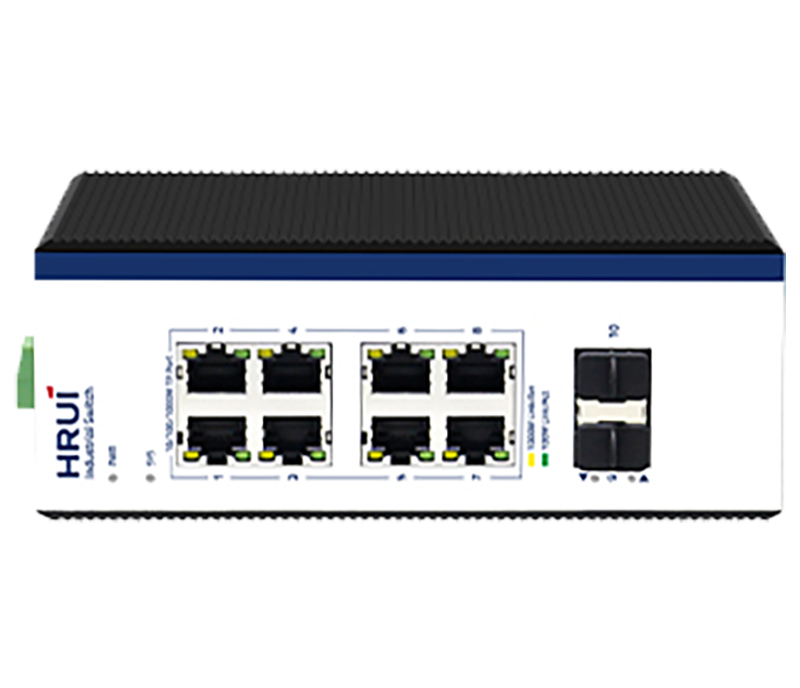
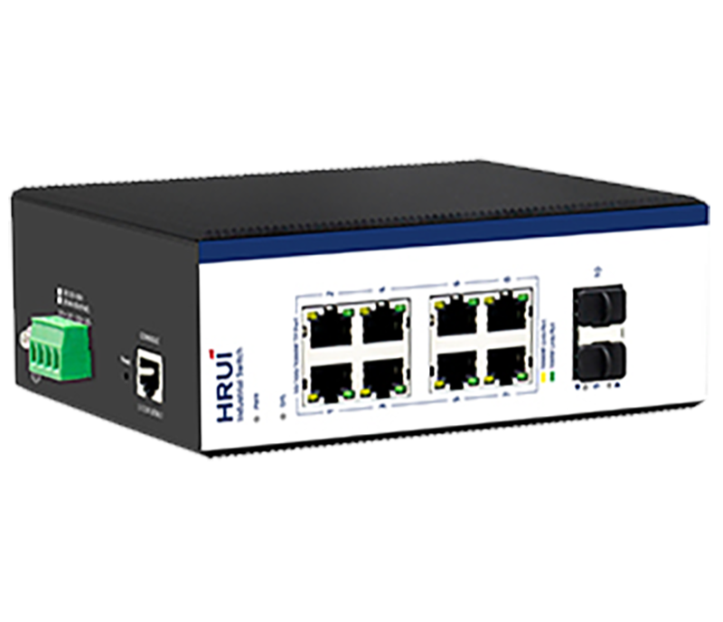
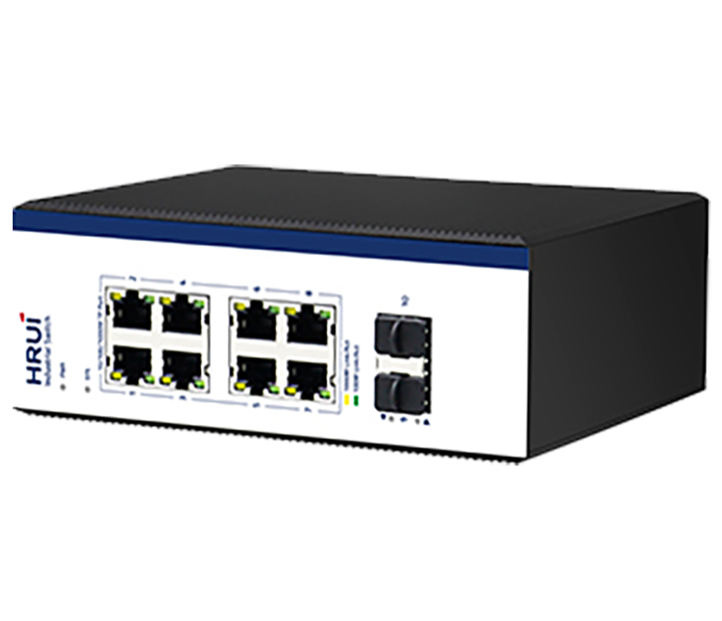
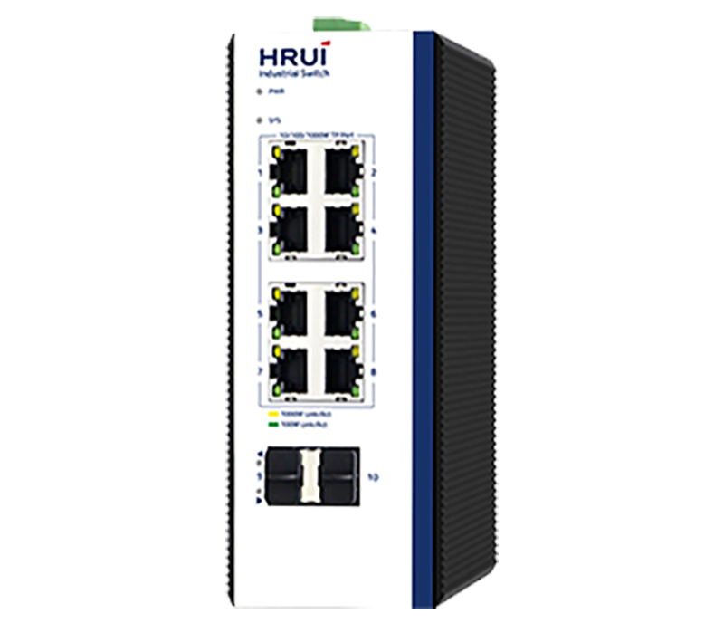

# HR600-SWG2082AS

> 来源：<https://www.hruitech.com/industrial-ethernet-switch/181.html>（抓取 2026-10-21T04:36:48Z；英文原文照录，中文仅为栏目名）  
> 官网描述：Industrial L2+ 8-Port 10/100/1000T + 2-Port 1G/2.5G SFP Managed Ethernet Switch  
> 类目：Industrial Ethernet Switch（site id 181）  
> 接口：8*1Gbps RJ45 ports / 2*2.5G SFP ports (comply with 155M/1.25Gbps) / 1*Console port；PoE 预算 —；交换带宽 26Gbps；电源 DC12~55V / Power wiring: 4 PIN industrial terminals (redundant V1+V1-, V2+V2-)

**Brief:** 2.5G ring network industiral managed Ethernet switch, with 8*Gigabit RJ45 ports + 2*2.5G uplink SFP ports + 1*Console port, 9-10 ports support 2.5G, bandwidth 26Gbps, Layer 2 management, support ERPS protocol, ring network redundancy, IP40 protection, Surge 6KV, ESD 15KV, DC12-55V power input, redundant power supply, adapt to -40°C~+75°C wide temperature

## 产品图





## Datasheet
- [HR600_SWG2082AS.pdf](https://www.hruitech.com/web/userfiles/productfile/HR600_SWG2082AS.pdf) （本地：`data/hrui_site_raw/datasheets/HR600_SWG2082AS.pdf`；文本：`data/hrui_site_raw/datasheet_text/HR600_SWG2082AS.txt`）

## Feature and Benefits（原文）
```
The HR600-SWG2082AS is a robust, 2.5G industrial managed Ethernet switch designed for demanding network environments. Equipped with 8 Gigabit RJ45 ports and 2 2.5G uplink SFP ports, along with 1 console port, this switch delivers a high bandwidth capacity of 26Gbps. It features advanced Layer 2 management and supports the ERPS protocol, ensuring reliable ring network redundancy. Engineered for durability, it boasts an IP40 rating for protection against dust, as well as impressive surge (6KV) and electrostatic discharge (15KV) resilience. The unit operates on a broad power input range of DC 12-55V and includes a redundant power supply feature, making it suitable for extreme temperature ranges of -40°C to +75°C.
Product Features:
Comprehensive Protocol Support:
Compatible with IEEE802.3 standards, including IEEE802.3u, IEEE802.3x, IEEE802.3z/AB, IEEE802.1Q, IEEE802.1p, and IEEE802.1D/w.
Advanced Network Redundancy:
Support for Spanning Tree Protocol (STP), Rapid Spanning Tree Protocol (RSTP), Multiple Spanning Tree Protocol (MSTP), and ERPS ensures minimal downtime and enhances network reliability.
Efficient Network Management:
SNMP v1/v2/v3 support allows for streamlined network monitoring and management.
Multicast Filtering:
Offers IGMP Snooping, static multicast filtering, and MLD Snooping to optimize data transmission and reduce unnecessary traffic.
Enhanced Security:
Features 802.1x port authentication and AAA authentication to bolster network security.
Versatile Management Options:
Management through WEB, Telnet, CLI, and SSH interfaces for flexible access.
Robust Build Quality:
Constructed with a high-strength aluminum profile shell, rated to IP40, and designed for DIN35 rail installation.
Industrial-Grade Design:
Engineered for extreme conditions, operating effectively in temperatures from -40°C to +75°C, ensuring reliability in harsh environments.
Power Supply Redundancy:
Supports redundant power supply connections with anti-reverse protection to prevent misconfigurations.
EMC Compliance:
Meets the EMC EN55032 standard, ensuring minimal interference with other electronic devices.
```

## Parameter（规格表逐行）
| 项 | 值 |
|---|---|
| Description | Specification |
| Model | HR600-SWG2082AS |
| Interface | 8*1Gbps RJ45 ports |
| Interface | 2*2.5G SFP ports (comply with 155M/1.25Gbps) |
| Interface | 1*Console port |
| Port Standard | IEEE802.3 (Ethernet) |
| Port Standard | IEEE802.3u (Fast Ethernet) |
| Port Standard | IEEE 802.3ab (Gigabit Ethernet) |
| Port Standard | IEEE 802.3z (Gigabit Ethernet Fiber Standard) |
| Port Standard | IEEE802.3x (Flow Control) |
| Port Standard | IEEE 802.1w Rapid Spanning Tree Protocol |
| Port Standard | IEEE 802.1D Spanning Tree Protocol |
| Switching Bandwidth | 26Gbps |
| Packet Forwarding Rate | 19.34Mpps |
| Packet Buffer | 4Mbit |
| MAC Address Table | 8K |
| Jumbo Frame | Up to 9600bytes |
| VLAN | VLAN range 1-4094, maximum active VLAN is 4K |
| Transmission Method | Store and Forward |
| Power Supply | DC12~55V |
| Power Supply | Power wiring: 4 PIN industrial terminals (redundant V1+V1-, V2+V2-) |
| Mainboard Power Consumption | 6.278W |
| Structure Information | Product Dimensions: 165*130*65mm |
| Structure Information | Packaging Dimensions: 242*207*86mm |
| Structure Information | Product Net Weight: 0.76KG |
| Structure Information | Product Gross Weight: 1.04KG |
| Packing Information | Carton Dimensions: 445*445*510mm |
| Packing Information | Packing Quantity: 20PCS |
| Packing Information | Packing Weight: 21KG |
| Package Contents | Switch 1pcs, Manual 1pcs, Certificate of Inspection 1pcs, Serial cable 1pcs |
| Fan Quantity | 0 |
| Installation | Desktop, Wall mounting installation, Rail installation |
| Surge Protection | Port Surge: Common mode 6KV, Differential mode 2KV |
| Surge Protection | Electrostatic ESD: Air 15KV, Contact 8KV (Class C) |
| Operating Temperature | -40~75°C |
| Storage Temperature | -40~85°C |
| Operation Humidity | 10%~90%, non condensing |
| Storage Humidity | 5%~95%, non condensing |
| PWR | On: Powered on |
| PWR | Off: Powered off |
| SYS Green LED | On: The system is running normally |
| SYS Green LED | Flashing: System startup in progress |
| Ports 1-8 | Yellow LED on: 1Gbps Link normal |
| Ports 1-8 | Green LED on: 10/100Mbps Link normal |
| Ports 1-8 | Off: Link blocked |
| Ports 1-8 | Fast Flashing: Data transmitting |
| Ports G9-G10 Green LED | On: Fiber optic link normal |
| Ports G9-G10 Green LED | Off: Fiber optic link blocked |
| Ports G9-G10 Green LED | Flashing: Link data transmission |
| Reset | Short press to restart, long press for 6 seconds to restore factory settings |
| **Software Features** | |
| **L2 Function** | |
| IPv4 | IPv4 VLAN Interface |
| IPv4 | IPv4 Static Routes |
| IPv4 | ARP |
| Port | Port Switch configuration |
| Port | Port Description configuration |
| Port | Port Speed configuration |
| Port | Port Duplex configuration |
| Port | Port Flow Control configuration |
| Port | Max. 2500Mbps at SFP interface |
| Port | Jumbo Frame |
| Port | EEE |
| Port | Fiber Module(DDM) |
| Link Aggregation | Support load balance policy; Base on MAC and IP-MAC |
| Link Aggregation | Static and Dynamic Group |
| Link Aggregation | Support LACP |
| Storm Control | Boardcast suppression |
| Storm Control | Unknown Multicast |
| Storm Control | Unknown Unicast |
| Port Mirroring | One to one monitor |
| Port Mirroring | Many to one monitor |
| Port Mirroring | Ingress/Egress/Both |
| Port Security | MAC Address Constraints |
| Port Security | Action：Trap/Shutdown |
| Port Isolation | Support |
| Port Rate-limit | Support |
| Loopback Detection | Support |
| VLAN | Access/Trunk/Hybrid |
| VLAN | VLAN Tunnel (Q-in-Q Tunnel) |
| VLAN | GVRP |
| VLAN | VLAN range 1-4094, maximum active VLAN is 4K |
| MAC Address | Dynamic MAC address |
| MAC Address | Static MAC address |
| Spanning Tree Protocol | STP/RSTP/MSTP |
| Spanning Tree Protocol | BPDU Filter |
| Spanning Tree Protocol | BPDU Guard |
| Spanning Tree Protocol | Edge Port |
| ERPS | Major and sub ring |
| ERPS | up to 16 rings |
| Smart Ring | Private Ring |
| Smart Ring | Major and sub ring |
| Smart Ring | Up to 16 rings |
| PTP | Ordinary Clock |
| PTP | Boundary Clock |
| PTP | Transparent clock |
| LLDP | Support |
| Multicast | IGMP Snooping |
| Multicast | IGMP V1/V2/V3 |
| Multicast | Router Port |
| Multicast | Static IGMP group address |
| Multicast | IGMP groups filtering |
| Multicast | Querier |
| Multicast | MLD Snooping |
| QoS | Traffic classification based, Strict priority and WRR |
| QoS | Port Priority |
| QoS | 802.1P Priority |
| QoS | IP DSCP Priority |
| QoS | Support up to 8 queues per port |
| QoS | Port Shaping |
| **Services** | |
| DHCP | DHCP Server |
| DHCP | IP Pool |
| DHCP | Static Binding |
| DHCP | DHCP Relay |
| Access Protocol | HTTP |
| Access Protocol | Telnet |
| Access Protocol | SSH |
| Access Protocol | Manager ACL |
| **Security** | |
| AAA | RADIUS |
| AAA | TACACS+ |
| AAA | 802.1X |
| AAA | Base on port/MAC/local/WEB |
| DHCP Snooping | Support |
| IP Source Guard | Support |
| Dynamic ARP Inspection | Support |
| ACL | MAC ACL |
| ACL | Port ACL |
| ACL | IPv4 ACL |
| ACL | IPv6 ACL |
| **Diagnostics** | |
| Syslog | Logging Message |
| Syslog | Remote Server |
| Ping | Support |
| Traceroute | Support |
| Cable Diagnositics | Support |
| **Equipment Management** | |
| Manager Access | Console |
| Manager Access | HTTP |
| Manager Access | Telnet |
| Manager Access | SSHv2 |
| Manager Access | SNMP |
| Manager IP | Static Address |
| Manager IP | DHCP Client |
| Manager IP | Support IPv4 and IPv6 address |
| Manager IP | DNS |
| Time Synchronization | SNTP |
| Time Synchronization | Manual Time |
| SNMP | V1/V2C/V3 |
| SNMP | Community |
| SNMP | V3 User |
| SNMP | Group |
| SNMP | Trap Host |
| SNMP MIB | RFC 1213 MIB-II |
| SNMP MIB | RFC 1493 Bridge MIB |
| SNMP MIB | RFC 1643 Ethernet MIB |
| SNMP MIB | RFC 2819 RMON MIB (Groups 1, 2, 3 and 9) |
| SNMP MIB | RFC 2863 Interface MIB |
| SNMP MIB | Private MIB |
| RMON | Statistics |
| RMON | History Configuration |
| RMON | Event Configuration |
| RMON | Alarm Configuration |
| User Management | Congurable user privilege level from 0 - 15; |
| Firmware Management | Firmware upgrade |
| Firmware Management | Double Image; Swap between Active and Alternate firmware image. |
| Configuration Management | Upload and download |
| Save | Support |
| Restart | Support |
| Factory Defaults | Support |
| **Standard Compliance** | |
| **IEEE 802.3x flow control and back pressure** | |
| **IEEE 802.3ad port trunk with LACP** | |
| **IEEE 802.1D Spanning Tree Protocol** | |
| **IEEE 802.1w Rapid Spanning Tree Protocol** | |
| **IEEE 802.1s Multiple Spanning Tree Protocol** | |
| **IEEE 802.1p Class of Service** | |
| **IEEE 802.1Q VLAN tagging** | |
| **IEEE 802.1x Port Authentication Network Control** | |
| **IEEE 802.1ab LLDP** | |
| **RFC 768 UDP** | |
| **RFC 793 TFTP** | |
| **RFC 791 IP** | |
| **RFC 792 ICMP** | |
| **RFC 2068 HTTP** | |
| **RFC 1112 IGMP v1** | |
| **RFC 2236 IGMP v2** | |
| **RFC 3376 IGMP v3** | |
| **RFC 2710 MLD v1** | |
| **FRC 3810 MLD v2** | |

## Product structure / Application topology（图）
- https://www.hruitech.com/web/userfiles/image/20250113/1736751613250842.png
