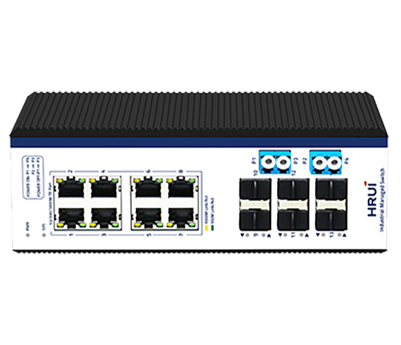
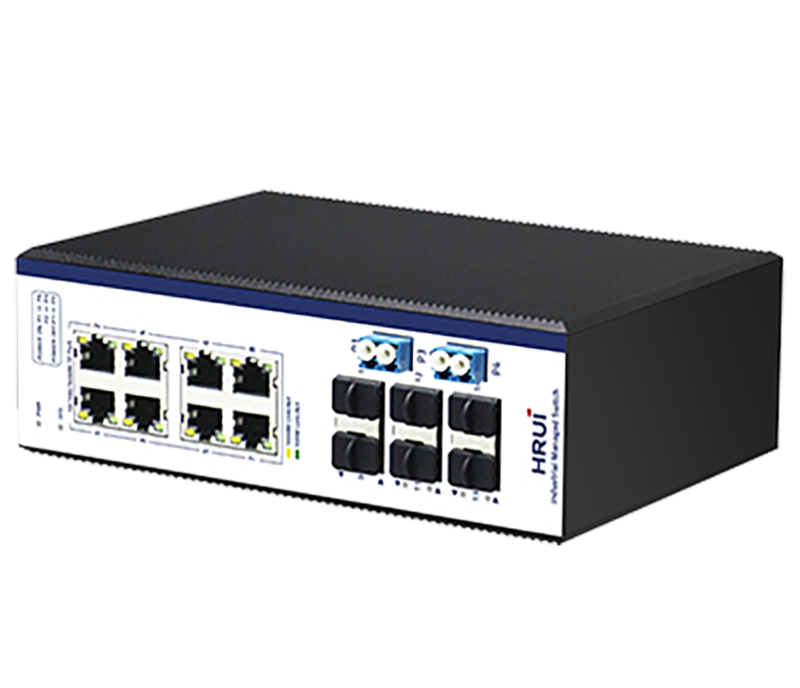
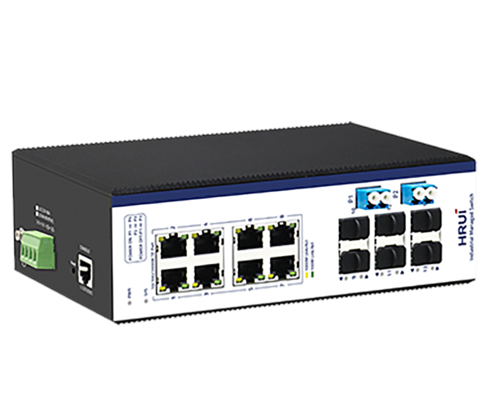
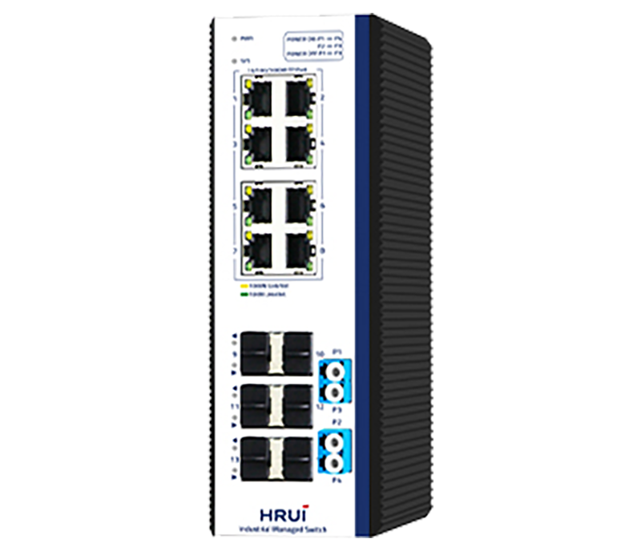

# HR600-SWG2086AS-BP

> 来源：<https://www.hruitech.com/industrial-ethernet-switch/172.html>（抓取 2026-10-21T03:47:33Z；英文原文照录，中文仅为栏目名）  
> 官网描述：14-Port Gigabit Industrial Managed Ethernet Switch  
> 类目：Industrial Ethernet Switch（site id 172）  
> 接口：8×Gigabit；PoE 预算 —；交换带宽 —；电源 Input Voltage: DC12～55V / Type of input: 4 PIN terminal （block V1+V1- V2+ V2-） / Protect grade： IP40 / Installation ：DIN Rail / Product weight： 1 KG Package weight： 1.3KG（Without power） Produc Dimensions(L×W×H): 188mm*130mm*64mm / Package Dimensions(L×W× H): 250mm×210mm×88mm Standard packing(L×W× H): 608mm×500 mm×435mm

**Brief:** 2.5G ring network industiral managed Ethernet switch, integrated with bypass protection function, 8*Gigabit RJ45 ports + 6*Gigabit uplink SFP ports + 1*Console port, 13-14 ports support 2.5G, bandwidth 34Gbps, Layer 2 management, support ERPS protocol, ring network redundancy, IP40 protection, Surge 6KV, ESD 15KV, DC12-55V power input, redundant power supply, adapt to -40°C~+75°C wide temperature

## 产品图





## Datasheet
- [HR600_SWG2086AS_BP.pdf](https://www.hruitech.com/web/userfiles/productfile/HR600_SWG2086AS_BP.pdf) （本地：`data/hrui_site_raw/downloads/HR600_SWG2086AS_BP.pdf`；文本：`data/hrui_site_raw/datasheet_text/HR600_SWG2086AS_BP.txt`）

## Feature and Benefits（原文）
```
The HR600-SWG2086AS-BP is a robust 14-Port Gigabit Industrial Ethernet Switch designed for high-performance networking in demanding industrial environments. It offers a versatile configuration with 8 Gigabit ports and 6 Gigabit SFP ports (ports 13 and 14 supporting 2.5G, compatible with 1.25G/155M), plus a dedicated console port. The switch supports both DIN rail and wall mounting for flexible installation options.
Built to withstand extreme conditions, this industrial switch operates within a -40 to 75°C temperature range and features dual power input (DC12-55V). It meets rigorous industrial certifications, including FCC, CE, CCC, and RoHS, ensuring compliance with international standards for quality and reliability. The HR600-SWG2086AS-BP is ideal for use in a variety of sectors, including wind power, electric power, assembly automation, subway passenger information systems (PIS), electric power SCADA, sewage treatment, metallurgy, intelligent transportation, rail transport, and military applications.
This energy-efficient switch incorporates advanced network management features such as rapid redundancy protocols, loop protection, VLAN support, Quality of Service (QoS), speed control, port mirroring, and online firmware upgrades. Its rugged design and industrial-grade components guarantee stable operation, thereby ensuring the integrity of automation systems even in challenging conditions.
Product Features:
Flexible Port Configuration:
8 Gigabit Ports + 6 Gigabit SFP Ports (Ports 13-14 support 2.5G, compatible with 1.25G/155M), plus 1 Console Port.
Compliance with Standards:
Supports IEEE802.3, IEEE802.3u, IEEE802.3x, IEEE802.3z/ab, IEEE802.1q, IEEE802.1p, IEEE802.1d/w.
Spanning Tree Protocols:
Includes STP (802.1D), RSTP (802.1w), 802.1s (MSTP), and ERPS for increased network reliability.
Advanced Management:
Compatible with SNMP v1/v2/v3 for network management, IGMP Snooping, Static multicast filtering, and MLD Snooping.
Enhanced Security Features:
Supports 802.1x port authentication with AAA certification to enhance network security.
User-friendly Management Interfaces:
Manage via WEB, Telnet, CLI, or SSH.
Durable Design:
IP40 protection rating with a rugged metal housing ideal for industrial applications. DIN35 rail mounting support.
EMC Compliance:
EMC grade 4 design, ensuring performance stability in electromagnetic environments.
Extreme Temperature Operation:
Designed to function within a wide -40 to 75°C temperature range.
Redundant Power Supply:
Supports redundant power supply connections with anti-reverse connection features.
Lightning Protection:
Integrated port lightning protection with Surge ratings of 6KV (Common Mode) and 2KV (Differential Mode), along with 15KV ESD protection, complying with EMC EN55032 standard.
```

## Parameter（规格表逐行）
| 项 | 值 |
|---|---|
| **Conventional parameters** | |
| Product Name | 14 Ports Gigabit Industrial Managed PoE Switch |
| Product Model | HR600-SWG2086AS |
| Port Definition | 8 Gigabit Ports + 6 Gigabit SFP Port (13-14 Port support 2.5G, Compatible with 1.25G/155M) + 1 Console Port |
| Network Protocols | IEEE802.3 |
| Network Protocols | IEEE802.3u IEEE802.3z IEEE802.3ab IEEE802.3x IEEE802.1d |
| Network Protocols | IEEE802.1w |
| Network Media | 10BASE-T: Cat3,4,5UTP(≤100 M) |
| Network Media | 100BASE-TX: Cat5 or above UTP(≤100 M) 1000BASE-TX: Cat5 or above UTP(≤100 M) |
| Fiber Media | Multi-mode ：850nm, 1310nm Transmission Distance: 550m/2Km |
| Fiber Media | Single-mode：1310nm, 1550nm Transmission Distance: 20/40/60/80/100/120Km |
| LED Indicator | PWR / Lighting ：Powered Un-Light：No Power |
| LED Indicator | SYS / Lighting ：System is operating normally Un-Light：System is not running |
| LED Indicator | Yellow light / Lighting ：1000M Link |
| LED Indicator | Yellow light / Un-Light：10/100M Link |
| LED Indicator | Green light G9-G14 / Slow Flashing ：10/100/1000 Link normally |
| LED Indicator | Green light G9-G14 / Un-Light：Link disconnect |
| LED Indicator | Green light G9-G14 / Flashing ：Link data transmission |
| LED Indicator | Green light G9-G14 / Lighting ：Fiber Connection is Normal Un-Light：Disconnect |
| Power Supply | Input Voltage: DC12～55V |
| Power Supply | Type of input: 4 PIN terminal （block V1+V1- V2+ V2-） |
| Power Supply | Protect grade： IP40 |
| Power Supply | Installation ：DIN Rail |
| Power Supply | Product weight： 1 KG Package weight： 1.3KG（Without power） Produc Dimensions(L×W×H): 188mm*130mm*64mm |
| Power Supply | Package Dimensions(L×W× H): 250mm×210mm×88mm Standard packing(L×W× H): 608mm×500 mm×435mm |
| Physical structure | Standard packing quantity：28 (PCS) |
| Physical structure | Operating temperature: -40～85℃ |
| Working Environment | Storage temperature: -40～85℃ |
| Working Environment | Humidity: 5%~95 % ( No condensation) |
| Working Environment | EMI: FCC Part 15, CISPR (EN55032) class A |
| Industry Standard | EMS: EN61000-4-2 (ESD) EN61000-4-4 (EFT) |
| Industry Standard | EN61000-4-5 (Surge) |
| Certification | CE , FCC , ROHS |
| MTBF | 100,000 hours |
| MTBF | 1. Industrial grade switch: 1 Set |
| MTBF | 2. Instruction manual: 1 PCS |
| Packing list | 3. Certificate, warranty card: 1 PCS |
| Packing list | 4. Serial cable：1PCS |
| Packing list | 5. Operation manual CD ：1 PCS |
| Warranty | 5 years |
| **Hardware Parameters** | |
| Bandwidth | 34Gbps |
| Packet Forwarding Rate | 25.29Mpps |
| RAM | 128MB |
| Flash | 16MB |
| Packet Buffer Memory | 4M |
| Jumbo frame | 9.6Kbytes |
| VLANs | 4096 |
| MAC | 8K |
| Forwarding Mode | Store-And-Forward |
| Menu Items | Sub menus / Secondary Sub menus / Triple Sub menus |
| Information & Status | System Information |
| Information & Status | IP Status |
| Information & Status | Syslog |
| Information & Status | Detailed Syslog |
| Information & Status | MAC Table |
| Information & Status | VLANs / Membership |
| Information & Status | VLANs / Ports |
| Information & Status | Ports / Traffic Overview |
| Information & Status | Ports / Detailed Statistics |
| Information & Status | LACP / System Status |
| Information & Status | LACP / Port Status |
| Information & Status | LACP / Port Statistics |
| Information & Status | Green Ethernet |
| Information & Status | LLDP / Neighbors |
| Information & Status | LLDP / Port Statistics |
| Information & Status | Loop Protection |
| Information & Status | Spanning Tree / Bridge Status |
| Information & Status | Spanning Tree / Port Status |
| Information & Status | Spanning Tree / Port Statistics |
| Information & Status | IGMP Snooping / Status |
| Information & Status | IGMP Snooping / Groups Information |
| Information & Status | IGMP Snooping / IPv4 SFM Information |
| Information & Status | MLD Snooping / Status |
| Information & Status | MLD Snooping / Groups Information |
| Information & Status | MLD Snooping / IPv6 SFM Information |
| Information & Status | DHCP / Server / Statistics |
| Information & Status | DHCP / Server / Binding |
| Information & Status | DHCP / Server / Declined IP |
| Information & Status | DHCP / Snooping Table |
| Information & Status | DHCP / Relay Statistics |
| Information & Status | DHCP / Detailed Statistics |
| Information & Status | Security / Port Security / Switch |
| Information & Status | Security / Port Security / Port |
| Information & Status | Security / Access Management Statistics |
| Information & Status | Security / 802.1X / Switch |
| Information & Status | Security / 802.1X / Port |
| Information & Status | Security / ACL Status |
| Information & Status | Security / AAA / RADIUS Overview |
| Information & Status | Security / AAA / RADIUS Details |
| Information & Status | QoS / QoS Statistics |
| Information & Status | QoS / QCL Status |
| Network Admin | IP Config |
| Network Admin | IP Status |
| Network Admin | DHCPServer / Mode |
| Network Admin | DHCPServer / Excluded IP |
| Network Admin | DHCPServer / Pool |
| Network Admin | NTP |
| Network Admin | Timezone |
| Network Admin | SNMP / System |
| Network Admin | SNMP / Trap |
| Network Admin | SNMP / Communities |
| Network Admin | SNMP / Users |
| Network Admin | SNMP / Groups |
| Network Admin | SNMP / Views |
| Network Admin | SNMP / Access |
| Network Admin | Syslog |
| Port Configure | Ports |
| Port Configure | Aggregation / Static |
| Port Configure | Aggregation / LACP |
| Port Configure | Mirroring |
| Port Configure | Green Ethernet |
| Port Configure | DDM / DDM Configuration |
| Port Configure | DDM / DDM Overview |
| Port Configure | DDM / DDM Detailed |
| PoE | PoE Setting |
| PoE | PoE Status |
| Advanced Configure | MAC Table |
| Advanced Configure | VLANs |
| Advanced Configure | GVRP / Global config |
| Advanced Configure | GVRP / Port config |
| Advanced Configure | Port Isolation / Port Group |
| Advanced Configure | Port Isolation / Port Isolation |
| Advanced Configure | Loop Protection |
| Advanced Configure | Spanning Tree / Bridge Setting |
| Advanced Configure | Spanning Tree / MSTI Mapping |
| Advanced Configure | Spanning Tree / MSTI Priorities |
| Advanced Configure | Spanning Tree / CIST Ports |
| Advanced Configure | Spanning Tree / MSTI Ports |
| Advanced Configure | IPMC Profile / Profile Table |
| Advanced Configure | IPMC Profile / Address Entry |
| Advanced Configure | MEP |
| Advanced Configure | ERPS |
| Advanced Configure | IGMP Snooping / Basic Configuration |
| Advanced Configure | IGMP Snooping / VLAN Configuration |
| Advanced Configure | IGMP Snooping / Port Filtering Profile |
| Advanced Configure | IPV6 MLD Snooping / Basic Configuration |
| Advanced Configure | IPV6 MLD Snooping / VLAN Configuration |
| Advanced Configure | IPV6 MLD Snooping / Port Filtering Profile |
| Advanced Configure | LLDP |
| Security Configure | Users |
| Security Configure | Privilege Levels |
| Security Configure | SSH |
| Security Configure | Port Security Limit |
| Security Configure | Access Management |
| Security Configure | 802.1X |
| Security Configure | ACL / Ports |
| Security Configure | ACL / Rate Limiters |
| Security Configure | ACL / Access Control List |
| Security Configure | DHCP / Snooping Setting |
| Security Configure | DHCP / Snooping Table |
| Security Configure | DHCP / Relay |
| Security Configure | DHCP / Relay Statistics |
| Security Configure | DHCP / Detailed Statistics |
| Security Configure | IP&MAC Source Guard / Configuration |
| Security Configure | IP&MAC Source Guard / Static Table |
| Security Configure | IP&MAC Source Guard / Dynamic Table |
| Security Configure | ARP Inspection / Port Configuration |
| Security Configure | ARP Inspection / VLAN Configuration |
| Security Configure | ARP Inspection / Static Table |
| Security Configure | ARP Inspection / Dynamic Table |
| Security Configure | AAA / RADIUS |
| Security Configure | AAA / TACACS+ |
| QoS Configure | Port Classification |
| QoS Configure | Port Policing |
| QoS Configure | Queue Policing |
| QoS Configure | Port Scheduler |
| QoS Configure | Port Shaping |
| QoS Configure | Port Tag Remarking |
| QoS Configure | Port DSCP |
| QoS Configure | DSCP-Based QoS |
| QoS Configure | DSCP Translation |
| QoS Configure | DSCP Classification |
| QoS Configure | QoS Control List |
| QoS Configure | Storm Policing |
| Diagnostics | Ping |
| Diagnostics | Cable Diagnostics |
| Diagnostics | CPU Load |
| Maintenance | Restart Device |
| Maintenance | Factory Defaults |
| Maintenance | Firmware Upgrade |
| Maintenance | Firmware Select |
| Maintenance | Configuration / Download |
| Maintenance | Configuration / Upload |
| Maintenance | Configuration / Activate |
| Maintenance | Configuration / Delete |
