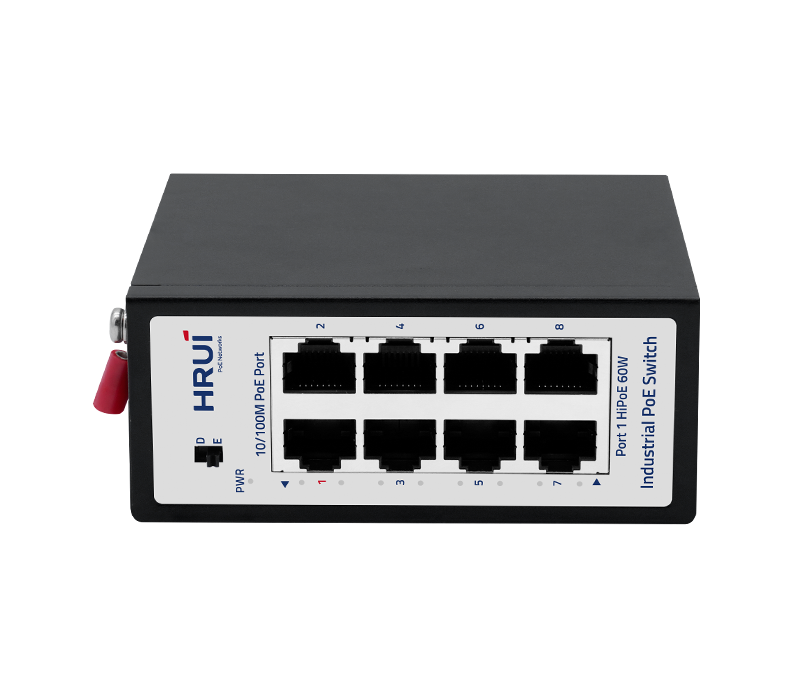
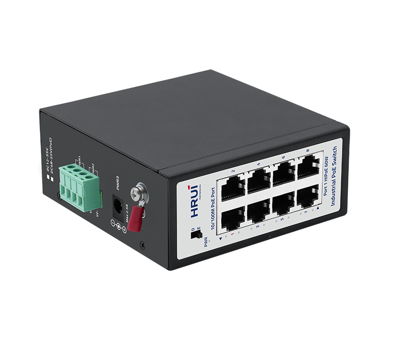
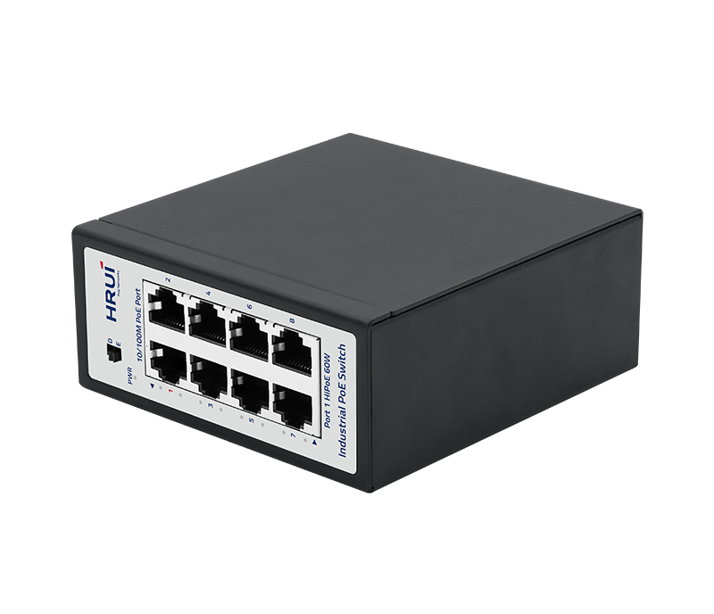
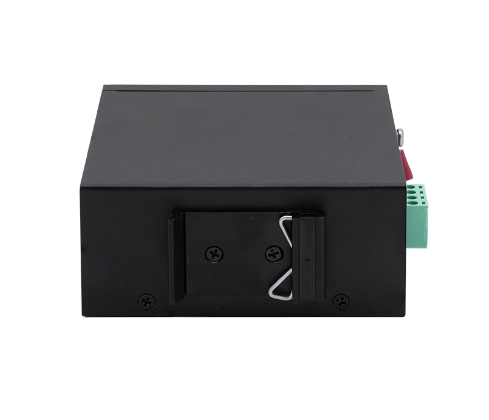

# HR710P-8T

> 来源：<https://www.hruitech.com/industrial-poe-switch/316.html>（抓取 2026-10-21T04:36:26Z；英文原文照录，中文仅为栏目名）  
> 官网描述：Industrial 8-Port 10/100T 802.3af/at PoE Ethernet Switch  
> 类目：Industrial PoE Switch（site id 316）  
> 接口：8*100Mbps PoE ports；PoE 预算 According to the adapter；交换带宽 1.6Gbps；电源 DC12~55V / DC48~55V (PoE) / Power wiring: 4 PIN industrial terminals (redundant V1+V1-, V2+V2-)/DC 2.1

**Brief:** 6KV Port Surge Protection | 15KV ESD Protection | 250M Long-distance Transmission | HiPoE 60W | IP40 Protection | -40~75°C Wide-range Temperature | 2000V Power Input Protection | Triple Power Input Design

## 产品图





## Datasheet
- [HR710P-8T-28EN-29_cpDvw.pdf](https://www.hruitech.com/web/userfiles/productfile/HR710P-8T-28EN-29_cpDvw.pdf) （本地：`data/hrui_site_raw/datasheets/HR710P-8T-28EN-29_cpDvw.pdf`；文本：`data/hrui_site_raw/datasheet_text/HR710P-8T-28EN-29_cpDvw.txt`）

## Feature and Benefits（原文）
```
HR710P-8T is a compact industrial PoE switch designed for reliable power and data delivery in harsh environments. Featuring 8×10/100Mbps PoE ports with IEEE 802.3af/at support and 60W HiPoE on Port 1, it enables flexible deployment for transportation monitoring, outdoor surveillance, EV charging systems, and industrial automation. With 6kV surge, 15kV ESD, 2KV power input protection, -40°C to 75°C wide temperature tolerance, and triple power input, the HR710P-8T ensures stable, uninterrupted operation. Its IP40 enclosure and DIN35 rail mounting make it ideal for space-constrained industrial cabinets and mission-critical applications.
Product Features:
Port Configuration:
8 × 10/100Mbps PoE ports for stable power and data delivery in industrial applications.
High PoE Support:
Port 1 supports 60W HiPoE for compatible devices.
PoE Standard:
IEEE 802.3af/at (≤30W per port).
Extended Transmission:
Supports 250m long-distance PoE for flexible deployment across wide monitoring areas.
Industrial Design:
IP40 enclosure with DIN35 rail installation for durable and efficient cabinet integration.
Wide Temperature Range:
Operates reliably from -40°C to 75°C in harsh or extreme environments.
Dual/Triple Power Input:
Triple power input with anti-reverse protection and 2000V power-input insulation for safe, uninterrupted operation.
Protection:
6kV surge protection and 15kV ESD protection for enhanced reliability in industrial scenarios.
Certifications:
CE, FCC, and RoHS compliance for international safety and environmental standards.
```

## Parameter（规格表逐行）
| 项 | 值 |
|---|---|
| Description | Specification |
| Model | HR710P-8T |
| Interface | 8*100Mbps PoE ports |
| Port Standard | IEEE802.3 (Ethernet) |
| Port Standard | IEEE802.3u (Fast Ethernet) |
| Port Standard | IEEE802.3x (Flow Control) |
| Switching Bandwidth | 1.6Gbps |
| Packet Forwarding Rate | 1.19Mpps |
| Packet Buffer | 768Kbit |
| MAC Address Table | 2K |
| Transmission Method | Store and Forward |
| PoE Standard | IEEE802.3af (15.4W) |
| PoE Standard | IEEE802.3at (30W) |
| PoE Port Output Voltage | DC 48-55V |
| PoE Ports | Port 1 supports HiPoE 60W |
| PoE Ports | Ports 2-8 PoE power output <30W |
| PoE Power Budget | According to the adapter |
| Power Supply | DC12~55V |
| Power Supply | DC48~55V (PoE) |
| Power Supply | Power wiring: 4 PIN industrial terminals (redundant V1+V1-, V2+V2-)/DC 2.1 |
| Certification | CE, FCC, RoHS |
| Mainboard Power Consumption | 1.61W |
| Structure Information | Product Dimensions: 100*106*44mm |
| Structure Information | Packaging Dimensions: 150*145*60mm |
| Structure Information | Product Net Weight: 0.53KG |
| Structure Information | Product Gross Weight: 0.6KG |
| Packing Information | Carton Dimensions: 470*330*330mm |
| Packing Information | Packing Quantity: 30PCS |
| Packing Information | Packing Weight: 19KG |
| Package Contents | Switch 1pcs, Manual 1pcs, Certificate of Inspection 1pcs |
| Fan Quantity | 0 |
| Installation | Desktop, Wall mounting installation, Rail installation |
| Surge Protection | Port Surge: Common mode 6KV, Differential mode 2KV(Class B) |
| Surge Protection | Electrostatic ESD: Air 15KV, Contact 8KV(Class B) |
| Surge Protection | Power Supply: Common mode 2KV, Differential mode 1KV(Class B) |
| Operating Temperature | -40~75°C |
| Storage Temperature | -40~85°C |
| Operation Humidity | 10%~90%, non condensing |
| Storage Humidity | 5%~95%, non condensing |
| PWR Green LED | On: Powered on |
| PWR Green LED | Off: Powered off |
| Ports 1-8 Green LED | On: 10/100Mbps Link normal |
| Ports 1-8 Green LED | Off: Link blocked |
| Ports 1-8 Green LED | Flashing: Data transmitting |
| D/E Modes Buttons | D: Normal mode, all ports can communicate with each other, transmission distance is within 100 meters, transmission rate is 10/100Mbps adaptive |
| D/E Modes Buttons | E: Extend mode, when the PoE port is in Extend mode, ports 1-8 force 10Mbps to extend the transmission distance to 250meters |

## Product structure / Application topology（图）
- https://www.hruitech.com/web/userfiles/image/20251210/1765348060628045.png
