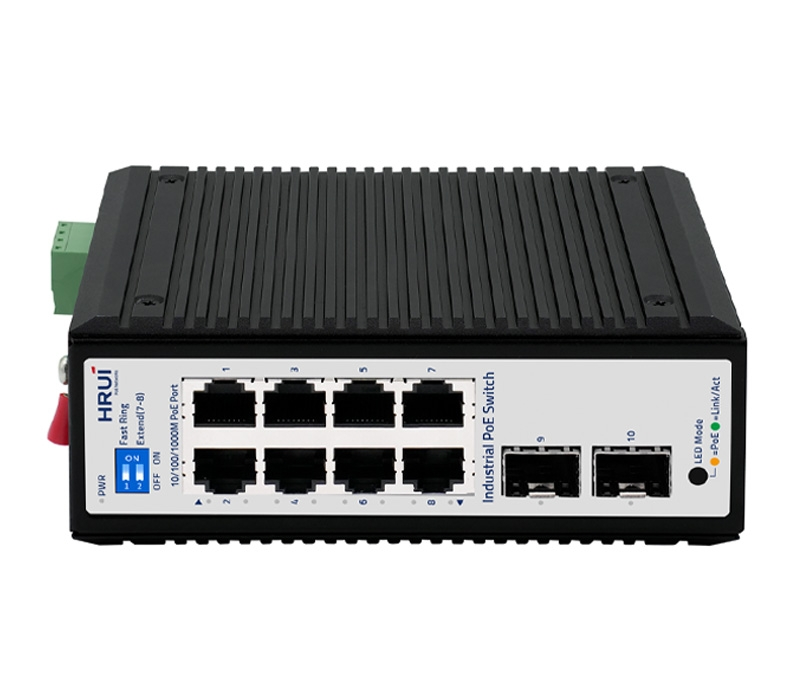
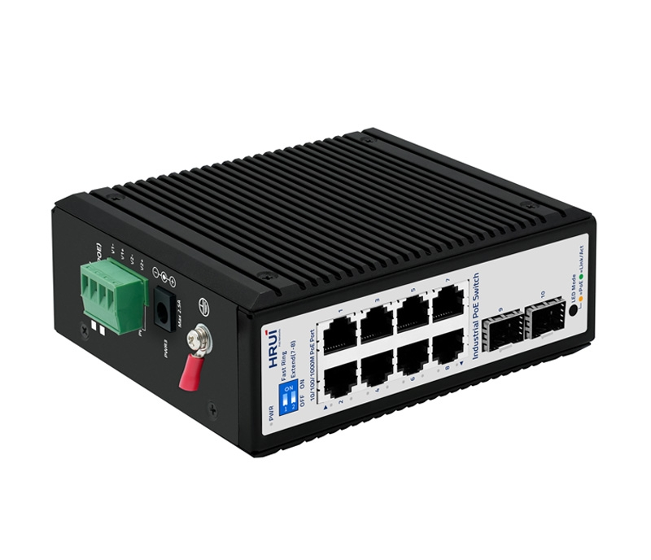
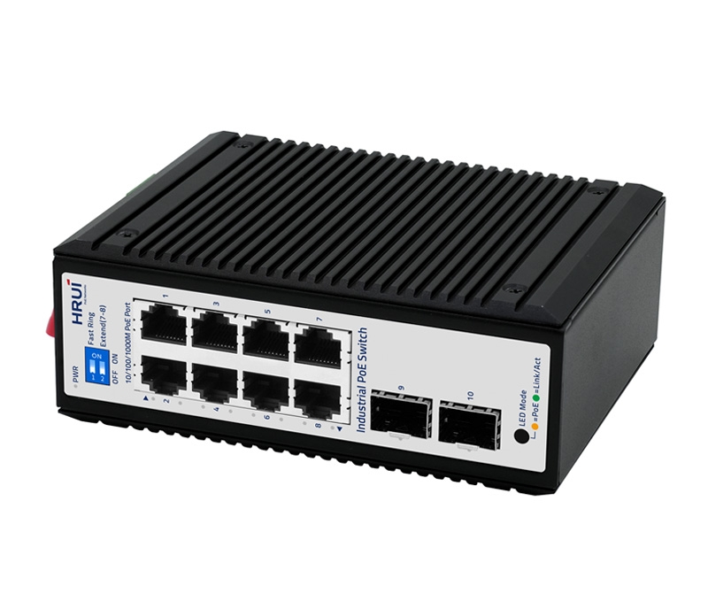
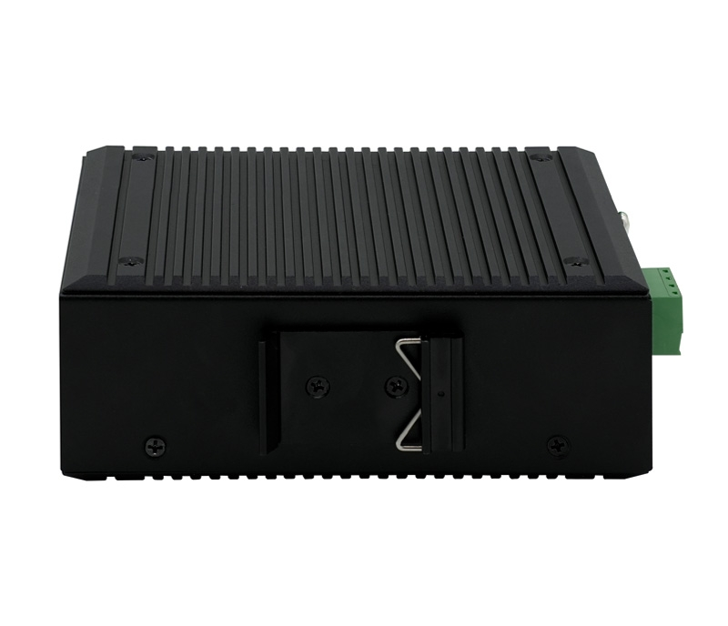

# HR720P-8T2GS

> 来源：<https://www.hruitech.com/industrial-poe-switch/308.html>（抓取 2026-10-21T04:36:27Z；英文原文照录，中文仅为栏目名）  
> 官网描述：Industrial  8-Port 10/100/1000T 802.3af/at PoE + 2-Port 1000X SFP Ethernet Switch  
> 类目：Industrial PoE Switch（site id 308）  
> 接口：8 *1Gbps PoE ports / 2 *1Gbps SFP ports；PoE 预算 200W@60°C;120W@75°C；交换带宽 20Gbps；电源 DC12~55V / DC48~55V(PoE) / Power wiring: 4 PIN industrial terminals (redundant V1+V1-, V2+V2-)+DC2.1

**Brief:** 6KV port lightning protection | 2KV power supply protection | 15KV ESD protection | Triple redundant power supply | One-click fast ring network | 250-meter transmission | PoE watchdog | HiPoE 60W | IP40 protection | -40~75°C

## 产品图





## Datasheet
- [HR720P-8T2GS-28EN-29.pdf](https://www.hruitech.com/web/userfiles/productfile/HR720P-8T2GS-28EN-29.pdf) （本地：`data/hrui_site_raw/datasheets/HR720P-8T2GS-28EN-29.pdf`；文本：`data/hrui_site_raw/datasheet_text/HR720P-8T2GS-28EN-29.txt`）

## Feature and Benefits（原文）
```
HR720P-8T2GS is a rugged industrial-grade PoE switch designed for harsh environments. It features 8×Gigabit PoE ports and 2×Gigabit SFP slots, complying with IEEE 802.3af/at standards. With a switching bandwidth of 20Gbps and a PoE power budget of up to 200W, it ensures reliable power delivery and high-speed data transmission. Operating in temperatures from -40°C to 75°C and equipped with robust surge (6KV) and ESD (15KV) protection, this switch is ideal for industrial automation, surveillance, and outdoor applications
Product Features:
Port Configuration:
8×Gigabit PoE + 2×Gigabit SFP
Flexible copper and fiber connectivity.
High PoE Support:
Port 1: 60W HiPoE; Ports 2-8: 30W. Powers PTZ cameras and APs,etc.
Industrial Design:
IP40 metal housing, DIN rail mount. Built for harsh environments.
Wide Temperature:
-40°C to 75°C
Dual Power Input:
Supports 12–55V DC and 48–55V PoE with reverse protection.
PoE Budget:
200W@60°C; 120W@75°C.
Strong Protection:
6KV port lightning , 2KV power supply, 15KV ESD.
VLAN & Jumbo Frames:
Better traffic management and efficiency.
Certification:
CE, FCC, RoHS,complying with international safety and environmental standards.
```

## Parameter（规格表逐行）
| 项 | 值 |
|---|---|
| Description | Specification |
| Model | HR720P-8T2GS |
| Interface | 8 *1Gbps PoE ports |
| Interface | 2 *1Gbps SFP ports |
| Port Standard | IEEE802.3 (Ethernet) |
| Port Standard | IEEE802.3u (Fast Ethernet) |
| Port Standard | IEEE 802.3ab (Gigabit Ethernet) |
| Port Standard | IEEE 802.3z (Gigabit Ethernet Fiber Standard) |
| Port Standard | IEEE802.3x (Flow Control) |
| Switching Bandwidth | 20Gbps |
| Packet Forwarding Rate | 14.88Mpps |
| Packet Buffer | 4Mbit |
| MAC Address Table | 8K |
| Jumbo Frame | 10Kbytes |
| VLAN | VLAN range 1-4094, maximum active VLAN is 4K |
| Transmission Method | Store and Forward |
| PoE Standard | IEEE802.3af (15.4W) |
| PoE Standard | IEEE802.3at (30W) |
| PoE Port Output Voltage | DC 48-55V |
| PoE Ports | Ports 2-8 PoE power output <30W |
| PoE Ports | Port 1 supports HiPoE 60W |
| PoE Power Budget | 200W@60°C;120W@75°C |
| Power Supply | DC12~55V |
| Power Supply | DC48~55V(PoE) |
| Power Supply | Power wiring: 4 PIN industrial terminals (redundant V1+V1-, V2+V2-)+DC2.1 |
| Mainboard Power Consumption | 7.12W |
| Structure Information | Product Dimensions :138*108*51mm |
| Structure Information | Packaging Dimensions :245*190*70mm |
| Structure Information | Product Net Weight:0.71Kg |
| Structure Information | Product Gross Weight:0.92Kg |
| Packing Information | Carton Dimensions :520*380*400mm |
| Packing Information | Packing Quantity: 20PCS |
| Packing Information | Packing Weight: 19.4KG |
| Package Contents | Switch 1pcs, Manual 1pcs,Certificate of Inspection 1pcs |
| Fan Quantity | 0 |
| Certification | CE, FCC, RoHS |
| Installation | Desktop,Wall mounting installation, Rail installation |
| Surge Protection | Port Surge: common mode 6KV,Differential mode 2KV(Class B) |
| Surge Protection | Electrostatic ESD: Air 15KV, Contact 8KV(Class C) |
| Operating Temperature | -40~75°C |
| Storage Temperature | -40 °C ~ 85 °C |
| Operation Humidity | 10%~90%,non condensing |
| Storage Humidity | 5%~95%,non condensing |
| PWR Green LED | On: Powered on |
| PWR Green LED | Off: Powered off |
| Ports 1-8 Green LED | On: 10/100/1000Mbps Link normal |
| Ports 1-8 Green LED | Off: Link blocked |
| Ports 1-8 Green LED | Flashing: Data transmitting |
| PoE Yellow LED | On: PoE powered on |
| PoE Yellow LED | Off: PoE powered off |
| Ports G9-G10 Green LED | On: 1Gbps Link normal |
| Ports G9-G10 Green LED | Off: Link blocked |
| Ports G9-G10 Green LED | Flashing: Data transmitting |
| LED Mode Button | Dual color LED selection: default green (link data), switch yellow LED(PoE) |
| Button | Fast Ring: Fast Ring on, T<2s |
| Button | Extend：Extend mode, ports 7-8 force 10Mbps to extend the transmission distance to 250meters, and automatically activate the PoE watchdog mode |
