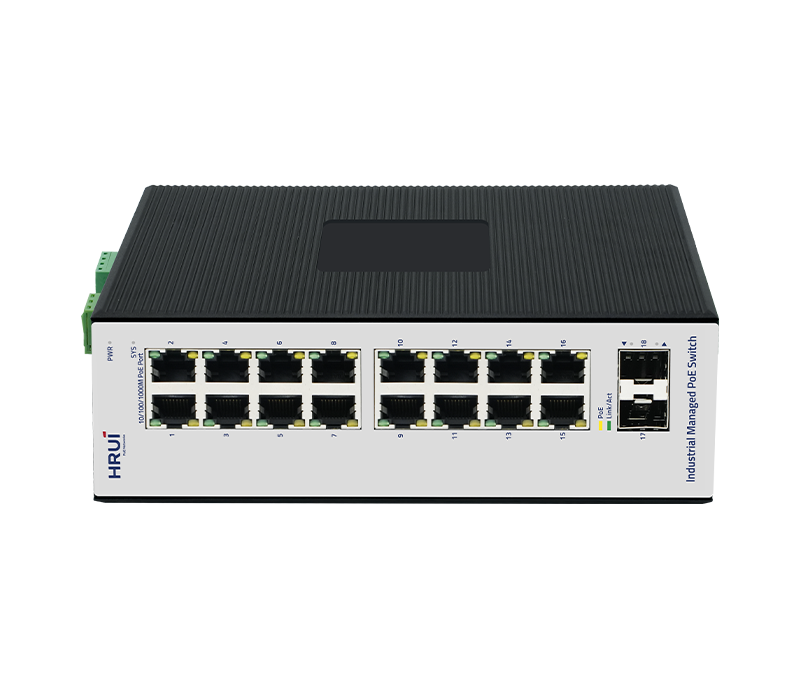
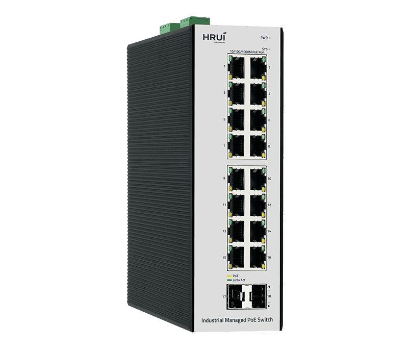
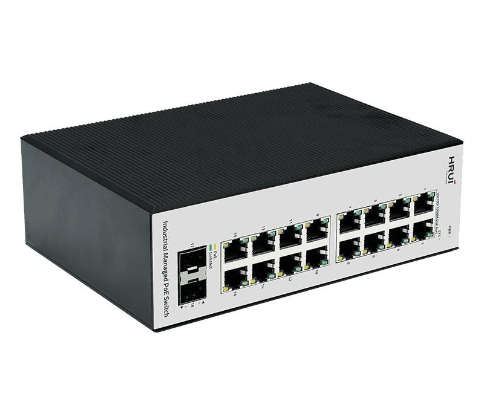
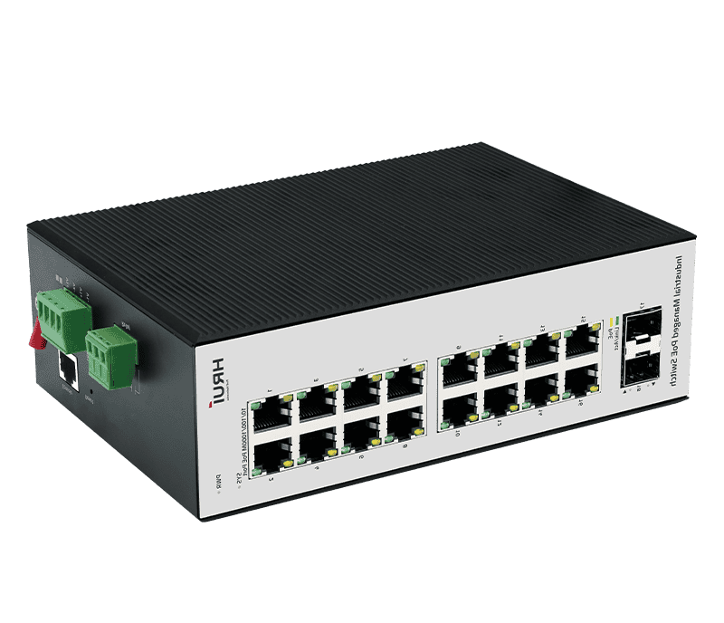
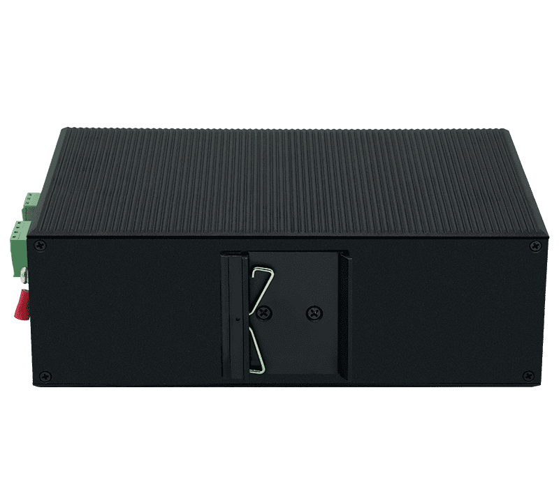

# HR722P-16T2GS

> 来源：<https://www.hruitech.com/industrial-poe-switch/302.html>（抓取 2026-10-21T04:36:27Z；英文原文照录，中文仅为栏目名）  
> 官网描述：Industrial L2+ 16-Port 10/100/1000T 802.3af/at PoE + 2-Port 1000X SFP Managed Ethernet Switch  
> 类目：Industrial PoE Switch（site id 302）  
> 接口：16*1Gbps PoE ports 2*1Gbps SFP ports 1*Console port；PoE 预算 According to the adapter；交换带宽 36Gbps；电源 DC12~55V DC48~55V (PoE) Power wiring: 4 PIN industrial terminals (redundant V1+V1-, V2+V2-)

**Brief:** 16×PoE ports -40~75°C | 36Gbps speed | SNMPv3 security | Dual PSU redundancy | 6KV surge shield | DIN-rail mount | L2+ management | Industrial-grade aluminum

## 产品图






## Datasheet
- [HR722P-16T2GS-28EN-29.pdf](https://www.hruitech.com/web/userfiles/productfile/HR722P-16T2GS-28EN-29.pdf) （本地：`data/hrui_site_raw/datasheets/HR722P-16T2GS-28EN-29.pdf`；文本：`data/hrui_site_raw/datasheet_text/HR722P-16T2GS-28EN-29.txt`）

## Feature and Benefits（原文）
```
The HR722P-16T2GS is an 18-port industrial-grade managed PoE switch designed for harsh environments, featuring 16×1Gbps PoE ports (IEEE 802.3af/at) and 2×1Gbps SFP slots. With a 36Gbps switching capacity, -40~55°C operating range, and IP40 rugged aluminum housing, it ensures reliable connectivity for critical applications. Advanced L2+ features like VLAN, QoS, and SNMPv3 enhance network security and management, while dual redundant power inputs and 6KV surge protection guarantee uninterrupted operation.
Product Highlights：
1、Support: IEEE802.3, IEEE802.3u, IEEE802.3x, IEEE802.3z / ab, IEEE802.1Q, IEEE802.1p, IEEE802.1d/w
2、Support SNMP v1/v2/v3 Simple Network Management Protocol
3、Support IGMP Snooping, static multicast filtering, and MLD Snooping filtering
4、Support 802.1x port authentication and AAA authentication to enhance network security
5、Support WEB, Telnet, CLI, SSH management
6、IP40 protection level, high-strength aluminum shell, DIN35 rail installation
7、Industrial grade 4-level design, operating temperature from -40~55°C
8、Support redundant power supply connection and anti reverse connection
```

## Parameter（规格表逐行）
| 项 | 值 |
|---|---|
| Description | Specification |
| Model | HR722P-16T2GS |
| Interface | 16*1Gbps PoE ports 2*1Gbps SFP ports 1*Console port |
| Port Standard | IEEE802.3 (Ethernet) IEEE802.3u (Fast Ethernet) IEEE 802.3ab (Gigabit Ethernet) IEEE 802.3z (Gigabit Ethernet Fiber Standard) IEEE802.3x (Flow Control) IEEE 802.1w Rapid Spanning Tree Protocol IEEE 802.1D Spanning Tree Protocol |
| Switching Bandwidth | 36Gbps |
| Packet Forwarding Rate | 26.78Mpps |
| Packet Buffer | 4.1Mbit |
| MAC Address Table | 8K |
| Jumbo Frame | Support |
| VLAN | VLAN range 1-4094, maximum active VLAN is 4K |
| Transmission Method | Store and Forward |
| Relay | Reserved relay (3pin terminal block), relay protection: Common mode 2KV, Differential mode 1KV |
| PoE Standard | IEEE802.3af (15.4W) IEEE802.3at (30W) |
| PoE Port Output Voltage | DC 48-55V |
| PoE Ports | Ports 1-16 PoE power output <30W |
| PoE Power Budget | According to the adapter |
| Power Supply | DC12~55V DC48~55V (PoE) Power wiring: 4 PIN industrial terminals (redundant V1+V1-, V2+V2-) |
| Mainboard Power Consumption | TBC |
| Structure Information | Product Dimensions: 187*128*62.8mm Packaging Dimensions : 242*207*86mm Product Net Weight: 1.11KG Product Gross Weight: 1.34KG |
| Packing Information | Carton Dimensions: 445*445*265mm Packing Quantity: 10PCS Packing Weight: 14.4KG |
| Package Contents | Switch 1pcs, Serial cable 1pcs, Manual 1pcs, Certificate of Inspection 1pcs |
| Fan Quantity | 0 |
| Installation | Desktop, Wall mounting installation, Rail installation |
| Surge Protection | Port Surge: Common mode 6KV, Differential mode 2KV(Class B) Electrostatic ESD: Air 15KV, Contact 8KV(Class B) |
| Operating Temperature | -40~75°C |
| Storage Temperature | -40~85°C |
| Operation Humidity | 10%~90%, non condensing |
| Storage Humidity | 5%~95%, non condensing |
| PWR Green LED | On: Powered on Off: Powered off |
| SYS Green LED | Flashing: System startup in progress On: The system is running normally |
| Ports 1-16 Green LED | On: 10/100/1000Mbps Link normal Off: Link blocked Fast Flashing: Data transmitting |
| Ports 1-16 Yellow LED | On: PoE powered on Off: PoE powered off |
| Ports 17-18 Green LED | On: 1Gbps Link normal Off: Link blocked Flashing: Data transmitting |
| Reset | Short press to restart, long press for 6 seconds to restore factory settings |
| **L2+ Function** | |
| IPv4 | IPv4 VLAN Interface |
| IPv4 | IPv4 Static Routes |
| IPv4 | ARP |
| IPv6 | IPv6 VLAN Interface |
| IPv6 | IPv6 Static Routes |
| IPv6 | IPv6 ND |
| **L2 Function** | |
| Port | Port Switch configuration |
| Port | Port Description configuration |
| Port | Port Speed configuration |
| Port | Port Duplex configuration |
| Port | Port Flow Control configuration |
| Port | Jumbo Frame |
| Port | EEE |
| Port | Fiber Module(DDM) |
| Link Aggregation | Support load balance policy; Base on MAC and IP-MAC |
| Link Aggregation | Static and Dynamic Group |
| Link Aggregation | Up to 8 groups |
| Link Aggregation | Support LACP |
| Storm Control | Boardcast suppression |
| Storm Control | Unknown Multicast |
| Storm Control | Unknown Unicast |
| Port Mirroring | One to one monitor |
| Port Mirroring | Many to one monitor |
| Port Mirroring | Ingress/Egress/Both |
| Port Mirroring | Up to 4 session groups |
| Port Security | MAC Address Constraints |
| Port Security | Port Security MAC Address |
| Port Security | Protect/Restrict/Shutdown |
| Port Isolation | Support |
| Port Rate-limit | Support |
| Loopback Detection | Support |
| VLAN | Access/Trunk/Hybrid |
| VLAN | VLAN Tunnel (Q-in-Q Tunnel) |
| VLAN | VLAN range 1-4094, maximum active VLAN is 4K |
| VLAN | Voice VLAN |
| VLAN | MAC VLAN |
| VLAN | Surveillance VLAN |
| VLAN | Protocol VLAN |
| VLAN | GVRP |
| MAC Address | Dynamic MAC address |
| MAC Address | Static MAC address |
| MAC Address | Filtering MAC Address |
| Spanning Tree Protocol | STP/RSTP/MSTP |
| Spanning Tree Protocol | BPDU Filter |
| Spanning Tree Protocol | BPDU Guard |
| Spanning Tree Protocol | Edge Port |
| LLDP | LLDP |
| LLDP | LLDP MED |
| Multicast | IGMP Snooping |
| Multicast | IGMP V1/V2/V3 |
| Multicast | Router Port |
| Multicast | Static IGMP group address |
| Multicast | IGMP groups filtering |
| Multicast | Querier |
| Multicast | MLD Snooping |
| Multicast | MVR |
| QoS | Traffic classification based, Strict priority and WRR |
| QoS | Port Priority |
| QoS | 802.1P Priority |
| QoS | IP TOS Priority |
| QoS | IP DSCP Priority |
| QoS | Support up to 8 queues per port |
| QoS | Priority Remarking |
| ERPS | Only SFP port |
| **PoE** | |
| PoE Configuration | PoE Temperature |
| PoE Configuration | PoE Type/Level/Power/Voltage/Current query |
| PoE Configuration | PoE Switch Configuration |
| PoE Configuration | PoE Watchdog Configuration |
| PoE Configuration | PoE power AF/AT adaptation |
| PoE Schedule | Support |
| PoE Port Timer Reboot | Support |
| **Services** | |
| DHCP | DHCP Server |
| DHCP | IP Pool |
| DHCP | Static Binding |
| DHCP | Option 43 |
| DHCP | DHCP Relay |
| Access Protocol | HTTP |
| Access Protocol | HTTPS |
| Access Protocol | Telnet |
| Access Protocol | SSHv2 |
| Access Protocol | Manager ACL |
| Access Protocol | Session Timeout |
| Access Protocol | Password Retry Count |
| Access Protocol | Silent Time |
| **Security** | |
| AAA | RADIUS |
| AAA | TACACS+ |
| AAA | 802.1X |
| AAA | Base on port/MAC/local/WEB |
| DHCP Snooping | Global/VLAN |
| DHCP Snooping | Option 82 |
| DHCP Snooping | Circuit ID |
| IP Source Guard | Support |
| Dynamic ARP Inspection | Support |
| DoS | Support |
| ACL | MAC ACL |
| ACL | IPv4 ACL |
| ACL | IPv6 ACL |
| **Diagnostics** | |
| Syslog | Logging Message |
| Syslog | Remote Server |
| Ping | Support |
| Traceroute | Support |
| Copper Test | Support |
| UDLD | Support |
| Port Statistics | Support |
| **Equipment Management** | |
| Manager Access | Console |
| Manager Access | HTTP/HTTPS |
| Manager Access | Telnet |
| Manager Access | SSH |
| Manager Access | SNMP |
| Manager IP | Static Address |
| Manager IP | DHCP Client |
| Manager IP | Support IPv4 and IPv6 address |
| Manager IP | Manager VLAN |
| Manager IP | DNS |
| Time Synchronization | SNTP |
| Time Synchronization | Manual Time |
| SNMP | V1/V2C/V3 |
| SNMP | Community |
| SNMP | V3 User |
| SNMP | Group |
| SNMP | Trap Host |
| SNMP MIB | RFC 1213 MIB-II |
| SNMP MIB | RFC 1493 Bridge MIB |
| SNMP MIB | RFC 1643 Ethernet MIB |
| SNMP MIB | RFC 2819 RMON MIB (Groups 1, 2, 3 and 9) |
| SNMP MIB | RFC 2863 Interface MIB |
| SNMP MIB | LLDP |
| SNMP MIB | Private MIB |
| RMON | Statistics |
| RMON | History Configuration |
| RMON | Event Configuration |
| RMON | Alarm Configuration |
| User Management | Support |
| Firmware Management | Firmware upgrade |
| Configuration Management | Upload and download |
| Save | Support |
| Restart | Support |
| Factory Defaults | Support |
| **Standard Compliance** | |
| **IEEE 802.3x flow control and back pressure IEEE 802.3ad port trunk with LACP IEEE 802.1D Spanning Tree Protocol IEEE 802.1w Rapid Spanning Tree Protocol IEEE 802.1s Multiple Spanning Tree Protocol IEEE 802.1p Class of Service IEEE 802.1Q VLAN tagging IEEE 802.1x Port Authentication Network Control IEEE 802.1ab LLDP IEEE 802.3af Power over Ethernet IEEE 802.3at Power over Ethernet Plus RFC 768 UDP RFC 793 TFTP RFC 791 IP RFC 792 ICMP RFC 2068 HTTP RFC 1112 IGMP v1 RFC 2236 IGMP v2 RFC 3376 IGMP v3 RFC 2710 MLD v1 FRC 3810 MLD v2** | |

## Product structure / Application topology（图）
- https://www.hruitech.com/web/userfiles/image/20250728/1753696004848093.png
