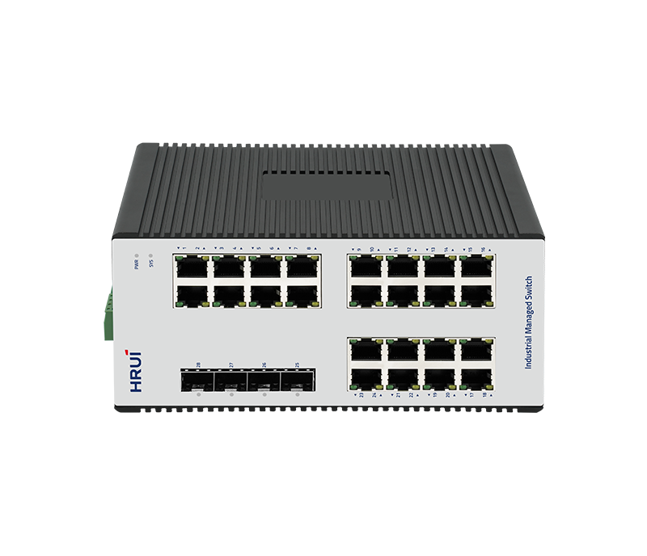
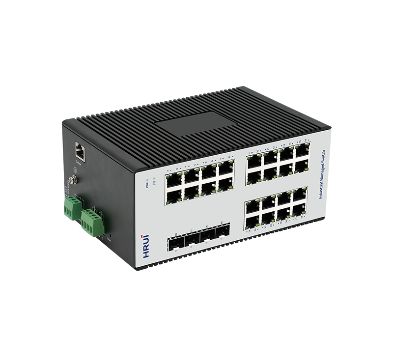
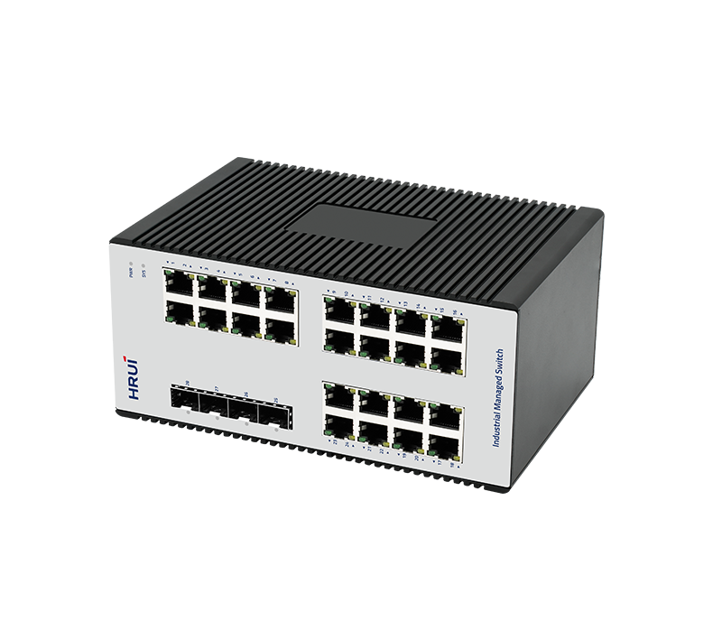
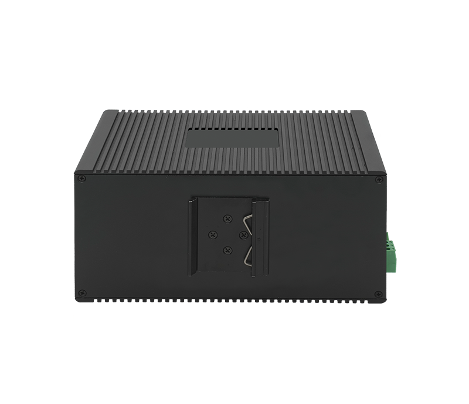

# HR722S-24T4GS

> 来源：<https://www.hruitech.com/industrial-ethernet-switch/320.html>（抓取 2026-10-21T04:36:43Z；英文原文照录，中文仅为栏目名）  
> 官网描述：Industrial L2+ 24-Port 10/100/1000T + 4-Port 1000X SFP Managed Ethemet Switch  
> 类目：Industrial Ethernet Switch（site id 320）  
> 接口：24*1Gbps RJ45 ports / 4*1Gbps SFP ports / 1*Console port；PoE 预算 —；交换带宽 56Gbps；电源 DC12~55V / Power wiring: 4 PIN industrial terminals (redundant V1+V1-, V2+V2-)

**Brief:** HR722S-24T4GS delivers full Gigabit connectivity with SFP uplinks for high-bandwidth transmission. It operates reliably from -40°C to 75°C in a fanless IP40-rated aluminum enclosure, with strong protection including 6KV surge, 15KV ESD, and 2KV power input immunity. Advanced features such as VLAN, QoS, LACP, IGMP Snooping, and ERPS ensure efficient performance, while 802.1X, ACL, SSH, and SNMP provide secure network management. Its high-density ports and compact DIN-rail design enable easy and flexible deployment.

## 产品图





## Datasheet
- [HR722S-24T4GS-28EN-29.pdf](https://www.hruitech.com/web/userfiles/productfile/HR722S-24T4GS-28EN-29.pdf) （本地：`data/hrui_site_raw/datasheets/HR722S-24T4GS-28EN-29.pdf`；文本：`data/hrui_site_raw/datasheet_text/HR722S-24T4GS-28EN-29.txt`）

## Feature and Benefits（原文）
```
HR722S-24T4GS is designed for demanding industrial environments, providing robust connectivity and reliable performance for applications such as factory automation, intelligent transportation, and video surveillance.
It offers a
dvanced L2+ management capabilities and enhanced availability, enabling the construction of a secure, high-performance access layer for mission-critical applications.
Product Features:
Port Configuration:
24 × 1Gbps RJ45, 4 × 1Gbps SFP, and 1 console port for flexible industrial connectivity.
Protocol Support:
Compliant with IEEE 802.3/802.3u/802.3x/802.3z/ab, 802.1Q/1p, and 802.1d/w for reliable interoperability.
Advanced Network Management:
Supports STP/RSTP/MSTP and SNMP v1/v2
/v3
for efficient network control and redundancy.
Enhanced Security:
Features 802.1X and AAA authentication, plus IGMP and MLD Snooping for secure multicast management.
Flexible Management Options:
Offers WEB, Telnet, CLI, and SSH interfaces to match diverse operational preferences.
Rugged Industrial Design:
Durable metal housing with IP40 protection and DIN-35 rail mounting for harsh environments.
Industrial-Grade Reliability:
Wide operating temperature of –40°C to +75°C, with redundant power input and reverse-polarity protection.
Standards Compliance:
Meets industrial EMC and safety standards for stable performance in noisy environments.
```

## Parameter（规格表逐行）
| 项 | 值 |
|---|---|
| Description | Specification |
| Model | HR722S-24T4GS |
| Interface | 24*1Gbps RJ45 ports |
| Interface | 4*1Gbps SFP ports |
| Interface | 1*Console port |
| Port Standard | IEEE802.3 (Ethernet) |
| Port Standard | IEEE802.3u (Fast Ethernet) |
| Port Standard | IEEE 802.3ab (Gigabit Ethernet) |
| Port Standard | IEEE 802.3z (Gigabit Ethernet Fiber Standard) |
| Port Standard | IEEE802.3x (Flow Control) |
| Port Standard | IEEE 802.1w Rapid Spanning Tree Protocol |
| Port Standard | IEEE 802.1D Spanning Tree Protocol |
| Switching Bandwidth | 56Gbps |
| Packet Forwarding Rate | 41.66Mpps |
| Packet Buffer | 4.1Mbit |
| MAC Address Table | 8K |
| Jumbo Frame | 10Kbytes |
| VLAN | VLAN range 1-4094, maximum active VLAN is 4K |
| Transmission Method | Store and Forward |
| Power Supply | DC12~55V |
| Power Supply | Power wiring: 4 PIN industrial terminals (redundant V1+V1-, V2+V2-) |
| Relay | Reserved relay (3pin terminal block), relay protection: Common mode 2KV, Differential mode 1KV |
| Certification | CE, FCC, RoSH |
| Mainboard Power Consumption | 21.16W |
| Structure Information | Product Dimensions: 186.6*122.7*86mm |
| Structure Information | Packaging Dimensions : 245*190*103mm |
| Structure Information | Product Net Weight: 1.18KG |
| Structure Information | Product Gross Weight: 1.34KG |
| Packing Information | Carton Dimensions: 555*405*270mm |
| Packing Information | Packing Quantity: 10PCS |
| Packing Information | Packing Weight: 14.4KG |
| Package Contents | Switch 1pcs, Serial cable 1pcs, Manual 1pcs, Certificate of Inspection 1pcs |
| Fan Quantity | 0 |
| Installation | Desktop, Wall mounting installation, Rail installation |
| Surge Protection | Port Surge: Common mode 6KV, Differential mode 2KV |
| Surge Protection | Electrostatic ESD: Air 15KV, Contact 8KV(Class C) |
| Surge Protection | Power Port : Common mode 2KV, Differential mode 1KV |
| Operating Temperature | -40~75°C |
| Storage Temperature | -40~85°C |
| Operation Humidity | 10%~90%, non condensing |
| Storage Humidity | 5%~95%, non condensing |
| PWR Green LED | On: Powered on |
| PWR Green LED | Off: Powered off |
| SYS Green LED | Flashing: System startup in progress |
| SYS Green LED | On: The system is running normally |
| Ports 1-24 LED | Green LED on:1000Mbps Link normal |
| Ports 1-24 LED | Yellow LED on:10/100Mbps Link normal |
| Ports 1-24 LED | Off: Link blocked |
| Ports 1-24 LED | Fast Flashing: Data transmitting |
| Ports 25-28 Green LED | On: 1000Mbps Link normal |
| Ports 25-28 Green LED | Off: Link blocked |
| Ports 25-28 Green LED | Flashing: Data transmitting |
| Reset | Short press to restart, long press for 6 seconds to restore factory settings |
| **L2+ Function** | |
| IPv4 | IPv4 VLAN Interface |
| IPv4 | IPv4 Static Routes |
| IPv4 | ARP |
| IPv6 | IPv6 VLAN Interface |
| IPv6 | IPv6 Static Routes |
| IPv6 | IPv6 ND |
| **L2 Function** | |
| Port | Port Switch configuration |
| Port | Port Description configuration |
| Port | Port Speed configuration |
| Port | Port Duplex configuration |
| Port | Port Flow Control configuration |
| Port | Jumbo Frame |
| Port | EEE |
| Port | Fiber Module(DDM) |
| Link Aggregation | Support load balance policy; Base on MAC and IP-MAC |
| Link Aggregation | Static and Dynamic Group |
| Link Aggregation | Up to 8 groups |
| Link Aggregation | Support LACP |
| Storm Control | Boardcast suppression |
| Storm Control | Unknown Multicast |
| Storm Control | Unknown Unicast |
| Port Mirroring | One to one monitor |
| Port Mirroring | Many to one monitor |
| Port Mirroring | Ingress/Egress/Both |
| Port Mirroring | Up to 4 session groups |
| Port Security | MAC Address Constraints |
| Port Security | Port Security MAC Address |
| Port Security | Protect/Restrict/Shutdown |
| Port Isolation | Support |
| Port Rate-limit | Support |
| Loopback Detection | Support |
| VLAN | Access/Trunk/Hybrid |
| VLAN | VLAN Tunnel (Q-in-Q Tunnel) |
| VLAN | VLAN range 1-4094, maximum active VLAN is 4K |
| VLAN | Voice VLAN |
| VLAN | MAC VLAN |
| VLAN | Surveillance VLAN |
| VLAN | Protocol VLAN |
| VLAN | GVRP |
| MAC Address | Dynamic MAC address |
| MAC Address | Static MAC address |
| MAC Address | Filtering MAC Address |
| Spanning Tree Protocol | STP/RSTP/MSTP |
| Spanning Tree Protocol | BPDU Filter |
| Spanning Tree Protocol | BPDU Guard |
| Spanning Tree Protocol | Edge Port |
| LLDP | LLDP |
| LLDP | LLDP MED |
| Multicast | IGMP Snooping |
| Multicast | IGMP V1/V2/V3 |
| Multicast | Router Port |
| Multicast | Static IGMP group address |
| Multicast | Querier |
| Multicast | MLD Snooping |
| Multicast | MVR |
| QoS | Traffic classification based, Strict priority and WRR |
| QoS | Port Priority |
| QoS | 802.1P Priority |
| QoS | IP TOS Priority |
| QoS | IP DSCP Priority |
| QoS | Support up to 8 queues per port |
| QoS | Priority Remarking |
| ERPS | Only SFP port |
| **Services** | |
| DHCP | DHCP Server |
| DHCP | IP Pool |
| DHCP | Static Binding |
| DHCP | Option 43 |
| DHCP | DHCP Relay |
| Access Protocol | HTTP |
| Access Protocol | HTTPS |
| Access Protocol | Telnet |
| Access Protocol | SSHv2 |
| Access Protocol | Manager ACL |
| Access Protocol | Session Timeout |
| Access Protocol | Password Retry Count |
| Access Protocol | Silent Time |
| **Security** | |
| AAA | RADIUS |
| AAA | TACACS+ |
| AAA | 802.1X |
| AAA | Base on port/MAC/local/WEB |
| DHCP Snooping | Global/VLAN |
| DHCP Snooping | Option 82 |
| DHCP Snooping | Circuit ID |
| IP Source Guard | Support |
| Dynamic ARP Inspection | Support |
| DoS | Support |
| ACL | MAC ACL |
| ACL | IPv4 ACL |
| ACL | IPv6 ACL |
| **Diagnostics** | |
| Syslog | Logging Message |
| Syslog | Remote Server |
| Ping | Support |
| Traceroute | Support |
| Copper Test | Support |
| UDLD | Support |
| Port Statistics | Support |
| **Equipment Management** | |
| Manager Access | Console |
| Manager Access | HTTP/HTTPS |
| Manager Access | Telnet |
| Manager Access | SSH |
| Manager Access | SNMP |
| Manager IP | Static Address |
| Manager IP | DHCP Client |
| Manager IP | Support IPv4 and IPv6 address |
| Manager IP | Manager VLAN |
| Manager IP | DNS |
| Time Synchronization | SNTP |
| Time Synchronization | Manual Time |
| SNMP | V1/V2C/V3 |
| SNMP | Community |
| SNMP | V3 User |
| SNMP | Group |
| SNMP | Trap Host |
| SNMP MIB | RFC 1213 MIB-II |
| SNMP MIB | RFC 1493 Bridge MIB |
| SNMP MIB | RFC 1643 Ethernet MIB |
| SNMP MIB | RFC 2819 RMON MIB (Groups 1, 2, 3 and 9) |
| SNMP MIB | RFC 2863 Interface MIB |
| SNMP MIB | LLDP |
| SNMP MIB | Private MIB |
| RMON | Statistics |
| RMON | History Configuration |
| RMON | Event Configuration |
| RMON | Alarm Configuration |
| User Management | Support |
| Firmware Management | Firmware upgrade |
| Configuration Management | Upload and download |
| Save | Support |
| Restart | Support |
| Factory Defaults | Support |
| **Standard Compliance** | |
| **IEEE 802.3x flow control and back pressure** | |
| **IEEE 802.3ad port trunk with LACP** | |
| **IEEE 802.1D Spanning Tree Protocol** | |
| **IEEE 802.1w Rapid Spanning Tree Protocol** | |
| **IEEE 802.1s Multiple Spanning Tree Protocol** | |
| **IEEE 802.1p Class of Service** | |
| **IEEE 802.1Q VLAN tagging** | |
| **IEEE 802.1x Port Authentication Network Control** | |
| **IEEE 802.1ab LLDP** | |
| **RFC 768 UDP** | |
| **RFC 793 TFTP** | |
| **RFC 791 IP** | |
| **RFC 792 ICMP** | |
| **RFC 2068 HTTP** | |
| **RFC 1112 IGMP v1** | |
| **RFC 2236 IGMP v2** | |
| **RFC 3376 IGMP v3** | |
| **RFC 2710 MLD v1** | |
| **FRC 3810 MLD v2** | |

## Product structure / Application topology（图）
- https://www.hruitech.com/web/userfiles/image/20260324/1774318366423705.png
