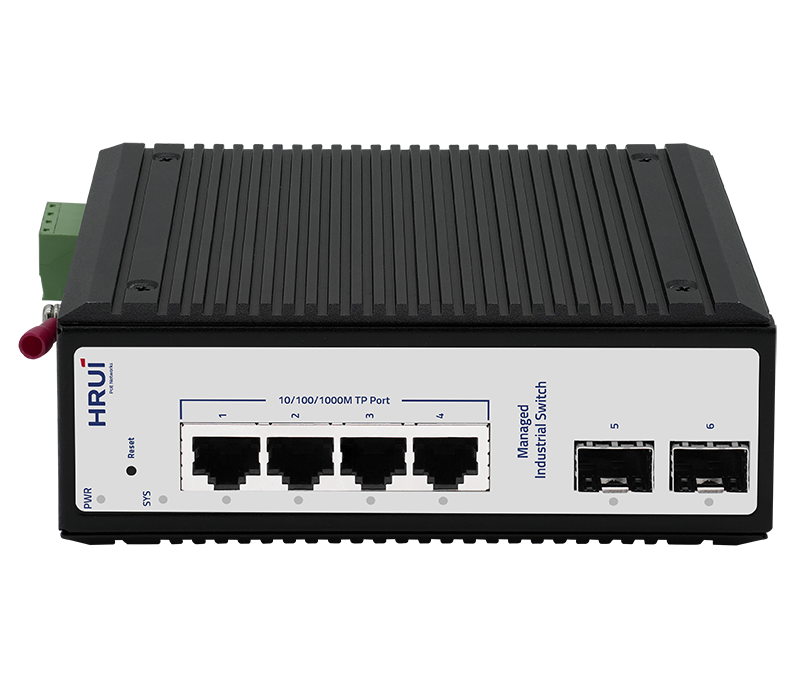
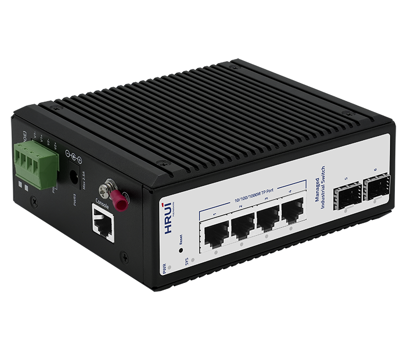
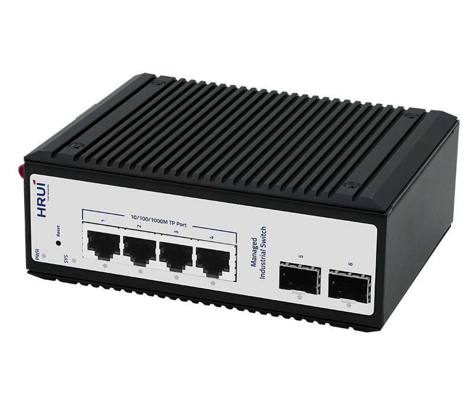
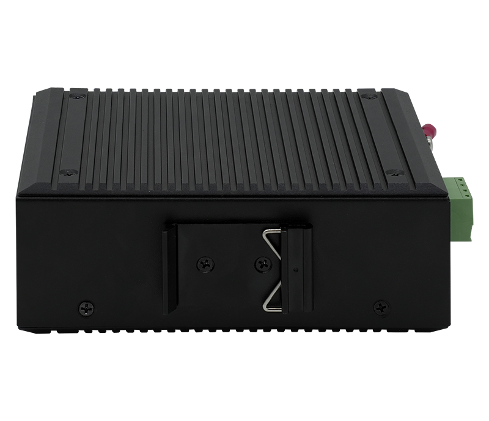

# HR722S-4T2GS

> 来源：<https://www.hruitech.com/industrial-ethernet-switch/270.html>（抓取 2026-10-21T03:47:25Z；英文原文照录，中文仅为栏目名）  
> 官网描述：Industrial L2+ 4-Port 10/100/1000T + 2-Port 1000X SFP Managed Ethemet Switch  
> 类目：Industrial Ethernet Switch（site id 270）  
> 接口：4*1Gbps RJ45 ports / 2*1Gbps SFP ports / 1*Console port；PoE 预算 —；交换带宽 12Gbps；电源 DC12~55V / Power wiring: 4 PIN industrial terminals (redundant V1+V1-, V2+V2-)

**Brief:** The HR722S-4T2GS is a high-performance, 6-port gigabit industrial managed switch designed for demanding applications in harsh environments. With its robust feature set and rugged design, this switch is ideal for industries that require reliable, high-speed networking.

## 产品图





## Datasheet
- [HR722S_4T2GS.pdf](https://www.hruitech.com/web/userfiles/productfile/HR722S_4T2GS.pdf) （本地：`data/hrui_site_raw/datasheets/HR722S_4T2GS.pdf`；文本：`data/hrui_site_raw/datasheet_text/HR722S_4T2GS.txt`）

## Feature and Benefits（原文）
```
The HR722S-4T2GS is a high-performance, 6-port gigabit industrial managed switch designed for demanding applications in harsh environments. With its robust feature set and rugged design, this switch is ideal for industries that require reliable, high-speed networking.
Product Features:
Standards Compliance:
Supports IEEE802.3, IEEE802.3u, IEEE802.3x, IEEE802.3z/ab, IEEE802.1Q, IEEE802.1p, and IEEE802.1d/w
Cloud Management:
Utilize HRUI Cloud Management for remote monitoring and management, ensuring seamless network optimization and troubleshooting.
Network Management:
Supports SNMP v1/v2/v3 Simple Network Management Protocol for efficient network administration.
Multicast Filtering:
Features IGMP Snooping, static multicast filtering, and MLD Snooping filtering for optimized network performance.
Enhanced Security:
Supports 802.1x port authentication and AAA authentication to ensure network security and integrity.
Management Options:
Offers WEB, Telnet, CLI, and SSH management for flexibility and convenience.
Durable Design:
Constructed with an IP40 protection level and housed in a sturdy aluminum shell, this switch is engineered for DIN35 rail installation and can withstand harsh conditions.
Industrial-Grade Reliability:
Designed for extreme environments with a 4-level industrial grade rating and operates effectively in temperatures ranging from -40°C to 75°C.
Redundant Power Supply:
Offers redundant power supply connections with reverse polarity protection for uninterrupted operation.
The HRUI Gigabit Managed Industrial Switch Series is specifically designed to meet diverse application needs, offering flexible port combination solutions. This series of switches supports a rich set of L2+ management features, providing high operability and flexibility, while also supporting HRUI cloud management to ensure convenient remote monitoring and management for users.
Adhering to industrial-grade design, the products are equipped with redundant power input to ensure high system reliability. The high-strength IP40 aluminum casing not only provides excellent heat dissipation performance but also maintains stable operation under extreme conditions (-40°C to 75°C), meeting the rigorous requirements for high and low-temperature environments. With its outstanding performance and reliability, this series of switches is widely used in fields such as industrial automation, intelligent transportation, and security monitoring.
Flexible Port Combinations for Diverse Needs
Providing a variety of port types and configurations to meet various network connectivity requirements.
Supports L2+ Network Management
This product offers a comprehensive suite of L2+ network management features, including support for VLAN, port mirroring, traffic control, LACP, QoS, and DHCP Snooping, among others. It is designed to meet a variety of complex network requirements, enhancing network security, reliability, and scalability.
Unified Management in the Cloud: Accessible, Scalable, and Efficient
Provide cloud-based management for remote equipment monitoring and control, simplifying detection, configuration, deployment, and maintenance to reduce costs and improve efficiency and reliability.
Secure Networking
The products feature advanced cybersecurity measures, including SSHv2 and SNMPv3 protocols, to protect against cyber threats. Its robust security capabilities enhance switch management while maintaining cost-effective deployment for critical network operations.
Enhanced Fiber Module DDM Capabilities
Support for Fiber Module DDM (Digital Diagnostic Monitoring) includes tracking key parameters such as transceiver supply voltage, temperature, transmitter bias current, transmitter output power, and received optical power. By analyzing these metrics, you can effectively diagnose issues that may be affecting the transceiver optics performance.
Industrial Design Enabling Durable Applications
The products feature aluminum alloy casings, offering exceptional heat dissipation and mechanical strength. They are capable of stable operation across a broad temperature range (-40°C to 75°C), making them particularly suitable for application scenarios such as industrial sites and outdoor base stations.
Triple Power Input Design
The device features triple power inputs, enabling you to deploy multiple power sources for enhanced reliability and redundancy. This design guarantees that your system stays operational during power failures or unexpected shutdowns.
APPLICATION
SPECIFICATION
```

## Parameter（规格表逐行）
| 项 | 值 |
|---|---|
| Description | Specification |
| Model | HR722S-4T2GS |
| Interface | 4*1Gbps RJ45 ports |
| Interface | 2*1Gbps SFP ports |
| Interface | 1*Console port |
| Port Standard | IEEE802.3 (Ethernet) |
| Port Standard | IEEE802.3u (Fast Ethernet) |
| Port Standard | IEEE 802.3ab (Gigabit Ethernet) |
| Port Standard | IEEE 802.3z (Gigabit Ethernet Fiber Standard) |
| Port Standard | IEEE802.3x (Flow Control) |
| Port Standard | IEEE 802.1w Rapid Spanning Tree Protocol |
| Port Standard | IEEE 802.1D Spanning Tree Protocol |
| Switching Bandwidth | 12Gbps |
| Packet Forwarding Rate | 8.928Mpps |
| Packet Buffer | 4.1Mbit |
| MAC Address Table | 8K |
| Jumbo Frame | 10Kbytes |
| VLAN | VLAN range 1-4094, maximum active VLAN is 4K |
| Transmission Method | Store and Forward |
| Power Supply | DC12~55V |
| Power Supply | Power wiring: 4 PIN industrial terminals (redundant V1+V1-, V2+V2-) |
| Mainboard Power Consumption | 6.2W |
| Structure Information | Product Dimensions: 138*108*51mm |
| Structure Information | Packaging Dimensions : 245*190*70mm |
| Structure Information | Product Net Weight: 0.81KG |
| Structure Information | Product Gross Weight: 1KG (excluding power supply) |
| Packing Information | Carton Dimensions: 520*380*400mm |
| Packing Information | Packing Quantity: 20PCS |
| Packing Information | Packing Weight: 21KG |
| Package Contents | Switch 1pcs, Serial cable 1pcs, Manual 1pcs, Certificate of Inspection 1pcs |
| Fan Quantity | 0 |
| Installation | Desktop, Wall mounting installation, Rail installation |
| Surge Protection | Port Surge: Common mode 6KV, Differential mode 2KV(Class B) |
| Surge Protection | Electrostatic ESD: Air 15KV, Contact 8KV(Class B) |
| Operating Temperature | -40~75°C |
| Storage Temperature | -40~85°C |
| Operation Humidity | 10%~90%, non condensing |
| Storage Humidity | 5%~95%, non condensing |
| PWR Green LED | On: Powered on |
| PWR Green LED | Off: Powered off |
| SYS Green LED | Flashing: System startup in progress |
| SYS Green LED | On: The system is running normally |
| Ports 1-4 Green LED | Slow Flashing: 10/100/1000Mbps Link normal |
| Ports 1-4 Green LED | Off: Link blocked |
| Ports 1-4 Green LED | Fast Flashing: Data transmitting |
| Ports G5-G6 Green LED | On: 10/100/1000Mbps Link normal |
| Ports G5-G6 Green LED | Off: Link blocked |
| Ports G5-G6 Green LED | Flashing: Data transmitting |
| Reset | Short press to restart, long press for 6 seconds to restore factory settings |
| **Software Features** | |
| **L2+ Function** | |
| IPv4 | IPv4 VLAN Interface |
| IPv4 | IPv4 Static Routes |
| IPv4 | ARP |
| IPv6 | IPv6 VLAN Interface |
| IPv6 | IPv6 Static Routes |
| IPv6 | IPv6 ND |
| **L2 Function** | |
| Port | Port Switch configuration |
| Port | Port Description configuration |
| Port | Port Speed configuration |
| Port | Port Duplex configuration |
| Port | Port Flow Control configuration |
| Port | Jumbo Frame |
| Port | EEE |
| Port | Fiber Module(DDM) |
| Link Aggregation | Support load balance policy; Base on MAC and IP-MAC |
| Link Aggregation | Static and Dynamic Group |
| Link Aggregation | Up to 8 groups |
| Link Aggregation | Support LACP |
| Storm Control | Boardcast suppression |
| Storm Control | Unknown Multicast |
| Storm Control | Unknown Unicast |
| Port Mirroring | One to one monitor |
| Port Mirroring | Many to one monitor |
| Port Mirroring | Ingress/Egress/Both |
| Port Mirroring | Up to 4 session groups |
| Port Security | MAC Address Constraints |
| Port Security | Port Security MAC Address |
| Port Security | Protect/Restrict/Shutdown |
| Port Isolation | Support |
| Port Rate-limit | Support |
| Loopback Detection | Support |
| VLAN | Access/Trunk/Hybrid |
| VLAN | VLAN Tunnel (Q-in-Q Tunnel) |
| VLAN | VLAN range 1-4094, maximum active VLAN is 4K |
| VLAN | Voice VLAN |
| VLAN | MAC VLAN |
| VLAN | Surveillance VLAN |
| VLAN | Protocol VLAN |
| VLAN | GVRP |
| MAC Address | Dynamic MAC address |
| MAC Address | Static MAC address |
| MAC Address | Filtering MAC Address |
| Spanning Tree Protocol | STP/RSTP/MSTP |
| Spanning Tree Protocol | BPDU Filter |
| Spanning Tree Protocol | BPDU Guard |
| Spanning Tree Protocol | Edge Port |
| LLDP | LLDP |
| LLDP | LLDP MED |
| Multicast | IGMP Snooping |
| Multicast | IGMP V1/V2/V3 |
| Multicast | Router Port |
| Multicast | Static IGMP group address |
| Multicast | IGMP groups filtering |
| Multicast | Querier |
| Multicast | MLD Snooping |
| Multicast | MVR |
| QoS | Traffic classification based, Strict priority and WRR |
| QoS | Port Priority |
| QoS | 802.1P Priority |
| QoS | IP TOS Priority |
| QoS | IP DSCP Priority |
| QoS | Support up to 8 queues per port |
| QoS | Priority Remarking |
| ERPS | Only SFP port |
| **Services** | |
| DHCP | DHCP Server |
| DHCP | IP Pool |
| DHCP | Static Binding |
| DHCP | Option 43 |
| DHCP | DHCP Relay |
| Access Protocol | HTTP |
| Access Protocol | HTTPS |
| Access Protocol | Telnet |
| Access Protocol | SSHv2 |
| Access Protocol | Manager ACL |
| Access Protocol | Session Timeout |
| Access Protocol | Password Retry Count |
| Access Protocol | Silent Time |
| **Security** | |
| AAA | RADIUS |
| AAA | TACACS+ |
| AAA | 802.1X |
| AAA | Base on port/MAC/local/WEB |
| DHCP Snooping | Global/VLAN |
| DHCP Snooping | Option 82 |
| DHCP Snooping | Circuit ID |
| IP Source Guard | Support |
| Dynamic ARP Inspection | Support |
| DoS | Support |
| ACL | MAC ACL |
| ACL | IPv4 ACL |
| ACL | IPv6 ACL |
| **Diagnostics** | |
| Syslog | Logging Message |
| Syslog | Remote Server |
| Ping | Support |
| Traceroute | Support |
| Copper Test | Support |
| UDLD | Support |
| Port Statistics | Support |
| **Equipment Management** | |
| Manager Access | Console |
| Manager Access | HTTP/HTTPS |
| Manager Access | Telnet |
| Manager Access | SSH |
| Manager Access | SNMP |
| Manager IP | Static Address |
| Manager IP | DHCP Client |
| Manager IP | Support IPv4 and IPv6 address |
| Manager IP | Manager VLAN |
| Manager IP | DNS |
| Time Synchronization | SNTP |
| Time Synchronization | Manual Time |
| SNMP | V1/V2C/V3 |
| SNMP | Community |
| SNMP | V3 User |
| SNMP | Group |
| SNMP | Trap Host |
| SNMP MIB | RFC 1213 MIB-II |
| SNMP MIB | RFC 1493 Bridge MIB |
| SNMP MIB | RFC 1643 Ethernet MIB |
| SNMP MIB | RFC 2819 RMON MIB (Groups 1, 2, 3 and 9) |
| SNMP MIB | RFC 2863 Interface MIB |
| SNMP MIB | LLDP |
| SNMP MIB | Private MIB |
| RMON | Statistics |
| RMON | History Configuration |
| RMON | Event Configuration |
| RMON | Alarm Configuration |
| User Management | Support |
| Firmware Management | Firmware upgrade |
| Configuration Management | Upload and download |
| Save | Support |
| Restart | Support |
| Factory Defaults | Support |
| **Standard Compliance** | |
| **IEEE 802.3x flow control and back pressure** | |
| **IEEE 802.3ad port trunk with LACP** | |
| **IEEE 802.1D Spanning Tree Protocol** | |
| **IEEE 802.1w Rapid Spanning Tree Protocol** | |
| **IEEE 802.1s Multiple Spanning Tree Protocol** | |
| **IEEE 802.1p Class of Service** | |
| **IEEE 802.1Q VLAN tagging** | |
| **IEEE 802.1x Port Authentication Network Control** | |
| **IEEE 802.1ab LLDP** | |
| **RFC 768 UDP** | |
| **RFC 793 TFTP** | |
| **RFC 791 IP** | |
| **RFC 792 ICMP** | |
| **RFC 2068 HTTP** | |
| **RFC 1112 IGMP v1** | |
| **RFC 2236 IGMP v2** | |
| **RFC 3376 IGMP v3** | |
| **RFC 2710 MLD v1** | |
| **FRC 3810 MLD v2** | |

## Product structure / Application topology（图）
- https://www.hruitech.com/web/userfiles/image/20250120/1737339467976296.png
