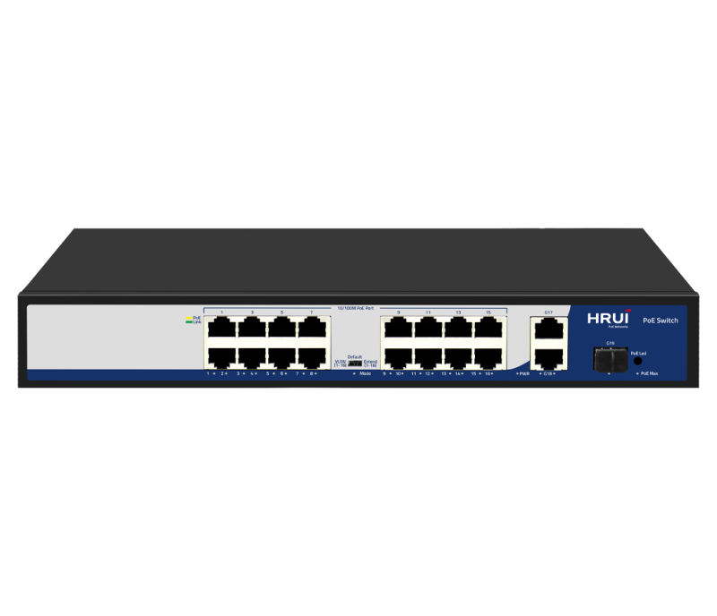
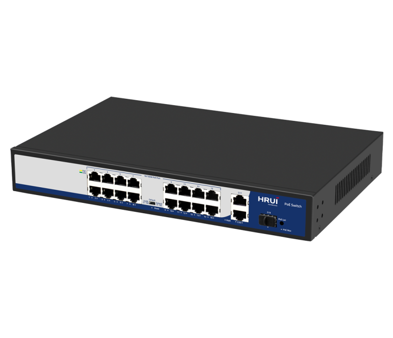
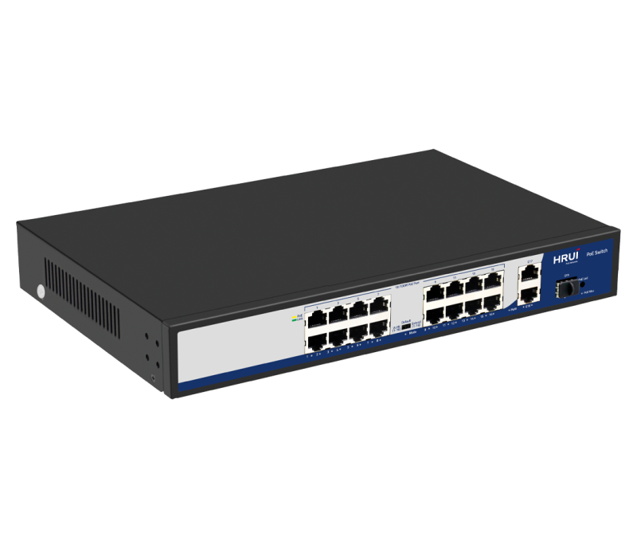
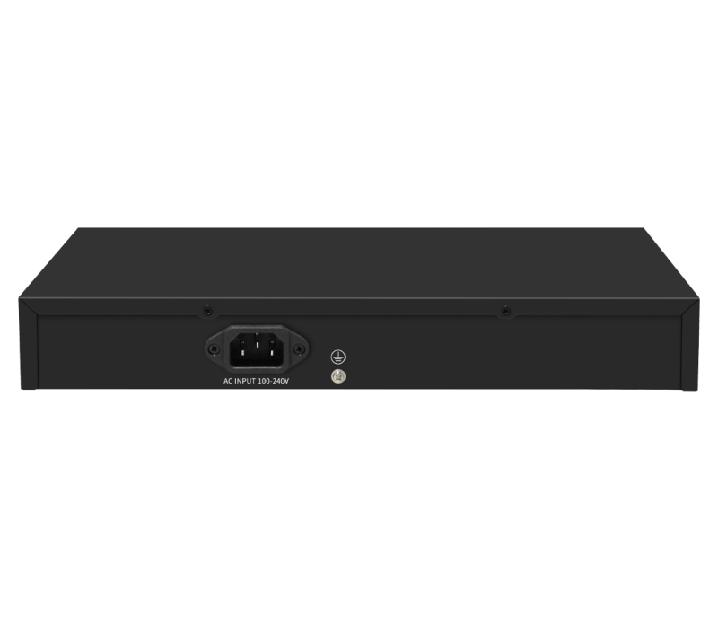

# HR900-AF-1621GS-300

> 来源：<https://www.hruitech.com/poe-switch/195.html>（抓取 2026-10-21T04:35:42Z；英文原文照录，中文仅为栏目名）  
> 官网描述：16*10/100T 802.3af/at PoE ports + 2-Port 10/100/1000T + 1-Port Gigabit SFP Ethernet Switch (300 Watts)  
> 类目：PoE Switch（site id 195）  
> 接口：16 *100Mbps Po E ports / 2 *1G RJ45 ports / 1 *1G SFP port；PoE 预算 290W；交换带宽 —；电源 AC 100-240V 50/60Hz / DC 52V 5.76A

**Brief:** 19 port 10/100/1000M intelligent standard PoE switch, adopting high-quality and high-speed network ICs and the most stable PoE chips, this series of PoE switches can provide seamless connection for 10/100/1000M Ethernet. The switches incorporate the latest AI functions, and the ports automatically turn on AI mode in Extend mode. The PoE power supply port can automatically detect and supply power to powered devices that comply with the IEEE802.3af or IEEE802.3at standards.

## 产品图





## Datasheet
- [HR900_AF_1621GS_300.pdf](https://www.hruitech.com/web/userfiles/productfile/HR900_AF_1621GS_300.pdf) （本地：`data/hrui_site_raw/datasheets/HR900_AF_1621GS_300.pdf`；文本：`data/hrui_site_raw/datasheet_text/HR900_AF_1621GS_300.txt`）

## Feature and Benefits（原文）
```
The HR900-AF-1621GS-300 is a robust 19-port intelligent PoE switch that supports 10/100/1000Mbps connections. Engineered with high-quality network ICs and stable PoE chips, it ensures seamless Ethernet connectivity. Featuring advanced AI capabilities, the switch automatically activates AI mode in Extend mode to optimize performance. It auto-detects and powers compliant IEEE802.3af/at devices while only transmitting data for non-PoE devices. Ideal for powering IP devices like phones, cameras, and access points, it simplifies installation and maintenance, making it perfect for various applications including industrial parks, government facilities, hotels, and schools.
Product Features:
16 x 100Mbps PoE ports, 2 x 1G RJ45 ports, 1 x 1G SFP port
Compliant with IEEE802.3 standards
RJ45 ports auto-adapt to 10/100Mbps
Extend mode activates PoE Watchdog on ports 1-16
Supports default PoE priority from port 1-16
Flow control via IEEE 802.3x for full duplex, back pressure for half duplex
LED indicators for easy status monitoring and fault analysis
Three operational modes: VLAN, Default, Extend
One port supports up to 60W PoE output
```

## Parameter（规格表逐行）
| 项 | 值 |
|---|---|
| Description | Specification |
| Model | HR900-AF-1621GS-300 |
| Interface | 16 *100Mbps Po E ports |
| Interface | 2 *1G RJ45 ports |
| Interface | 1 *1G SFP port |
| Port Standard | IEEE802.3 (Ethernet) |
| Port Standard | IEEE802.3u (Fast Ethernet) |
| Port Standard | IEEE802.3ab (Gigabit Ethernet) |
| Port Standard | IEEE802.3x (Flow Control) |
| Port Standard | IEEE 802.3z (Gigabit Ethernet Fiber Standard) |
| Bandwidth | 9.2Gbps |
| Packet Forwarding Rate | 6.84Mpps |
| Packet Buffer | 768Kbit |
| MAC Address Table | 2K |
| Transmission Method | Store and Forward |
| PoE Standard | IEEE802.3af （15.4W） |
| PoE Standard | IEEE802.3at （30W） |
| PoE Port Output Voltage | DC 44-57V |
| PoE Ports | Port 2-24 PoE power output <30W,Port 1 PoE power output 60W |
| PoE Power Budget | 290W |
| Power Supply | AC 100-240V 50/60Hz |
| Power Supply | DC 52V 5.76A |
| Mainboard Power Consumption | 5.3W |
| Structure Information | Product Dimensions :320*207*45mm |
| Structure Information | Packaging Dimensions : 370*290*85mm |
| Structure Information | Product Net Weight:1.61KG |
| Structure Information | Product Gross Weight:2.14KG |
| Packing Information | Carton Dimensions :445*310*390mm |
| Packing Information | Packing Quantity: 5PCS |
| Packing Information | Packing Weight: 11.7KG |
| Package Contents | Switch 1pcs, power cord 1pcs, manual 1pcs,certificate of qualification 1pcs |
| Fan Quantity | 0 |
| Installation | Desktop |
| Surge Protection | Port Surge: common mode 4KV, differential mode 2KV |
| Surge Protection | Electrostatic ESD: Air 8KV, Contact 6KV (Class B) |
| Operating Temperature | 0~40°C |
| Storage Temperature | -40 °C to 70 °C |
| Operation Humidity | 10%~90%,non condensing |
| Storage Humidity | 5%~95%,non condensing |
| PWR Green LED | On: Powered on |
| PWR Green LED | Off: Powered off |
| Mode Green LED | On:VLAN |
| Mode Green LED | Flashing:Extend |
| Mode Green LED | Off:Default |
| 1-16 Green LED | On: 10/100M Link normal |
| 1-16 Green LED | Off: Link blocked |
| 1-16 Green LED | Flashing: Data transmitting |
| 17-19 Green LED | On:10/100M/1G Link normal |
| 17-19 Green LED | Off: Link blocked |
| 17-19 Green LED | Flashing: Data transmitting |
| 1-16 Yellow LED (PoE) | On: PoE powered on |
| 1-16 Yellow LED (PoE) | Off: PoE powered off |
| PoE Max Green LED | On: indicates PoE power usage is less than 90% |
| PoE Max Green LED | Flashing: indicates PoE power usage of 90% ≤ P ≤ 95% |
| PoE Max Green LED | Off: indicates that PoE power is used at 95%<p<100%< span=""> |
| PoE LED Buttons | Dual color LED selection: default green (link data), switch yellow LED (PoE) |
| VLAN/Default/Extend Modes Buttons | VLAN: Isolation mode, 1-16 ports isolated from each other, communicating with 17-19 ports, port PoE watchdog mode enabled |
| VLAN/Default/Extend Modes Buttons | Default: Normal mode, all interfaces can communicate with each other, transmission distance is within 100 meters, transmission rate is 10/100Mbps adaptive, port PoE watchdog mode is turned off |
| VLAN/Default/Extend Modes Buttons | Extend: Link extension mode, 1-16 ports PoE power supply and data transmission distance can be extended to 250 meters, transmission speed is 10Mbps, port PoE watchdog mode is enabled |

## Product structure / Application topology（图）
- https://www.hruitech.com/web/userfiles/image/20241223/1734922888461732.png
