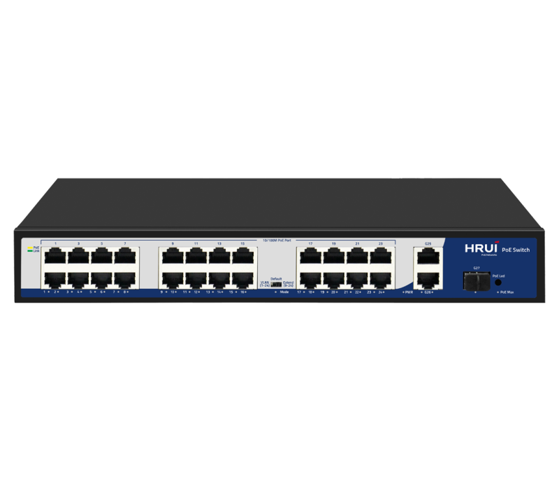
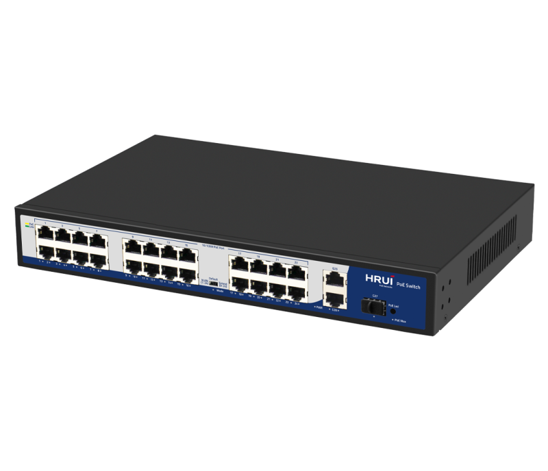
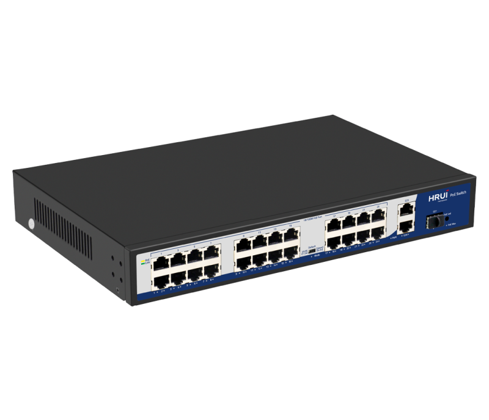
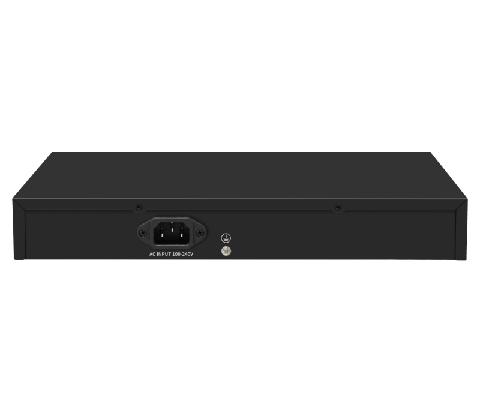

# HR900-AF-2421GS-300

> 来源：<https://www.hruitech.com/poe-switch/196.html>（抓取 2026-10-21T04:35:41Z；英文原文照录，中文仅为栏目名）  
> 官网描述： 24*10/100T 802.3af/at PoE ports + 2-Port 10/100/1000T + 1-Port Gigabit SFP Ethernet Switch (300 Watts)  
> 类目：PoE Switch（site id 196）  
> 接口：24*100Mbps PoE ports / 2*1000Mbps RJ45 ports / 1*1000Mbps SFP port；PoE 预算 290W；交换带宽 —；电源 AC 100-240V 50/60Hz / DC 52V 5.76A

**Brief:** 10/100/1000M intelligent PoE switch, with 24*10/100M PoE ports + 2*Gigabit uplink RJ45 ports + 1*Gigabit uplink SFP port, IEEE 802.3af/at standard, bandwidth 10.8Gbps, total power 300W, surpport port isolation and 250m transmission, support PoE MAX/ PoE LED indicator, suitable for -10~50℃ wide temperature environment.

## 产品图





## Datasheet
- [HR900_AF_2421GS_300.pdf](https://www.hruitech.com/web/userfiles/productfile/HR900_AF_2421GS_300.pdf) （本地：`data/hrui_site_raw/datasheets/HR900_AF_2421GS_300.pdf`；文本：`data/hrui_site_raw/datasheet_text/HR900_AF_2421GS_300.txt`）

## Feature and Benefits（原文）
```
The HRUI AI PoE switches provide a range of models featuring both 100M/Gigabit PoE, RJ45, and SFP uplink ports. These switches meet the IEEE 802.3af/at/Hi-PoE standards for Power over Ethernet, with PoE port 1 capable of delivering a maximum output of 60W and other PoE ports capable of 30W. The devices offer three working modes: Default, VLAN (Port Isolation), and Extend. Additionally, the series supports PoE watchdog functionality in both VLAN and Extend modes, enabling the detection and automatic reboot of unresponsive or dropped PoE-powered devices.
With user-friendly installation and maintenance processes, these switches help establish a secure and high-performance network. HRUI AI PoE switches are ideal for various Ethernet access applications, including small to medium-sized enterprises, internet cafes, hotels, and schools.
FEATURES
• Power Over Ethernet
This series of switches provides PoE ports, compliant with IEEE 802.3af/at/high PoE, enabling simultaneous data and power transmission to devices via a single, convenient Ethernet cable. Specifically,
PoE Port 1 offers a maximum output power of 60 watts
, permitting the powering of high-power devices. By integrating power delivery into a single cable, these switches streamline cabling infrastructure and eliminate the need for separate power sources, thereby providing an efficient and cost-effective solution for powering network devices.
• Advanced Functions with DIP Switch
VLAN:
Downlink ports are isolated from each other, but can still communicate with uplink ports. This mode also enables PoE watchdog on ports.
Default:
All ports support communication with each other, with a transmission distance of up to 100 meters and an adaptive speed of 10/100Mbps. This mode disables PoE watchdog on ports.
Extend:
The downlink PoE & data transmission distance of 9-24 ports can reach up to 250 meters, with a speed of 10Mbps. This mode enables PoE watchdog on ports.
• AI PoE Watchdog
Detect and reboot dropped or unresponsive PoE-powered devices.
• Safe PoE Smart Boot-up
Support PoE Smart Boot-up that enables PoE on ports from the first to last in sequence to prevent damage to the power supply by sudden large currents. The function is enabled by default.
• A Clear View of Power Usage
The product feature PoE Max indicators, allowing for easy monitoring of power consumption, enabling optimal power usage and ensuring efficient energy management.
• Plug and Play, Easy to Use
All Ethernet ports on our switches support MDI/MDIX compatibility, allowing for easy setup with no software installation or configuration needed.
• 19 Inch Rack Mout
• High Reliable Design
Support installed in a standard rack environment, easy to integrate with other equipment and manage cabling.
Support 4KV surge and 8KV ESD protection.
HRUI AI PoE Switch Models
HR900-AF-42N
HR900-AF-82N
HR900-AFG-82N
Port Rate: 4*FE PoE + 2*FE
PoE Standard: IEEE 802.3af/at
Port 1-4 PoE power output ≤ 30W
PoE Power Budget: 60W
Surge Protection: 4KV
Working Temperature: 0℃～40℃
Port Rate: 8*FE PoE + 2*FE
PoE Standard: IEEE 802.3af/at
Port 1-8 PoE power output ≤ 30W
PoE Power Budget: 115W
Surge Protection: 4KV
Working Temperature: 0℃～40℃
Port Rate: 8*GE PoE + 2*GE
PoE Standard: IEEE 802.3af/at/High PoE
Port 1 PoE power output ≤ 60W, port 2-8 PoE power output ≤ 30W
PoE Power Budget: 110W
Surge Protection: 4KV
Working Temperature: 0℃～40℃
HR900-AF-2421GS-300
HR900-AFG-1622S-200
HR900-AFG-242S-400
Port Rate: 24*FE PoE + 2*GE + 1*1G SFP
PoE Standard: IEEE 802.3af/at/High PoE
Port 1 PoE power output ≤ 60W, port 2-24 PoE power output ≤ 30W
PoE Power Budget: 290W
Surge Protection: 4KV
Working Temperature: 0℃～40℃
Port Rate: 16*GE PoE + 2*GE + 2*1G SFP
PoE Standard: IEEE 802.3af/at/High PoE
Port 1 PoE power output ≤ 60W, port 2-16 PoE power output ≤ 30W
PoE Power Budget: 185W
Surge Protection: 4KV
Working Temperature: 0℃～40℃
Port Rate: 24*GE PoE + 2*1G SFP
PoE Standard: IEEE 802.3af/at
Port 1-24 PoE power output ≤ 30W
PoE Power Budget: 380W
Surge Protection: 4KV
Working Temperature: 0℃～40℃
```

## Parameter（规格表逐行）
| 项 | 值 |
|---|---|
|  | • Power Over Ethernet |
|  | This series of switches provides PoE ports, compliant with IEEE 802.3af/at/high PoE, enabling simultaneous data and power transmission to devices via a single, convenient Ethernet cable. Specifically, PoE Port 1 offers a maximum output power of 60 watts , permitting the powering of high-power devices. By integrating power delivery into a single cable, these switches streamline cabling infrastructure and eliminate the need for separate power sources, thereby providing an efficient and cost-effective solution for powering network devices. |
|  | • Advanced Functions with DIP Switch |
|  | VLAN: Downlink ports are isolated from each other, but can still communicate with uplink ports. This mode also enables PoE watchdog on ports. |
|  | Default: All ports support communication with each other, with a transmission distance of up to 100 meters and an adaptive speed of 10/100Mbps. This mode disables PoE watchdog on ports. |
|  | Extend: The downlink PoE & data transmission distance of 9-24 ports can reach up to 250 meters, with a speed of 10Mbps. This mode enables PoE watchdog on ports. |
|  | • AI PoE Watchdog |
|  | Detect and reboot dropped or unresponsive PoE-powered devices. |
|  | • Safe PoE Smart Boot-up |
|  | Support PoE Smart Boot-up that enables PoE on ports from the first to last in sequence to prevent damage to the power supply by sudden large currents. The function is enabled by default. |
|  | • A Clear View of Power Usage |
|  | The product feature PoE Max indicators, allowing for easy monitoring of power consumption, enabling optimal power usage and ensuring efficient energy management. |
|  | • Plug and Play, Easy to Use |
|  | All Ethernet ports on our switches support MDI/MDIX compatibility, allowing for easy setup with no software installation or configuration needed. |
| • 19 Inch Rack Mout | • High Reliable Design |
| Support installed in a standard rack environment, easy to integrate with other equipment and manage cabling. | Support 4KV surge and 8KV ESD protection. |
| HR900-AF-42N | HR900-AF-82N / HR900-AFG-82N |
| Port Rate: 4*FE PoE + 2*FE PoE Standard: IEEE 802.3af/at Port 1-4 PoE power output ≤ 30W PoE Power Budget: 60W Surge Protection: 4KV Working Temperature: 0℃～40℃ | Port Rate: 8*FE PoE + 2*FE PoE Standard: IEEE 802.3af/at Port 1-8 PoE power output ≤ 30W PoE Power Budget: 115W Surge Protection: 4KV Working Temperature: 0℃～40℃ / Port Rate: 8*GE PoE + 2*GE PoE Standard: IEEE 802.3af/at/High PoE Port 1 PoE power output ≤ 60W, port 2-8 PoE power output ≤ 30W PoE Power Budget: 110W Surge Protection: 4KV Working Temperature: 0℃～40℃ |
| HR900-AF-2421GS-300 | HR900-AFG-1622S-200 / HR900-AFG-242S-400 |
| Port Rate: 24*FE PoE + 2*GE + 1*1G SFP PoE Standard: IEEE 802.3af/at/High PoE Port 1 PoE power output ≤ 60W, port 2-24 PoE power output ≤ 30W PoE Power Budget: 290W Surge Protection: 4KV Working Temperature: 0℃～40℃ | Port Rate: 16*GE PoE + 2*GE + 2*1G SFP PoE Standard: IEEE 802.3af/at/High PoE Port 1 PoE power output ≤ 60W, port 2-16 PoE power output ≤ 30W PoE Power Budget: 185W Surge Protection: 4KV Working Temperature: 0℃～40℃ / Port Rate: 24*GE PoE + 2*1G SFP PoE Standard: IEEE 802.3af/at Port 1-24 PoE power output ≤ 30W PoE Power Budget: 380W Surge Protection: 4KV Working Temperature: 0℃～40℃ |
| Description | Specification |
| Model | HR900-AF-2421GS-300 |
| Interface | 24*100Mbps PoE ports |
| Interface | 2*1000Mbps RJ45 ports |
| Interface | 1*1000Mbps SFP port |
| Port Standard | IEEE802.3 (Ethernet) |
| Port Standard | IEEE802.3u (Fast Ethernet) |
| Port Standard | IEEE802.3ab (1000Mbps Ethernet) |
| Port Standard | IEEE802.3x (Flow Control) |
| Port Standard | IEEE 802.3z (1000Mbps Ethernet Fiber Standard) |
| Switching Capacity | 10.8Gbps |
| Packet Forwarding Rate | 8.03Mpps |
| Packet Buffer | 768Kbit |
| MAC Address Table | 2K |
| Transmission Method | Store and Forward |
| PoE Standard | IEEE802.3af （15.4W） |
| PoE Standard | IEEE802.3at （30W） |
| PoE Port Output Voltage | DC 44-57V |
| PoE Ports | Port 2-24 PoE power output <30W，Port 1 PoE power output 60W |
| PoE Power Budget | 290W |
| Power Supply | AC 100-240V 50/60Hz |
| Power Supply | DC 52V 5.76A |
| Mainboard Power Consumption | 6.6W |
| Structure Information | Product Dimensions : 320*207*45mm |
| Structure Information | Packaging Dimensions : 370*290*85mm |
| Structure Information | Product Net Weight: 1.79KG |
| Structure Information | Product Gross Weight: 2.32KG |
| Packing Information | Carton Dimensions : 445*310*390mm |
| Packing Information | Packing Quantity: 5PCS |
| Packing Information | Packing Weight: 12.6KG |
| Package Content | Switch 1pcs, power cord 1pcs, manual 1pcs，certificate of qualification 1pcs |
| Fan Quantity | 0 |
| Installation | Desktop |
| Surge Protection | Surge protection: common mode 4KV, differential mode 2KV |
| Surge Protection | Electrostatic ESD: Air 8KV, Contact 6KV (Class B) |
| Operating Temperature | 0~40°C |
| Storage Temperature | -40 °C to 70 °C |
| Operation Humidity | 10%~90%，non condensing |
| Storage Humidity | 5%~95%，non condensing |
| PWR | On: Powered on |
| PWR | Off: Powered off |
| Mode | On: VLAN |
| Mode | Blinking: Extend |
| Mode | Off: Default |
| 1-27 Green Light | On: Link normal |
| 1-27 Green Light | Off: Link blocked |
| 1-27 Green Light | Blinking: Data transmitting |
| 1-24 Yellow Light (PoE) | On: PoE power on |
| 1-24 Yellow Light (PoE) | Off: PoE powered off |
| PoE Max | Off: indicates PoE power usage is less than 90% |
| PoE Max | Blinking: indicates PoE power usage of 90% ≤ P ≤ 95% |
| PoE Max | On: indicates that PoE power is used at 95%<p<100%< span=""> |
| PoE LED Buttons | Dual color light selection: default green (link data), switch yellow light (PoE) |
| VLAN/Default/Extend Modes Buttons | VLAN: Isolation mode, 1-24 ports isolated from each other, communicating with 25-27 ports, port PoE watchdog mode enabled |
| VLAN/Default/Extend Modes Buttons | Default: Normal mode, all interfaces can communicate with each other, transmission distance is within 100 meters, transmission rate is 10/100Mbps adaptive, port PoE watchdog mode is turned off |
| VLAN/Default/Extend Modes Buttons | Extend: Link extension mode, 9-24 ports PoE power supply and data transmission distance can be extended to 250 meters, transmission speed is 10Mbps, port PoE watchdog mode is enabled |

## Product structure / Application topology（图）
- https://www.hruitech.com/web/userfiles/product/productdetail/HR900_AF_2421GS_300/HR900-AF-2421GS-300Dimension.png
- https://www.hruitech.com/web/userfiles/product/productdetail/HR900_AF_2421GS_300/HR900-AF-2421GS-300-2810-29.jpg
