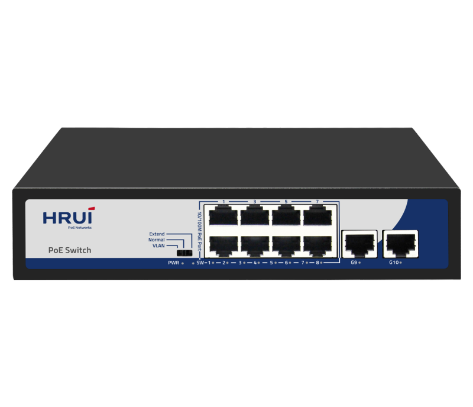
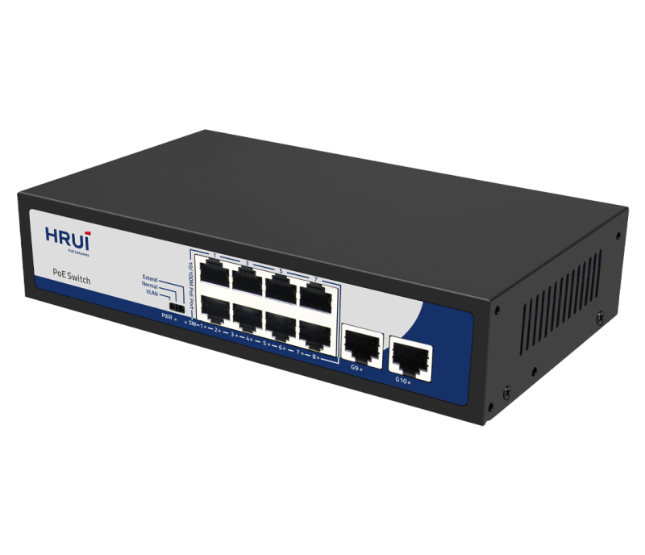
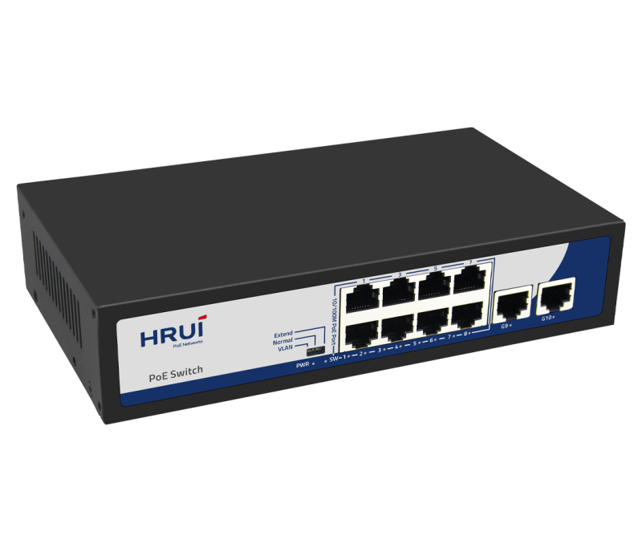
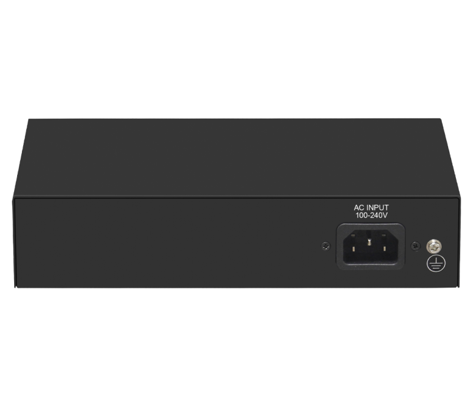

# HR900-AF-82GN

> 来源：<https://www.hruitech.com/poe-switch/194.html>（抓取 2026-10-21T04:35:43Z；英文原文照录，中文仅为栏目名）  
> 官网描述：8-Port 10/100T 802.3af/at PoE + 2-Port 10/100/1000T Ethernet Switch (120 Watts)  
> 类目：PoE Switch（site id 194）  
> 接口：8* 100Mbps PoE ports / 2* 1G uplink RJ45 port；PoE 预算 115W；交换带宽 —；电源 AC 100-240V 50/60Hz / DC 52V 2.3A

**Brief:** 100/1000M AI PoE switch, with 8*10/100M PoE ports + 2*Gigbit uplink RJ45 ports, IEEE 802.3af/at standard, bandwidth 5.6Gbps, total power 120W, surpport port isolation and 250m transmission, surpport PoE watchdog, surge 4KV, suitable for -10~50℃ wide temperature environment

## 产品图





## Datasheet
- [HR900-AF-82GN-28EN-29.pdf](https://www.hruitech.com/web/userfiles/productfile/HR900-AF-82GN-28EN-29.pdf) （本地：`data/hrui_site_raw/datasheets/HR900-AF-82GN-28EN-29.pdf`；文本：`data/hrui_site_raw/datasheet_text/HR900-AF-82GN-28EN-29.txt`）

## Feature and Benefits（原文）
```
The HR900-AF-82GN is a cutting-edge 100/1000M AI PoE switch designed to enhance your network infrastructure. It features 8 PoE ports operating at 10/100Mbps alongside 2 Gigabit uplink RJ45 ports, all compliant with IEEE 802.3af/at standards. With a robust bandwidth capacity of 5.6Gbps and a total power output of 120W, this switch is perfect for powering multiple devices while ensuring high-speed data transmission. Additional features include port isolation, 250m transmission range, PoE watchdog functionality, and surge protection of up to 4KV, making it suitable for use in environments with temperatures ranging from -10°C to 50°C.
Product Features:
Rich Port Design:
Provides 8 x 100Mbps PoE ports and 2 x 1Gbps uplink RJ45 ports for flexible connectivity.
Standards Compliance:
Fully compliant with IEEE 802.3, IEEE 802.3u, and IEEE 802.3x standards to ensure compatibility and performance.
Adaptive RJ45 Ports:
Each RJ45 port automatically adapts to 10/100Mbps for seamless integration with various devices.
Intelligent PoE Management:
The PoE ports can automatically trigger the PoE watchdog mode when operating in VLAN or Extend modes for enhanced reliability.
Efficient Flow Control:
Employs full duplex using IEEE 802.3x standards while half duplex utilizes back pressure for optimized data flow.
Auto MDI/MDIX Support:
Automatically adjusts for straight-through or crossover connections, facilitating easy installation.
Status Monitoring:
Panel indicator LEDs provide real-time monitoring of operational status, aiding in fault diagnosis.
Three Operation Modes:
Supports three operational modes: VLAN, Default, and Extend, allowing customization based on network requirements.
```

## Parameter（规格表逐行）
| 项 | 值 |
|---|---|
| Description | Specification |
| Model | HR900-AF-82GN |
| Interface | 8* 100Mbps PoE ports |
| Interface | 2* 1G uplink RJ45 port |
| Port Standard | IEEE802 .3 (Ethernet) |
| Port Standard | IEEE802.3u (Fast Ethernet) |
| Port Standard | IEEE802.3x (Flow Control) |
| Bandwidth | 5.6Gbps |
| Packet Forwarding Rate | 4.166Mpps |
| Packet Buffer | 1Mbit |
| MAC Address Table | 2K |
| Transmission Method | Store and Forward |
| PoE Standard | IEEE802.3af （15.4W） |
| PoE Standard | IEEE802.3at （30W） |
| PoE Port Output Voltage | DC 44-57V |
| PoE Ports | Port 1-8 PoE power output <30W |
| PoE Power Budget | 115W |
| Surge Protection | Port Surge: common mode 4KV, differential mode 2KV |
| Surge Protection | Electrostatic ESD: Air 8KV, Contact 6KV (Class B) |
| Operating Temperature | 0~40°C |
| Storage Temperature | -40 °C to 70 °C |
| Operation Humidity | 10%~90%,non condensing |
| Storage Humidity | 5%~95%,non condensing |
| Power Supply | AC 100-240V 50/60Hz |
| Power Supply | DC 52V 2.3A |
| Mainboard Power Consumption | 2.3W |
| Structure Information | Product Dimensions :200*118*44mm |
| Structure Information | Packaging Dimensions : 245*190*60mm |
| Structure Information | Product Net Weight:0.62 KG |
| Structure Information | Product Gross Weight:0.93 KG |
| Packing Information | Carton Dimensions :520*320*400mm |
| Packing Information | Packing Quantity: 20PCS |
| Packing Information | Packing Weight: 19.6KG |
| Package Contents | Switch 1pcs, power cord 1pcs, manual 1pcs,certificate of qualification 1pcs |
| Fan Quantity | 0 |
| Installation | Desktop |
| PWR Green LED | On: Powered on |
| PWR Green LED | Off: Powered off |
| SW Green LED | On:VLAN |
| SW Green LED | Flashing:Extend |
| SW Green LED | Off:Normal |
| 1-8 Green LED | On:10/100M Link normal |
| 1-8 Green LED | Off: Link blocked |
| 1-8 Green LED | Flashing: Data transmitting |
| 9-10 Green LED | On:10M/100M/1G Link normal |
| 9-10 Green LED | Off: Link blocked |
| 9-10 Green LED | Flashing: Data transmitting |
| VLAN/Normal/Extend Modes Buttons | VLAN: Isolation mode, 1-8 ports isolated from each other, communicating with 9-10 ports,and enable PoE watchdog mode on ports; |
| VLAN/Normal/Extend Modes Buttons | Normal: Normal mode, all interfaces can communicate with each other, transmission distance is within 100 meters, transmission rate is 10/100Mbps adaptive, and port PoE watchdog mode turned off; |
| VLAN/Normal/Extend Modes Buttons | Extend: Link extension mode,1-8 ports data transmission distance can be extended to 250 meters, transmission speed is 10Mbps,and enable PoE watchdog mode on ports; |
