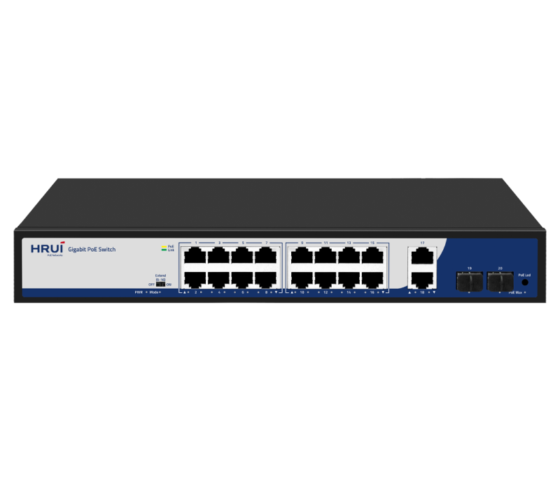
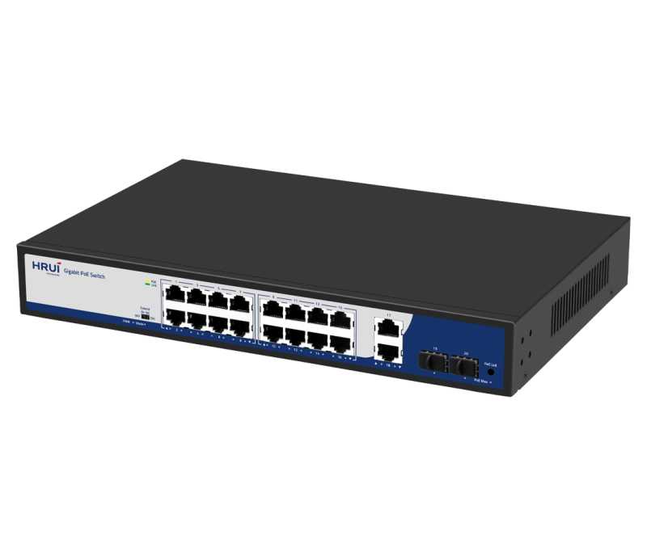
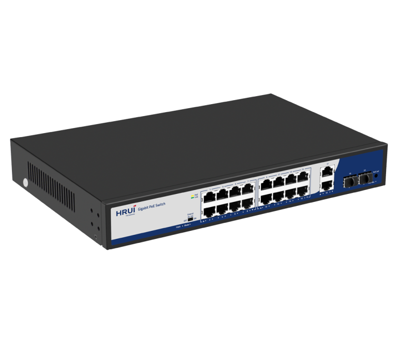
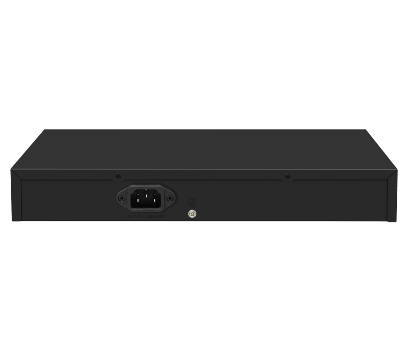

# HR900-AFG-1622S-200

> 来源：<https://www.hruitech.com/poe-switch/207.html>（抓取 2026-10-21T04:35:36Z；英文原文照录，中文仅为栏目名）  
> 官网描述：16-Port 10/100/1000T 802.3af/at PoE + 2-Port 10/100/1000T  + 2-Port Gigabit SFP Ethernet Switch (200 Watts)  
> 类目：PoE Switch（site id 207）  
> 接口：16-Port 10/100/1000T 802.3af/at PoE + 2-Port 10/100/1000T  + 2-Port Gigabit SFP Ethernet Switch (200 Watts)；PoE 预算 —；交换带宽 —；电源 —

**Brief:** 20 Port Gigabit Intelligent Standard PoE Switch, with high quality and high-speed network IC and the most stable PoE chips, support 16* 10/100/1000M PoE Ports+2*Gigabit Uplink+2* Gigabit SFP Ports, and provide seamless connections to 10/100/1000M Ethernet, and the PoE supply port can automatically detect and supply receiving devices meeting IEEE802.3af/at standard, non-PoE devices intelligently detect no power and only transmit data.

## 产品图





## Datasheet
- [HR900_AFG_1622S_200.pdf](https://www.hruitech.com/web/userfiles/productfile/HR900_AFG_1622S_200.pdf) （本地：`data/hrui_site_raw/datasheets/HR900_AFG_1622S_200.pdf`；文本：`data/hrui_site_raw/datasheet_text/HR900_AFG_1622S_200.txt`）

## Feature and Benefits（原文）
```
The HRUI AI PoE switches provide a range of models featuring both 100M/Gigabit PoE, RJ45, and SFP uplink ports. These switches meet the IEEE 802.3af/at/Hi-PoE standards for Power over Ethernet, with PoE port 1 capable of delivering a maximum output of 60W and other PoE ports capable of 30W. The devices offer three working modes: Default, VLAN (Port Isolation), and Extend. Additionally, the series supports PoE watchdog functionality in both VLAN and Extend modes, enabling the detection and automatic reboot of unresponsive or dropped PoE-powered devices.
With user-friendly installation and maintenance processes, these switches help establish a secure and high-performance network. HRUI AI PoE switches are ideal for various Ethernet access applications, including small to medium-sized enterprises, internet cafes, hotels, and schools.
FEATURES
• Power Over Ethernet
This series of switches provides PoE ports, compliant with IEEE 802.3af/at/high PoE, enabling simultaneous data and power transmission to devices via a single, convenient Ethernet cable. Specifically,
PoE Port 1 offers a maximum output power of 60 watts,
permitting the powering of high-power devices. By integrating power delivery into a single cable, these switches streamline cabling infrastructure and eliminate the need for separate power sources, thereby providing an efficient and cost-effective solution for powering network devices.
• Advanced Functions with DIP Switch
Default:
All ports support communication with each other, with a transmission distance of up to 100 meters and an adaptive speed of 10/100/1000Mbps. This mode disables PoE watchdog on ports.
Extend:
The downlink PoE & data transmission distance of port 9-16 can reach up to 250 meters, with a speed of 10Mbps. This mode enables PoE watchdog on ports.
• AI PoE Watchdog
Detect and reboot dropped or unresponsive PoE-powered devices.
• Safe PoE Smart Boot-up
Support PoE Smart Boot-up that enables PoE on ports from the first to last in sequence to prevent damage to the power supply by sudden large currents. The function is enabled by default.
• A Clear View of Power Usage
The product feature PoE Max indicators, allowing for easy monitoring of power consumption, enabling optimal power usage and ensuring efficient energy management.
• Plug and Play, Easy to Use
All Ethernet ports on our switches support MDI/MDIX compatibility, allowing for easy setup with no software installation or configuration needed.
• 19 Inch Rack Mout
• High Reliable Design
Support installed in a standard rack environment, easy to integrate with other equipment and manage cabling.
Support 4KV surge and 8KV ESD protection.
HRUI AI PoE Switch Models
HR900-AF-42N
HR900-AF-82N
HR900-AFG-82N
Port Rate: 4*FE PoE + 2*FE
PoE Standard: IEEE 802.3af/at
Port 1-4 PoE power output ≤ 30W
PoE Power Budget: 60W
Surge Protection: 4KV
Working Temperature: 0℃～40℃
Port Rate: 8*FE PoE + 2*FE
PoE Standard: IEEE 802.3af/at
Port 1-8 PoE power output ≤ 30W
PoE Power Budget: 115W
Surge Protection: 4KV
Working Temperature: 0℃～40℃
Port Rate: 8*GE PoE + 2*GE
PoE Standard: IEEE 802.3af/at/High PoE
Port 1 PoE power output ≤ 60W, port 2-8 PoE power output ≤ 30W
PoE Power Budget: 110W
Surge Protection: 4KV
Working Temperature: 0℃～40℃
HR900-AF-2421GS-300
HR900-AFG-1622S-200
HR900-AFG-242S-400
Port Rate: 24*FE PoE + 2*GE + 1*1G SFP
PoE Standard: IEEE 802.3af/at/High PoE
Port 1 PoE power output ≤ 60W, port 2-24 PoE power output ≤ 30W
PoE Power Budget: 290W
Surge Protection: 4KV
Working Temperature: 0℃～40℃
Port Rate: 16*GE PoE + 2*GE + 2*1G SFP
PoE Standard: IEEE 802.3af/at/High PoE
Port 1 PoE power output ≤ 60W, port 2-16 PoE power output ≤ 30W
PoE Power Budget: 185W
Surge Protection: 4KV
Working Temperature: 0℃～40℃
Port Rate: 24*GE PoE + 2*1G SFP
PoE Standard: IEEE 802.3af/at
Port 1-24 PoE power output ≤ 30W
PoE Power Budget: 380W
Surge Protection: 4KV
Working Temperature: 0℃～40℃
```

## Parameter（规格表逐行）
| 项 | 值 |
|---|---|
|  | • Power Over Ethernet |
|  | This series of switches provides PoE ports, compliant with IEEE 802.3af/at/high PoE, enabling simultaneous data and power transmission to devices via a single, convenient Ethernet cable. Specifically, PoE Port 1 offers a maximum output power of 60 watts, permitting the powering of high-power devices. By integrating power delivery into a single cable, these switches streamline cabling infrastructure and eliminate the need for separate power sources, thereby providing an efficient and cost-effective solution for powering network devices. |
|  | • Advanced Functions with DIP Switch |
|  | Default: All ports support communication with each other, with a transmission distance of up to 100 meters and an adaptive speed of 10/100/1000Mbps. This mode disables PoE watchdog on ports. |
|  | Extend: The downlink PoE & data transmission distance of port 9-16 can reach up to 250 meters, with a speed of 10Mbps. This mode enables PoE watchdog on ports. |
|  | • AI PoE Watchdog |
|  | Detect and reboot dropped or unresponsive PoE-powered devices. |
|  | • Safe PoE Smart Boot-up |
|  | Support PoE Smart Boot-up that enables PoE on ports from the first to last in sequence to prevent damage to the power supply by sudden large currents. The function is enabled by default. |
|  | • A Clear View of Power Usage |
|  | The product feature PoE Max indicators, allowing for easy monitoring of power consumption, enabling optimal power usage and ensuring efficient energy management. |
|  | • Plug and Play, Easy to Use |
|  | All Ethernet ports on our switches support MDI/MDIX compatibility, allowing for easy setup with no software installation or configuration needed. |
| • 19 Inch Rack Mout | • High Reliable Design |
| Support installed in a standard rack environment, easy to integrate with other equipment and manage cabling. | Support 4KV surge and 8KV ESD protection. |
| HR900-AF-42N | HR900-AF-82N / HR900-AFG-82N |
| Port Rate: 4*FE PoE + 2*FE PoE Standard: IEEE 802.3af/at Port 1-4 PoE power output ≤ 30W PoE Power Budget: 60W Surge Protection: 4KV Working Temperature: 0℃～40℃ | Port Rate: 8*FE PoE + 2*FE PoE Standard: IEEE 802.3af/at Port 1-8 PoE power output ≤ 30W PoE Power Budget: 115W Surge Protection: 4KV Working Temperature: 0℃～40℃ / Port Rate: 8*GE PoE + 2*GE PoE Standard: IEEE 802.3af/at/High PoE Port 1 PoE power output ≤ 60W, port 2-8 PoE power output ≤ 30W PoE Power Budget: 110W Surge Protection: 4KV Working Temperature: 0℃～40℃ |
| HR900-AF-2421GS-300 | HR900-AFG-1622S-200 / HR900-AFG-242S-400 |
| Port Rate: 24*FE PoE + 2*GE + 1*1G SFP PoE Standard: IEEE 802.3af/at/High PoE Port 1 PoE power output ≤ 60W, port 2-24 PoE power output ≤ 30W PoE Power Budget: 290W Surge Protection: 4KV Working Temperature: 0℃～40℃ | Port Rate: 16*GE PoE + 2*GE + 2*1G SFP PoE Standard: IEEE 802.3af/at/High PoE Port 1 PoE power output ≤ 60W, port 2-16 PoE power output ≤ 30W PoE Power Budget: 185W Surge Protection: 4KV Working Temperature: 0℃～40℃ / Port Rate: 24*GE PoE + 2*1G SFP PoE Standard: IEEE 802.3af/at Port 1-24 PoE power output ≤ 30W PoE Power Budget: 380W Surge Protection: 4KV Working Temperature: 0℃～40℃ |
| **Hardware Features & Performance** | |
| Model | HR900-AFG-1622S-200 |
| General | Interface / 16 *1000Mbps PoE ports(1 port supports 60W) |
| General | Interface / 2 *1000Mbps RJ45 ports |
| General | Interface / 2 *1000Mbps SFP ports |
| General | Port Standard / IEEE802.3 (Ethernet) |
| General | Port Standard / IEEE802.3u (Fast Ethernet) |
| General | Port Standard / IEEE802.3ab (1000Mbps Ethernet) |
| General | Port Standard / IEEE802.3x (Flow Control) |
| General | Port Standard / IEEE 802.3z (1000Mbps Ethernet Fiber Standard) |
| Performance | Switching Capacity / 40Gbps |
| Performance | Packet Forwarding Rate / 29.76Mpps |
| Performance | Packet Buffer / 3Mbit |
| Performance | MAC Address Table / 2K |
| Performance | Transmission Method / Store and Forward |
| PoE | PoE Standard / IEEE802.3af （15.4W） |
| PoE | PoE Standard / IEEE802.3at （30W） |
| PoE | PoE Standard / IEEE 802.3bt（60W） |
| PoE | PoE Port Output Voltage / DC 44-57V |
| PoE | PoE Ports / Port 1-16 PoE power output <30W |
| PoE | PoE Power Budget / 185W |
| Physical | Power Supply / AC 100-240V 50/60Hz |
| Physical | Power Supply / DC 52V 3.84A |
| Physical | Mainboard Power Consumption / 6.7W |
| Physical | Structure Information / Product Dimensions :320*207*45mm |
| Physical | Structure Information / Packaging Dimensions: 370*290*85mm |
| Physical | Structure Information / Product Net Weight: 1.78KG |
| Physical | Structure Information / Product Gross Weight: 2.28KG |
| Physical | Packing Information / Carton Dimensions: 445*310*390mm |
| Physical | Packing Information / Packing Quantity: 5PCS |
| Physical | Packing Information / Packing Weight: 12.4KG |
| Physical | Packing List / Switch 1pcs, power cord 1pcs, instruction manual 1pcs，certificate of qualification 1pcs |
| Physical | Fan Quantity / 0 |
| Physical | Installation / Desktop |
| Environment | Surge Protection / Surge protection: common mode 4KV, differential mode 2KV |
| Environment | Surge Protection / Electrostatic ESD: Air 8KV, Contact 6KV (Class B) |
| Environment | Operating Temperature / 0~40°C |
| Environment | Storage Temperature / -40 °C to 70 °C |
| Environment | Operation Humidity / 10%~90%，non condensing |
| Environment | Storage Humidity / 5%~95%，non condensing |
| Buttons & Indicator Lights | PWR / On: Powered on |
| Buttons & Indicator Lights | PWR / Off: Powered off |
| Buttons & Indicator Lights | Mode / Blinking：Extend on |
| Buttons & Indicator Lights | Mode / Off：Extend off |
| Buttons & Indicator Lights | 1-16 Green Light / On: Link normal |
| Buttons & Indicator Lights | 1-16 Green Light / Off: Link blocked |
| Buttons & Indicator Lights | 1-16 Green Light / Blinking: Data transmitting |
| Buttons & Indicator Lights | 1-16 Yellow Light (PoE) / On: PoE power on |
| Buttons & Indicator Lights | 1-16 Yellow Light (PoE) / Off: PoE powered off |
| Buttons & Indicator Lights | PoE Max / On: indicates PoE power usage is less than 90% |
| Buttons & Indicator Lights | PoE Max / Blinking: indicates PoE power usage of 90% ≤ P ≤ 95% |
| Buttons & Indicator Lights | PoE Max / Off: indicates that PoE power is used at 95%<p<100%< span=""> |
| Buttons & Indicator Lights | PoE LED Buttons / Dual color light selection: default green (link data), switch yellow light (PoE) |
| Buttons & Indicator Lights | Extend Mode Buttons / OFF: All interfaces can communicate with each other, with an adaptive transmission rate of 10M/100/1000Mbps, and port PoE watchdog mode turned off; |
| Buttons & Indicator Lights | Extend Mode Buttons / ON: 9-16 ports enable extension of Ethernet cable transmission distance by 250 meters, with a transmission rate of 10Mbps, and PoE watchdog mode enabled on the port; |

## Product structure / Application topology（图）
- https://www.hruitech.com/web/userfiles/image/20241224/1735005872613052.png
- https://www.hruitech.com/web/userfiles/product/productdetail/HR900_AFG_1622S/HR900-AFG-1622S-200-289-29.jpg
