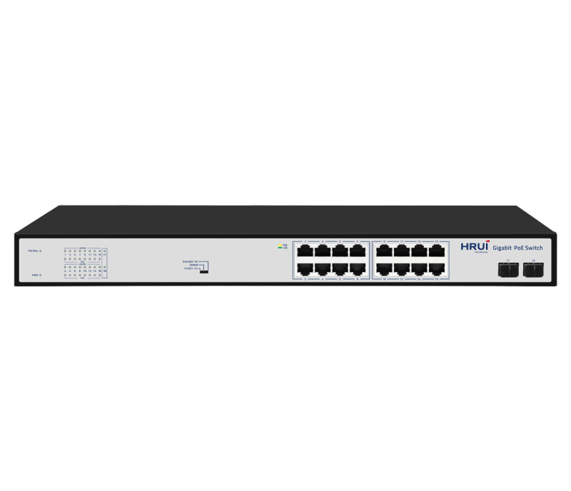
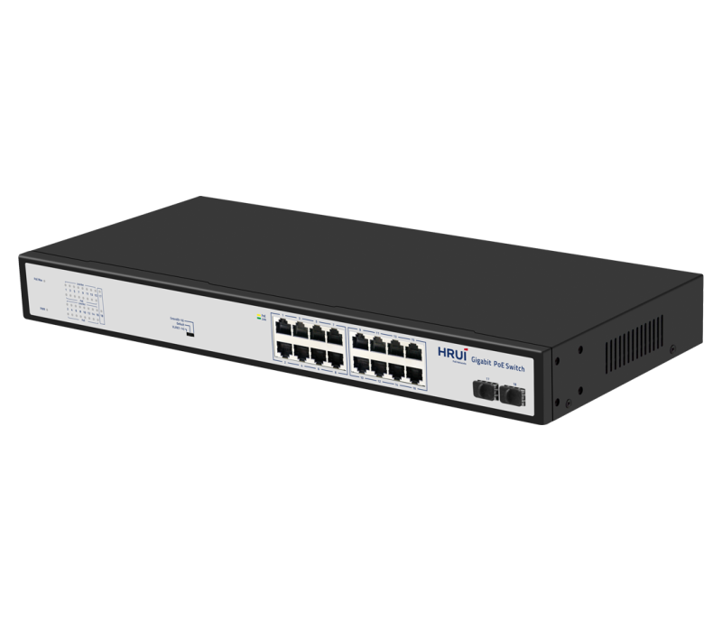
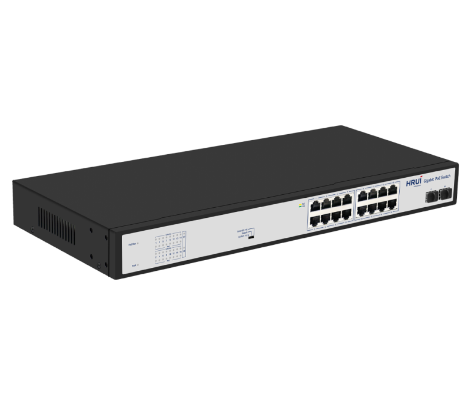
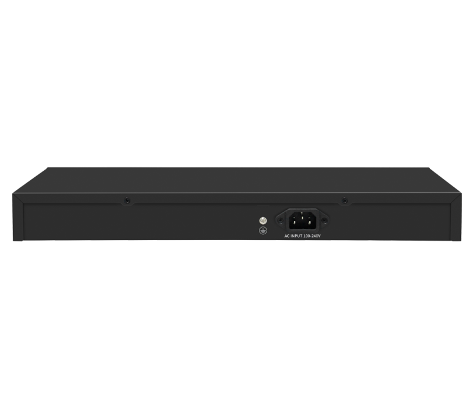

# HR900-AFG-162S-200

> 来源：<https://www.hruitech.com/poe-switch/221.html>（抓取 2026-10-21T04:35:27Z；英文原文照录，中文仅为栏目名）  
> 官网描述：16-Port 10/100/1000T 802.3af/at PoE + 2-Port Gigabit SFP Ethernet Switch(200 Watts)  
> 类目：PoE Switch（site id 221）  
> 接口：16* 1G PoE ports / 2 *1G uplink SFP ports；PoE 预算 185W；交换带宽 —；电源 AC 100-240V 50/60Hz / DC 52V3.84A

**Brief:** Gigabit intelligent PoE switch, with 16*Gigabit PoE ports + 2*Gigabit uplink SFP ports, IEEE 802.3af/at standard, bandwidth 36Gbps, total power 200W, surpport port isolation and 250m transmission mode, support PoE Max Indicator, suitable for -10~50℃ wide temperature environment, support surge protection: Common Mode 4KV, Differential Mode 2KV (Class B), ESD: Air 8KV, Contact 6KV (Class C).

## 产品图





## Datasheet
- [HR900_AFG_162S_200.pdf](https://www.hruitech.com/web/userfiles/productfile/HR900_AFG_162S_200.pdf) （本地：`data/hrui_site_raw/datasheets/HR900_AFG_162S_200.pdf`；文本：`data/hrui_site_raw/datasheet_text/HR900_AFG_162S_200.txt`）

## Feature and Benefits（原文）
```
HR900-AFG-162S-200, a state-of-the-art Gigabit PoE switch designed for high-performance networking. This intelligent switch features 16 Gigabit PoE ports and 2 Gigabit uplink SFP ports, compliant with IEEE 802.3af/at standards. With a robust bandwidth of 36 Gbps and a total power output of 200W, it efficiently supports advanced networking applications. Equipped with port isolation and a 250m transmission mode, the HR900-AFG-162S-200 is ideal for diverse installations.
Engineered to operate in a wide temperature range of -10 to 50°C, this switch also includes advanced surge protection (Common Mode 4KV, Differential Mode 2KV - Class B) and ESD protection levels (Air 8KV, Contact 6KV - Class C), ensuring reliable performance in challenging environments.
Product Features:
Port Configuration:
16 Gigabit PoE Ports + 2 Gigabit SFP Ports.
Standards Compliance:
Supports IEEE 802.3, 802.3u, 802.3x, 802.3ab, and 802.3z for seamless integration with existing networks.
Flexible Connectivity:
RJ45 ports support 10M, 100M, and 1G auto-negotiation for versatility.
Flow Control:
Supports Full Duplex (IEEE 802.3x) and Half Duplex (Back Pressure) flow control methods.
Auto MDI/MDIX Support:
Automatic port flipping capability eliminates the need for crossover cables, simplifying setup.
Advanced Mechanism:
Utilizes a storage and forwarding exchange mechanism for efficient data handling.
Line Speed Switching:
All ports on the switch support line speed switching for enhanced data flow.
1U Rack Mountable:
Space-saving design suitable for standard rack installations.
Status Monitoring:
The panel features LED indicators that monitor operational status and help with fault diagnosis.
Flexible Modes:
Supports VLAN, Default, and Extend modes for customized network management.
PoE Priority Management:
Default priority settings from ports 1 to 14 ensure efficient power distribution and management.
```

## Parameter（规格表逐行）
| 项 | 值 |
|---|---|
| Description | Specification |
| Model | HR900-AFG-162S-200 |
| Interface | 16* 1G PoE ports |
| Interface | 2 *1G uplink SFP ports |
| Port Standard | IEEE 802.3: Ethernet Media Access Control (MAC) Protocol |
| Port Standard | IEEE802.3 (10M Ethernet) |
| Port Standard | IEEE802.3u (100M Ethernet) |
| Port Standard | IEEE802.3ab (Gigabit Ethernet) |
| Port Standard | IEEE802.3z (Gigabit Ethernet Fiber Standard) |
| Port Standard | IEEE 802.3x: Flow Control |
| Bandwidth | 36 Gbps |
| Packet Forwarding Rate | 26.784Mpps |
| Packet Buffer | 4Mbit |
| MAC Address Table | 8K |
| Transmission Method | Store and Forward |
| PoE Standard | IEEE802.3af (15.4W) |
| PoE Standard | IEEE802.3at (30W) |
| PoE Port Output Voltage | DC 44-57V |
| PoE Ports | Port 1-16 PoE power output <30W |
| PoE Power Budget | 185W |
| Power Supply | AC 100-240V 50/60Hz |
| Power Supply | DC 52V3.84A |
| Mainboard Power Consumption | 11W |
| Structure Information | Product Dimensions :440*204*44mm |
| Structure Information | Packaging Dimensions : 500*290*85mm |
| Structure Information | Product Net Weight:2.74KG |
| Structure Information | Product Gross Weight:3.30KG |
| Packing Information | Carton Dimensions :520*445*310mm |
| Packing Information | Packing Quantity: 5PCS |
| Packing Information | Packing Weight: 17.5KG |
| Package Contents | Switch 1pcs, power cord 1pcs, manual 1pcs,certificate of qualification 1pcs |
| Fan Quantity | 0 |
| Installation | Desktop,Rack-Mounting |
| Surge Protection | Port Surge: Common mode 4KV, differential mode 2KV (Class B) |
| Surge Protection | Electrostatic ESD: Air 8KV, Contact 6KV (Class C) |
| Operating Temperature | 0~40°C |
| Storage Temperature | -40 °C to 70 °C |
| Operation Humidity | 10%~90%,non condensing |
| Storage Humidity | 5%~95%,non condensing |
| PWR Green LED | On: Powered on |
| PWR Green LED | Off: Powered off |
| 1-18 Green LED | On:10M/100M/1G Link normal |
| 1-18 Green LED | Off: Link blocked |
| 1-18 Green LED | Flashing: Data transmitting |
| 1-16 Yellow LED (PoE) | On: PoE powered on |
| 1-16 Yellow LED (PoE) | Off: PoE powered off |
| PoE Max Green LED | Off: Indicate that the PoE power usage is less than 90% |
| PoE Max Green LED | Flashing(Once per second): Indicate that the PoE power usage of 90% ≤ P ≤ 95% |
| PoE Max Green LED | On: Indicate that the PoE power is used at 95%<P<100% |
| VLAN/Default/Extend Modes Buttons | VLAN: Isolation mode, 1-14 ports isolated from each other, communicating with 15-18ports |
| VLAN/Default/Extend Modes Buttons | Default: Normal mode, all interfaces can communicate with each other, |
| VLAN/Default/Extend Modes Buttons | transmission distance is within 100 meters, transmission rate is 10M/100M/1G adaptive |
| VLAN/Default/Extend Modes Buttons | Extend: Link extension mode, 9-16 ports PoE power supply and data transmission distance can be extended to 250 meters, transmission speed is 10Mbps |

## Product structure / Application topology（图）
- https://www.hruitech.com/web/userfiles/image/20241225/1735093963793649.png
