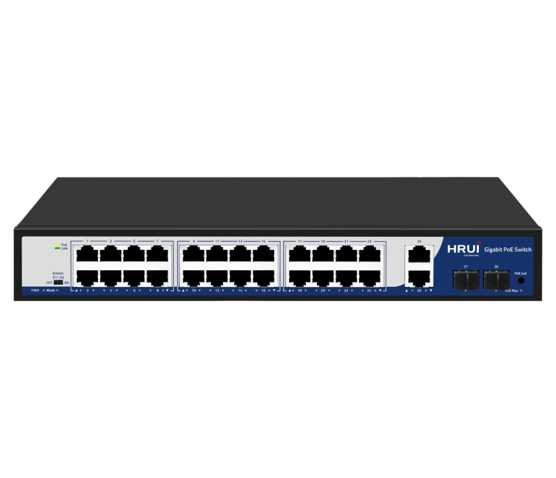
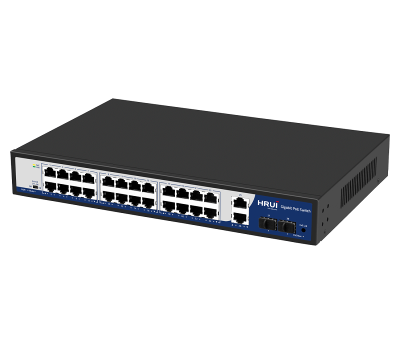
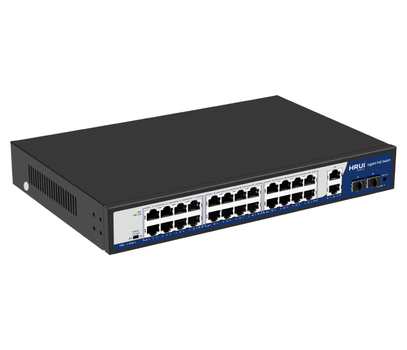
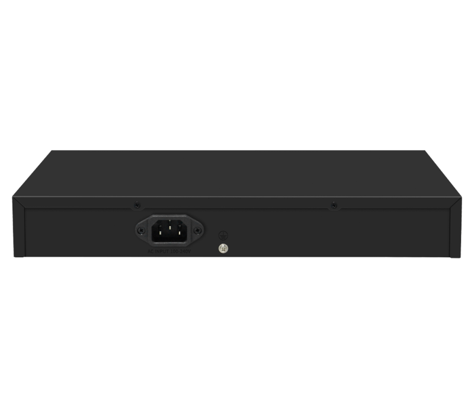

# HR900-AFG-2422S-300D

> 来源：<https://www.hruitech.com/poe-switch/206.html>（抓取 2026-10-21T04:35:37Z；英文原文照录，中文仅为栏目名）  
> 官网描述： 24-10/100/1000T 802.3af/at PoE + 2-Port 10/100/1000T+2-Port Gigabit SFP Ports Ethernet Switch (300 Watts)  
> 类目：PoE Switch（site id 206）  
> 接口：24 *1G PoE ports / 2 *1G RJ45 ports / 2 *1G SFP ports；PoE 预算 285W；交换带宽 —；电源 AC 100-240V 50/60Hz / DC 52V 5.76A

**Brief:** 28 Port Gigabit Intelligent Standard PoE Switch, with high quality and high-speed network IC and the most stable PoE chips, support 24* 10/100/1000M PoE Ports+2*Gigabit Uplink+2* Gigabit SFP Ports, and provide seamless connections to 10/100/1000M Ethernet, and the PoE supply port can automatically detect and supply receiving devices meeting IEEE802.3af/at standard, non-PoE devices intelligently detect no power and only transmit data.

## 产品图





## Datasheet
- [HR900_AFG_2422S_300D.pdf](https://www.hruitech.com/web/userfiles/productfile/HR900_AFG_2422S_300D.pdf) （本地：`data/hrui_site_raw/datasheets/HR900_AFG_2422S_300D.pdf`；文本：`data/hrui_site_raw/datasheet_text/HR900_AFG_2422S_300D.txt`）

## Feature and Benefits（原文）
```
24* 10/100/1000M PoE Ports+2*Gigabit Uplink+2* Gigabit SFP Ports；
Comply with IEEE802.3, IEEE802.3u, IEEE802.3ab Standard;
Ethernet Ports support 10/100/1000M self- adaptive;
The AI mode is automatically enabled 10M speed for Ports 17~24 in Extend mode;
POE priority is supported, from port 1 to port 16, which is enabled by default；
Flow control mode: IEEE 802.3X standard for full duplex, and Back Pressure standard for half duplex;
Zero configuration feature, automatically supplied to adaptive equipment;
Panel indicator monitoring status and help failure analysis;
With DIP switch, support Default and Extend modes;
Support port lightning surge: common mode 4KV, differential mode 2KV（level B）; Electrostatic ESD: air 8KV, contact 6KV（level C）.
```

## Parameter（规格表逐行）
| 项 | 值 |
|---|---|
| Description | Specification |
| Model | HR900-AFG-2422S-300D |
| Interface | 24 *1G PoE ports |
| Interface | 2 *1G RJ45 ports |
| Interface | 2 *1G SFP ports |
| Port Standard | IEEE802.3 (Ethernet) |
| Port Standard | IEEE802.3u (Fast Ethernet) |
| Port Standard | IEEE802.3ab (Gigabit Ethernet) |
| Port Standard | IEEE802.3x (Flow Control) |
| Port Standard | IEEE 802.3z (Gigabit Ethernet Fiber Standard) |
| Bandwidth | 56Gbps |
| Packet Forwarding Rate | 41.644Mpps |
| Packet Buffer | 3Mbit |
| MAC Address Table | 2K |
| Transmission Method | Store and Forward |
| PoE Standard | IEEE802.3af （15.4W） |
| PoE Standard | IEEE802.3at （30W） |
| PoE Port Output Voltage | DC 44-57V |
| PoE Ports | Port 2-24 PoE power output <30W,Port 1 PoE power output 60W |
| PoE Power Budget | 285W |
| Power Supply | AC 100-240V 50/60Hz |
| Power Supply | DC 52V 5.76A |
| Mainboard Power Consumption | 14.27W |
| Structure Information | Product Dimensions :320*207*44mm |
| Structure Information | Packaging Dimensions :370*290*85mm |
| Structure Information | Product Net Weight:1.967KG |
| Structure Information | Product Gross Weight:2.497KG |
| Packing Information | Carton Dimensions :445*310*390mm |
| Packing Information | Packing Quantity: 5PCS |
| Packing Information | Packing Weight: 13.485KG |
| Package Contents | Switch 1pcs, power cord 1pcs, manual 1pcs,certificate of qualification 1pcs |
| Fan Quantity | 0 |
| Installation | Desktop |
| Surge Protection | Port Surge: common mode 4KV, differential mode 2KV |
| Surge Protection | Electrostatic ESD: Air 8KV, Contact 6KV (Class C) |
| Operating Temperature | 0~40°C |
| Storage Temperature | -40 °C to 70 °C |
| Operation Humidity | 10%~90%,non condensing |
| Storage Humidity | 5%~95%,non condensing |
| PWR Green LED | On: Powered on |
| PWR Green LED | Off: Powered off |
| 1-28 Green LED | On: 10M/100M/1GLink normal |
| 1-28 Green LED | Off: Link blocked |
| 1-28 Green LED | Flashing: Data transmitting |
| 1-24 Yellow LED (PoE) | On: PoE powered on |
| 1-24 Yellow LED (PoE) | Off: PoE powered off |
| PoE Max Green LED | Off: Indicate that the PoE power usage is less than 90% |
| PoE Max Green LED | Flashing(Once per second): Indicate that the PoE power usage of 90% ≤ P ≤ 95% |
| PoE Max Green LED | On: Indicate that the PoE power is used at 95%<P<100% |
| Mode LED Green LED | Off: Extend off |
| Mode LED Green LED | Flashing: Extend on |
| PoE Led Button | Dual color LED selection: default green (link data), switch yellow LED (PoE) |
| Extend mode Button | OFF: All ports can communicate with each other, with an adaptive transmission rate of 10M/100M/1G, and port PoE watchdog mode turned off; |
| Extend mode Button | ON: The 17-24 ports can extend the transmission distance by 250 meters, with a transmission rate of 10Mbps, and the PoE watchdog mode is enable on the port; |

## Product structure / Application topology（图）
- https://www.hruitech.com/web/userfiles/image/20241223/1734942690705373.png
