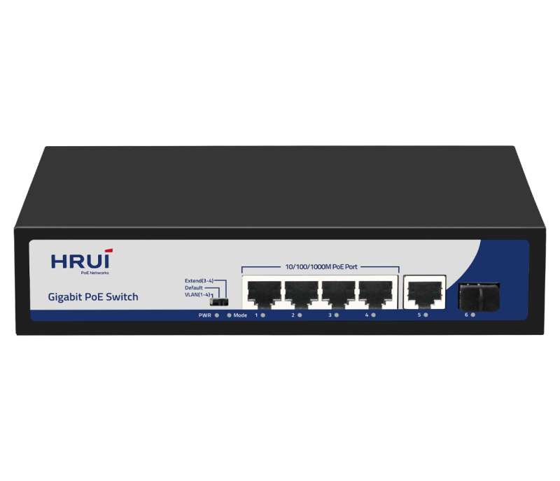
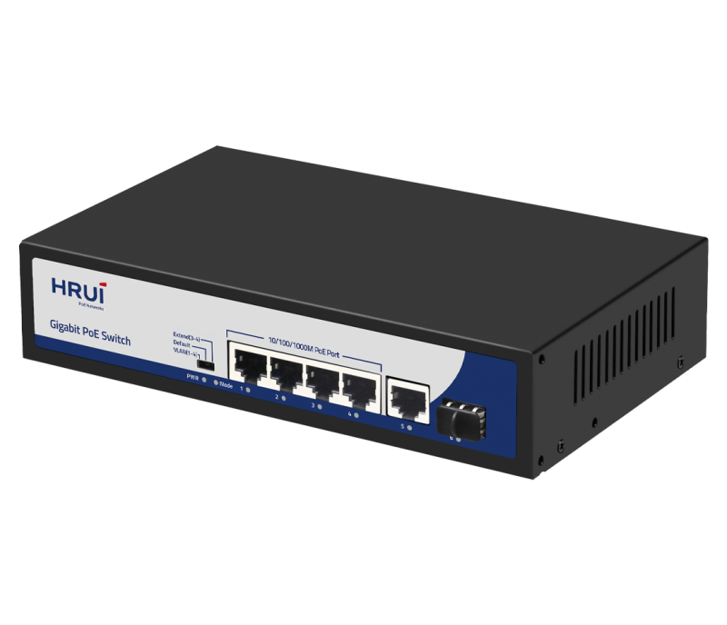
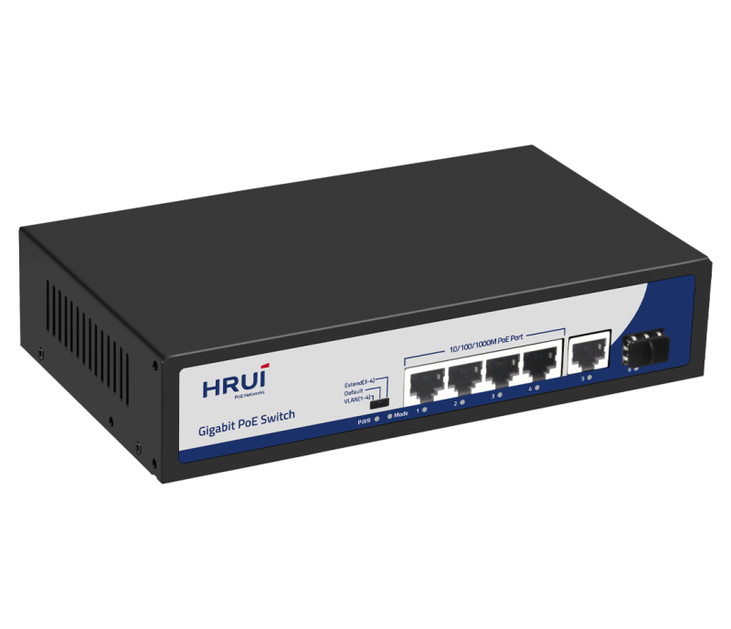
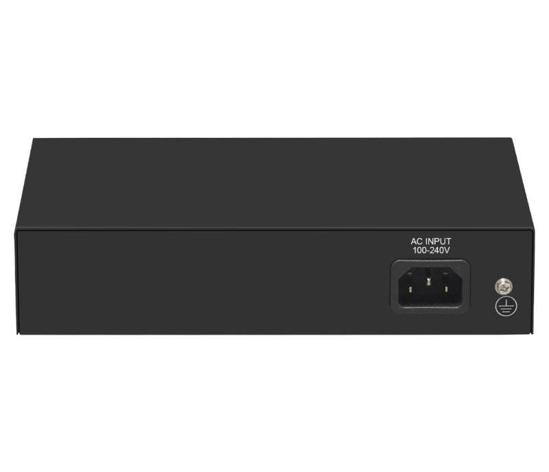

# HR900-AFG-411NS-120

> 来源：<https://www.hruitech.com/poe-switch/236.html>（抓取 2026-10-21T04:35:24Z；英文原文照录，中文仅为栏目名）  
> 官网描述：4-Port 10/100/1000T 802.3af/at PoE + 1-Port 10/100/1000T + 1-Port Gigabit SFP Ethernet Switch (120 Watts)  
> 类目：PoE Switch（site id 236）  
> 接口：4 *1G PoE ports / 1 *1G RJ45 port / 1* 1G SFP port；PoE 预算 115W；交换带宽 —；电源 AC 100-240V 50/60Hz / DC 52V2.3A

**Brief:** Gigabit PoE switch, with 4*Gigabit PoE ports + 1*Gigabit uplink RJ45 port + 1*Gigabit SFP port, IEEE 802.3af/at standard, bandwidth 12Gbps, total power 120W, surpport port isolation and 250m extend mode, suitable for -10~50℃ wide temperature environment, support surge protection 4KV, ESD 8KV.

## 产品图





## Datasheet
- [HR900_AFG_411NS_120.pdf](https://www.hruitech.com/web/userfiles/productfile/HR900_AFG_411NS_120.pdf) （本地：`data/hrui_site_raw/datasheets/HR900_AFG_411NS_120.pdf`；文本：`data/hrui_site_raw/datasheet_text/HR900_AFG_411NS_120.txt`）

## Feature and Benefits（原文）
```
HR900-AFG-411NS-120, a high-performance Gigabit PoE switch designed to meet the needs of modern networking environments. This versatile switch features four Gigabit PoE ports, one Gigabit uplink RJ45 port, and one Gigabit SFP port, all compliant with the IEEE 802.3af/at standards. With a remarkable total bandwidth of 12Gbps and a power capacity of 120W, this switch ensures seamless connectivity for all your devices. It supports port isolation and boasts a 250m extended mode, making it ideal for various applications in the range of -10°C to 50°C. Enhanced with 4KV surge protection and 8KV ESD protection, the HR900-AFG-411NS-120 guarantees reliability and durability in demanding environments.
Product Features:
Port Configuration:
Equipped with 4 Gigabit PoE ports, 1 Gigabit RJ45 uplink port, and 1 Gigabit SFP port.
Standards Compliance:
Designed in accordance with IEEE 802.3, IEEE 802.3u, IEEE 802.3ab, IEEE 802.3z, and IEEE 802.3x standards for reliable performance.
Extended Mode Functionality:
In extended mode, ports 3-4 automatically switch to 10M, enabling the PoE watchdog mode for enhanced network reliability.
Flexible Connectivity:
RJ45 ports support 10M, 100M, and 1G auto-negotiation for versatility.
Flow Control:
Supports Full Duplex (IEEE 802.3x) and Half Duplex (Back Pressure) flow control methods.
Auto MDI/MDIX Support:
Automatic port flipping capability eliminates the need for crossover cables, simplifying setup.
Advanced Mechanism:
Utilizes a store-and-forward switching mechanism for optimal data handling.
Status Monitoring:
The panel features LED indicators that monitor operational status and help with fault diagnosis.
Flexible Modes:
Supports VLAN, Default, and Extend modes for customized network management.
Power Output:
Delivers up to 60W of PoE power from Port 1, ideal for power-hungry devices.
```

## Parameter（规格表逐行）
| 项 | 值 |
|---|---|
| Description | Specification |
| Model | HR900-AFG-411NS-200 |
| Interface | 4 *1G PoE ports |
| Interface | 1 *1G RJ45 port |
| Interface | 1* 1G SFP port |
| Port Standard | IEEE802.3 (Ethernet) |
| Port Standard | IEEE802.3u (Fast Ethernet) |
| Port Standard | IEEE802.3ab (Gigabit Ethernet) |
| Port Standard | IEEE 802.3z (Gigabit Ethernet Fiber Standard) |
| Port Standard | IEEE802.3x (Flow Control) |
| Bandwidth | 12Gbps |
| Packet Forwarding Rate | 8.928Mpps |
| Packet Buffer | 1Mbit |
| MAC Address Table | 2K |
| Transmission Method | Store and Forward |
| PoE Standard | IEEE802.3af (15.4W) |
| PoE Standard | IEEE802.3at (30W) |
| PoE Port Output Voltage | DC 44-57V |
| PoE Ports | Port 1 PoE power output <60W,Port 3-4 PoE power output <30W |
| PoE Power Budget | 115W |
| Power Supply | AC 100-240V 50/60Hz |
| Power Supply | DC 52V2.3A |
| Mainboard Power Consumption | 3.7W |
| Structure Information | Product Dimensions :200*118*44mm |
| Structure Information | Packaging Dimensions : 245*190*60mm |
| Structure Information | Product Net Weight:0.65Kg |
| Structure Information | Product Gross Weight:0.95Kg |
| Packing Information | Carton Dimensions :520*320*400mm |
| Packing Information | Packing Quantity: 20PCS |
| Packing Information | Packing Weight: 20KG |
| Package Contents | Switch 1pcs, power cord 1pcs, manual 1pcs,certificate of qualification 1pcs |
| Fan Quantity | 0 |
| Installation | Desktop |
| Surge Protection | Port Surge: Common mode 4KV, |
| Surge Protection | Electrostatic ESD: Air 8KV, Contact 6KV |
| Operating Temperature | 0~40°C |
| Storage Temperature | -40 °C to 70 °C |
| Operation Humidity | 10%~90%,non condensing |
| Storage Humidity | 5%~95%,non condensing |
| PWR Red LED | On: Powered on |
| PWR Red LED | Off: Powered off |
| Mode Green LED | On:VLAN |
| Mode Green LED | Flashing:Extend |
| Mode Green LED | Off:Default |
| 1-6 Green LED | On:10M/100M/1G Link normal |
| 1-6 Green LED | Off: Link blocked |
| 1-6 Green LED | Flashing: Data transmitting |
| VLAN/Default/Extend Modes Buttons | VLAN: Isolation mode, 1-4 ports isolated from each other, communicating with 5-6 ports,and enable PoE watchdog mode on ports; |
| VLAN/Default/Extend Modes Buttons | Default: Normal mode, all interfaces can communicate with each other, transmission distance is within 100 meters, transmission rate is 10/100Mbps adaptive, and port PoE watchdog mode turned off; |
| VLAN/Default/Extend Modes Buttons | Extend: Link extension mode, 3-4 port PoE power supply and data transmission distance can be extended to 250 meters, transmission speed is 10Mbps,and enable PoE watchdog mode on ports; |

## Product structure / Application topology（图）
- https://www.hruitech.com/web/userfiles/image/20241225/1735095807395547.png
