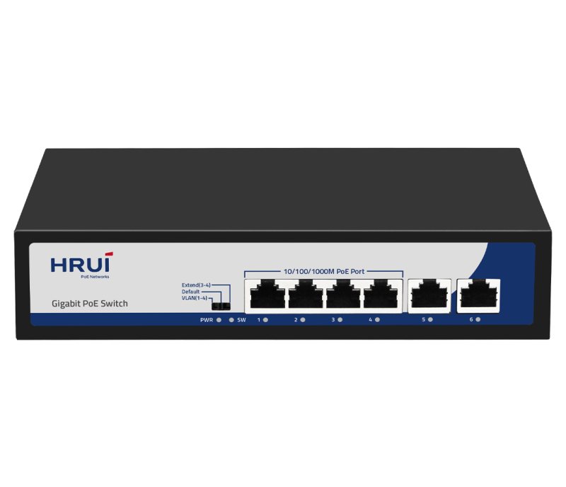
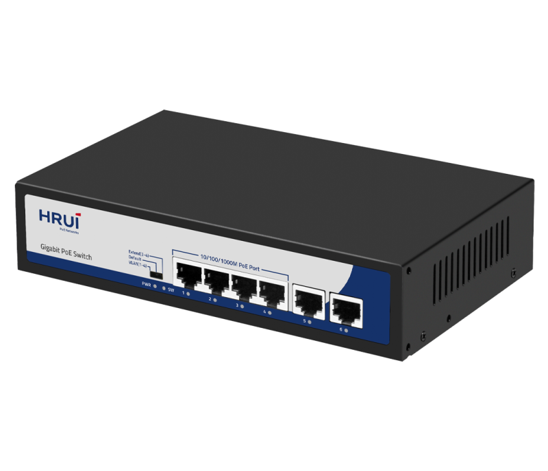
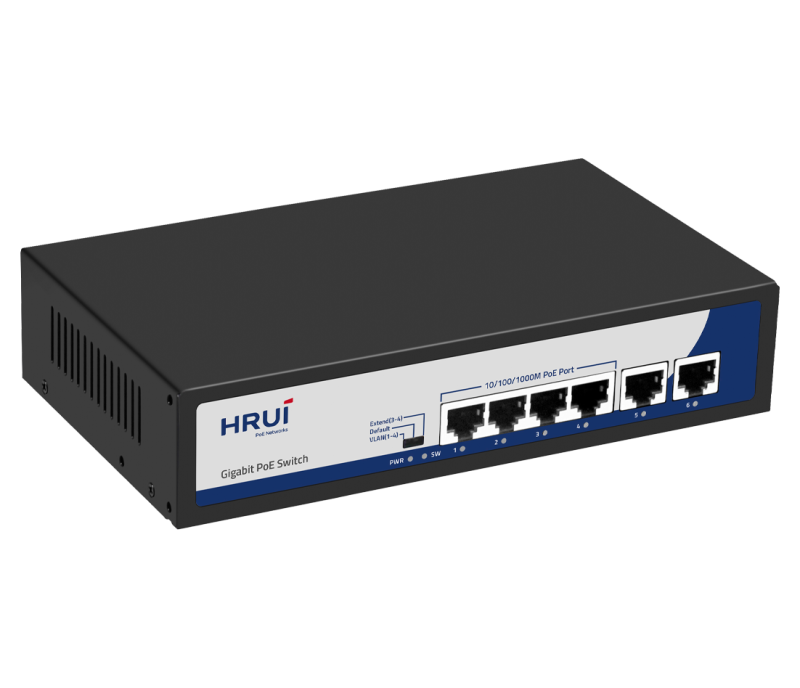
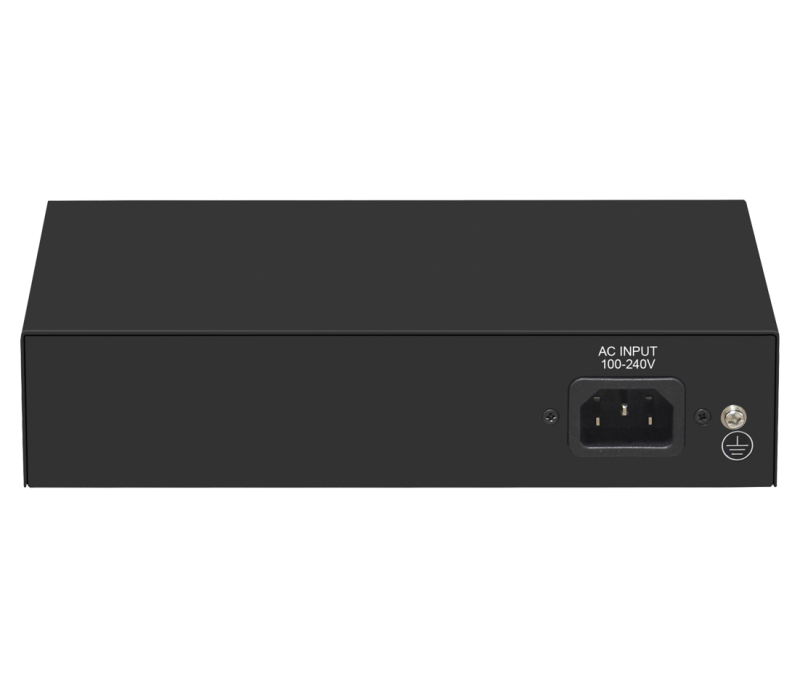

# HR900-AFG-42N

> 来源：<https://www.hruitech.com/poe-switch/197.html>（抓取 2026-10-21T04:35:41Z；英文原文照录，中文仅为栏目名）  
> 官网描述：4-Port 10/100/1000T 802.3af/at PoE + 2-Port 10/100/1000T Ethernet Switch (65 Watts)  
> 类目：PoE Switch（site id 197）  
> 接口：4 *1G PoE ports / 2* 1G RJ45 port；PoE 预算 60W；交换带宽 —；电源 AC 100-240V 50/60Hz / DC 52V 1.25A

**Brief:** The 6 port full Gigabit intelligent standard PoE switch, using high-quality and high-speed network IC and the most stable PoE chip. It supports 4* Gigabit PoE ports+2 Gigabit Ethernet ports, and the PoE port meets the 802.3af or 802.3at standards. This series of PoE switches can provide seamless connection for 10/100/1000M Ethernet, and the PoE power supply port can automatically detect and power powered devices that meet the IEEE802.3af or IEEE802.3at standards. Non PoE devices are not powered by intelligent detection and only transmit data.

## 产品图





## Datasheet
- [HR900_AFG_42N.pdf](https://www.hruitech.com/web/userfiles/productfile/HR900_AFG_42N.pdf) （本地：`data/hrui_site_raw/datasheets/HR900_AFG_42N.pdf`；文本：`data/hrui_site_raw/datasheet_text/HR900_AFG_42N.txt`）

## Feature and Benefits（原文）
```
HR900-AFG-42N, a high-performance 6-Port Gigabit Intelligent Standard PoE Switch designed for modern networking needs. This switch incorporates premium, high-speed network integrated circuits and a reliable PoE chip, ensuring optimal performance and stability. It features 4 Gigabit PoE ports and 2 additional Gigabit Ethernet ports, all compliant with 802.3af and 802.3at standards.
The HR900-AFG-42N seamlessly connects a variety of devices across 10/100/1000M Ethernet, effortlessly powering devices that meet the IEEE 802.3af/802.3at standards while intelligently detecting non-PoE devices to avoid unnecessary power supply. This makes it an ideal solution for environments requiring efficient data transmission alongside power delivery.
Product Features:
6 Ports for Versatile Connectivity:
4 Gigabit PoE ports and 2 Gigabit RJ45 ports for simultaneous device connections.
Standards Compliance:
Fully complies with IEEE 802.3, IEEE 802.3u, IEEE 802.3ab, IEEE 802.3z, and IEEE 802.3x standards, ensuring broad compatibility and reliable performance.
Adaptive RJ45 Ports:
The RJ45 ports support automatic adaptation for 10M, 100M, and 1G speeds, offering flexibility based on your networking requirements.
Efficient Flow Control:
Implements IEEE 802.3x standard for full duplex and utilizes back pressure for half duplex, enabling efficient network communication.
Auto MDI/MDIX Support:
Automatically adjusts for straight-through or crossover connections, facilitating easy installation.
Storage and Forwarding Mechanism:
Uses a storage and forwarding exchange mechanism to enhance data processing and management.
Status Monitoring:
Panel indicator LEDs provide real-time monitoring of operational status, aiding in fault diagnosis.
Three Operation Modes:
Supports three operational modes: VLAN, Default, and Extend, allowing customization based on network requirements.
PoE Watchdog Support:
Features advanced PoE watchdog capabilities for superior monitoring and management of powered devices.
```

## Parameter（规格表逐行）
| 项 | 值 |
|---|---|
| Description | Specification |
| Model | HR900-AFG-42N |
| Interface | 4 *1G PoE ports |
| Interface | 2* 1G RJ45 port |
| Port Standard | IEEE802.3 (Ethernet) |
| Port Standard | IEEE802.3u (Fast Ethernet) |
| Port Standard | IEEE802.3ab (Gigabit Ethernet) |
| Port Standard | IEEE802.3x (Flow Control) |
| Bandwidth | 12Gbps |
| Packet Forwarding Rate | 8.928Mpps |
| Packet Buffer | 1Mbit |
| MAC Address Table | 2K |
| Transmission Method | Store and Forward |
| PoE Standard | IEEE802.3af (15.4W) |
| PoE Standard | IEEE802.3at (30W) |
| PoE Port Output Voltage | DC 44-57V |
| PoE Ports | Port 1-4 PoE power output <30W |
| PoE Power Budget | 60W |
| Power Supply | AC 100-240V 50/60Hz |
| Power Supply | DC 52V 1.25A |
| Mainboard Power Consumption | 3.7W |
| Structure Information | Product Dimensions :200*118*44mm |
| Structure Information | Packaging Dimensions : 245*190*60mm |
| Structure Information | Product Net Weight:0.61Kg |
| Structure Information | Product Gross Weight:0.91Kg |
| Packing Information | Carton Dimensions :520*320*400mm |
| Packing Information | Packing Quantity: 20PCS |
| Packing Information | Packing Weight: 19.2KG |
| Package Contents | Switch 1pcs, power cord 1pcs, manual 1pcs,certificate of qualification 1pcs |
| Fan Quantity | 0 |
| Installation | Desktop |
| Surge Protection | Port Surge: common mode 4KV, differential mode 2KV |
| Surge Protection | Electrostatic ESD: Air 8KV, Contact 6KV(Class B) |
| Operating Temperature | 0~40°C |
| Storage Temperature | -40 °C to 70 °C |
| Operation Humidity | 10%~90%,non condensing |
| Storage Humidity | 5%~95%,non condensing |
| PWR Red LED | On: Powered on |
| PWR Red LED | Off: Powered off |
| SW Green LED | On:VLAN |
| SW Green LED | Flashing:Extend |
| SW Green LED | Off:Default |
| 1-6 Green LED | On:10M/100M/1G Link normal |
| 1-6 Green LED | Off: Link blocked |
| 1-6 Green LED | Flashing: Data transmitting |
| VLAN/Default/Extend Modes Buttons | VLAN: Isolation mode, 1-4 ports isolated from each other, communicating with 5-6 ports,and enable PoE watchdog mode on ports; |
| VLAN/Default/Extend Modes Buttons | Default: Normal mode, all interfaces can communicate with each other, transmission distance is within 100 meters, transmission rate is 10M/100M/1G adaptive, and port PoE watchdog mode turned off; |
| VLAN/Default/Extend Modes Buttons | Extend: Link extension mode, 3-4 ports data transmission distance can be extended to 250 meters, transmission speed is 10Mbps,and enable PoE watchdog mode on ports; |

## Product structure / Application topology（图）
- https://www.hruitech.com/web/userfiles/image/20241223/1734938318707591.png
