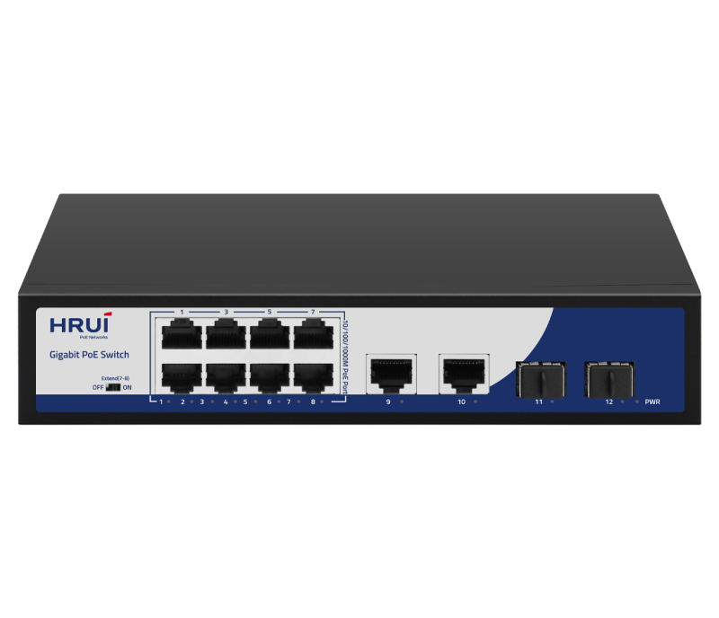
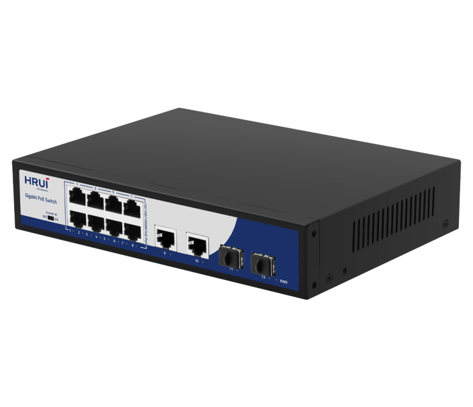
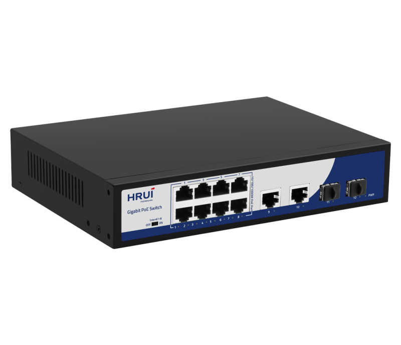
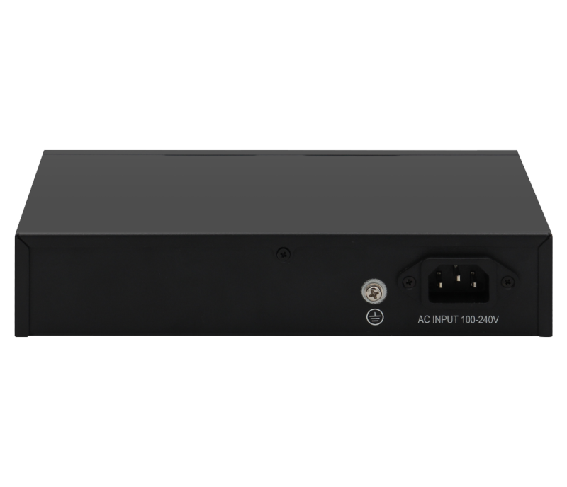

# HR900-AFG-822NS

> 来源：<https://www.hruitech.com/poe-switch/208.html>（抓取 2026-10-21T04:35:36Z；英文原文照录，中文仅为栏目名）  
> 官网描述：8-Port 10/100/1000T 802.3af/at PoE + 2-Port 10/100/1000T +2-Port Gigabit SFP Ethernet Switch (120 Watts)  
> 类目：PoE Switch（site id 208）  
> 接口：8* 1G PoE ports / 2 *1G uplink SFP ports / 2* 1G RJ45 ports；PoE 预算 110W；交换带宽 —；电源 AC 100-240V 50/60Hz / DC 52V 2.3A

**Brief:** The 12-port Gigabit intelligent standard PoE switch, uses high-quality, high-speed network IC and the most stable PoE chip. It supports 8* Gigabit PoE Ports+2* Gigabit Ethernet ports+2* Gigabit SFP Ports and can provide seamless connectivity on 10/100/1000M Ethernet network. The latest AI function is integrated into the switch, and the port automatically enables AI mode in Extend mode. The PoE power supply port automatically detects and supplies power to the powered devices that comply with the IEEE802.3af or IEEE802.3at standards. Non-poe devices do not automatically detect power supply and only transmit data.

## 产品图





## Datasheet
- [HR900_AFG_822NS.pdf](https://www.hruitech.com/web/userfiles/productfile/HR900_AFG_822NS.pdf) （本地：`data/hrui_site_raw/datasheets/HR900_AFG_822NS.pdf`；文本：`data/hrui_site_raw/datasheet_text/HR900_AFG_822NS.txt`）

## Feature and Benefits（原文）
```
HR900-AFG-822NS, a high-performance 12-port Gigabit intelligent PoE switch designed for seamless connectivity in modern networking environments. Equipped with premium, high-speed network ICs and a reliable PoE chip, this switch features 8 Gigabit PoE ports, 2 Gigabit Ethernet ports, and 2 Gigabit SFP ports, enabling fast and efficient data transfer across a range of devices.
The switch incorporates advanced AI functionality to automatically enable "AI mode" in Extend mode, optimizing performance for your connected devices. With its intelligent design, the PoE power supply ports automatically detect and provide power to devices compliant with the IEEE 802.3af and IEEE 802.3at standards, ensuring hassle-free integration. Non-PoE devices can transmit data without automatic power detection.
Product Features:
Port Configuration:
8 Gigabit PoE ports, 2 Gigabit Ethernet ports, and 2 Gigabit SFP ports ensure versatile connectivity options.
Standards Compliance:
Fully supports IEEE 802.3, IEEE 802.3u, and IEEE 802.3x standards for reliable networking.
Adaptive RJ45 Ports:
Ethernet ports are self-adaptive, supporting 10/100/1000M speeds for flexible network performance.
Efficient Flow Control:
Implements IEEE 802.3x standard for full duplex and utilizes back pressure for half duplex, enabling efficient network communication.
Extend Mode Functionality:
Ports 7 and 8 can operate in Extend mode, forcing a 10Mbps speed while automatically activating PoE watchdog mode for enhanced device monitoring.
PoE Priority Management:
The switch features default PoE priority, systematically prioritizing power supply from ports 1 to 8.
Status Monitoring:
Panel indicator LEDs provide real-time monitoring of operational status, aiding in fault diagnosis.
Zero Configuration:
Automatically recognizes and allocates power to compatible devices without manual setup.
Surge Protection:
Built-in protection features include 4KV common mode surge protection and ESD ratings of 8KV (air) and 6KV (contact), ensuring robust durability and reliability.
```

## Parameter（规格表逐行）
| 项 | 值 |
|---|---|
| Description | Specification |
| Model | HR900-AFG-822NS |
| Interface | 8* 1G PoE ports |
| Interface | 2 *1G uplink SFP ports |
| Interface | 2* 1G RJ45 ports |
| Port Standard | IEEE802.3 (Ethernet) |
| Port Standard | IEEE802.3u (Fast Ethernet) |
| Port Standard | IEEE802.3ab (Gigabit Ethernet) |
| Port Standard | IEEE802.3x (Flow Control) |
| Bandwidth | 24Gbps |
| Packet Forwarding Rate | 17.856Mpps |
| Packet Buffer | 3Mbit |
| MAC Address Table | 2K |
| Transmission Method | Store and Forward |
| PoE Standard | IEEE802.3af (15.4W) |
| PoE Standard | IEEE802.3at (30W) |
| PoE Port Output Voltage | DC 44-57V |
| PoE Ports | Port 1-8 PoE power output <30W |
| PoE Power Budget | 110W |
| Power Supply | AC 100-240V 50/60Hz |
| Power Supply | DC 52V 2.3A |
| Mainboard Power Consumption | 6.7W |
| Structure Information | Product Dimensions :220*161*44mm |
| Structure Information | Packaging Dimensions : 315*215*85mm |
| Structure Information | Product Net Weight:0.88KG |
| Structure Information | Product Gross Weight:1.22KG |
| Packing Information | Carton Dimensions :445*445*335mm |
| Packing Information | Packing Quantity: 10PCS |
| Packing Information | Packing Weight: 13.2KG |
| Package Contents | Switch 1pcs, power cord 1pcs, manual 1pcs,certificate of qualification 1pcs |
| Fan Quantity | 0 |
| Installation | Desktop |
| Surge Protection | Port Surge: Common mode 4KV, differential mode 2KV (Class B); |
| Surge Protection | Electrostatic ESD: Air 8KV, Contact 6KV (Class C) |
| Operating Temperature | 0~40°C |
| Storage Temperature | -40 °C to 70 °C |
| Operation Humidity | 10%~90%,non condensing |
| Storage Humidity | 5%~95%,non condensing |
| PWR Green LED | On: Powered on |
| PWR Green LED | Off: Powered off |
| 1-12 Green LED | On:10M/100M/1G Link normal |
| 1-12 Green LED | Off: Link blocked |
| 1-12 Green LED | Flashing: Data transmitting |
| Extend Mode Button | OFF: Normal mode, all ports can communicate with each other, transmission distance is within 100 meters, transmission rate is 10M/100M/1G adaptive, and port PoE watchdog mode turned off; |
| Extend Mode Button | ON: Link extension mode, 7-8 ports data transmission distance can be extended to 250 meters,transmission speed is 10Mbps,and enable PoE watchdog mode on ports; |

## Product structure / Application topology（图）
- https://www.hruitech.com/web/userfiles/image/20241224/1735007400462655.png
