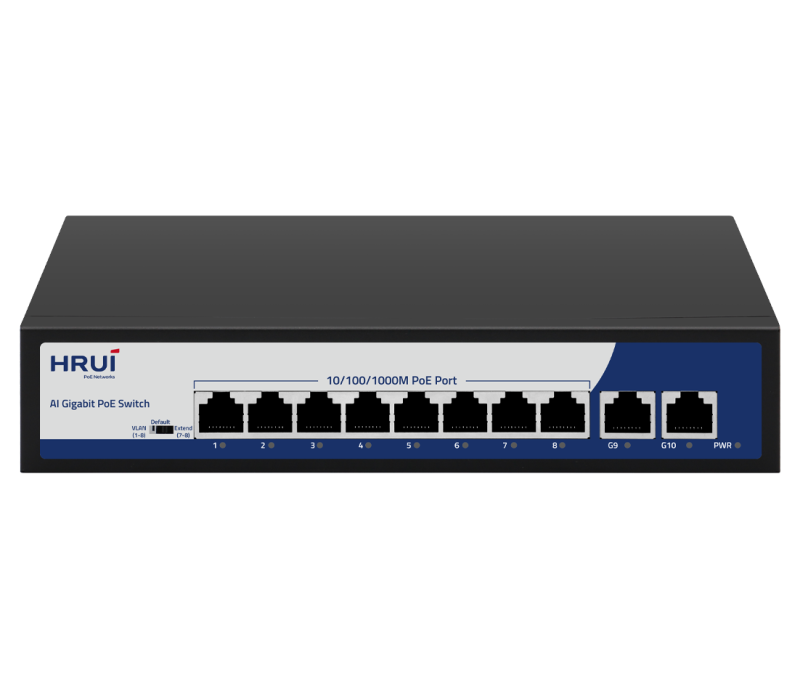
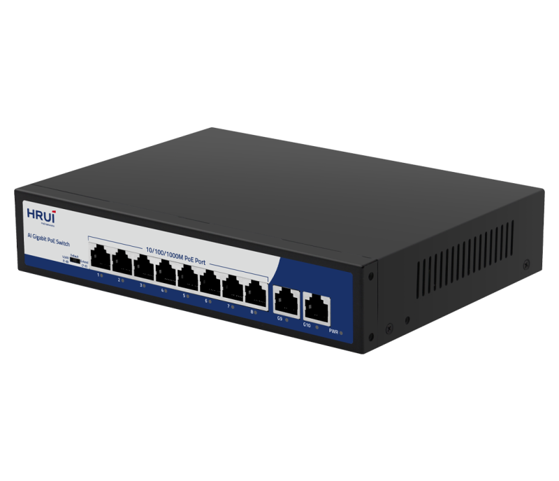
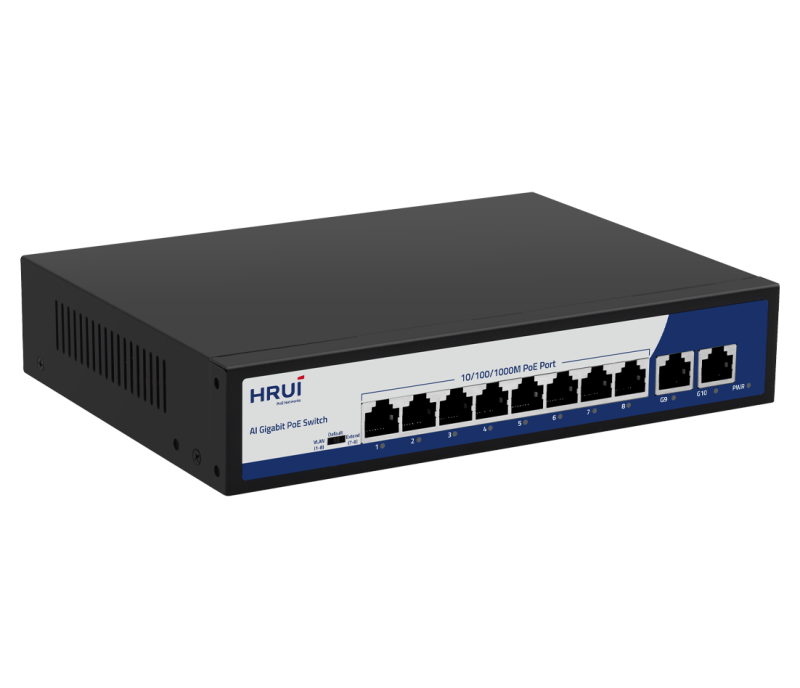
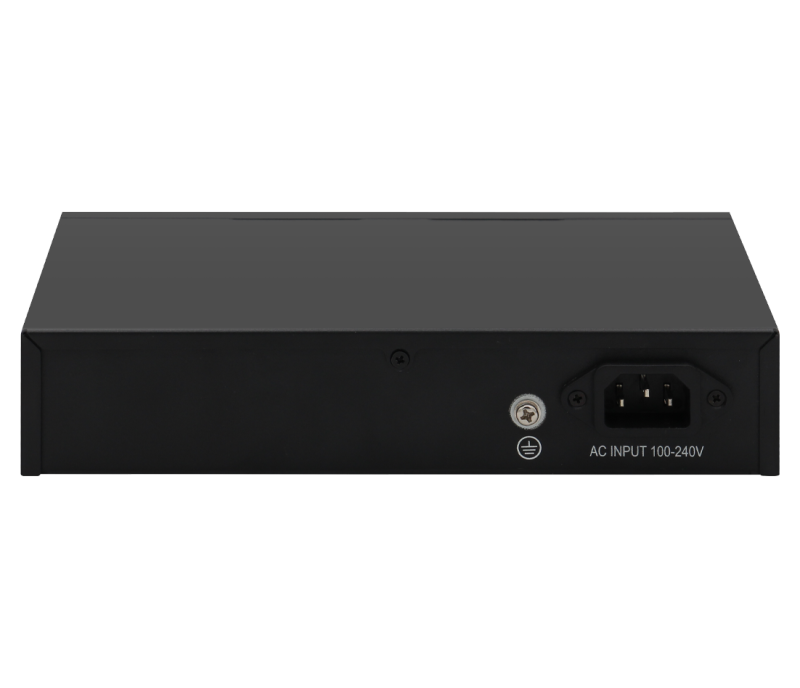

# HR900-AFG-82N

> 来源：<https://www.hruitech.com/poe-switch/199.html>（抓取 2026-10-21T04:35:39Z；英文原文照录，中文仅为栏目名）  
> 官网描述：8-Port 10/100/1000T 802.3af/at PoE + 2-Port 10/100/1000T Ethernet Switch (120 Watts)  
> 类目：PoE Switch（site id 199）  
> 接口：8-Port 10/100/1000T 802.3af/at PoE + 2-Port 10/100/1000T Ethernet Switch (120 Watts)；PoE 预算 —；交换带宽 —；电源 —

**Brief:** 10 Port Full Gigabit Intelligent Standard PoE Switch, using high-quality high-speed network IC and the most stable POE chip, POE port meets 802.3af / 802.3at standard, this series of PoE Switch can be 10/100/1000M Ethernet. The network provides a seamless connection, and the PoE power port can automatically detect and power the powered devices that comply with the IEEE802.3af / IEEE802.3at standards. The non-POE device intelligently detects no power and only transmits data.

## 产品图





## Datasheet
- [HR900_AFG_82N.pdf](https://www.hruitech.com/web/userfiles/productfile/HR900_AFG_82N.pdf) （本地：`data/hrui_site_raw/datasheets/HR900_AFG_82N.pdf`；文本：`data/hrui_site_raw/datasheet_text/HR900_AFG_82N.txt`）

## Feature and Benefits（原文）
```
The HRUI AI PoE switches provide a range of models featuring both 100M/Gigabit PoE, RJ45, and SFP uplink ports. These switches meet the IEEE 802.3af/at/Hi-PoE standards for Power over Ethernet, with PoE port 1 capable of delivering a maximum output of 60W and other PoE ports capable of 30W. The devices offer three working modes: Default, VLAN (Port Isolation), and Extend. Additionally, the series supports PoE watchdog functionality in both VLAN and Extend modes, enabling the detection and automatic reboot of unresponsive or dropped PoE-powered devices.
With user-friendly installation and maintenance processes, these switches help establish a secure and high-performance network. HRUI AI PoE switches are ideal for various Ethernet access applications, including small to medium-sized enterprises, internet cafes, hotels, and schools.
FEATURES
• Power Over Ethernet
This series of switches provides PoE ports, compliant with IEEE 802.3af/at/high PoE, enabling simultaneous data and power transmission to devices via a single, convenient Ethernet cable. Specifically,
PoE Port 1 offers a maximum output power of 60 watts
, permitting the powering of high-power devices. By integrating power delivery into a single cable, these switches streamline cabling infrastructure and eliminate the need for separate power sources, thereby providing an efficient and cost-effective solution for powering network devices.
• Advanced Functions with DIP Switch
VLAN:
Downlink ports are isolated from each other, but can still communicate with uplink ports. This mode also enables PoE watchdog on ports.
Default:
All ports support communication with each other, with a transmission distance of up to 100 meters and an adaptive speed of 10/100/1000Mbps. This mode disables PoE watchdog on ports.
Extend:
The downlink PoE & data transmission distance of port 7-8 can reach up to 250 meters, with a speed of 10Mbps. This mode enables PoE watchdog on ports.
• AI PoE Watchdog
Detect and reboot dropped or unresponsive PoE-powered devices.
• Safe PoE Smart Boot-up
Support PoE Smart Boot-up that enables PoE on ports from the first to last in sequence to prevent damage to the power supply by sudden large currents. The function is enabled by default.
• Plug and Play, Easy to Use
All Ethernet ports on our switches support MDI/MDIX compatibility, allowing for easy setup with no software installation or configuration needed.
• 19 Inch Rack Mout
• High Reliable Design
Support installed in a standard rack environment, easy to integrate with other equipment and manage cabling.
Support 4KV surge and 8KV ESD protection.
HRUI AI PoE Switch Models
HR900-AF-42N
HR900-AF-82N
HR900-AFG-82N
Port Rate: 4*FE PoE + 2*FE
PoE Standard: IEEE 802.3af/at
Port 1-4 PoE power output ≤ 30W
PoE Power Budget: 60W
Surge Protection: 4KV
Working Temperature: 0℃～40℃
Port Rate: 8*FE PoE + 2*FE
PoE Standard: IEEE 802.3af/at
Port 1-8 PoE power output ≤ 30W
PoE Power Budget: 115W
Surge Protection: 4KV
Working Temperature: 0℃～40℃
Port Rate: 8*GE PoE + 2*GE
PoE Standard: IEEE 802.3af/at/High PoE
Port 1 PoE power output ≤ 60W, port 2-8 PoE power output ≤ 30W
PoE Power Budget: 110W
Surge Protection: 4KV
Working Temperature: 0℃～40℃
HR900-AF-2421GS-300
HR900-AFG-1622S-200
HR900-AFG-242S-400
Port Rate: 24*FE PoE + 2*GE + 1*1G SFP
PoE Standard: IEEE 802.3af/at/High PoE
Port 1 PoE power output ≤ 60W, port 2-24 PoE power output ≤ 30W
PoE Power Budget: 290W
Surge Protection: 4KV
Working Temperature: 0℃～40℃
Port Rate: 16*GE PoE + 2*GE + 2*1G SFP
PoE Standard: IEEE 802.3af/at/High PoE
Port 1 PoE power output ≤ 60W, port 2-16 PoE power output ≤ 30W
PoE Power Budget: 185W
Surge Protection: 4KV
Working Temperature: 0℃～40℃
Port Rate: 24*GE PoE + 2*1G SFP
PoE Standard: IEEE 802.3af/at
Port 1-24 PoE power output ≤ 30W
PoE Power Budget: 380W
Surge Protection: 4KV
Working Temperature: 0℃～40℃
```

## Parameter（规格表逐行）
| 项 | 值 |
|---|---|
|  | • Power Over Ethernet |
|  | This series of switches provides PoE ports, compliant with IEEE 802.3af/at/high PoE, enabling simultaneous data and power transmission to devices via a single, convenient Ethernet cable. Specifically, PoE Port 1 offers a maximum output power of 60 watts , permitting the powering of high-power devices. By integrating power delivery into a single cable, these switches streamline cabling infrastructure and eliminate the need for separate power sources, thereby providing an efficient and cost-effective solution for powering network devices. |
|  | • Advanced Functions with DIP Switch |
|  | VLAN: Downlink ports are isolated from each other, but can still communicate with uplink ports. This mode also enables PoE watchdog on ports. |
|  | Default: All ports support communication with each other, with a transmission distance of up to 100 meters and an adaptive speed of 10/100/1000Mbps. This mode disables PoE watchdog on ports. |
|  | Extend: The downlink PoE & data transmission distance of port 7-8 can reach up to 250 meters, with a speed of 10Mbps. This mode enables PoE watchdog on ports. |
|  | • AI PoE Watchdog |
|  | Detect and reboot dropped or unresponsive PoE-powered devices. |
|  | • Safe PoE Smart Boot-up |
|  | Support PoE Smart Boot-up that enables PoE on ports from the first to last in sequence to prevent damage to the power supply by sudden large currents. The function is enabled by default. |
|  | • Plug and Play, Easy to Use |
|  | All Ethernet ports on our switches support MDI/MDIX compatibility, allowing for easy setup with no software installation or configuration needed. |
| • 19 Inch Rack Mout | • High Reliable Design |
| Support installed in a standard rack environment, easy to integrate with other equipment and manage cabling. | Support 4KV surge and 8KV ESD protection. |
| HR900-AF-42N | HR900-AF-82N / HR900-AFG-82N |
| Port Rate: 4*FE PoE + 2*FE PoE Standard: IEEE 802.3af/at Port 1-4 PoE power output ≤ 30W PoE Power Budget: 60W Surge Protection: 4KV Working Temperature: 0℃～40℃ | Port Rate: 8*FE PoE + 2*FE PoE Standard: IEEE 802.3af/at Port 1-8 PoE power output ≤ 30W PoE Power Budget: 115W Surge Protection: 4KV Working Temperature: 0℃～40℃ / Port Rate: 8*GE PoE + 2*GE PoE Standard: IEEE 802.3af/at/High PoE Port 1 PoE power output ≤ 60W, port 2-8 PoE power output ≤ 30W PoE Power Budget: 110W Surge Protection: 4KV Working Temperature: 0℃～40℃ |
| HR900-AF-2421GS-300 | HR900-AFG-1622S-200 / HR900-AFG-242S-400 |
| Port Rate: 24*FE PoE + 2*GE + 1*1G SFP PoE Standard: IEEE 802.3af/at/High PoE Port 1 PoE power output ≤ 60W, port 2-24 PoE power output ≤ 30W PoE Power Budget: 290W Surge Protection: 4KV Working Temperature: 0℃～40℃ | Port Rate: 16*GE PoE + 2*GE + 2*1G SFP PoE Standard: IEEE 802.3af/at/High PoE Port 1 PoE power output ≤ 60W, port 2-16 PoE power output ≤ 30W PoE Power Budget: 185W Surge Protection: 4KV Working Temperature: 0℃～40℃ / Port Rate: 24*GE PoE + 2*1G SFP PoE Standard: IEEE 802.3af/at Port 1-24 PoE power output ≤ 30W PoE Power Budget: 380W Surge Protection: 4KV Working Temperature: 0℃～40℃ |
| **Hardware Features & Performance** | |
| Model | HR900-AFG-82N |
| General | Interface / 8* 1000Mbps PoE ports |
| General | Interface / 2* 1000Mbps uplink RJ45 port |
| General | Port Standard / IEEE802.3 (Ethernet) |
| General | Port Standard / IEEE802.3u (Fast Ethernet) |
| General | Port Standard / IEEE802.3ab (Gigabit Ethernet) |
| General | Port Standard / IEEE802.3x (Flow Control) |
| Performance | Switching Capacity / 20Gbps |
| Performance | Packet Forwarding Rate / 14.88Mpps |
| Performance | Packet Buffer / 1Mbit |
| Performance | MAC Address Table / 2K |
| Performance | Transmission Method / Store and Forward |
| PoE | PoE Standard / IEEE802.3af (15.4W) |
| PoE | PoE Standard / IEEE802.3at (30W) |
| PoE | POE Port Output Voltage / DC 44-57V |
| PoE | PoE Ports / Port 2-24 PoE power output <30W，Port 1 PoE power output 60W |
| PoE | PoE Power Budget / 110W |
| Physical | Power Supply / AC 100-240V 50/60Hz |
| Physical | Power Supply / DC 52V 2.3A |
| Physical | Mainboard Power Consumption / 6.5W |
| Physical | Structure Information / Product Dimensions :220*161*44mm |
| Physical | Structure Information / Packaging Dimensions: 315*215*85mm |
| Physical | Structure Information / Product Net Weight:0.88KG |
| Physical | Structure Information / Product Gross Weight:1.38KG |
| Physical | Packing Information / Carton Dimensions :445*445*335mm |
| Physical | Packing Information / Packing Quantity: 10PCS |
| Physical | Packing Information / Packing Weight: 14.8KG |
| Physical | Packing List / Switch 1pcs, power cord 1pcs, instruction manual 1pcs，certificate of qualification 1pcs |
| Physical | Fan Quantity / 0 |
| Physical | Installation / Desktop |
| Environment | Surge Protection / Surge protection: common mode 4KV, differential mode 2KV |
| Environment | Surge Protection / Electrostatic ESD: Air 8KV, Contact 6KV (Class B) |
| Environment | Operating Temperature / 0~40°C |
| Environment | Storage Temperature / -40 °C to 70 °C |
| Environment | Operation Humidity / 10%~90%，non condensing |
| Environment | Storage Humidity / 5%~95%，non condensing |
| Buttons & Indicator Lights | PWR / On: Powered on |
| Buttons & Indicator Lights | PWR / Off: Powered off |
| Buttons & Indicator Lights | 1-10 Green Light / On: Link normal |
| Buttons & Indicator Lights | 1-10 Green Light / Off: Link blocked |
| Buttons & Indicator Lights | 1-10 Green Light / Flashing: Data transmitting |
| Buttons & Indicator Lights | VLAN/Default/Extend Modes Buttons / VLAN: Isolation mode, 1-8 ports isolated from each other, communicating with 9-10 ports，and enable PoE watchdog mode on ports; |
| Buttons & Indicator Lights | VLAN/Default/Extend Modes Buttons / Default: Normal mode, all interfaces can communicate with each other, transmission distance is within 100 meters, transmission rate is 10/100/1000Mbps adaptive， and port PoE watchdog mode turned off; |
| Buttons & Indicator Lights | VLAN/Default/Extend Modes Buttons / Extend: Link extension mode, 7-8 ports data transmission distance can be extended to 250 meters, transmission speed is 10Mbps，and enable PoE watchdog mode on ports; |

## Product structure / Application topology（图）
- https://www.hruitech.com/web/userfiles/product/productdetail/HR900_AFG_82N/HR900-AFG-82NDimension.png
- https://www.hruitech.com/web/userfiles/product/productdetail/HR900_AFG_82N/HR900-AFG-82N-289-29.jpg
