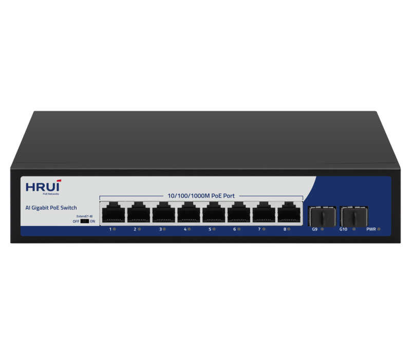
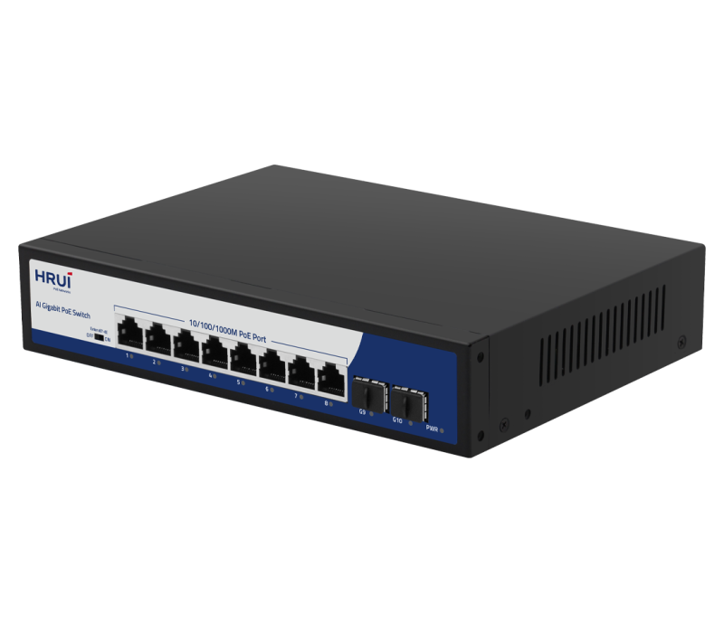
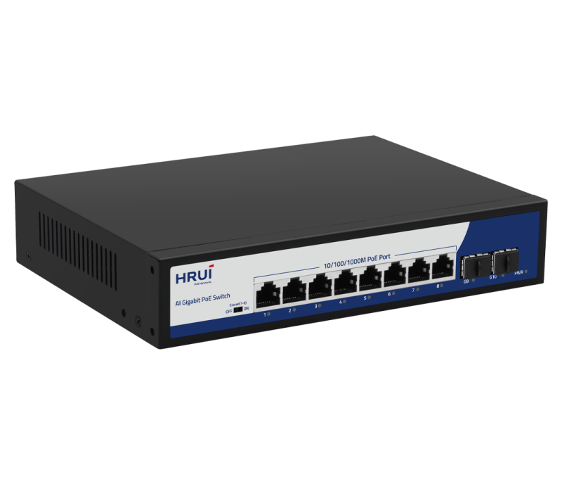
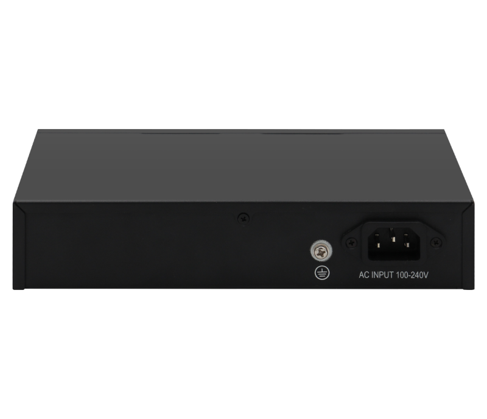

# HR900-AFG-82NS

> 来源：<https://www.hruitech.com/poe-switch/198.html>（抓取 2026-10-21T04:35:40Z；英文原文照录，中文仅为栏目名）  
> 官网描述：8-Port 10/100/1000T 802.3af/at PoE + 2-Port Gigabit SFP Ports Ethernet Switch(120 Watts)  
> 类目：PoE Switch（site id 198）  
> 接口：8* 1G PoE ports / 2 *1G uplink SFP ports；PoE 预算 110W；交换带宽 —；电源 AC 100-240V 50/60Hz / DC 52V 2.3A

**Brief:** 10 Port Full Gigabit Intelligent Standard PoE switch,Support 8* 10/100/1000M PoE Ports+2* Gigabit SFP Ports; with high quality and high-speed network IC and the most stable PoE chips, provide seamless connections to 10/100/1000M Ethernet, and the PoE supply port can automatically detect and supply receiving devices meeting IEEE802.3af/at standard, non-PoE devices intelligently detect no power and only transmit data.

## 产品图





## Datasheet
- [HR900_AFG_82NS.pdf](https://www.hruitech.com/web/userfiles/productfile/HR900_AFG_82NS.pdf) （本地：`data/hrui_site_raw/datasheets/HR900_AFG_82NS.pdf`；文本：`data/hrui_site_raw/datasheet_text/HR900_AFG_82NS.txt`）

## Feature and Benefits（原文）
```
HR900-AFG-82NS, a robust 10-Port Full Gigabit Intelligent Standard PoE Switch. This versatile switch features 8 PoE ports capable of delivering 10/100/1000 Mbps speeds, along with 2 Gigabit SFP ports for enhanced connectivity options. Powered by advanced, high-quality network ICs and stable PoE chips, it ensures reliable connections across all Ethernet devices. The intelligent PoE supply ports automatically detect and power devices that comply with the IEEE 802.3af/at standards, while non-PoE devices are intelligently recognized, allowing for data transmission without power.
Product Features:
8 x 1G PoE Ports + 2 x 1G SFP Ports:
Versatile connectivity to accommodate various devices and network configurations.
Standards Compliance:
Fully complies with IEEE 802.3, IEEE 802.3u, IEEE 802.3ab, IEEE 802.3z, and IEEE 802.3x standards, ensuring broad compatibility and reliable performance.
Adaptive RJ45 Ports:
The RJ45 ports support automatic adaptation for 10M, 100M, and 1G speeds, offering flexibility based on your networking requirements.
Efficient Flow Control:
Implements IEEE 802.3x standard for full duplex and utilizes back pressure for half duplex, enabling efficient network communication.
Extend Mode Functionality:
Ports 7 and 8 can operate in Extend mode, forcing a 10Mbps speed while automatically activating PoE watchdog mode for enhanced device monitoring.
PoE Priority Management:
The switch features default PoE priority, systematically prioritizing power supply from ports 1 to 8.
Status Monitoring:
Panel indicator LEDs provide real-time monitoring of operational status, aiding in fault diagnosis.
High-Powered Port:
One port supports an impressive 60W output for high-demand PoE devices.
```

## Parameter（规格表逐行）
| 项 | 值 |
|---|---|
| Description | Specification |
| Model | HR900-AFG-82NS |
| Interface | 8* 1G PoE ports |
| Interface | 2 *1G uplink SFP ports |
| Port Standard | IEEE802.3 (E thernet) |
| Port Standard | IEEE802.3u (Fast Ethernet) |
| Port Standard | IEEE802.3ab (Gigabit Ethernet) |
| Port Standard | IEEE802.3x (Flow Control) |
| Bandwidth | 20Gbps |
| Packet Forwarding Rate | 14.88Mpps |
| Packet Buffer | 1Mbit |
| MAC Address Table | 2K |
| Transmission Method | Store and Forward |
| PoE Standard | IEEE802.3af （15.4W） |
| PoE Standard | IEEE802.3at （30W） |
| PoE Port Output Voltage | DC 44-57V |
| PoE Ports | Port 2-24 PoE power output <30W,Port 1 PoE power output 60W |
| PoE Power Budget | 110W |
| Surge Protection | Port Surge: common mode 4KV, differential mode 2KV |
| Surge Protection | Electrostatic ESD: Air 8KV, Contact 6KV (Class B) |
| Operating Temperature | 0~40°C |
| Storage Temperature | -40 °C to 70 °C |
| Operation Humidity | 10%~90%,non condensing |
| Storage Humidity | 5%~95%,non condensing |
| Power Supply | AC 100-240V 50/60Hz |
| Power Supply | DC 52V 2.3A |
| Mainboard Power Consumption | 6.5W |
| Structure Information | Product Dimensions :220*161*44mm |
| Structure Information | Packaging Dimensions : 315*215*85mm |
| Structure Information | Product Net Weight:0.88KG |
| Structure Information | Product Gross Weight:1.22KG |
| Packing Information | Carton Dimensions :445*445*335mm |
| Packing Information | Packing Quantity: 10PCS |
| Packing Information | Packing Weight: 13.2KG |
| Package Contents | Switch 1pcs, power cord 1pcs, manual 1pcs,certificate of qualification 1pcs |
| Fan Quantity | 0 |
| Installation | Desktop |
| PWR Green LED | On: Powered on |
| PWR Green LED | Off: Powered off |
| 1-10 Green LED | On:10M/100M/1G Link normal |
| 1-10 Green LED | Off: Link blocked |
| 1-10 Green LED | Flashing: Data transmitting |
| Extend Mode Button | OFF: Normal mode, all interfaces can communicate with each other, transmission distance is within 100 meters, transmission rate is 10M/100M/1G adaptive, and port PoE watchdog mode turned off; |
| Extend Mode Button | ON: Link extension mode, 7-8 ports data transmission distance can be extended to 250 meters, transmission speed is 10Mbps,and enable PoE watchdog mode on ports; |

## Product structure / Application topology（图）
- https://www.hruitech.com/web/userfiles/image/20241223/1734938611618618.png
