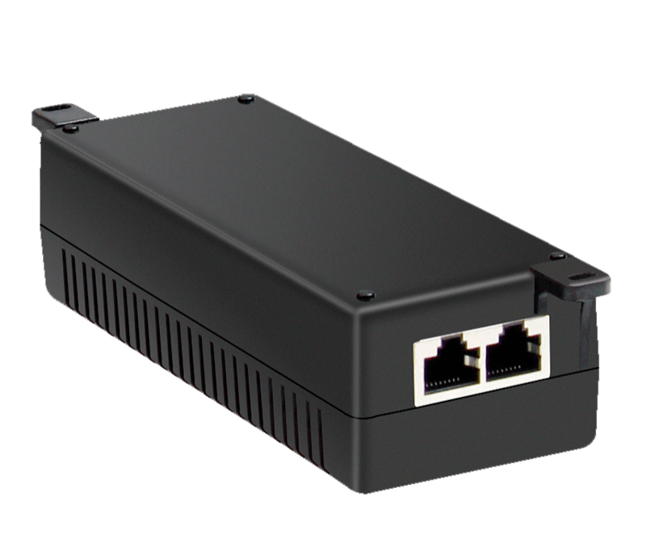
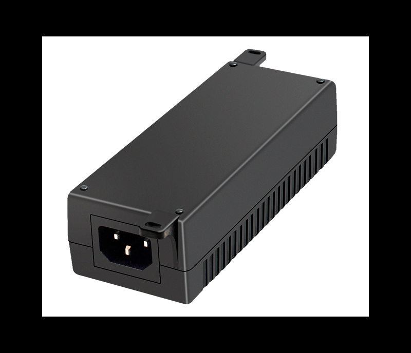
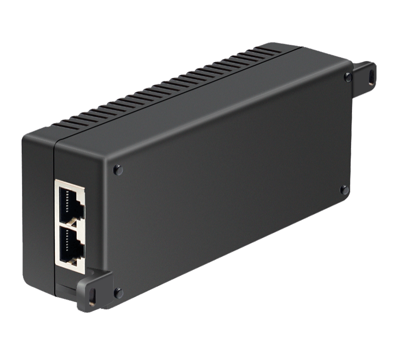
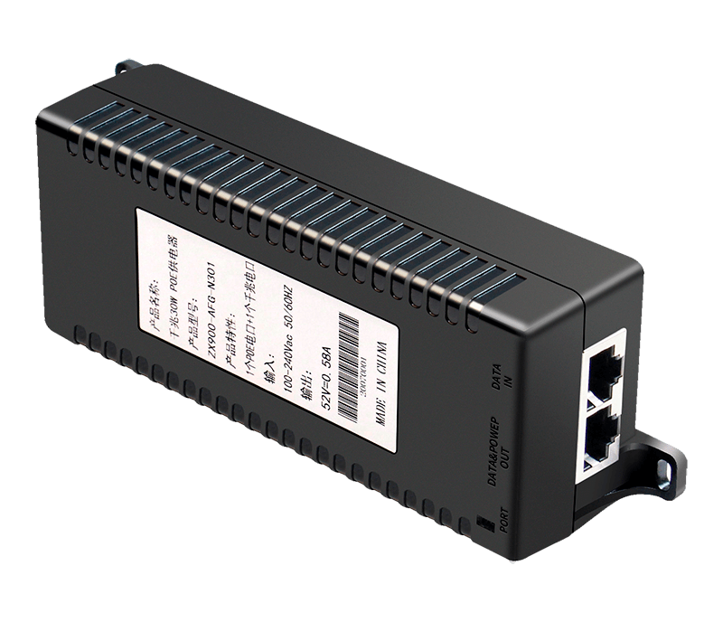

# HR900-AFG-N301

> 来源：<https://www.hruitech.com/poe-accessory/163.html>（抓取 2026-10-21T04:37:00Z；英文原文照录，中文仅为栏目名）  
> 官网描述：Gigabit 30W IEEE 802.3af/at PoE Injector  
> 类目：PoE Accessory（site id 163）  
> 接口：Gigabit 30W IEEE 802.3af/at PoE Injector；PoE 预算 —；交换带宽 —；电源 —

**Brief:** Gigabit IEEE 802.3af/at PoE injector, 1*AC power port + 1*Gigabit Ethernet Port + 1*Gigabit PoE port, 30W maximum PoE power output, support 10/100/1000M self-adaption, working temperature range -10°C~+50°C, seamless ultrasonic bonding, better protection effect

## 产品图





## Datasheet
- [HR900-AFG2-N301.pdf](https://www.hruitech.com/web/userfiles/productfile/HR900-AFG2-N301.pdf) （本地：`data/hrui_site_raw/datasheets/HR900-AFG2-N301.pdf`；文本：`data/hrui_site_raw/datasheet_text/HR900-AFG2-N301.txt`）

## Feature and Benefits（原文）
```
HR900-AFG-N301, a high-performance Gigabit Ethernet PoE Injector designed to deliver reliable power and data transmission across your network. This versatile injector supports a maximum output power of 30W, ensuring that your powered devices receive ample energy without sacrificing performance. Equipped with a 10/100/1000M self-adaptive port, it seamlessly accommodates various Ethernet standards, enabling efficient networking in diverse environments. The HR900-AFG-N301 operates on an input voltage range of AC 100-240V, making it ideal for both residential and commercial applications.
Engineered to withstand operating temperatures from -10℃ to +50℃, this injector features seamless ultrasonic bonding for enhanced durability and protection. Compliance with FCC, CE, and RoHS standards guarantees a safe and environmentally-friendly product, ensuring the reliability of your automation systems with uninterrupted and stable performance.
Product Features:
Multiple Ports:
1*10/100/1000M PoE Port + 1*10/100/1000M Ethernet Port
Standards Compliance:
Fully compliant with IEEE 802.3, IEEE 802.3u, and IEEE 802.3ab standards
Adaptive Speed:
Ethernet port supports adaptive speeds of 10/100/1000Mbps with PoE functionality
Automatic Configuration:
Port Auto Flip (Auto MDI/MDIX) for easy setup
PoE Standard:
Supports IEEE 802.3af (15.4W) and IEEE 802.3at (30W) standards
Wide Input Voltage:
Accepts AC power supply in the range of 100-240V
Temperature Tolerance:
Reliable performance in temperatures ranging from -10°C to +50°
Wall Mountable:
Convenient wall-mount design for flexible installation options
```

## Parameter（规格表逐行）
| 项 | 值 |
|---|---|
| **Specifications** | |
| **I/O Interface** | |
| Power | AC 100-240 V |
| Ethernet | 1*10/100/1000Mbps Ethernet Port |
| Ethernet | 1*10/100/1000Mbps PoE Port |
| **Standard** | |
| Network protocol | IEEE802.3 (10Base-T) |
| Network protocol | IEEE802.3u (100Base-TX) |
| Network protocol | IEEE802.3ab (1000Base-TX) |
| Network protocol | IEEE802.3x (Flow control) |
| PoE protocol | IEEE802.3af (15.4 W） |
| PoE protocol | IEEE802.3at (30 W） |
| PoE protocol | POE output voltage: DC44-57V |
| Industry Standard | EMI: FCC Part 15 CISPR (EN55032) class A |
| Industry Standard | EMS: EN61000-4-2 (ESD)、EN61000-4-4 (EFT) |
| Industry Standard | Shock: IEC 60068-2-27 |
| Industry Standard | Free Fall: IEC 60068-2-32 |
| Industry Standard | Vibration: IEC 60068-2-6 |
| Network Medium | 10Base-T: Cat3, 4, 5 or above UTP(≤100m) |
| Network Medium | 100Base-TX: Cat5 or above UTP(≤100m) |
| Network Medium | 1000Base-TX: Cat5 or above UTP(≤100m) |
| **Protection** | |
| Security Certificae | CE, FCC, RoHS |
| **Environment** | |
| Working Environment | Working Temperature: -10~50°C |
| Working Environment | Storage Temperature: -40~80°C |
| Working Environment | Working Humidity: 10%~90%，non-condensing |
| Working Environment | Storage Temperature: 5%~90%，non-condensing |
| **Indication** | |
| LED Indicators | PORT |
| **Mechanical** | |
| Structure Size | Product Size: 142* 55*40MM |
| Structure Size | Package Size: 203* 160*55MM |
| Structure Size | Product Net-Weight: 0.2KG |
| Structure Size | Product Gross-Weight: 0.4KG |
| Packing Info | MEAS: 580*335*445MM |
| Packing Info | Packing Qty: 40PCS |
| Packing Info | Packing weight: 17 KG |
| Power Voltage | Input Voltage: AC 100-240 V |
| Package List | PoE Injector * 1 pcs |
| Package List | User Manual * 1 pcs |
| Package List | Power Cable * 1pcs |
| **Ordering Info** | |
| HR900-AFG-N301 | 30W Gigabit POE Injector |
