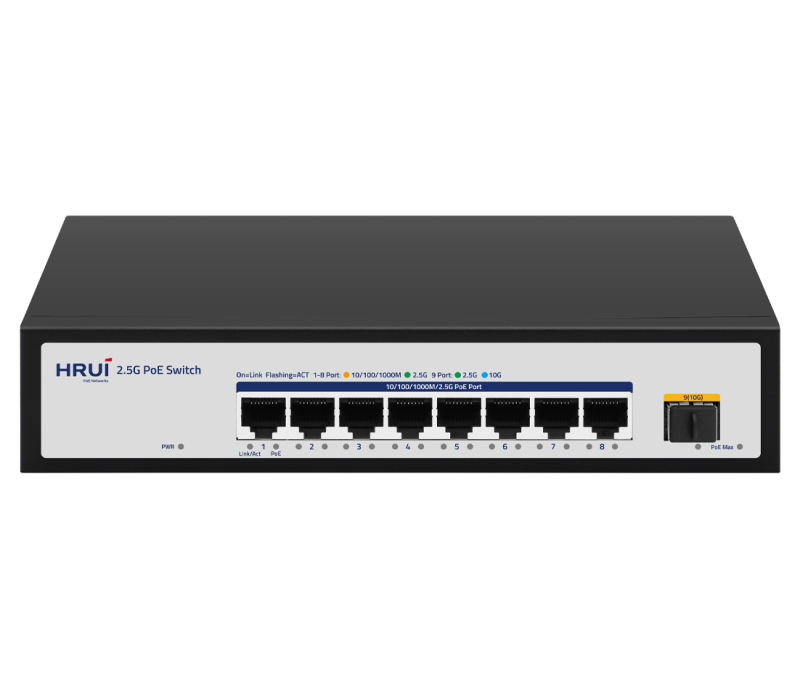
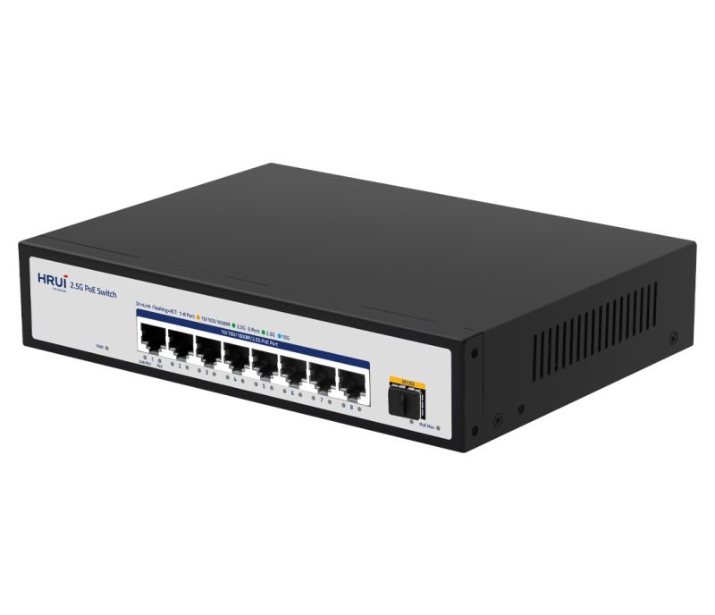
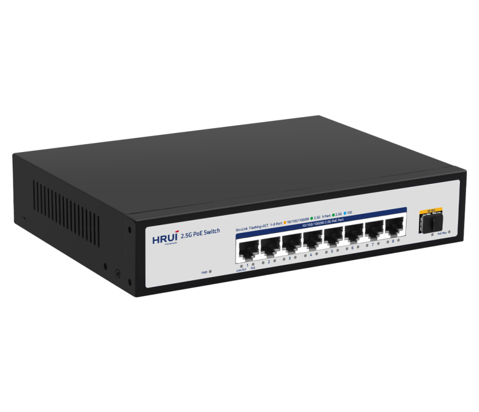
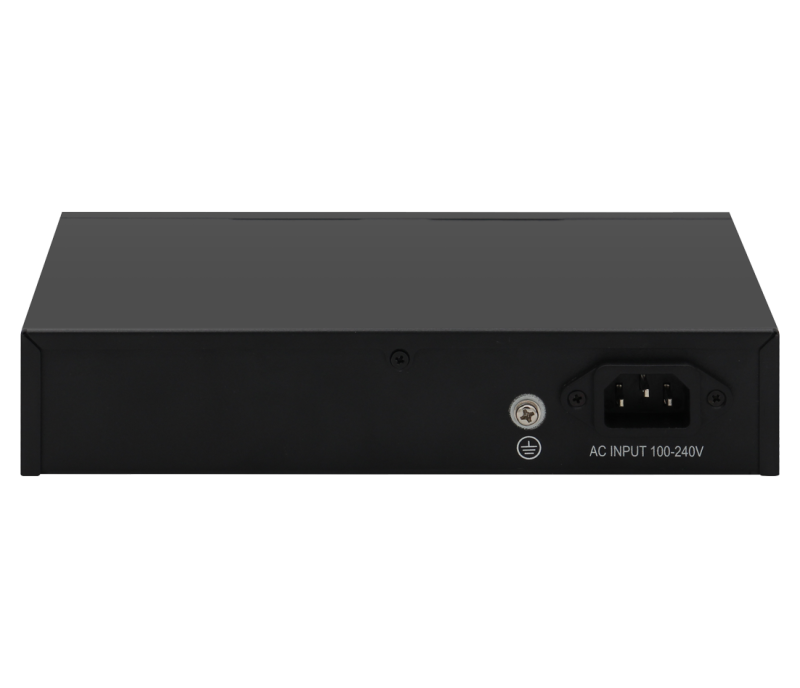

# HR900-AFG-SWTG018ANS

> 来源：<https://www.hruitech.com/poe-switch/209.html>（抓取 2026-10-21T04:35:35Z；英文原文照录，中文仅为栏目名）  
> 官网描述：8-Port 100/1000/2500T 802.3af/at PoE + 1-Port 10G SFP+  Ethemet Switch (100 Watts)  
> 类目：PoE Switch（site id 209）  
> 接口：8 * 2.5G PoE port / 1 * 10G SFP+ port；PoE 预算 85W；交换带宽 —；电源 AC 100-240V 50/60Hz / DC 52V 1.92A

**Brief:** 9 Port 10 Gigabit uplink 2.5G PoE switch，Adopting a high-quality and high-speed network chip solution, this product thoroughly solves the problem of high noise when deploying small switches in office environments through a fanless and silent design. This switch has 8* 100/1000/2500M PoE ports and 1* 10G SFP+port.

## 产品图





## Datasheet
- [HR900_AFG_SWTG018ANS.pdf](https://www.hruitech.com/web/userfiles/productfile/HR900_AFG_SWTG018ANS.pdf) （本地：`data/hrui_site_raw/datasheets/HR900_AFG_SWTG018ANS.pdf`；文本：`data/hrui_site_raw/datasheet_text/HR900_AFG_SWTG018ANS.txt`）

## Feature and Benefits（原文）
```
HR900-AFG-SWTG018ANS, a state-of-the-art 9-port switch with a robust 10 Gigabit uplink and advanced 2.5G Power over Ethernet (PoE) capabilities. Engineered with a high-performance, low-noise network chip solution, this switch is specifically designed for office environments, employing a fanless architecture to ensure silent operation, ideal for noise-sensitive settings. It features 8 versatile 100/1000/2500 Mbps PoE ports alongside a 10G SFP+ uplink port, providing seamless connectivity for high-bandwidth applications.
Product Features:
Port Configuration:
8x 100/1000/2500Mbps PoE ports + 1x 2.5G RJ45 port + 1x 10G SFP+ port.
Adaptive RJ45 Ports:
Ethernet ports are self-adaptive, supporting 10/100/1000M speeds for flexible network performance.
PoE Priority Management:
Configurable priority levels from 1 to 8, with default settings enabled for optimal power management.
Status Monitoring:
Panel indicator LEDs provide real-time monitoring of operational status, aiding in fault diagnosis.
Surge Protection:
Includes protection against common mode surges up to 4KV and differential mode up to 2KV (level B), ensuring reliable operation in challenging environments.
Electrostatic Discharge (ESD) Protection:
Designed to withstand air discharge up to 12KV and contact discharge up to 6KV (level B), enhancing durability and safety in various settings.
```

## Parameter（规格表逐行）
| 项 | 值 |
|---|---|
| Description | Specification |
| Model | HR900-AFG-SWTG018ANS |
| Interface | 8 * 2.5G PoE port |
| Interface | 1 * 10G SFP+ port |
| Port Standard | IEEE802.3 (Ethernet) |
| Port Standard | IEEE802.3u (Fast Ethernet) |
| Port Standard | IEEE802.3ab (Gigabit Ethernet) |
| Port Standard | IEEE 802.3bz (2.5G Ethernet) |
| Port Standard | IEEE 802.3z (Gigabit Ethernet) |
| Port Standard | IEEE 802.3ae (10G Ethernet) |
| Port Standard | IEEE802.3x (Flow Control) |
| Bandwidth | 60Gbps |
| Packet Forwarding Rate | 44.64Mpps |
| Packet Buffer | 8Mbit |
| MAC Address Table | 4K |
| Transmission Method | Store and Forward |
| PoE Standard | IEEE802.3af (15.4W) |
| PoE Standard | IEEE802.3at (30W) |
| PoE Port Output Voltage | DC 44-57V |
| PoE Ports | Port 1-8 PoE power output <30W |
| PoE Power Budget | 85W |
| Power Supply | AC 100-240V 50/60Hz |
| Power Supply | DC 52V 1.92A |
| Mainboard Power Consumption | 14.4W |
| Structure Information | Product Dimensions :220*161*44mm |
| Structure Information | Packaging Dimensions :315*215*85mm |
| Structure Information | Product Net Weight:0.916KG |
| Structure Information | Product Gross Weight:1.23KG |
| Packing Information | Carton Dimensions: 445*445*335mm |
| Packing Information | Packing Quantity: 5PCS |
| Packing Information | Packing Weight: 13.3KG |
| Package Contents | Switch 1pcs, power cord 1pcs, manual 1pcs,certificate of qualification 1pcs |
| Fan Quantity | 0 |
| Installation | Desktop |
| Surge Protection | Port Surge: Common mode 4KV, differential mode 2KV (Class B) |
| Surge Protection | Electrostatic ESD: Air 12KV, Contact 6KV (Class B) |
| Operating Temperature | 0~40°C |
| Storage Temperature | -40 °C to 70 °C |
| Operation Humidity | 10%~90%,non condensing |
| Storage Humidity | 5%~95%,non condensing |
| PWR Green LED | On: Powered on |
| PWR Green LED | Off: Powered off |
| 1-8 Link/Act LED | Green LED On:2.5G Link normal |
| 1-8 Link/Act LED | Yellow LED On:10M/100M/1G Link normal |
| 1-8 Link/Act LED | Off: Link blocked |
| 1-8 Link/Act LED | Flashing: Data transmitting |
| 1-8 PoE LED | Yellow LED On: PoE powered on |
| 1-8 PoE LED | Yellow LED Off: PoE powered off |
| PoE Max Green LED | Off: Indicate that the PoE power usage is less than 90% |
| PoE Max Green LED | Flashing(Once per second): Indicate that the PoE power usage of 90% ≤ P ≤ 95% |
| PoE Max Green LED | On: Indicate that the PoE power is used at 95%<P<100% |
| 9 SFP+ LED | Blue LED on: 10G link normal |
| 9 SFP+ LED | Green LED on: 1G/2.5G link normal |
| 9 SFP+ LED | Off: Link blocked |
| 9 SFP+ LED | Flashing: Data transmitting |

## Product structure / Application topology（图）
- https://www.hruitech.com/web/userfiles/image/20241224/1735008867665136.png
