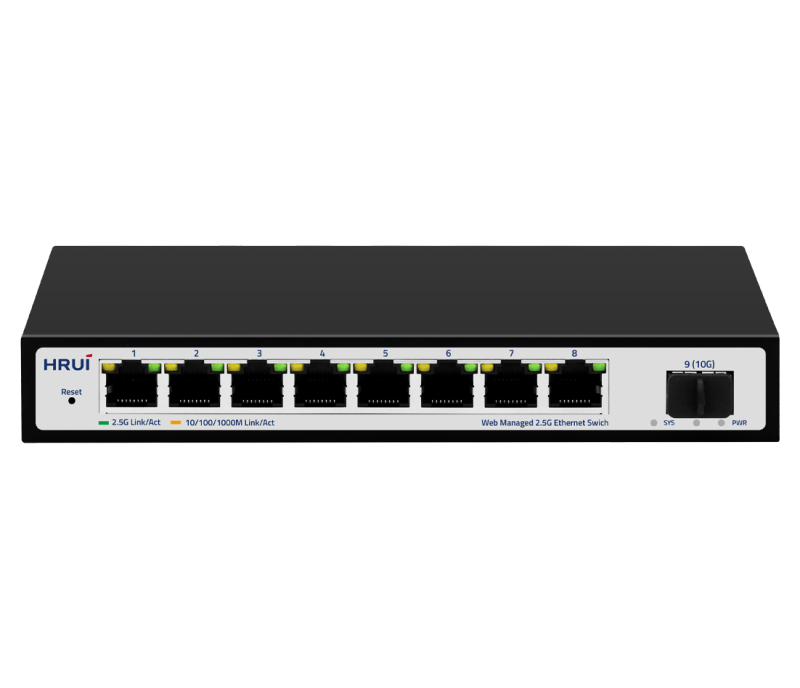
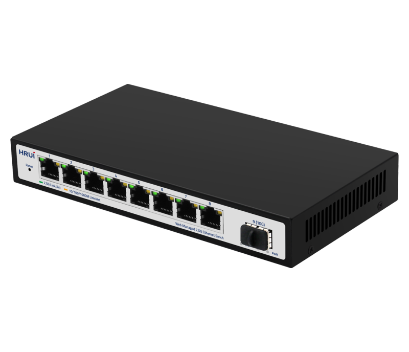
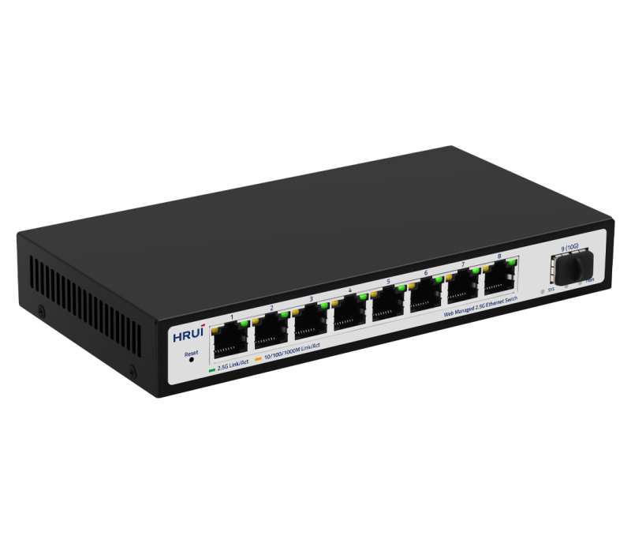
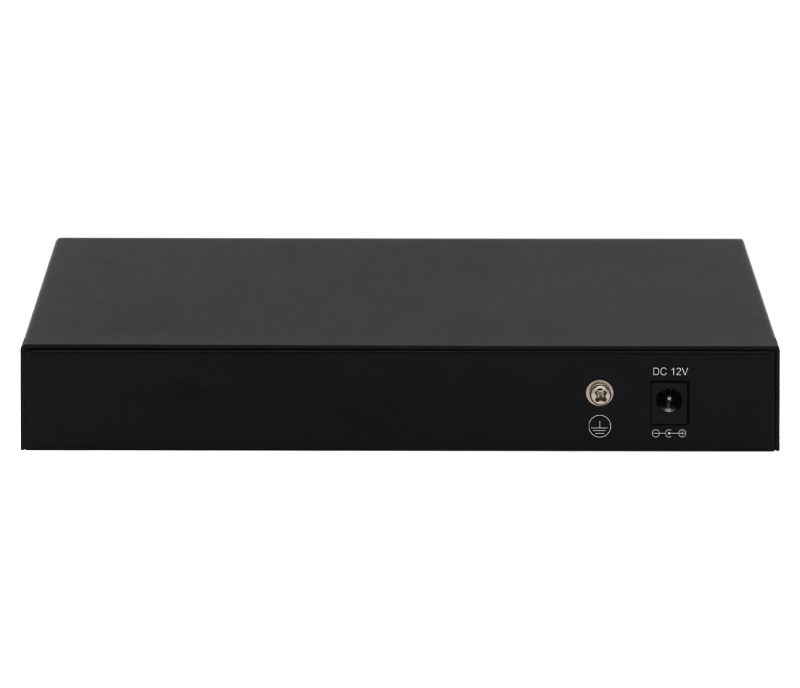

# HR902-SWTGW218AS

> 来源：<https://www.hruitech.com/managed-switch/219.html>（抓取 2026-10-21T04:36:14Z；英文原文照录，中文仅为栏目名）  
> 官网描述：9 Port 10G uplink 2.5G Web Managed Ethernet switch  
> 类目：Managed Switch（site id 219）  
> 接口：8 * 2.5G RJ45 ports / 1 * 10G SFP+ port；PoE 预算 —；交换带宽 —；电源 AC 100-240V 50/60Hz / DC 12V 1A

**Brief:** 9 Port 10G uplink 2.5G Web Managed Ethernet switch. adopts the network chip solution of high quality and high speed. The product is designed to be fan-free and quiet, which completely solves the problem of loud noise of small switches deployed in the office environment. The switch has 8* 100/1000/2500M RJ45 ports and 1* 10G SFP+ port, providing seamless connection to 100/1000/2500M Ethernet for easy management and maintenance. The switch can be widely used in security network video surveillance, hotels, campuses, and network engineering of small and medium-sized enterprises.

## 产品图





## Datasheet
- [HR902_SWTGW218AS.pdf](https://www.hruitech.com/web/userfiles/productfile/HR902_SWTGW218AS.pdf) （本地：`data/hrui_site_raw/datasheets/HR902_SWTGW218AS.pdf`；文本：`data/hrui_site_raw/datasheet_text/HR902_SWTGW218AS.txt`）

## Feature and Benefits（原文）
```
HR902-SWTGW218AS, a state-of-the-art 9-Port 10G Uplink 2.5G Web Managed Ethernet Switch optimized for high performance and ultra-reliable connectivity. Engineered with advanced high-speed network chip solutions, this switch is fan-free, delivering silent operation and eliminating disruptive noise in office settings.
Equipped with 8 versatile RJ45 ports that support 100/1000/2500M connections and a dedicated 10G SFP+ uplink port, this switch facilitates seamless data transfer and effortless network management. Its robust design makes it ideal for various applications, including security network video surveillance, hospitality environments, educational campuses, and the networking needs of small to medium-sized enterprises.
Product Features:
Port Configuration:
8 x 2.5G RJ45 ports plus 1 x 10G SFP+ port for expanded connectivity options.
Standards Compliance:
IEEE 802.3, IEEE 802.3u, IEEE 802.3ab, IEEE 802.3bz, IEEE 802.3z, IEEE 802.3ae, and IEEE 802.3x standards.
Self-Adaptive Ethernet Ports:
RJ45 ports support 100M/1G/2.5G adaptive connections for flexible networking.
Automatic Port Detection:
Features Auto MDI/MDIX for simplified device connections.
Status Monitoring:
Built-in LED indicators to monitor operational status and assist in fault diagnostics.
Flow Control:
Implements IEEE 802.3x standard for full duplex and backpressure for half duplex to optimize network performance.
Quality of Service (QoS):
Supports data priority settings for efficient bandwidth management.
```

## Parameter（规格表逐行）
| 项 | 值 |
|---|---|
| Description | Specification |
| Model | HR902-SWTGW218AS |
| Interface | 8 * 2.5G RJ45 ports |
| Interface | 1 * 10G SFP+ port |
| Port Standard | IEEE802.3 (Ethernet) |
| Port Standard | IEEE802.3u (Fast Ethernet) |
| Port Standard | IEEE802.3ab (Gigabit Ethernet) |
| Port Standard | IEEE802.3z (Gigabit Ethernet Fiber Standard) |
| Port Standard | IEEE802.3bz (2.5G Ethernet) |
| Port Standard | IEEE 802.3ae (10G Ethernet) |
| Port Standard | IEEE802.3x (Flow Control) |
| Bandwidth | 60Gbps |
| Packet Forwarding Rate | 44.64Mpps |
| Packet Buffer | 8Mbit |
| MAC Address Table | 4K |
| Jumbo Frame | 12K |
| VLAN | VLAN range 1-4094, maximum active VLAN is 31 |
| Transmission Method | Store and Forward |
| Power Supply | AC 100-240V 50/60Hz |
| Power Supply | DC 12V 1A |
| Mainboard Power Consumption | 11.29W |
| Structure Information | Product Dimensions: 190*100*28mm |
| Structure Information | Packaging Dimensions: 245*190*60mm |
| Structure Information | Product Net Weight: 0.49KG |
| Packing Information | Carton Dimensions: 520*320*400mm |
| Packing Information | Packing Quantity: 20PCS |
| Packing Information | Packing Weight: 15.2KG |
| Package Contents | Switch 1pcs, ac adapter 1pcs, manual 1pcs,certificate of qualification 1pcs |
| Fan Quantity | 0 |
| Installation | Desktop |
| Surge Protection | Port Surge: common mode 6KV, differential mode 2KV ; Electrostatic ESD: air 8KV, contact 6KV |
| Operating Temperature | 0~40°C |
| Storage Temperature | -40 °C to 70 °C |
| Operation Humidity | 10%~90%，non condensing |
| Storage Humidity | 5%~95%，non condensing |
| PWR Green LED | On: Powered on |
| PWR Green LED | Off: Powered off |
| 45665 | Green LED on: 2.5G link normal |
| 45665 | Yellow LED on: 10M/100M/1G link normal |
| 45665 | Off: Link blocked |
| 45665 | Flashing: Data transmitting |
| 9 Green LED | On: 10G/1G link normal |
| 9 Green LED | Off: Link blocked |
| 9 Green LED | Flashing: Data transmitting |
| SYS Green LED | On: The system is normal |
| SYS Green LED | Flashing: System startup in progress |
| Reset | Long press for 6 seconds to restore factory settings |
| **Software Features** | |
| **L2 Function** | |
| Port | Port Switch configuration |
| Port | Port Speed configuration |
| Port | Port Duplex configuration |
| Port | Port Flow Control configuration |
| Port | EEE |
| Port | Jumbo Frame |
| Link Aggregation | Max. 4 members per group |
| Link Aggregation | Static Group |
| Link Aggregation | LACP |
| Link Aggregation | Up to 2 groups |
| Storm Control | Boardcast suppression |
| Storm Control | Unknown Multicast |
| Storm Control | Unknown Unicast |
| Port Mirroring | Support |
| Port Security | MAC Address Constraints |
| Port Isolation | Support |
| Port Rate-limit | Support |
| VLAN | Access/Trunk/Hybrid |
| VLAN | Congurable VID from 1 - 4094;Max. 31 static VLAN groups |
| MAC Address | Dynamic MAC Address |
| MAC Address | Static MAC address |
| Spanning Tree Protocol | STP/RSTP |
| Spanning Tree Protocol | Edge Port |
| Multicast | IGMP Snooping |
| Multicast | Router Port |
| Multicast | Static IGMP Join |
| Multicast | IGMP V1/V2 |
| QoS | Traffic classification, Supporting SP and WRR scheduling |
| QoS | Port Priority |
| QoS | Supports up to 8 queues per port |
| **Services** | |
| Access Protocol | HTTP |
| **Diagnostics** | |
| Port Statistics | Support |
| **Equipment Management** | |
| Manager Access | HTTP |
| Manager IP | Static Address |
| Manager IP | DHCP Client |
| User Management | Support |
| Firmware Management | Firmware upgrade |
| Configuration Management | Upload/Backup Configuration |
| Save | Support |
| Restart | Support |
| Factory Defaults | Support |
| **Standard Compliance** | |
| **IEEE 802.3x flow control and back pressure** | |
| **IEEE 802.1D Spanning Tree Protocol** | |
| **IEEE 802.1w Rapid Spanning Tree Protocol** | |
| **IEEE 802.1Q VLAN tagging** | |
| **RFC 768 UDP** | |
| **RFC 791 IP** | |
| **RFC 792 ICMP** | |
| **RFC 2068 HTTP** | |
| **RFC 1112 IGMP v1** | |
| **RFC 2236 IGMP v2** | |

## Product structure / Application topology（图）
- https://www.hruitech.com/web/userfiles/image/20250102/1735783190510315.png
