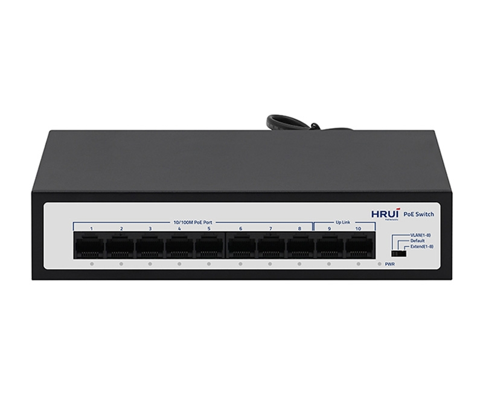
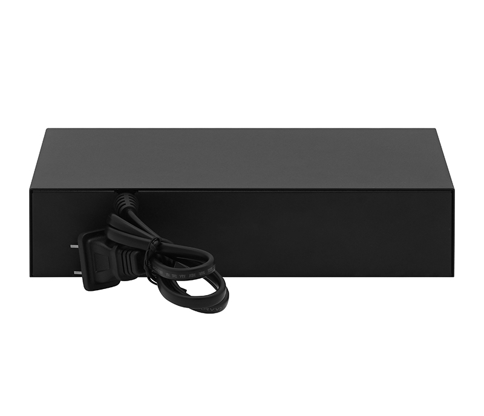
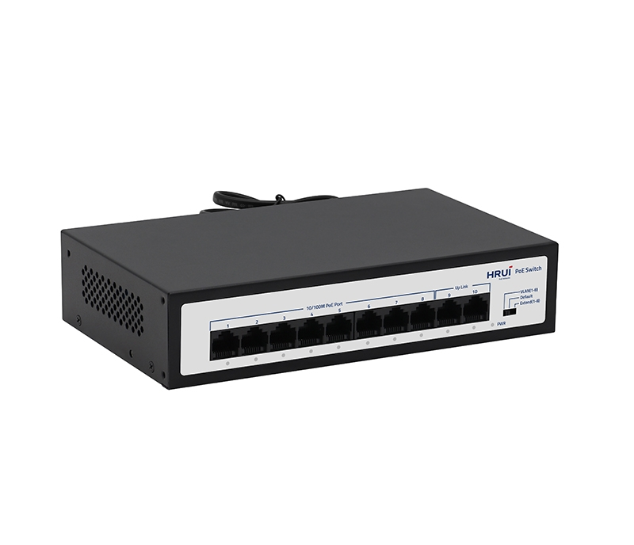
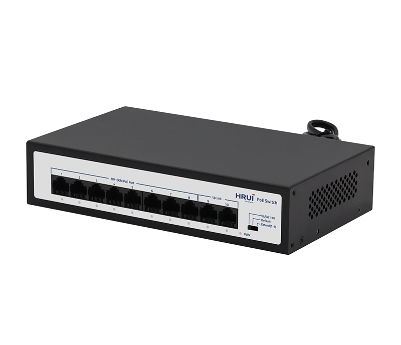

# HR903-AF-82Y-120

> 来源：<https://www.hruitech.com/poe-switch/306.html>（抓取 2026-10-21T04:35:18Z；英文原文照录，中文仅为栏目名）  
> 官网描述：8-Port 10/100T 802.3af/at PoE + 2-Port 10/100/1000T Ethernet Switch (120 Watts)  
> 类目：PoE Switch（site id 306）  
> 接口：8 *100Mbps PoE ports / 2 *100Mbps uplink RJ45 port；PoE 预算 115W；交换带宽 —；电源 AC 100-110V 76.8W / AC 110-200V 96 W / AC 200-240V 120 W / DC 52V 2.3A

**Brief:** HR903-AF-82Y-120: 10-port Fast Ethernet PoE switch with 8×PoE ports (802.3af/at, 120W total) and 2×uplink RJ45 ports. Supports VLAN, Default, and Extend mode (250m range). Operates at 0–40°C, offers 4KV surge/8KV ESD protection, fanless desktop design.

## 产品图





## Datasheet
- [HR903-AF-82Y-120-28EN-29.pdf](https://www.hruitech.com/web/userfiles/productfile/HR903-AF-82Y-120-28EN-29.pdf) （本地：`data/hrui_site_raw/datasheets/HR903-AF-82Y-120-28EN-29.pdf`；文本：`data/hrui_site_raw/datasheet_text/HR903-AF-82Y-120-28EN-29.txt`）

## Feature and Benefits（原文）
```
HR903-AF-82Y-120 is a 10-port Fast Ethernet PoE switch designed for reliable network performance. It features 8 Fast Ethernet PoE ports and 2 Fast Ethernet uplink RJ45 ports, compliant with IEEE 802.3, 802.3u, and 802.3x standards. Supporting IEEE 802.3af/at PoE with a total power budget of 120W, it enables flexible power delivery for connected devices. The switch offers three operation modes: VLAN, Default, and Extend mode, which extends transmission distance up to 250 meters at 10Mbps. With built-in 4KV surge protection and 8KV ESD protection, it ensures enhanced durability. Operating in temperatures of 0°C to 40°C, this fanless desktop switch is ideal for small to medium-sized network deployments.
Product Features:
Port Configuration:
8×100Mbps PoE ports + 2×100Mbps uplink RJ45 ports.
Standards Compliance:
IEEE 802.3, IEEE 802.3u, IEEE 802.3x.
Auto-Negotiation:
Ethernet ports support 10/100Mbps self-adaptive operation.
Flow Control:
Full duplex (IEEE 802.3x) and half duplex (Back Pressure).
Auto MDI/MDIX Support:
Automatic port flipping for simplified cabling.
Switching Mechanism:
Store-and-forward architecture.
Status Indicators:
LED panel monitors operation and aids troubleshooting .
Operating Modes:
Supports VLAN, Default, and Extend modes (extends distance to 250m at 10Mbps).
```

## Parameter（规格表逐行）
| 项 | 值 |
|---|---|
| Description | Specification |
| Model | HR903-AF-82Y -120 |
| Interface | 8 *100Mbps PoE ports |
| Interface | 2 *100Mbps uplink RJ45 port |
| Port Standard | IEEE802.3 (Ethernet) |
| Port Standard | IEEE802.3u (Fast Ethernet) |
| Port Standard | IEEE802.3x (Flow Control) |
| Bandwidth | 2Gbps |
| Packet Forwarding Rate | 1.488Mpps |
| Packet Buffer | 768kbit |
| MAC Address Table | 2K |
| Transmission Method | Store and Forward |
| PoE Standard | IEEE802.3af (15.4W) |
| PoE Standard | IEEE802.3at (30W) |
| PoE Port Output Voltage | DC 44-57V |
| PoE Ports | Ports 1-8 PoE power output <30W |
| PoE Power Budget | 115W |
| Power Supply | AC 100-110V 76.8W |
| Power Supply | AC 110-200V 96 W |
| Power Supply | AC 200-240V 120 W |
| Power Supply | DC 52V 2.3A |
| Mainboard Power Consumption | 1.98W |
| Structure Information | Product Dimensions :200*118*44mm |
| Structure Information | Packaging Dimensions : 245*190*60mm |
| Structure Information | Product Net Weight:0.61Kg |
| Structure Information | Product Gross Weight:0.69Kg |
| Packing Information | Carton Dimensions :520*320*400mm |
| Packing Information | Packing Quantity: 20PCS |
| Packing Information | Packing Weight: 14.8KG |
| Package Contents | Switch 1pcs, Manual 1pcs,Certificate of Inspection 1pcs |
| Fan Quantity | 0 |
| Installation | Desktop |
| Surge Protection | Port Surge: common mode 4KV,Differential mode 2KV(Class C) |
| Surge Protection | Electrostatic ESD: Air 8KV, Contact 6KV(Class C) |
| Operating Temperature | 0~40°C |
| Storage Temperature | -40 °C to 70 °C |
| Operation Humidity | 10%~90%,non condensing |
| Storage Humidity | 5%~95%,non condensing |
| PWR Green LED | On: Powered on |
| PWR Green LED | Off: Powered off |
| Ports 1-10 Green LED | On: Link normal |
| Ports 1-10 Green LED | Off: Link blocked |
| Ports 1-10 Green LED | Flashing: Data transmitting |
| VLAN/Default/Extend Modes Buttons | VLAN: VLAN mode, ports 1-8 are isolated from each other, communicating with ports 9-10 ,and automatically activate the PoE watchdog mode |
| VLAN/Default/Extend Modes Buttons | Default: Normal mode, all ports can communicate with each other, transmission distance is within 100 meters, transmission rate is 10/100Mbps adaptive(PoE Watching off) |
| VLAN/Default/Extend Modes Buttons | Extend: Extend mode,when the PoE is in Extend mode,ports 1-8 force 10 Mbps the transmission distance to 250 meters, and automatically activate the PoE waching mode |

## Product structure / Application topology（图）
- https://www.hruitech.com/web/userfiles/image/20250827/1756289994578311.png
